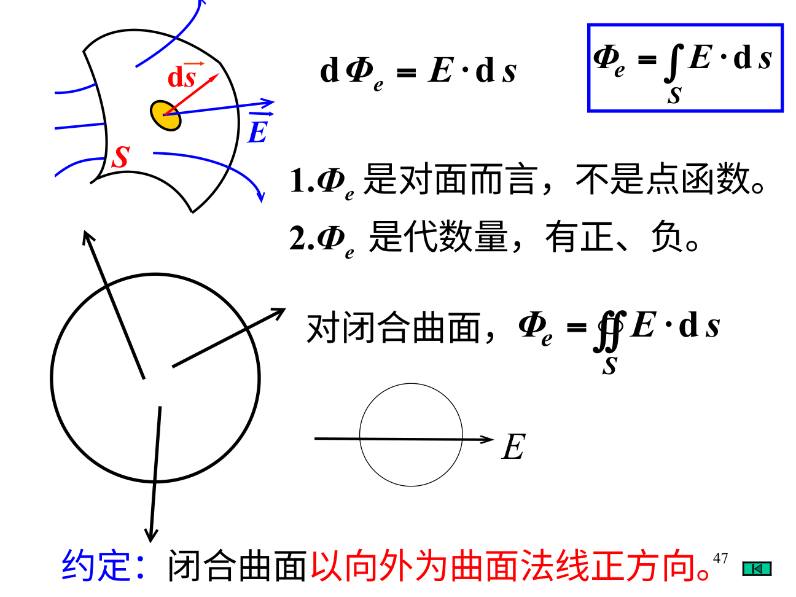

# 必要的数学：先把箭头和一小块说清楚

## 标量、矢量和分量

温度、电势是标量，只需一个数加单位；场强E是矢量，还要方向。$\mathbf E=E_x\hat{\mathbf x}+E_y\hat{\mathbf y}+E_z\hat{\mathbf z}$，分量可以为负，大小$E=\sqrt{E_x^2+E_y^2+E_z^2}$非负。把两个矢量的大小直接相加，只有同向等特殊情形才对。

点积$\mathbf A\cdot\mathbf B=AB\cos\theta$挑出平行部分；叉积大小$AB\sin\theta$，方向按右手，交换顺序会反号。电通量用点积，磁力用叉积，所以一个看投影、一个看垂直程度。

## 积分其实是在“把很多小份加起来”

线电荷$\lambda=dq/dl$，面电荷$\sigma=dq/dS$，体电荷$\rho=dq/dV$，因此小份电荷分别写$\lambda dl$、$\sigma dS$、$\rho dV$。每小份对观察点产生一个小场矢量，再把分量积分。观察点坐标是固定的，源点坐标是积分变量；混用两者会让距离和方向都错。

通量$\Phi=\int\mathbf E\cdot d\mathbf S$中，$d\mathbf S$是带法向的小面积。法向与场夹角为90°时穿过量为0；平行时最大。闭合曲面约定向外为正。环流$\oint\mathbf E\cdot d\mathbf l$则沿回路切向累计，和通量不是同一种积分。

## 梯度、散度、旋度，先用一句实在的话

梯度$\nabla\varphi$指向标量增长最快的方向；静电场$\mathbf E=-\nabla\varphi$指向电势下降最快的方向。散度衡量某点附近净流出的密度；旋度衡量局部绕转趋势。它们不是箭头真的流动或旋转的唯一解释，而是场的空间变化特征。

在一维$\mathbf E=-d\varphi/dx\,\hat{\mathbf x}$。例如$\varphi(x)=5-2x$ V（x用米），导数为-2 V/m，所以E=+2 V/m，沿+x。不要因为电势表达式里有负号就直接说场沿负向。

## 量纲检查能救很多题

电势单位J/C，场强N/C=V/m；电容C/V=F；磁通T·m²=Wb；感应电动势Wb/s=V；能量J。若算出的电场中只剩$k_eq/r$，单位其实是电势，说明少除一个长度。

**自测。** 一小块面积法向与场夹60°，通量是否$ES\sin60°$？答：不是，是$ES\cos60°=ES/2$；若题目给的是“场与平面”的夹角，才需先换成法向夹角。
