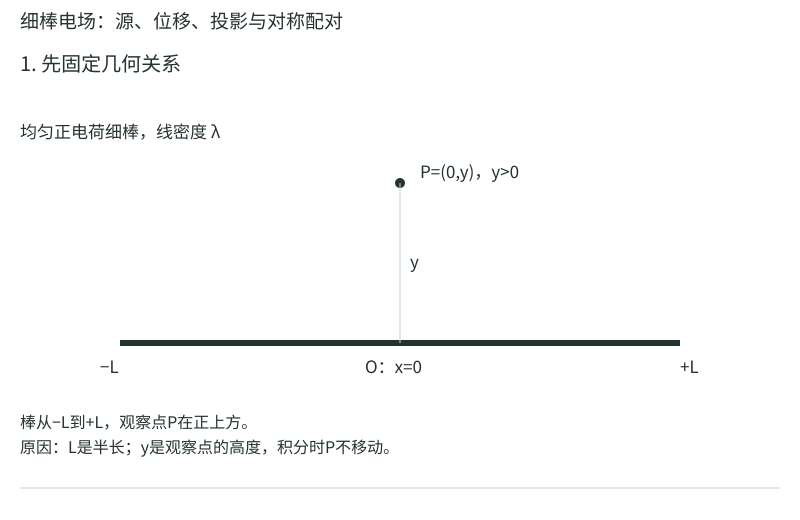
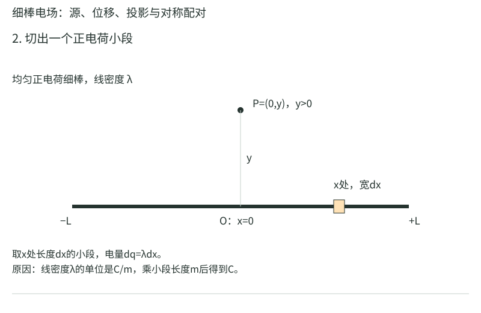
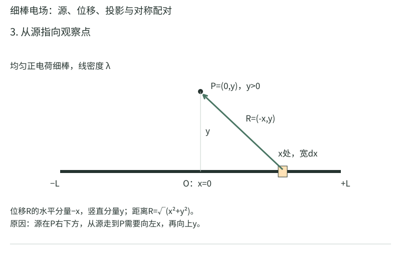
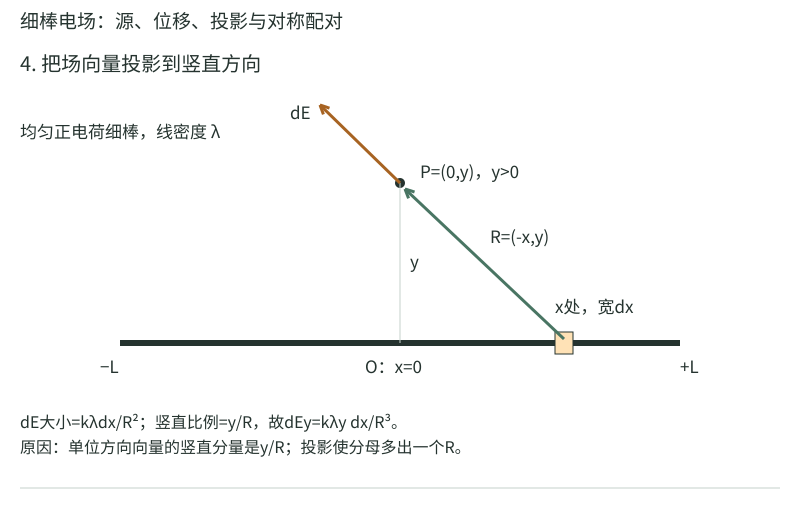
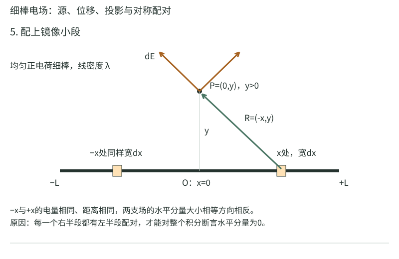
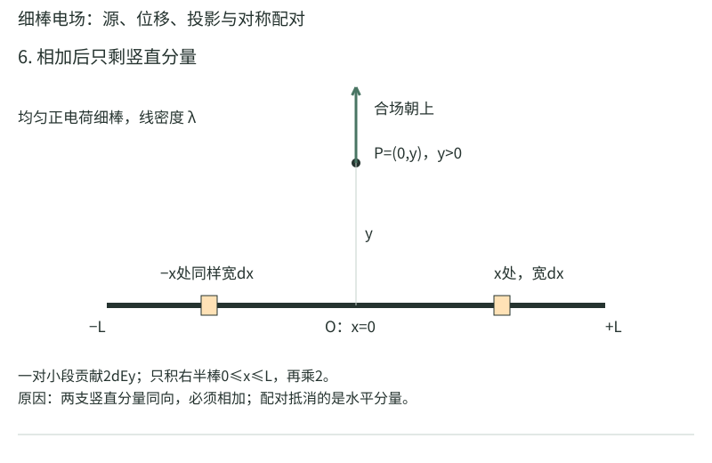
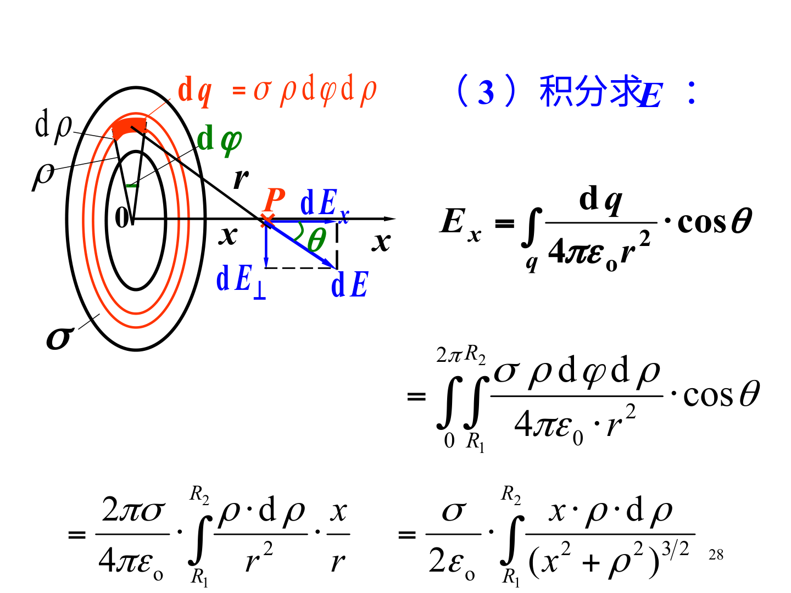
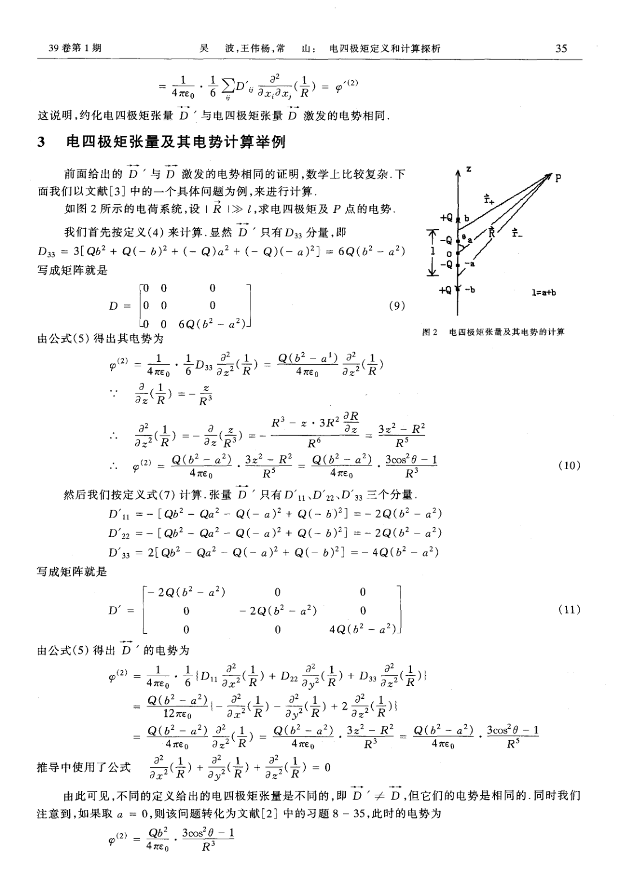

# 电场怎样从一小块一小块电荷加出来

两颗带电小球之间的力容易算。一根棒、一张圆盘就麻烦了：近处的电荷贡献大，远处的贡献小，箭头还不一定朝同一个方向。处理它们的办法很朴素：把物体切成小电荷，算每块的场，再把箭头相加。本章让这个过程在纸上完整走一遍。

## 从试探电荷到电场

先设想在位置P放一个很小的正电荷，用它检验这里的电作用。把这个试探电荷的电荷量记为$q_0$，单位是库仑，记作C；它受到的力记为$\mathbf F$，单位是牛顿，记作N。粗体表示这个量有方向，要按向量相加。若把试探电荷加倍，力也加倍，那么“力除以试探电荷量”就没有变。这个比值定义该位置的电场$\mathbf E$，单位为N/C。

为了不让试探电荷明显改变原来的电荷分布，定义时还要让$q_0$趋于0：

$$\mathbf E=\lim_{q_0\to0}\frac{\mathbf F}{q_0}.$$

符号$\lim_{q_0\to0}$读作“当$q_0$趋近于0时的极限”。我们并不把0代入分母，而是考察一系列越来越小的正试探电荷，观察比值趋向什么。电场定义好后，若放入一个不会明显改变源分布的电荷$q_{\text{试}}$，它的受力就是$\mathbf F=q_{\text{试}}\mathbf E$。正电荷的力沿场方向，负电荷反向。即使P处没有放试探电荷，仍可谈源在P产生的场。

现在只保留一个产生场的点电荷，电荷量记为$q$。它称为源电荷，和刚才的试探电荷不同。用$\mathbf r'$表示源的位置向量，用$\mathbf r$表示观察点的位置向量，撇号用来区分这两个位置。先作减法$\mathbf R=\mathbf r-\mathbf r'$，所得箭头从源指向观察点。令$R=|\mathbf R|$为距离，$\hat{\mathbf R}=\mathbf R/R$为同方向、长度1的单位向量。帽子表示单位向量，不是又一种距离。

真空中静止点电荷的场为

$$\mathbf E(\mathbf r)=\frac{1}{4\pi\epsilon_0}\frac{q\mathbf R}{R^3}=k\frac q{R^2}\hat{\mathbf R}.$$

这里$k=1/(4\pi\epsilon_0)\approx8.99\times10^9\,\mathrm{N\,m^2/C^2}$，是库仑常量；$\pi$是圆周率，$\epsilon_0$是真空介电常量。两种写法相同，因为$\mathbf R=R\hat{\mathbf R}$，故$\mathbf R/R^3=\hat{\mathbf R}/R^2$。正$q$给出沿$\mathbf R$的场，负$q$使箭头反向。理想点源本身的位置$R=0$不适用这条场公式；真实带电小球内部需要按它的分布重新求场。

若有多个源，就逐个算它们在同一个观察点的场。用下标$i$给源编号，$\mathbf E_i$表示第$i$个源的贡献；$\sum_i$表示把这些贡献全部相加，所以$\mathbf E=\sum_i\mathbf E_i$。相加时要分别加各方向的分量。两个源到P的距离或方向不同，就不能先把电荷量相加、再随便挑一个距离代入点电荷公式。

## 算例一：两个电荷，中点的场和零场点

把$+q$放在$x=-a$，$-q$放在$x=+a$，其中$q>0$，$a>0$是每个源到原点的距离。约定x轴向右，$\hat{\mathbf x}$表示向右的单位向量。

在纸上按从左到右的顺序写出“$+q$、P、$-q$”。P取原点。先只看左侧正源：从它走到P是向右，正源的场也向右，大小$kq/a^2$。再只看右侧负源：从它走到P是向左，但负号要把场箭头反过来，因此它在P的场仍向右，大小也是$kq/a^2$。两箭头同向，才可以直接加大小：

$$\mathbf E(0)=\frac{2kq}{a^2}\hat{\mathbf x}.$$

代数相加得到$kq/a^2+kq/a^2=2kq/a^2$，方向由$\hat{\mathbf x}$保留。取$q=2\,\mathrm{nC}=2\times10^{-9}\,\mathrm C$，$a=0.10\,\mathrm m$，先算$a^2=0.010\,\mathrm{m^2}$，再算$kq\approx17.98\,\mathrm{N\,m^2/C}$，于是每个源贡献约1798N/C，总场约$3.60\times10^3\,\mathrm{N/C}$，向右。总电荷相加等于0，并没有使这两个同向的场相消。

再换成$x=0$的$+q$和$x=d$的$+4q$，其中$d>0$是两源间距。要找零场点，先按区域检查方向：左外侧两场均向左，右外侧两场均向右，只有中间区域两场相反。设观察点位于$0<x<d$，它到小源的距离为$x$，到大源为$d-x$。让两个场的大小相等，才能相消：

$$\frac{kq}{x^2}=\frac{4kq}{(d-x)^2}
\quad\Longrightarrow\quad (d-x)^2=4x^2.$$

第一步约去两边非零的$kq$，第二步乘上正数$x^2(d-x)^2$清除分母。因为$x$与$d-x$都是正距离，开平方取正根，得到$d-x=2x$；把$x$移到右侧得到$d=3x$，所以$x=d/3$。例如$d=0.30$m，点在$x=0.10$m，小源距离0.10m、大源距离0.20m。大源电量为4倍但距离为2倍，平方衰减恰好抵消4倍，两个场大小相等、方向相反。

## 连续分布的四个问题

在积分前依次回答：源电荷在哪里？观察点在哪里？切出的微元带多少电？它的场投影到哪个方向？

连续分布的矢量式为

$$\mathbf E(\mathbf r)=k\int\frac{\mathbf r-\mathbf r'}{|\mathbf r-\mathbf r'|^3}\,dq.$$

这条式子把正确方向和距离一起写全。线电荷用 $dq=\lambda dl$，面电荷用 $dq=\sigma dS$，体电荷用 $dq=\rho dV$。若密度不均匀，就让密度跟着积分变量变，不能提前拿出积分号。

对称性可以在积分前使用。例如圆环轴线上的观察点，对径两小段的横向场正好相反，轴向场相同。说“横向抵消”时，应该能指出是哪两个微元配对，而不是把不想算的分量随手删去。

## 算例二：均匀细棒中垂线上的场

一根总长$2L$的均匀绝缘细棒沿x轴，从$-L$到$L$。$L$是半长，不是全长。线密度$\lambda>0$表示每米棒上有多少库仑电荷，单位C/m。观察点P在$(0,y)$，$y>0$；$y$固定不动。我们用$x$标记棒上的源位置，沿棒移动的是$x$。

把位于$x$附近、长度为$dx$的一小段取出来，电荷量就是$dq=\lambda dx$。$d$在这里表示微小量，$dq$不是字母$d$乘$q$。这个小段的位置为$(x,0)$，从它指向P的位移为$(0-x,y-0)=(-x,y)$，由直角三角形得到距离$r=\sqrt{x^2+y^2}$。

<!-- trace:physics-rod -->

先把几何、微元与配对画出来，再回到式子逐项计算。图中的橙色小段是同一对镜像微元；场箭头画在观察点P处，表示P处的场。

<!-- /trace:physics-rod -->

先只处理这一小段。把它当点电荷，场的大小为$k\,dq/r^2=k\lambda dx/r^2$。沿从小段指向P的箭头，竖直位移占总长度的比例为$y/r$；这就是向量在竖直方向的投影比例。因此竖直场分量为

$$dE_y=\frac{k\lambda y\,dx}{(x^2+y^2)^{3/2}}.$$

分母的三次方来自距离平方衰减$r^2$和投影分母$r$相乘，而不是把平方反比定律改成了三次反比。水平分量则为$-k\lambda x\,dx/r^3$。把$x$处小段与$-x$处同长小段配对，它们距离相等、电荷量相等，水平分量异号而竖直分量相同。这才允许我们略去总水平场，并把右半棒的竖直贡献乘2：

$$E_y=2k\lambda y\int_0^L\frac{dx}{(x^2+y^2)^{3/2}}=\frac{2k\lambda L}{y\sqrt{L^2+y^2}}.$$

积分号表示把$x=0$到$x=L$的所有小段贡献加起来。$k$、$\lambda$、$y$均不随$x$改变，可以放在积分号外。为说明最后一步怎样算，令

$$F(x)=\frac{x}{y^2\sqrt{x^2+y^2}}
=\frac1{y^2}x(x^2+y^2)^{-1/2}.$$

这里$F$只是为求积分引入的辅助函数，和前面的力$\mathbf F$不同。对$x$求导时把$y$当常数，使用乘积求导和链式求导：

$$F'(x)=\frac1{y^2}\left[(x^2+y^2)^{-1/2}-x^2(x^2+y^2)^{-3/2}\right].$$

提出共同因子$(x^2+y^2)^{-3/2}$后，方括号分子成为$(x^2+y^2)-x^2=y^2$，恰好与外面的$1/y^2$抵消。因此$F'(x)=1/(x^2+y^2)^{3/2}$，确实是被积函数。定积分等于上限值减下限值：

$$\int_0^L\frac{dx}{(x^2+y^2)^{3/2}}
=F(L)-F(0)=\frac{L}{y^2\sqrt{L^2+y^2}}-0.$$

再乘前面的$2k\lambda y$，约去一个$y$，才得到$E_y=2k\lambda L/[y\sqrt{L^2+y^2}]$。取$L=0.15$m、$y=0.20$m、$\lambda=4\times10^{-9}$C/m，先算根号$\sqrt{0.15^2+0.20^2}=0.25$m；分母为$0.20\times0.25=0.050$ m²，分子$2\times8.99\times10^9\times4\times10^{-9}\times0.15=10.788$ N·m²/C，再除得约216N/C，方向向上。

答案要过两道边界检查。若 $y\gg L$，根号约y，总电荷 $Q=2\lambda L$，于是 $E\approx kQ/y^2$，远处看成点电荷。若 $L\gg y$，则 $E\approx2k\lambda/y=\lambda/(2\pi\epsilon_0y)$，恢复无限长线电荷。一个积分同时连起两种熟悉极限，能检查你是否漏了 y 或系数2。

## 算例三：圆环轴线、中心和最大值

半径$a$、总电荷$Q$的均匀细圆环位于xy平面，中心在原点，轴线为z轴。P在$(0,0,z)$。先取$z>0$、$Q>0$。圆环上的每一小段到P距离相同，直角三角形两直角边分别为半径$a$与高度$z$，故距离为$R=\sqrt{a^2+z^2}$。一小段带电$dq$，它在P的场大小为$k\,dq/R^2$，轴向投影比例为$z/R$，因此$dE_z=kz\,dq/R^3$。

给每一小段找到圆环对面的同长小段，横向分量相反、轴向分量相同，故总场只有z分量。把$dE_z$沿环相加时，$k$、$z$、$R$对各微元都一样，能移到积分号外；剩下的$\int dq=Q$就是全部微元电荷的总和。于是

$$E_z=\int\frac{kz}{R^3}\,dq
=\frac{kz}{R^3}\int dq
=\frac{kQz}{R^3}.$$

最后把$R=\sqrt{a^2+z^2}$代回，得到

$$E_z=\frac{kQz}{(a^2+z^2)^{3/2}}.$$

在中心z=0，场为0，因为所有箭头成对抵消。在远处 $z\gg a$，恢复点电荷场。若Q为正、z为负，公式自动给出负的z分量；不必另背“另一侧”公式。

场在轴线上什么时候最大？设$Q>0$，只看$z>0$，半径$a$与电量$Q$不变。求导用来判断$z$稍微增大时场是在增大还是减小：

$$\frac{dE_z}{dz}=kQ\left[(a^2+z^2)^{-3/2}
-3z^2(a^2+z^2)^{-5/2}\right]
=kQ\frac{a^2-2z^2}{(a^2+z^2)^{5/2}}.$$

第一项来自$z$的导数1；第二项来自$(a^2+z^2)^{-3/2}$的导数$(-3/2)(a^2+z^2)^{-5/2}\,2z$，再乘原来的$z$。通分时把第一项分子补上$a^2+z^2$，减去$3z^2$，留下$a^2-2z^2$。分母恒正，$kQ>0$，所以导数符号只由这个分子决定。$z<a/\sqrt2$时导数正，场递增；$z>a/\sqrt2$时导数负，场递减；两段交界处$z=a/\sqrt2$就是正半轴最大值。中心的场为0，不能把离电荷分布中心最近误当作场最大。

取 $a=0.10\,\mathrm m$、$Q=1\,\mathrm{nC}$、$z=0.10\,\mathrm m$，场约318N/C。注意根号项的单位是 m³，分子Qz含 m，最后仍按 m²在分母。

## 圆盘到无限平面：再积一层圆环

半径R、面密度σ的均匀圆盘，也放在xy平面。把它切成半径r、宽dr的细圆环，$dq=\sigma2\pi r\,dr$。用刚才的环轴场，在z>0处有

$$E_z=2\pi k\sigma z\int_0^R\frac{r\,dr}{(r^2+z^2)^{3/2}}=\frac{\sigma}{2\epsilon_0}\left(1-\frac z{\sqrt{z^2+R^2}}\right).$$

这里$R$表示圆盘的外半径，$r$表示当前小环半径，$dr$是小环宽度，$\sigma$为每平方米的电荷量；$z>0$是固定观察高度。小环面积近似为周长$2\pi r$乘宽度$dr$，故$dq=\sigma2\pi r\,dr$。这个面积近似在$dr$趋于0时进入积分。

积分本身也展开一次。令$u=r^2+z^2$，则$du=2r\,dr$；$r$从0走到$R$时，$u$从$z^2$走到$R^2+z^2$。于是

$$\int_0^R\frac{r\,dr}{(r^2+z^2)^{3/2}}
=\frac12\int_{z^2}^{R^2+z^2}u^{-3/2}\,du
=\left[-u^{-1/2}\right]_{z^2}^{R^2+z^2}
=\frac1z-\frac1{\sqrt{R^2+z^2}}.$$

中间一步用幂函数积分：$u^{-3/2}$的原函数是$-2u^{-1/2}$，再乘$1/2$留下负号。上下限相减时，因$z>0$，$\sqrt{z^2}=z$。乘回$2\pi k\sigma z$，利用$2\pi k=1/(2\epsilon_0)$，得到上式。若在$z<0$一侧，不能继续把$\sqrt{z^2}$直接换成$z$，要保留$|z|$并检查方向。

老师原页使用带内孔的圆环面，能把圆盘作为内半径为0的特例看清：

原图的$x$对应本节轴向高度$z$，原图的$\rho$对应本节小环半径$r$，$R_1$和$R_2$分别为内、外半径。它用$d\varphi$表示小扇形角宽，$\varphi$是绕轴的方位角。先把方位角从0积到$2\pi$，得到完整小环的$2\pi r\,dr$，再对半径积分。观察点处$d\mathbf E$的轴向分量为$dE_x=dE\cos\theta$，图中的垂直分量要与对侧微元配对抵消，不能将一支$d\mathbf E$当成整个圆环的场。

圆盘远处$z\gg R$时，可以把括号化成便于看极限的形式：令$t=R^2/z^2\ll1$，则$z/\sqrt{z^2+R^2}=(1+t)^{-1/2}\approx1-t/2$，所以括号约为$R^2/(2z^2)$。这里用的是小$t$的一阶近似，忽略$t^2$及更高次。代回得到$E_z\approx\sigma R^2/(4\epsilon_0z^2)=kQ/z^2$，其中$Q=\pi R^2\sigma$是总电量。若$R\gg z$，分数$z/\sqrt{z^2+R^2}$趋于0，恢复无限绝缘薄平面单侧场$\sigma/(2\epsilon_0)$。静电导体表面外的$\sigma/\epsilon_0$还使用了导体内部场为0这一条件，不能把两个对象的结论混用。

## 电偶极矩：电荷总和为零之后，还剩什么

两个等量异号电荷相距矢量 $\mathbf d$，规定它从负电荷指向正电荷。偶极矩 $\mathbf p=q\mathbf d$，单位C·m。观察距离r远大于d时，偶极电势为 $V\approx k\mathbf p\cdot\hat{\mathbf r}/r^2$，场则按 $1/r^3$ 衰减。相对于点电荷的 $1/r^2$ 场，多了一次抵消，所以远处衰减更快。

在均匀外电场里，两个电荷受力大小相等、方向相反，合力为0，但一般有转矩 $\boldsymbol\tau=\mathbf p\times\mathbf E$。转矩使偶极矩趋向外场方向。势能 $U=-\mathbf p\cdot\mathbf E$，同向时最低。若场不均匀，两电荷所在处场不同，合力可以不为0；不能把均匀场的合力结论搬过去。

电四极矩对应更进一步的对称抵消。本课程的补充阅读讨论它的定义和场。先检查总电荷与偶极矩是否为0，再讨论最低非零多极项；单凭“四个电荷”不能断言偶极项消失。不同文献的四极矩张量可能差一个常数因子，计算前必须对齐定义。

## 再走一个不同几何：细棒延长线

均匀细棒沿x从0到L，观察点在x=b>L，λ>0。所有微元场都朝右，这次没有横向抵消。源坐标x处的距离是b−x，不是x，故

$$E_x=k\lambda\int_0^L\frac{dx}{(b-x)^2}=k\lambda\left(\frac1{b-L}-\frac1b\right).$$

积分时 $d[1/(b-x)]/dx=1/(b-x)^2$，符号为正，常见失误来自忘记内层−x的导数。若L=0.20m、b=0.30m、λ=2nC/m，得E约120N/C。距离近端只有0.10m，直接把整个电荷Q=λL放在棒中心、距P0.20m，会给约89.9N/C，误差已经很明显。

b≫L时用 $1/(b-L)\approx1/b+L/b^2$，相减剩L/b²，所以E≈kλL/b²=kQ/b²。这里第一项恰好相消，必须保留下一阶。b→L⁺时理想细棒近端场发散，真实棒有半径、端部形状和可能的电荷重新分布，理想线模型会失去适用性。

## 偶极远场的系数也要从方向算出来

把−q放在z=−a、+q放在z=+a，偶极矩p=2aq朝z正向。轴线上z>a，正电荷场朝正z，负电荷场朝负z，总场

$$E_z=kq\left[\frac1{(z-a)^2}-\frac1{(z+a)^2}\right]\approx\frac{4kqa}{z^3}=\frac{2kp}{z^3}.$$

赤道平面上距中心r的位置，到两电荷距离相同。横向分量相消，两个轴向分量都朝负z，因此

$$\mathbf E_{\text{赤道}}=-\frac{kp}{(r^2+a^2)^{3/2}}\hat{\mathbf z}\approx-\frac{kp}{r^3}\hat{\mathbf z}.$$

同样半径的远场，轴线上系数2，赤道系数1且方向反p。不能只记“偶极场是kp/r³”然后给所有位置同一个箭头。一般方向的远场写成 $\mathbf E=k[3(\mathbf p\cdot\hat{\mathbf r})\hat{\mathbf r}-\mathbf p]/r^3$，轴向与赤道都是它的特例。

## 四极矩补充阅读怎样读而不被定义绕晕

一个对称例子是z=±a各放+q，原点放−2q。总电荷0，偶极矩也0，但场不会处处为0。对轴线上远点z>a，电势

$$V=kq\left(\frac1{z-a}+\frac1{z+a}-\frac2z\right)\approx\frac{2kqa^2}{z^3}.$$

常数阶与一阶项相消，第一次剩下的是a²项；相应轴向场再求负导数，按1/z⁴衰减。这就是多极展开在做的事：按几何尺寸与观察距离之比，把远处能分辨出的结构逐级留下。

教师《关于电四极矩补充阅读.pdf》讨论张量形式与记号。先把它变成一份可逐格计算的表。张量在这里可以先理解为一个3×3的分量表，行、列分别表示x、y、z方向。为了避免把“第几个电荷”和“哪个方向”写成同一个下标，给电荷编号$s$，给方向使用$\alpha,\beta$。$q_s$是第s个电荷的电量，$\mathbf r_s$是它相对原点的位置，$r_{s,\alpha}$是该位置的某个坐标分量。

本书明确选择无迹四极矩的定义：

$$Q_{\alpha\beta}=\sum_s q_s\left(3r_{s,\alpha}r_{s,\beta}
-|\mathbf r_s|^2\delta_{\alpha\beta}\right).$$

$\delta_{\alpha\beta}$称Kronecker符号：两个方向相同时为1，不同时为0；例如$\delta_{zz}=1$、$\delta_{xz}=0$。$|\mathbf r_s|^2=x_s^2+y_s^2+z_s^2$是源到原点距离的平方。每个分量的单位都是C·m²。这里$Q_{\alpha\beta}$有两个方向下标，与前文无下标的总电荷$Q$不同。

对本节$z=\pm a$各放$+q$、原点放$-2q$的例子，所有源的x、y坐标均为0。先算zz分量：上方正源贡献$q(3a^2-a^2)=2qa^2$，下方正源贡献$q[3(-a)^2-a^2]=2qa^2$，中心源因位置为0贡献0。所以$Q_{zz}=4qa^2$。再算xx分量：两正源各贡献$q(0-a^2)=-qa^2$，中心仍0，故$Q_{xx}=-2qa^2$；yy相同。不同方向的坐标乘积均为0，所以非对角分量为0。完整结果为

$$Q_{\alpha\beta}=\begin{pmatrix}
-2qa^2&0&0\\0&-2qa^2&0\\0&0&4qa^2
\end{pmatrix}.$$

“无迹”就是对角三项相加为0，本例$-2qa^2-2qa^2+4qa^2=0$。一般定义也满足：对每一个源，三项相加为$3(x_s^2+y_s^2+z_s^2)-3|\mathbf r_s|^2=0$，再把所有源相加仍为0。这项检查能发现符号错误。

这个分量表为什么能给电势？设观察点距原点$R$，方向单位向量为$\mathbf n$，源分布尺寸远小于R。对单个源，令$u=\mathbf n\cdot\mathbf r_s$、$v=|\mathbf r_s|^2$，则

$$\frac1{|R\mathbf n-\mathbf r_s|}
=\frac1R\left(1-\frac{2u}{R}+\frac v{R^2}\right)^{-1/2}
\approx\frac1R+\frac u{R^2}+\frac{3u^2-v}{2R^3}.$$

这一步使用小量$t=-2u/R+v/R^2$的展开$(1+t)^{-1/2}=1-t/2+3t^2/8+\cdots$，只保留到源坐标的二次项。$t^2$里保留$4u^2/R^2$；含$uv$或$v^2$的项已是三次及更高源坐标，暂不保留。再给每项乘$kq_s$并相加：第一项正比总电荷，第二项正比偶极矩。两者为0时，首次留下

$$V_{\text{四极}}(R\mathbf n)
\approx\frac{k}{2R^3}\sum_{\alpha,\beta}Q_{\alpha\beta}n_\alpha n_\beta.$$

其中$n_\alpha$为单位方向向量的分量；双重求和共包含3×3个行列项。沿正z轴时$n_z=1$，另两分量0，只剩$kQ_{zz}/(2R^3)=2kqa^2/R^3$，恰与前面的直接展开一致。若文献改变四极矩定义中的系数3或无迹处理方式，电势前面的系数也要一起改变，不能各取一半公式拼接。

用实际数值比较这个近似。取$q=1$ nC、$a=0.01$m，观察点$R=0.10$m。按三个点源直接相加，得到$V=8.99[1/0.09+1/0.11-2/0.10]\approx1.816$V；四极近似给$2\times8.99\times0.01^2/0.10^3=1.798$V，约低1%。两个大的正贡献与一个大的负贡献几乎抵消，最后还剩一个较小的量。若在消掉前两阶后又把二次项删掉，就会错报为0。R越大、a/R越小，保留低阶展开通常越可靠；这里给出的误差比较只针对这个明确的模型与参数。

原补充阅读PDF第3页、印刷第35页，给出了更一般的四点模型：$z=\pm b$放$+Q$，$z=\pm a$放$-Q$。那一页的$D'_{33}$单行末尾印成$-4Q(b^2-a^2)$，但紧接的矩阵第三对角元写成$+4Q(b^2-a^2)$。按同页无迹定义逐源计算，zz项为$2\sum_s q_sz_s^2=4Q(b^2-a^2)$，所以矩阵中的正号与定义一致；若取单行的负号，三条对角元相加也不能为0。本书据定义采用正号，不把两处矛盾默默略过。

实际分子或原子核的多极矩还包含分布与坐标原点选择的问题。总电荷为0时偶极矩不依赖平移原点；更高矩的变换则要连低阶矩一起检查。对入门题先固定对称中心，能把多余的坐标争议降到最低。

## 没有对称性时，怎样老实留下两个分量

一段均匀棒从x=0到L，观察点P=(0,a)，a>0，棒只在右半边。它的每个微元给P一个朝左上方的场，没有左半棒来抵消横向。仍用源坐标x，便有

$$E_x=-k\lambda\int_0^L\frac{x\,dx}{(x^2+a^2)^{3/2}}=k\lambda\left(\frac1{\sqrt{L^2+a^2}}-\frac1a\right),$$

$$E_y=k\lambda\int_0^L\frac{a\,dx}{(x^2+a^2)^{3/2}}=\frac{k\lambda L}{a\sqrt{L^2+a^2}}.$$

对λ>0，x分量负、y分量正，与画出的箭头一致。若L=a，两个分量比例 $|E_x|/E_y=\sqrt2-1$，不是45°，因为靠P较近的微元贡献更大，不能只取棒中点到P的连线作总场方向。

这个例子只比中垂线题少一半棒，却从一个分量变成两个。对称性不是看图“差不多左右都有”，而是存在能与每个微元一一配对、距离与电荷一致的对象。密度λ(x)若左右不对称，完整棒也未必能抵消横向。

## 电场线图能告诉你多少

场线每一点的切向表示E方向，正电荷受力沿切向，负电荷相反。它不是粒子的必然轨迹：粒子还有初速度，惯性会让轨迹不同于场线。只有在某些强阻尼或特定初始条件下，运动才可能近似沿场线。

静电场线不相交，因为同一位置的场向量不能同时有两种不同方向。图上在零场点附近可能几条线趋近特殊结构，那不代表那里可以定义两支不同的非零E。画线数目本身通常是选择的示意密度，计算仍要依电荷、距离和边界，不能从一张未标定的图数十根线就报出精确N/C。

## 积分暂时算不出时，先做一个能核对的离散近似

把总电荷Q的均匀细棒分N段，每段放 $\Delta q=Q/N$ 在段中点，逐段计算 $k\Delta q\mathbf R/R^3$ 后加起来。N增大时，观察点不在源上的普通光滑情形会逐渐逼近连续积分。它可用于验证方向和量级，但不是随便取N=2就声称高精度。

比较N=100、200、400的结果，若目标位数不再明显变化，才对数值收敛有一些证据；若观察点很靠近某个微元，局部变化陡，可能需要更细分或自适应积分。这个过程可帮助你检查解析式，但必须保留模型假设，数值计算不会自动修复把观察点位置写错的问题。

连续积分与离散相加的物理逻辑一致。真正从一堆点跃迁成连续体，是假设物体尺度远大于离散电荷间距、关心宏观平均场；在原子附近看单个局部场时，这个平滑化也有适用范围。

[电场与四极矩核对程序](示例/电场与四极矩.py)使用SI单位，把棒与环各分成4000个点源直接叠加，再与本章解析结果比较；四极矩则逐源计算九个分量、检查迹为0，并比较精确电势与远场近似。可以先改分段数观察收敛，再改电荷正负检查方向。运行它只需要Python标准库。

## 练习与详细解答

练习一：均匀圆环挖掉一个很小的带正电弧段，求圆心处场的方向。设挖掉部分电荷为 $\Delta Q$，弧很短、半径a，近似场强多大？

解：完整圆环圆心场为0。把缺口部分产生的场记作 $\mathbf E_{\text{缺}}$，剩余部分必须满足 $\mathbf E_{\text{剩}}+\mathbf E_{\text{缺}}=0$。缺口里的正电荷原本把圆心处场推向远离缺口的一侧，因此剩余圆环的场指向缺口。短弧可近似点电荷，大小 $k\Delta Q/a^2$。若弧角不小，则应对弧积分，不能继续用同一近似。

练习二：圆盘半径R，在轴线z=R处场强为无限大平面结果的多少？能否说离盘面这么近就已是无限平面？

解：将z=R代入，比例为 $1-1/\sqrt2\approx0.293$，只达到约29.3%。无限平面近似要求z远小于R，z=R不满足。这个比例不依赖σ，说明几何误差不会靠增大电荷密度消失。

对任何积分结果，先把源电荷全部反号试一遍：静电场应整体反向、大小不变。若推导中把q提前替成绝对值，就会失去这项有用检查。
