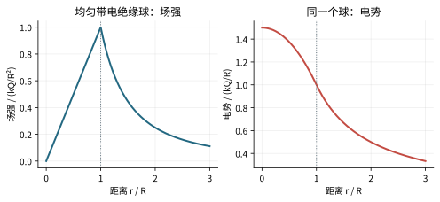

# 高斯定理：总是成立，不是总能一行求场

## 通量只看包住的净电荷

真空中$\oint_S\mathbf E\cdot d\mathbf S=Q_{\mathrm{in}}/\epsilon_0$。右边只计曲面内部电荷，左边的E却是所有电荷共同产生的总场。外部电荷对净通量为0，不代表它在曲面每点产生的E为0。

高斯定理要拿来直接求E，需要对称性帮你确定场方向和等大小的位置。净包围电荷0只能推出净通量0，不能推出处处E=0；均匀外电场穿过空盒就是反例。

## 均匀带电实心球：里外分开

半径R、体密度ρ，总电荷$Q=4\pi R^3\rho/3$。球对称让场沿径向，同一半径处大小相等。r<R时只包住半径r内电荷：

$$E(r)4\pi r^2=\frac{\rho(4\pi r^3/3)}{\epsilon_0},\quad E(r)=\frac{\rho r}{3\epsilon_0}.$$

r≥R时包住全部Q，$E=k_eQ/r^2$。在r=R两式连续，r=0场为0。若你在球内仍代全部Q，会得到中心发散，和对称性矛盾。

## 无限长线与无限平面

线密度λ的无限长直线，取同轴圆柱高斯面，侧面E等大且法向平行，端面场与法向垂直，故$E(2\pi rL)=\lambda L/\epsilon_0$，得$E=\lambda/(2\pi\epsilon_0r)$。

面密度σ的无限平面，取薄柱跨两侧，两端各贡献ES，侧面无通量，$2ES=\sigma S/\epsilon_0$，得$E=\sigma/(2\epsilon_0)$。导体表面外紧邻场$E=\sigma/\epsilon_0$是另一种边界问题，内部E=0，不能与单独非导体无限面结果混用。

## 画错高斯面不会让定理错，只会让计算麻烦

点电荷旁随便画一个不以其为中心的球面，定理仍成立，但E大小与法向夹角都变化，不能从积分号外提出一个统一E。技巧是利用真实电荷分布的对称性，而不是“我能画一个漂亮的球”。

**自测。** 空腔中放一个偏心电荷，高斯面取任意球，是否一定能得到$E=k_eq/r^2$？答：不能；缺少关于该球心的球对称性。通量可知，不代表局部分布已知。
