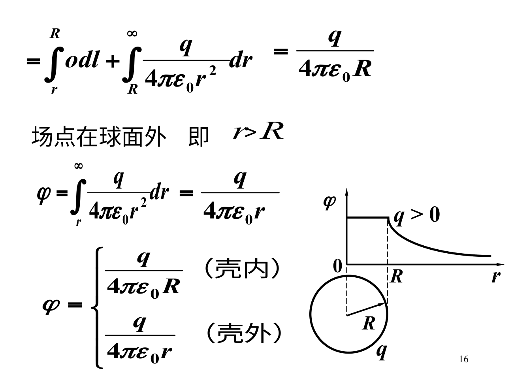

# 电势：用一个标量把静电场的功记下来

## 电势差的负号从哪里来

静电力沿场方向推动正电荷时做正功，电势能降低，所以

$$\varphi_B-\varphi_A=-\int_A^B\mathbf E\cdot d\mathbf l,\qquad W_{A\to B}=q(\varphi_A-\varphi_B).$$

电势差由场决定，不依赖试探电荷q；势能U=qφ会随q正负变化。电子朝高电势运动时，势能反而降低，因为q<0。每次先写U=qφ，再判断增减，不必硬背“电荷往高处还是低处”。

## 零点可以选，但要整题一致

孤立有限电荷分布常取无穷远电势0，于是点电荷φ=k_eq/r，均匀环轴线φ=k_eQ/√(R²+z²)。无限长带电直线的电势差含log r，不能让无穷远同时作为有限零点；应选有限参考半径r₀，$\varphi(r)-\varphi(r_0)=\lambda\ln(r_0/r)/(2\pi\epsilon_0)$。

## 从场算势，要跨分区积分

带电导体球半径R、总电荷Q，球外E=k_eQ/r²，球内E=0。以无穷远为零，球外φ=k_eQ/r，球内整个等于k_eQ/R。内部场为0，只表示电势不再变化，不表示电势为0。

均匀带电绝缘实心球则不同，内部场不为0。由表面φ(R)=k_eQ/R向内积分，得$\varphi(r)=k_eQ(3R^2-r^2)/(2R^3)$。r=R与外式接上；中心φ=3k_eQ/(2R)有限。

## 等势面与场线

沿等势面走，dφ=0，所以E没有沿面切向分量，场线与等势面正交（场为零等退化点另论）。等势面越密，表示相同势差在更短距离内变化，场通常越强。图上“间距”有意义的前提是相邻等势差相同。

**例题。** q=2 μC从10 V到-5 V，电场做功$2\times10^{-6}\times(10+5)=30\ \mu J$。若换成电子，电势差不变，功的符号与数值按其负电荷重算。

**自测。** φ某点为0能否推出E=0？答：不能；零势由参考选择，场由空间导数决定。φ=x在x=0处为0，但其场沿负x且非零。
