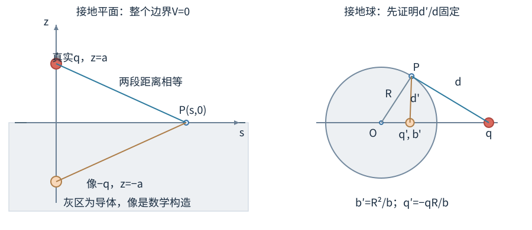
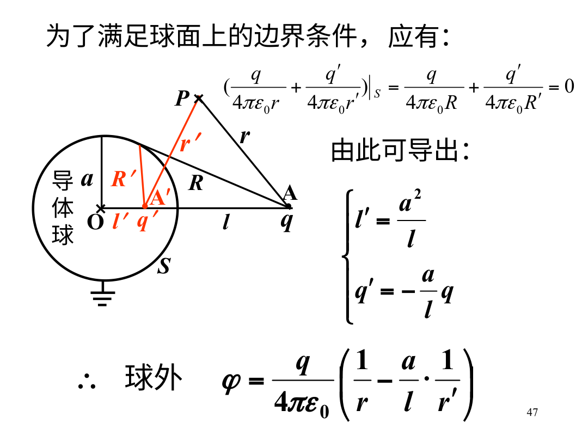

# 导体的静电平衡、屏蔽与电像

金属内有能够移动的电荷。把金属放进静电场后，电荷重新分布，直到导体材料内部的总电场变成0；否则电荷还会继续被驱动。这一状态称为静电平衡。本章先看带电金属球，再处理空腔与外来点电荷。持续有电流的导线不属于这里的平衡模型。

## 算例一：孤立带电金属球

真空中，半径R的孤立导体球带电Q，无外来电荷。球面各位置等价，自由电荷在表面均匀分布，因此表面密度 $\sigma=Q/(4\pi R^2)$。球内场为0，球外场 $E_r=kQ/r^2$。无穷远零点下，球内及表面电势都是 $kQ/R$。

若R=0.10m、Q=1nC，则表面电势约89.9V，外紧邻场约899N/C。把球半径缩小一半但保持Q，电势变为2倍，外表面场变为4倍。要说明保持什么：若球接着理想电源、保持电势，Q也会改变，不能继续使用“Q不变”的比例。

两颗远离彼此的导体球半径R₁、R₂，用细导线连接，忽略导线电荷和两球互相影响。平衡时 $kQ_1/R_1=kQ_2/R_2$，所以电荷按半径比分配。它们的表面场比却为 $E_1/E_2=R_2/R_1$；小球表面场较强。若两球距离不够远，球面感应分布会破坏这种简单近似。

## 从自由电荷停止移动推出什么

静电平衡时导体材料内部 $\mathbf E=0$。如果仍有非零场，自由电荷就会继续受到定向驱动，与“已经平衡”不符。由于内部场为0，导体内部和整个相连表面等势。表面切向场也必须为0，否则表面自由电荷仍会沿表面移动。

多余自由电荷分布在表面。可以在导体材料内部画任意很小的闭合高斯面，因E=0，包围净电荷为0；这排除了平衡材料体内存在宏观净体电荷密度。表面有电荷时，场允许从内部0跳到外侧非零：

$$E_{\text{外,n}}=\frac{\sigma}{\epsilon_0}.$$

法向从金属指向外部，σ是带符号面密度。这里E是由全部电荷共同产生的外紧邻总场，不是只由高斯薄盒中那一小块电荷产生的场。高斯定理右边只数局部电荷，左边仍是总场。

金属表面电势相同，不代表面密度处处相同。尖锐处曲率大，常会聚集较高面密度和较强外场；但“越尖越强”是特定几何与边界下的趋势，不能只看某一点半径就精确算出任意导体的σ。

## 空腔：先把材料区和洞区分开

导体材料内E=0，不等于导体包围的每一个空间都E=0。空腔里若放有电荷，空腔中完全可以有场。围绕空腔、完全走在导体材料内部的高斯面总通量为0，因此腔内电荷q与内壁感应电荷之和为0，内壁总电荷必为−q。

若导体自身净电荷是Q，则外壁总电荷为Q+q。这个总量结论不要求空腔或导体呈球形；但局部面密度通常不均匀，不能用“总量确定”假装已经知道分布。

空腔内没有电荷、导体达到静电平衡且腔壁相连等势时，唯一性定理给出腔内电势为常数，场为0。这是外部静电场被屏蔽的条件。它不是对任意高频电磁波都完全有效的承诺。

## 算例二：球形空腔、偏心电荷与外场

一个球形导体壳外半径R，壳总电荷为0。空腔内放点电荷+q。即使q偏离球心，内壁总电荷仍为−q，外壁总电荷为+q。若外面没有别的电荷，外表面是球形等势面，外部解为中心点电荷场 $E=kq/r^2$，外壁密度均匀。

内壁密度却不会均匀：靠近点电荷的地方感应更强。空腔内部场要结合电荷位置和边界解，不能由“外部像中心点电荷”推断“内部也像中心点电荷”。

若把壳接地，允许电荷与大地交换，外表面电势被固定为0。无外部源时外场为0，外壁总电荷为0，壳净电荷变成−q。接地前后变化的不是腔内电荷q，而是导体可从大地取得电子。隔绝导体固定净电荷，接地导体固定电势，属于不同边界条件。

### 同一导体中的两个空腔

同一块相连静电导体里有两个分离空腔。固定每个腔内源电荷后，腔壁是共同等势。一个腔内源重新移动会改变该腔内壁局部分布，但导体材料仍E=0，另一个腔内的场在满足相同源与等势边界时保持原解，至多整体电势参考随外部条件改变。

这不是说导体没有任何整体响应。若导体孤立，外表面总电荷由全部腔内电荷与导体总净电荷共同确定；腔内某电荷总量改变，外部也可能改变。要区分“腔内源位置变化”和“总电荷变化”，以及问的是场还是绝对电势。

如果空腔开了孔，或者两块金属没有电连接形成同一等势体，屏蔽条件就不再是同一问题。真实屏蔽罩的缝隙、导电连接和频率都可能重要，不能用理想封闭静电腔保证任何实际装置都百分之百屏蔽。

### 接地固定的是电势

孤立导体接地以后，电势趋于大地参考值，不是无条件把其净电荷设为0。若旁边有一个外来正电荷，它会使导体原本电势升高，接地后电子可从大地流入，使表面保持0势；导体可以保留非零感应净电荷。

只有没有外部源、几何与边界使零电势解对应无净电荷的特定情形，才常见“接地后放电到中性”。电像法接地球的像q′本来就非零，正是这个反例。判断接地前后流了多少电荷，要分别求两种边界条件下的总表面电荷，再相减。

静电屏蔽也有内外不同问题：外部源不能在封闭空腔无源区建立场；腔内有源时，孤立壳外壁可能带对应净电荷，让外部场非零。把壳接地可使无外源的外部解为0。说“一块金属把里面外面互相完全隔绝”没有把这两种电荷约束区分开。

## 算例三：点电荷面对接地无限平面

左图把所求空间z>0与导体z<0分开，q在真实空间，−q只在被排除的导体区域参与数学构造。右图同理只求球外。图中d/d′是观察点到两颗电荷的距离，R是球半径，三者不是同一个长度。

接地导体占z<0，表面z=0。点电荷q在z=a，a>0。放一颗像电荷−q在z=−a。对平面上任意点，两颗电荷距离相等，电势相消为0；上半空间仅有真实q，因此构造满足边界。

上半空间电势为

$$V(x,y,z)=kq\left[\frac1{\sqrt{x^2+y^2+(z-a)^2}}-\frac1{\sqrt{x^2+y^2+(z+a)^2}}\right].$$

真实q所受导体吸引力等于像电荷对它的力：距离2a，故大小 $F=kq^2/(4a^2)$，方向朝平面。若q=1nC、a=0.10m，则F约 $2.25\times10^{-7}$N。方向与q的正负无关，因为像电荷总与它异号。

从表面外法向场还能求感应密度。令 $s=\sqrt{x^2+y^2}$，求 $E_z=-\partial V/\partial z$ 后取z=0⁺，得

$$\sigma(s)=-\frac{qa}{2\pi(s^2+a^2)^{3/2}}.$$

把求导步骤也保留。令$D_-^2=s^2+(z-a)^2$、$D_+^2=s^2+(z+a)^2$，由链式求导，$\partial(1/D_-)/\partial z=-(z-a)/D_-^3$，另一个同理。因此

$$
E_z=-kq\left[-\frac{z-a}{D_-^3}+\frac{z+a}{D_+^3}\right].
$$

z→0⁺时两距离都为$\sqrt{s^2+a^2}$，括号两项都是$a/(s^2+a^2)^{3/2}$，所以$E_z=-2kqa/(s^2+a^2)^{3/2}$。外法向朝+z，导体内部场0，σ=ε₀Ez；再用$2k\epsilon_0=1/(2\pi)$，得到上式。

总感应电荷用同心圆环相加，圆环面积$2\pi s\,ds$：

$$
Q_{\mathrm{ind}}=-qa\int_0^\infty\frac{s\,ds}{(s^2+a^2)^{3/2}}.
$$

换元u=s²+a²，du=2s ds，下限a²、上限∞，积分为$\tfrac12\int_{a^2}^{\infty}u^{-3/2}du=[-u^{-1/2}]_{a^2}^{\infty}=1/a$，故总量−q。q>0时整面感应为负，最靠近电荷的位置绝对值最大；对平面积分总感应量为−q。公式量纲中 $qa/(s^2+a^2)^{3/2}$ 为C/m²，可检查分母指数。

### 相互作用能为什么不是直接取两点电荷的能量

像电荷的位置会跟着真实电荷位置改变。真实电荷从无穷远移到a时，用力积分得到导体相互作用能 $U=-kq^2/(4a)$。明确以a为向上坐标，导体力分量$F_a=-kq^2/(4a^2)$。规定无穷远相互作用能0，则

$$
U(a)-U(\infty)=-\int_{\infty}^{a}F_s\,ds
=\frac{kq^2}{4}\int_{\infty}^{a}s^{-2}ds
=-\frac{kq^2}{4a}.
$$

这时a减小，U更负，粒子可释放动能；反求−dU/da又得到向下的负力分量。如果把真实q与像−q当成独立固定的两点电荷，写 $-kq^2/(2a)$，会多一倍。这里可写 $U=qV_{\text{感应}}/2$；二分之一来自逐渐建立感应电荷的过程。求瞬时力用像电荷直接算，求总能量要考虑感应分布随构型变化。

### 为什么满足边界后就能代替导体

电像法把复杂导体边界换成几个数学上的假电荷。它之所以可靠，是因为在所求区域里，只要电荷分布与边界电势相同，静电解就唯一。构造出的解必须同时满足实际电荷位置、边界条件和远处条件。

像电荷通常放在实际不求解的导体区域。不能把它当作金属内部真的藏了一颗点电荷，也不能拿构造解去描述本来被金属占据的区域。使用电像法后，最好明确写一句“这个势只用于导体外的实际空间”。

### 构造中哪些区域不能使用

如果为了满足某个边界，你在真实真空区域随便加了一个像电荷，那么方程里的源就变了，唯一性定理不能再替你证明与原题相同。合格构造要把像放在排除的导体内部或其他不求解区域，使所求区域的真实源保持原样。

相同边界上检几个特殊点不够。平面对称构造对任意平面点等距，球面构造对任意球面点有固定距离比例，这些几何关系才保证整片边界成立。若只在最近点让电势相消，其他点不满足0势，就不是正确电像解。

## 接地球的像：公式前先认几何

图源：《静电场中的导体.ppt》兼容PDF第47页。图中a是球半径，l是球心到真实q的距离，红色l′和q′在球内；本章分别用R、b、b′。P是任意球面点，R与R′是从P到两电荷的距离。固定距离比例让整片球面电势为0，不能只检验离q最近的那一个点。

半径R的接地导体球，真实q距球心b>R。沿球心指向q的直线上，在距球心 $b'=R^2/b$ 处放像电荷 $q'=-qR/b$。任意球面点到两电荷的距离成固定比例，使球面电势为0。教师《静电场中的导体.ppt》PDF第47页给出的正是这一几何比例。

为什么这一组数能对整片球面成立？取任意球面点P，θ是OP与Oq的夹角。到真实q和像q′的距离分别为d、d′，余弦定理给

$$
d^2=b^2+R^2-2bR\cos\theta,
$$

$$
d'^2=b'^2+R^2-2b'R\cos\theta
=\frac{R^2}{b^2}(b^2+R^2-2bR\cos\theta)
=\frac{R^2}{b^2}d^2.
$$

因b、R和两距离都正，开根得d′=(R/b)d。再代入q′：$q'/d'=(-qR/b)/[(R/b)d]=-q/d$，所以任意θ的P处$kq/d+kq'/d'=0$。证明没有挑最近点或赤道点，整片边界都满足。

若球是孤立中性球，单独这个像会造成净感应电荷q'，不满足中性；还要在球心加一个−q'的像电荷，球面仍等势但不再固定为0。接地与中性不能只换一句话，数学构造也要相应改。

## 接地球电像的吸力，逐个距离代对

上文真实q距球心b>R，像电荷 $q'=-qR/b$，位置 $b'=R^2/b$。两电荷距离不是b，也不是球面间隙b−R，而是 $b-b'=(b^2-R^2)/b$。由像法，真实电荷受力大小

$$F=k\frac{|qq'|}{(b-b')^2}=\frac{kq^2Rb}{(b^2-R^2)^2},$$

方向朝球心。若R=0.10m、b=0.20m、q=1nC，像电荷为−0.50nC，位置距中心0.050m，两电荷距离0.150m，F约 $2.00\times10^{-7}$N。

当b≫R，力按1/b³衰减，这是接地球可从大地吸入净电荷的情形。孤立中性球还需中心补像，远处净单极项消失，诱导偶极吸引衰减得更快。接地与中性对近场图看起来都吸引，远场幂次却不同，说明边界条件会影响整个解。

当b=R+s且s≪R，$b^2-R^2\approx2Rs$，吸力约 $kq^2/(4s^2)$，回到距离平面s的电像力。很大曲率半径的局部表面近似平面，是对两个电像结果的独立核对。

## 导体表面力为什么要扣掉自身那一半场

一小块表面电荷σ所在处，内外总场分别0与σ/ε₀。求这一小块受力不能让它对自身施力。局部表面自身的场在两侧近似为±σ/(2ε₀)，其他电荷在表面的平均场为外内平均 $\sigma/(2\epsilon_0)$。

因此向外静电压力 $p=\sigma[\sigma/(2\epsilon_0)]=\sigma^2/(2\epsilon_0)$。用外侧总场直接乘σ会多一倍。压力不随σ符号改变，正负同号表面都表现为局部电荷相互排斥的张力；整个物体的合力还需对所有表面压力方向积分。

例如球表面各处都有向外压力，完整孤立球的总矢量力仍为0，因为各方向对称相消。局部机械应力和整体平移合力不是同一量，不能见压力非零就说球会无缘无故朝某个方向加速。

## 练习与解答

练习一：一个净电荷Q的导体壳有两个互不相通空腔，分别放q₁、q₂。各内壁与外壁的总电荷是多少？

解：分别在导体材料中包围每个空腔画高斯面，得两内壁分别为−q₁、−q₂。壳自身总量守恒，外壁为Q+q₁+q₂。只能确定总量；若空腔不球对称或电荷偏心，不能接着说每壁密度均匀。

练习二：平面电像算例中，把距离a变成2a。力和相互作用能分别变多少？为什么不是同一个比例？

解：$F\propto a^{-2}$，变为原来的1/4；$U\propto-a^{-1}$，变为原来的一半，数值更接近0。能量对位置的导数才给力，不是能量本身等于力乘某个固定距离。代入 $-dU/da=-kq^2/(4a^2)$，可核对吸引力方向。
