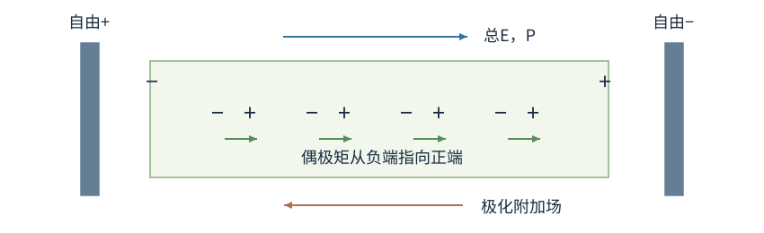
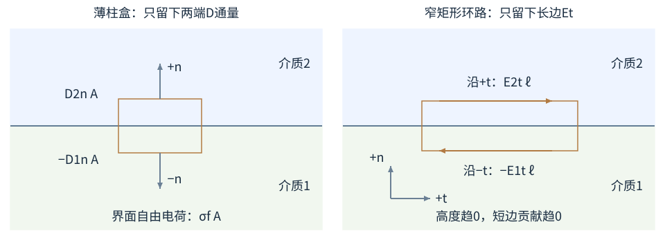
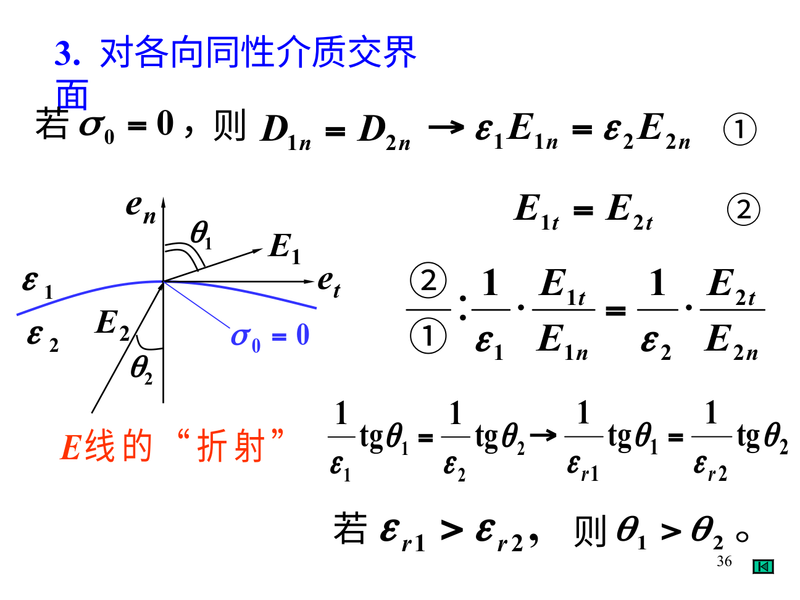

# 电介质的极化、自由电荷与界面

把玻璃插入带电极板之间，分子中的正负电荷会发生微小相对位移，或使已有的分子偶极改变取向。它们通常没有像金属载流子那样穿过整块材料，却仍会改变总电场。我们先计算这些微小位移怎样在两端形成电荷，再区分自由电荷与束缚电荷。

## 极化强度P在统计什么

取一块横截面积1cm²、厚1mm的介质，体积为$10^{-7}\,\mathrm{m^3}$。为说明计算方法，假设其中有$10^{21}$个同向偶极，每个偶极由电荷$\pm e$相隔$10^{-12}$m组成，负端在左、正端在右。一个偶极的电偶极矩大小为$ed=1.60\times10^{-31}\,\mathrm{C\,m}$，总偶极矩为$1.60\times10^{-10}\,\mathrm{C\,m}$。除以体积得到$1.60\times10^{-3}\,\mathrm{C/m^2}$，方向向右。这就是本例的极化强度P；数值只用于演示统计定义，不代表特定玻璃的测量值。

一般地，电偶极矩从负电荷指向正电荷。极化强度 $\mathbf P$ 定义为单位体积的电偶极矩，单位为 $(\mathrm{C\,m})/\mathrm{m^3}=\mathrm{C/m^2}$。没有永久偶极的分子可发生位移极化；有永久偶极的分子还会受电场转矩而取向极化。热运动会妨碍完全排齐，所以一般不是所有分子都整整齐齐同向。

图中两块深色金属板上的+和−是电源搬来的自由电荷；浅绿介质自己的左端−、右端+是束缚电荷。微小偶极矩从每一对的负端指向正端，平均P朝右；介质两端电荷产生的附加场从其右正端指向左负端，朝左。总场是自由源与束缚源的矢量和。

在均匀极化体内部，相邻偶极的正负端大体相抵；边缘没有邻居继续抵消，便表现为束缚表面电荷。带符号关系是

$$\sigma_b=\mathbf P\cdot\hat{\mathbf n},\qquad \rho_b=-\nabla\cdot\mathbf P.$$

下标b表示束缚电荷，n是从介质指向外部的法向。P朝右的介质板，右端外法向朝右，$\sigma_b>0$；左端法向朝左，$\sigma_b<0$。同一块板两面的密度大小可以相等，符号相反。

体密度公式可从一维分层看负号。设P只沿x，在很窄两层的接面，左层朝外的面电荷是+P(x)，右层向左朝外的面电荷是−P(x+dx)，相加为P(x)−P(x+dx)。除以层宽dx并取极限，就是$\rho_b=-dP_x/dx$。三维把三个方向相同贡献相加，得到负散度。P沿x越往右越大，相邻层没有抵掉的部分恰是负束缚体电荷。

均匀P时体内散度为0，因此体束缚密度为0；P不均匀时内部也可出现束缚电荷。不能因为叫“束缚”就认为它只在表面，它的名称描述微观电荷不自由流动，位置仍由极化分布决定。

## D把自由电荷单独记出来

真实场满足 $\nabla\cdot\mathbf E=(\rho_f+\rho_b)/\epsilon_0$。把$\rho_b=-\nabla\cdot\mathbf P$代入，得到$\epsilon_0\nabla\cdot\mathbf E=\rho_f-\nabla\cdot\mathbf P$。把右边散度移到左边，再用散度对相加的线性关系：

$$\nabla\cdot(\epsilon_0\mathbf E+\mathbf P)=\rho_f.$$

因此把括号这一支新向量定义为D，便有

$$\mathbf D=\epsilon_0\mathbf E+\mathbf P,\qquad \oint\mathbf D\cdot d\mathbf S=Q_{f,\text{内}}.$$

f表示自由电荷，例如电源搬到金属极板上的电荷。D称电位移，单位同P，为C/m²。它的高斯定理右边只数自由电荷；E的高斯定理右边仍数全部电荷。D是方便处理材料响应的辅助场，不要把它理解成试探电荷直接受到的力除以电荷量，那个定义属于E。

线性、各向同性介质满足 $\mathbf P=\epsilon_0\chi_e\mathbf E$，从而 $\mathbf D=\epsilon\mathbf E$，$\epsilon=\epsilon_0\epsilon_r$，$\epsilon_r=1+\chi_e$。χ是电极化率，εᵣ无量纲。很强的场、铁电材料、各向异性晶体不一定服从这个简单比例；ε也可能随频率改变。

如果题目只给εᵣ，不给几何与自由源，你通常不能唯一求E、D、P各自数值；εᵣ只提供它们之间的材料比例。像知道电阻R不等于已经知道电流I，还需要电压或电路条件。把本构关系当成源条件，会让很多介质题少一条方程。

## 算例一：固定自由电荷的平行板填介质

两块大板上的自由面电荷密度为±8nC/m²，板间完全填满相对介电常量εᵣ=4的均匀线性介质，忽略边缘。这里先保持极板自由电荷不变，取正极板指向负极板为正方向。用σf表示自由面密度的正值。由D的高斯定理，板间 $D=\sigma_f$，所以 $E=\sigma_f/(4\epsilon_0)$。没有介质时为 $\sigma_f/\epsilon_0$，电场降为四分之一。

取 $\sigma_f=8\,\mathrm{nC/m^2}$，则D=8nC/m²，E约226V/m。极化强度 $P=D-\epsilon_0E=6\,\mathrm{nC/m^2}$，两端束缚电荷密度为±6nC/m²。P与原场同向，但介质端面产生的附加场在板间反向，导致总场减小。

这个结论保持的是自由电荷不变。如果极板一直接电源，电势差和板距固定，E=U/d不变，电源会继续送来更多自由电荷。说“插介质就一定减小E”，没有交代电路条件。

## 边界条件从两个很小的几何图来

先固定坐标：界面水平，介质1在下、2在上，n向上，t向右。左图盒子的上端外法向+n，下端外法向−n；右图沿上边向右、下边向左绕行，环路方向与场方向必须分别记。

取跨介质界面的薄柱盒，厚度趋于0。侧面面积趋于0，D通量只剩上下两面，于是

$$D_{2n}-D_{1n}=\sigma_f.$$

代数过程是$D_{2n}A-D_{1n}A=\sigma_f A$，再除以非零面积A。右边的电荷属于界面，盒子厚度趋0仍有σfA；有限的体密度乘趋零厚度则消失。左右侧壁面积趋0，只要场有限，其通量也趋0。

统一法向n从介质1指向介质2。σf是界面自由面电荷，不包括已经由P记入的束缚电荷。若σf=0，D的法向分量连续；不能因此说E法向连续。

再取跨界面的窄矩形环路，长边沿界面切向，短边高度趋于0。静电场环流为0，所以

$$E_{2t}=E_{1t}.$$

环路上边与+t同向，贡献E₂tℓ；下边反向，贡献−E₁tℓ。两条短边的长度趋0，有限E下贡献消失，所以$(E_{2t}-E_{1t})\ell=0$，除以ℓ才得到切向连续。这里必须是静电环流0；随时间变化的磁通若不能忽略，就要用Faraday定律而非这条静电式。

第一条来自自由电荷的高斯定理，第二条来自静电无旋性质。它们约束的是不同分量，不能写成整支E或D都连续。

原图来自《静电场中的电介质.ppt》PDF第36页。黑色竖线是法向，黑色水平线是切向；θ₁、θ₂都从法向量起。图上σ₀=0对应这里的σf=0。因为切向E连续、法向εE连续，得到 $\tan\theta_1/\epsilon_1=\tan\theta_2/\epsilon_2$。这个角度关系并非另背一条定律。无自由面电荷时，记共同法向D为Dn、共同切向E为Et。由分量定义$\tan\theta_i=E_t/E_{in}$，再用$\epsilon_iE_{in}=D_n$，便有

$$\frac{\tan\theta_i}{\epsilon_i}=\frac{E_t}{\epsilon_iE_{in}}=\frac{E_t}{D_n}.$$

两侧右边相同，得到图中关系。若Dn=0，使角度为90°而正切不定义，应直接用原来的两条分量边界，不能强行除零。这与光线折射的公式形式不同，图里折的是静电场方向，不能把光学Snell定律套进来。

## 算例二：给定一侧场，求另一侧

介质1为真空，介质2的εᵣ=3，界面无自由面电荷。设法向从1指向2，介质1中 $E_{1n}=600\,\mathrm{V/m}$、$E_{1t}=200\,\mathrm{V/m}$。法向条件 $\epsilon_0E_{1n}=3\epsilon_0E_{2n}$ 给 $E_{2n}=200$V/m；切向条件给 $E_{2t}=200$V/m。

介质1的角度 $\tan\theta_1=200/600=1/3$，约18.4°；介质2为45°。进入介电常量更大的材料后，法向分量更小，切向不变，因此E更偏离法向。这也核对了原图中的角度关系。

如果界面带自由面密度σf，应该改用 $3\epsilon_0E_{2n}-\epsilon_0E_{1n}=\sigma_f$，不能继续沿用无自由面电荷的“折射”结论。

### 界面上自由电荷与束缚电荷分别怎样计算

P可能在界面跳变，界面会出现束缚面电荷。统一法向n从1到2，把两块材料各自朝外的法向区分后，界面总束缚密度为 $(\mathbf P_1-\mathbf P_2)\cdot\hat{\mathbf n}$。E法向跳变由自由与束缚总电荷决定；D法向跳变只由自由部分决定。

这两句话可以同时成立。以无自由面电荷、法向D连续的界面为例，ε不同导致E法向不同，所需E跳变正由极化束缚电荷承担。若把“σf=0”读成“界面没有任何电荷”，就会把两条边界关系看成矛盾。

再强调方向：E切向连续不意味着场线不能改变角度；法向分量变、切向分量不变，合成箭头就转了。判断转向不要在图上凭“介质大就更吸场线”猜，用两个分量算一组数，θ自然确定。

### 换一组材料，把总电荷也核对

介质1相对介电常量2，介质2为5，E₁法向分量100V/m，界面没有自由面电荷。由D法向连续，E₂n=40V/m。两侧P法向分别为 $P_{1n}=\epsilon_0(2-1)(100\,\mathrm{V/m})\approx0.885\,\mathrm{nC/m^2}$、$P_{2n}=\epsilon_0(5-1)(40\,\mathrm{V/m})\approx1.42\,\mathrm{nC/m^2}$，故界面束缚密度约为−0.531nC/m²。

总E跳变乘ε₀为 $\epsilon_0(E_{2n}-E_{1n})=\epsilon_0(-60\,\mathrm{V/m})\approx-0.531\,\mathrm{nC/m^2}$，恰等于束缚面电荷。D跳变0与E跳变非0因此并不矛盾：D的跳变由自由面电荷决定，ε₀E的跳变由自由与束缚面电荷之和决定。

若另有自由面密度 $\sigma_f=\epsilon_0(20\,\mathrm{V/m})\approx0.177\,\mathrm{nC/m^2}$，D条件除以ε₀后变为 $5E_{2n}-2(100\,\mathrm{V/m})=20\,\mathrm{V/m}$，所以E₂n=44V/m。此时P₂n约1.56nC/m²，束缚密度约−0.673nC/m²，总面密度约0.177−0.673=−0.496nC/m²，也等于ε₀乘以−56V/m。每一步保留单位与符号，能检查公式有没有把自由与总电荷混用。

## 算例三：两层介质沿电场串起来

两块大平行板相距d，面积A，中间两层介质厚度d₁、d₂，介电常量ε₁、ε₂，界面平行极板，且无界面自由电荷。自由电荷Q固定时，两层法向D同为Q/A。因此 $E_1=Q/(A\epsilon_1)$、$E_2=Q/(A\epsilon_2)$，总电压

$$U=E_1d_1+E_2d_2=\frac QA\left(\frac{d_1}{\epsilon_1}+\frac{d_2}{\epsilon_2}\right).$$

所以等效电容 $C=A/(d_1/\epsilon_1+d_2/\epsilon_2)$。这正对应两个电容串联。若d₁=d₂=d/2，εᵣ分别2与6，则 $C=3\epsilon_0A/d$。不能把相对介电常量直接平均成4，因为同一自由电荷通过两层，而两层电压不同。

若改为两种介质各占半块极板面积、都跨越完整板距，它们承受相同电压、自由电荷分流，等效并联，得到 $C=4\epsilon_0A/d$。同样的两种材料，几何摆法改变了约束。

## 非均匀极化的束缚体电荷

设圆柱形介质内 $\mathbf P=ar\hat{\mathbf r}$，r为到轴线的距离。柱坐标散度 $\nabla\cdot(P_r\hat{\mathbf r})=(1/r)d(rP_r)/dr$，所以ρb=−2a。半径R的侧面外法向径向，σb=aR；端面法向沿轴线，与P垂直，无束缚面电荷。

长ℓ圆柱体内束缚电荷为−2aπR²ℓ，侧面为(aR)(2πRℓ)=+2aπR²ℓ，恰好抵消。这个计算既核对负散度与表面点乘的符号，也说明只算表面会错误地认为极化凭空造出了正净电荷。

a的单位应为C/m³，因为P单位C/m²、r单位m。给定P是宏观极化分布，不代表我们已经知道产生它的外部E；若题目同时要求场，还要结合自由源、材料关系与边界，不能把P直接当E。

## 自由点电荷在均匀无限介质里

中心放自由点电荷q，均匀线性介质填满整个空间，球对称给 $D_r=q/(4\pi r^2)$，$E_r=q/(4\pi\epsilon r^2)$。相对于真空，固定自由q的场减小为1/εᵣ。

但真实实验把电荷放进介质时，往往有空腔、接触面或分子尺度结构；“整个空间均匀连续介质”的理想化在电荷附近可能不适用。若题目给一个真空球腔半径a、外面才是介质，那么腔内E用ε₀，外面用ε，电势还要跨界面分段积分。不能只把全部空间的ε₀一键替换为ε。

例如自由q位于球腔中心，取无穷远零点，腔内r<a的电势

$$V(r)=\frac q{4\pi\epsilon_0}\left(\frac1r-\frac1a\right)+\frac q{4\pi\epsilon a}.$$

腔内场仍等于真空点电荷场，但电势整体多了由介质边界决定的常数偏移。它再次展示：局部E相同，不保证相对无穷远的V也相同。

## 各向异性时，D和E可以不平行

在晶体里不同方向响应不同，最简单主轴系可写Dₓ=εₓEₓ、Dᵧ=εᵧEᵧ、D_z=ε_zE_z。若E在x、y都有分量且εₓ≠εᵧ，D通常会转到另一个方向。这时不能把ε当单一数字，使用标量“场线折射式”前必须先检查各向同性条件。

例如εₓ=2ε₀、εᵧ=4ε₀，E=(100,100,0)V/m，D≈(1.77,3.54,0)nC/m²。E与x轴45°，D与x轴约63.4°，并不重合。边界条件依旧分别约束D法向与E切向，只是材料关系变成张量，把分量联系起来。

后面的双折射波片就是光频下各向异性响应的一种应用。静电介电常量与光频折射率之间要考虑频率依赖，不能拿一张低频εᵣ表就精确预测所有光学波片参数。

## 极化能与“固定场”也要说清楚

一个永久固定偶极在外场中有势能−p·E；一个原本没有偶极、由线性极化逐渐诱导出来的偶极，相互作用能还包括建立极化时的能量变化，常见有效相互作用能出现−αE²/2，而非直接把最终p=αE塞进−pE得到−αE²。

二分之一与电容逐步充电、感应电荷逐步建立类似，来源是响应从0增加到最终值。具体是固定自由电荷还是恒定外加电压，也影响外源做功。遇到极化力，先说对象有永久偶极还是诱导偶极，避免用同一能量公式跨模型。

## 练习与解答

练习一：半径R的球体均匀极化为 $\mathbf P=P\hat{\mathbf z}$。写出球面束缚电荷密度，说明总束缚电荷是否为0。

解：球面外法向与z轴夹角θ，所以 $\sigma_b=P\cos\theta$。北半球正，南半球负，赤道为0。均匀P使体密度0；表面积分 $\int_0^{2\pi}\int_0^\pi P\cos\theta R^2\sin\theta\,d\theta d\phi=0$。极化重新分配正负电荷，不会凭空制造净电荷。

练习二：一块均匀介质中已知E=100V/m、εᵣ=5，求D与P大小。若这两个场都垂直材料表面，束缚面密度大小是多少？

解：$D=5\epsilon_0\times100\approx4.43\,\mathrm{nC/m^2}$；$P=4\epsilon_0\times100\approx3.54\,\mathrm{nC/m^2}$。垂直表面时 $|\sigma_b|=P$，符号由P与各面外法向的点乘决定。把D直接当作束缚面密度会多算ε₀E那一部分。

介电击穿以后可能有明显自由传导电流，静电绝缘模型与常数介电关系都可能改变。题目说“介质”不是保证在任意强场、任意频率下永远不导电，使用前仍要保留线性绝缘范围。
