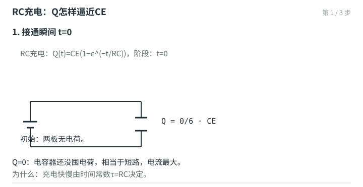
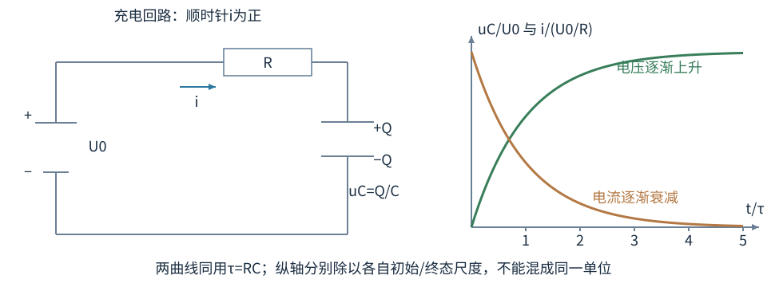
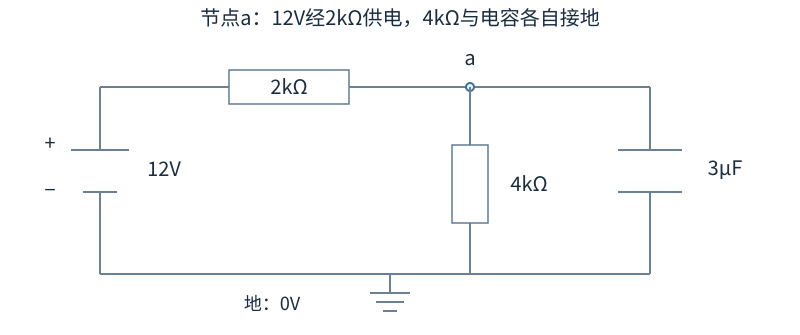

# 电流、电源与电容充电：电流为什么会逐渐变小

闭合开关以后，灯会亮，电容会充电，电路中的电荷并没有沿导线被消耗掉。电源给电荷增加能量，电阻把电能转成热，电容把部分能量存进电场。用电荷守恒和能量守恒写方程，比面对复杂电路时猜串并联更稳。

充电过程两板电荷的积累：

## 电流方向和电子运动方向

穿过一个定向截面的净电荷量随时间变化率是电流 $I=dQ/dt$。习惯方向按正电荷移动方向定义。金属中的载流电子带负电，因此电子平均漂移与电流相反。电流的正负依赖你先画的参考箭头；解出负值表示实际方向反过来，方程并没有失败。

电流密度 $\mathbf j$ 是单位面积上定向流动的电荷通量，$I=\int\mathbf j\cdot d\mathbf S$，单位A/m²。均匀流且垂直截面时I=jA。若载流子数密度n、每颗电荷q、平均漂移速度 $\mathbf v_d$，则 $\mathbf j=nq\mathbf v_d$。

漂移速度通常远小于电磁信号沿电路传播速度。开灯并不需要等某一颗电子从电源一路跑到灯泡；导线内原本就有载流子，电磁场的变化驱动各处电荷开始响应。

### 算例一：细导线里的电子走多快

铜导线截面积 $A=1.0\,\mathrm{mm^2}$，电流I=1.0A，假设载流电子密度 $n=8.5\times10^{28}\,\mathrm{m^{-3}}$。漂移速度大小

$$v_d=\frac I{neA}=\frac1{(8.5\times10^{28})(1.60\times10^{-19})(10^{-6})}\approx7.35\times10^{-5}\,\mathrm{m/s}.$$

约每秒0.074mm，方向与电流相反。把mm²漏换成 $10^{-6}$m²会错一百万倍。这个估算采用单一载流子模型，不把电子的热运动速度和平均定向漂移混作一个量。

## 欧姆定律说的材料条件

均匀、各向同性欧姆材料中，$\mathbf j=\sigma\mathbf E$，σ是电导率；电阻率 $\rho=1/\sigma$。长度L、截面积A的均匀导体有 $R=\rho L/A$，两端电压U与电流满足U=IR。此处ρ指电阻率，和静电章节的体电荷密度同字母但不是同一物理量，单位Ω·m能帮你分清。

欧姆定律不是所有元件的定义定律。二极管、温度变化很大的灯丝，U与I可能不成固定比例。$P=UI$ 是电功率关系；在满足U=IR的电阻上，才进一步写成 $I^2R$ 或 $U^2/R$。

## 电源的电动势不是机械力

电动势 $\mathcal E$ 的单位是V，表示电源内部非静电作用每搬运单位正电荷提供多少能量。它叫“势”，并不是牛顿为单位的力。化学电源靠化学过程，发电机靠电磁作用。

电源有内阻r、外电阻R时，选电流由电源正极流向外电路，回路方程 $\mathcal E-Ir-IR=0$。因此 $I=\mathcal E/(R+r)$，端电压 $U=\mathcal E-Ir=IR$。放电时端电压小于电动势；给电池充电时电流方向反过来，不能仍把放电式当成无条件大小关系。

## 节点与回路方程如何写符号

稳恒电路节点不持续堆积电荷，所以流入电流和等于流出电流和。写成代数形式是 $\sum I=0$，但你要先说明流入取正还是流出取正。

绕闭合回路走一圈，电势回到原处，总电势变化为0。经过电源从负极到正极记 $+\mathcal E$；顺参考电流穿电阻记−IR，逆参考电流记+IR。电路有强变化磁通时还需把感应电动势写入，不能只用静电势差绕圈。

### 算例二：含内阻电源的能量核对

$\mathcal E=12$V、r=1Ω、R=5Ω。回路电流2A，端电压10V。电源每秒提供功率 $\mathcal EI=24$W；外阻耗散 $I^2R=20$W；内阻耗散4W，加起来24W。若只拿端电压乘电流，会算出交给外电路的20W，漏掉电源内部耗散的4W。这两个功率回答不同问题。

两支电阻R₁=6Ω、R₂=3Ω并联在端电压6V的理想源上，支路电流为1A与2A，总3A。节点电流守恒与各支路电压相同共同确定结果；不是电流看见分叉后“平均分”了。

## RC充电：电容电压升高，电流逐渐减小

图中上极板记+Q、下极板−Q，电流参考方向沿上方导线向右，流入上极板；uC定义为上极板减下极板电势。沿电源负极到正极，再顺电流走过R与C，电势依次升U₀、降iR、降uC，因此回路符号可以从图逐段读出。曲线横轴t/τ无量纲，绿色纵值uC/U₀，棕色纵值i/(U₀/R)，它们不是伏特和安培共用同一标尺。

先取R=10kΩ、C=100μF、电源5V，电容初始电压为0。开关接通时，电阻两端有5V，电流是0.50mA。如果在接下来的0.20s内暂用这个初始电流近似，流入正板的电荷为$\Delta Q=i\Delta t=100\,\mu\mathrm C$，电容电压增加$\Delta Q/C=1.0$V。此后电阻两端只剩4V，电流降为0.40mA；再按相同方法估算0.20s，电压增加0.80V。

|时间t/s|近似电容电压/V|据此算出的下一段起点电流/mA|下一段0.20s增加电压/V|
|---|---|---|---|
|0|0|0.500|1.000|
|0.20|1.000|0.400|0.800|
|0.40|1.800|0.320|0.640|
|0.60|2.440|0.256|0.512|

这张表使用“每段内电流暂取段首值”的近似，实际电流在一段内也持续下降。例如精确解在0.20s给出0.906V，比表中的1.000V低。把时间段缩小，就能减小这种误差；令时间段趋于0，下面的微分方程描述的正是这个连续过程。电流减小的原因已经可见：电容电压升高，留给电阻的电压降低。

电阻R与电容C串联，接恒压源 $U_0$，电容初始未充电。以流向正极板的电流为正，$i=dQ/dt$，电容电压 $u_C=Q/C$。回路方程是

$$U_0-R\frac{dQ}{dt}-\frac QC=0.$$

把目标值 $CU_0$ 减去当前Q，得 $dQ/dt=(CU_0-Q)/(RC)$：还差得越多，充得越快；越接近目标，电流越小。令 $X=CU_0-Q$，则$dX/dt=-X/(RC)$。用τ=RC表示时间尺度，先在X≠0时分离变量，再从初始状态积分到t：

$$
\int_{X(0)}^{X(t)}\frac{dX'}{X'}=-\int_0^t\frac{dt'}\tau,
\qquad \ln\left|\frac{X(t)}{X(0)}\right|=-\frac t\tau.
$$

X′、t′只是在积分中变化的临时变量。两边取指数，幅值比例为$e^{-t/\tau}$。本题Q(0)=0，所以X(0)=CU₀>0，X在向0靠近过程中保持正号，得到X(t)=CU₀e的−t/τ次方。若起初X=0，已经到目标，直接取恒定解，不能再除以X。

最后把X从定义中移回，$Q=CU_0-X$，再分别除C和对t求导，得到：

$$Q(t)=CU_0(1-e^{-t/\tau}),\quad u_C(t)=U_0(1-e^{-t/\tau}),\quad i(t)=\frac{U_0}R e^{-t/\tau},\qquad\tau=RC.$$

求电流这一行也可核对：Q中常数CU₀导数0，$-CU_0e^{-t/\tau}$求导时再乘$-1/\tau$，结果是$(CU_0/\tau)e^{-t/\tau}=(U_0/R)e^{-t/\tau}$，方向符合初始参考箭头。初始t=0有Q=0、uC=0、i=U₀/R；很久后Q趋CU₀、uC趋U₀、i趋0，三者同时满足回路方程。

时间常数τ单位为秒，因为Ω·F=s。在一个τ后电压达到目标的 $1-e^{-1}\approx63.2\%$，不是“已经充满”；约5τ后达到99.3%。指数趋近不会在有限时间严格到达目标，工程上允许误差才谈充满。

### 算例三：多久达到90%

R=10kΩ、C=100μF，所以τ=1.0s。达到0.9U₀时 $e^{-t/\tau}=0.1$，两边取自然对数，$t=\tau\ln(10)\approx2.30$s。若U₀=5V，初始电流0.50mA，一个τ后约0.184mA。若题目问“电压达到90%时电流”，则为初始值的10%，即0.050mA；不要把电压的90%也套给电流。

初始已带电 $u_C(0)=U_i$ 时，通解是 $u_C=U_0+(U_i-U_0)e^{-t/\tau}$。电容电压在有限电流模型下连续，不能闭合开关瞬间凭空从Uᵢ跳到U₀。这个通解比为每一种充放电情形重新背公式更方便。

## 放电与能量去哪了

把电源断开，让初始电压Uᵢ的电容通过R放电。取放电电流方向，$i=-dQ/dt$，解为 $Q=CU_i e^{-t/\tau}$，电压同样指数衰减。初始场能 $CU_i^2/2$ 最终转成电阻热。

从未充电状态经电阻接理想恒压源充到U₀，电源提供 $U_0Q=CU_0^2$，电容只存 $CU_0^2/2$，另一半耗散在电阻。R变小，电流更大、时间更短，理想模型中的总热量却仍是这一半；R=0的瞬间过程不再能由这个纯RC模型直接描述，寄生电感、辐射等会参与。

### 把电阻热从0积到充电结束

初始未充电RC中，$i=(U_0/R)e^{-t/RC}$，热功率 $i^2R=(U_0^2/R)e^{-2t/RC}$。从0积到无穷，指数的原函数是$-(RC/2)e^{-2t/(RC)}$，于是

$$
W_R=\frac{U_0^2}{R}\left[-\frac{RC}{2}e^{-2t/(RC)}\right]_0^{\infty}
=\frac{U_0^2}{R}\left(0+\frac{RC}{2}\right)
=\frac12CU_0^2.
$$

前面系数里的R与积分带来的RC相约，剩C。R确实约掉，原因是热功率随R增加而降低、持续时间同比增加。

这个约掉只在给定理想恒压、初始未充电、纯串联R和C的模型里成立。若电源电压随时间缓慢控制、借电感可逆交换能量、或初始电容已带电，热量可不同。所谓“电容充电永远损失一半”没有保留这些条件，是把一条例题结论扩成了错误定律。

## 从一段导线的电荷守恒得到连续性方程

取导线里一个短小体积，边界上净流出的电荷，必然来自体内净电荷的减少：$dQ_{\text{内}}/dt=-\oint\mathbf j\cdot d\mathbf S$。局部形式是 $\partial\rho_q/\partial t+\nabla\cdot\mathbf j=0$。ρq标明这里是电荷密度，避免与电阻率混淆。

稳恒时各处电荷分布不再随时间变，散度为0。导线截面突然变细时，同一电流I要通过更小A，j=I/A变大；若材料相同，局部E=j/σ也变大。导线并不因此在细处永久堆积电荷；少量表面电荷调整建立了适当的场分布。截面积变化不意味着电流凭空损失。

取横截面A₁=2mm²、A₂=1mm²，电流2A，两个j分别 $10^6$ 与 $2\times10^6$A/m²。同密度载流子中漂移速度也翻倍。若把“串联同电流”误写成“串联同电流密度”，就在这里失败。

## Drude模型怎样得到电阻率

经典近似把载流电子看成在碰撞之间受电场加速，散射之间的平均自由飞行时间（或动量弛豫时间）τc。若电子在碰撞后定向运动记忆消失，平均漂移动量量级为−eEτc，故 $\mathbf v_d=-e\tau_c\mathbf E/m$，再乘n(−e)得 $\mathbf j=ne^2\tau_c\mathbf E/m$。

因此电导率 $\sigma=ne^2\tau_c/m$，电阻率m/(ne²τc)。τc称平均自由飞行时间或弛豫时间，不是电子从导线一头走到另一头的时间。教师勘误第28条修正的正是这个术语。模型能解释一些趋势，却不能正确处理全部金属热容、温度依赖与量子统计，后面的费米气体会改进这幅微观图像。

例如n不变、平均弛豫时间减半，电导率减半、电阻率翻倍。温度升高往往增强金属晶格散射，但半导体还会显著改变载流子浓度，所以要分别考虑载流子浓度与散射，不能统一假定所有材料升温后电阻增大。

## 遇到不能一眼串并联的电路，选节点电势

设一个未知节点V，通过R₁连到已知电势U₁，通过R₂连到U₂，通过R₃接地。每支由节点流出的电流分别(V−U₁)/R₁、(V−U₂)/R₂、V/R₃。节点守恒给三项和为0，直接解V。

取U₁=12V、U₂=6V、R₁=R₂=R₃=3Ω，则3V−18=0，V=6V。来自12V支路流入2A，6V支路无电流，接地支路流出2A。电阻两端电势相等就没有电流，即使这支画在复杂网络中，看着像“电路的一部分”也不会自动有电流。

这种写法先定义所有支路“由节点流出”为正，避免每一支先猜实际方向。解出负支路电流自然表示流入。多个未知节点就列多个守恒式，连接结构比图画在左边还是右边重要。

## 从三条真实支路求终值和时间常数

设电容上端节点为a，下端接地。节点a向左经$R_1=2\,\mathrm{k\Omega}$接理想12V电源的正端，电源负端接地；节点a还经$R_2=4\,\mathrm{k\Omega}$接地；第三条支路是$C=3\,\mu\mathrm F$从a接地。电容原先不带电，t=0接通电源。

长时间后电容电流为0，第三支路开路，另外两电阻串联，电流$12/(2000+4000)=2\,\mathrm{mA}$。节点a对地电压是R₂上的降压，$u_\infty=2\,\mathrm{mA}\times4\,\mathrm{k\Omega}=8\,\mathrm V$。

再求电容看到的电阻：暂拿掉电容，把12V理想源置0并短接后，R₁的左端也变成地。于是从a到地有2kΩ与4kΩ并联，$1/R_{\text{等}}=1/2000+1/4000=3/4000$，得到$R_{\text{等}}=4000/3\,\Omega$，不是2kΩ+4kΩ。故$\tau=R_{\text{等}}C=(4000/3)\times3\times10^{-6}=0.004\,\mathrm s$。

由初值$u_0=0$，完整解为$u_C(t)=8(1-e^{-t/(0.004\,\mathrm s)})\,\mathrm V$。t=4ms时$u_C=8(1-e^{-1})\approx5.06\,\mathrm V$。初始瞬间电容还为0V，电源支路电流12/2kΩ=6mA，R₂支路电流0，全部6mA给电容；终态电源支路2mA全部流过R₂，电容电流变0。用这两个极限再核对节点电流守恒。

### 从这个例子整理一阶RC的求法

先求开关动作前的稳态，电容在直流稳态相当开路，由此确定uC(0⁻)。第二步用电压连续得uC(0⁺)，再求新电路很久后的uC(∞)。第三步求电容端口的等效电阻。先暂取下电容，把独立理想电压源设为0V，相当于短路；把独立理想电流源设为0A，相当于开路。电源自己的内阻若在电路图中单独画出，仍保留。若有受控源，它依赖电路变量，不能一起关掉，应保留并在端口加测试电压$u_{\text{试}}$，算流入电流$i_{\text{试}}$，再求$R_{\text{等}}=u_{\text{试}}/i_{\text{试}}$。得到电阻后，时间常数为$\tau=R_{\text{等}}C$。仅在一阶线性电路、没有额外动态元件的模型下，才直接写单指数通解。

例：某电容初始8V，开关后连接到等效电压2V、等效电阻5kΩ的网络，C=20μF。τ=0.10s，$u_C=2+6e^{-t/0.1}$V。初始斜率−60V/s，说明它从8V向2V放电式下降；t→∞趋2V而不是0。若套“放电到零”的公式，会把终态边界丢掉。

所谓电容在初始瞬间“像短路”也有条件：只对初始电压为0、有限电源和普通开关模型而言。初始已8V的电容绝不能在瞬间当0V短路，它要保留这8V作为初始约束。

## 最大输出功率与效率不是同一个优化目标

电动势ε、内阻r的源接可调外阻R，输出功率 $P_R=\epsilon^2R/(R+r)^2$。先把它写成$\mathcal E^2R(R+r)^{-2}$，乘积求导得到

$$
\frac{dP_R}{dR}=\mathcal E^2[(R+r)^{-2}-2R(R+r)^{-3}]
=\frac{\mathcal E^2(r-R)}{(R+r)^3}.
$$

R、r为正，分母正，所以导数的符号只由r−R决定；R<r时增加负载电阻会增大输出，R>r时反而减小，最大在R=r。此时I=ε/(2r)，外阻功率ε²/(4r)，内阻热也相同，效率只有一半。

若改成R远大于r，效率R/(R+r)接近1，但电流小、输出功率也小。因此问“怎样最省电”和“怎样让负载得到最大功率”不一定同答案。理想电源r=0没有有限的同一最优R，模型还会在R→0给无穷电流，真实电源限流与内阻不能忽略。

例如ε=10V、r=2Ω，最大负载功率12.5W，发生在R=2Ω，电流2.5A。若用R=18Ω，效率90%，输出功率4.5W。列一组数就能看出两个目标为何冲突，而不需笼统说“大电阻好”或“小电阻好”。

## 温度不恒定时，R也可能跟着时间变

如果电阻发热显著，R(T)随温度改变，原来常数R的RC指数解未必继续精确。钨丝灯泡刚通电时较冷、电阻较小，可能有较大瞬时电流，稳定后温度升高、阻值增大。把额定工作电压除以额定电流得到的是相应工作点电阻，不必等于冷态小信号电阻。

题目明确恒温欧姆电阻时，按常数模型算即可；若给R(T)、热容和散热律，就要把电方程与热方程耦合。是否需要更复杂模型取决于数据与所求，不是“所有现实效应都加上才算严谨”。保留足够解释目标的假设，并在结果旁说清，是可计算物理的常用做法。

判断测量曲线是否欧姆，可看不同U下I是否过原点线性；只有一组U、I数据不能证明在全部电压范围内线性。实验说“电阻约100Ω”通常还隐含温度、频率和工作范围，比较数据前要统一这些条件。

## 温差也能提供电动势：热电偶

两种不同导体接成回路，把两个接点保持在不同温度，会出现Seebeck温差电动势。小温区可用两材料Seebeck系数差S近似，$\mathcal E\approx S(T_{\text{热}}-T_{\text{冷}})$；更宽温区应对温度依赖系数积分。S单位V/K，换材料或温区需要重新标定。

若S=40μV/K，冷端20℃、热端120℃，温差100K，电动势约4.0mV。两个温度用摄氏相减得到的温差与开尔文差数值相同；与黑体T⁴必须绝对温度不同。能量来源是外界维持温差的热过程，不是不同金属一接触就能在同温平衡中无限发电。

教师《恒定电流.ppt》PDF第28—29页画了一热一冷两个接头，读图应沿完整回路追踪两种材料与温度，不只盯某一个接触电势。反向电流驱动接点吸放热的Peltier效应，与普通电阻热的电流方向依赖不同；实际热电制冷还需排热与能量输入。

## 两个练习

练习一：RC电路τ=2s，放电初始电压12V。电压降到3V需要多久？此时能量剩初始的多少？

解：电压比例1/4，$e^{-t/2}=1/4$，故 $t=2\ln(4)\approx2.77$s。场能正比电压平方，所以剩1/16，不能说剩1/4。电荷比例为1/4，电流大小也为1/4，能量是另一种比例。

练习二：电动势9V、内阻1Ω的电源接外电阻2Ω。若把外阻改成8Ω，端电压与输出功率怎样变？

解：原电流3A，端电压6V，外功率18W。改后电流1A，端电压8V，外功率8W。端电压升高而输出功率下降，原因是电流明显减小。功率需要电压与电流共同决定，单看电压不能判断。
