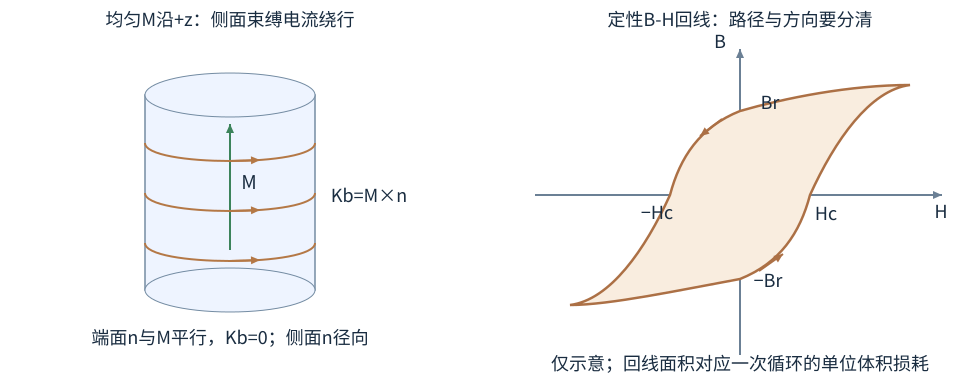
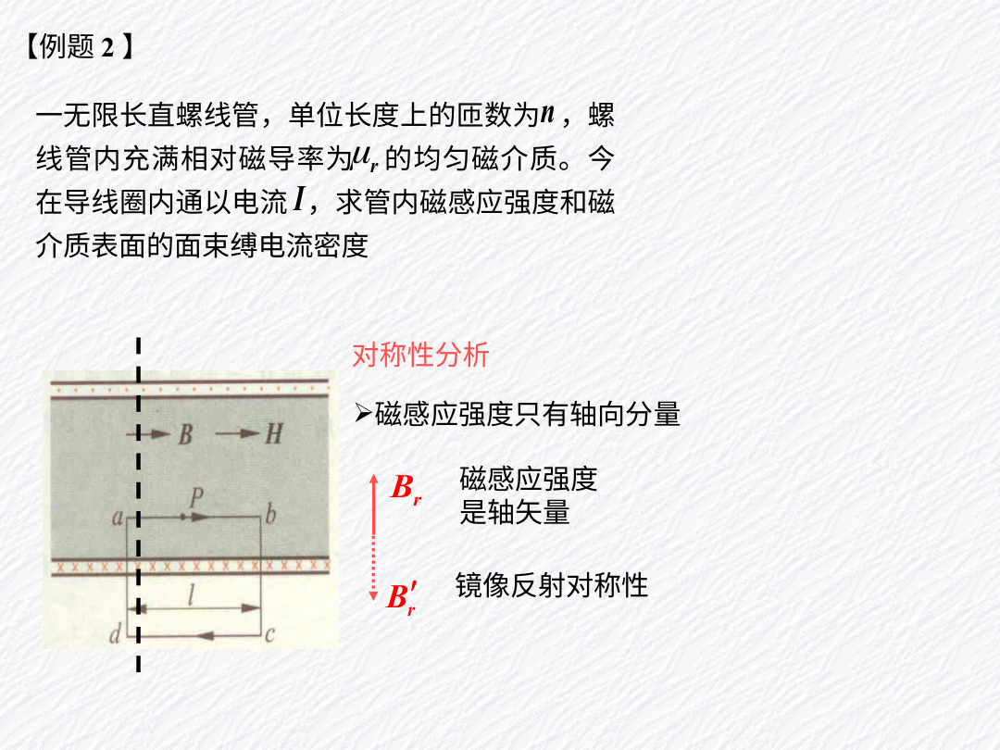

# 材料怎样改变磁场：从小磁矩到磁畴

把铁芯插入通电线圈，磁场常明显增强；换成铜、铝，变化小得多。它们并不是简单地“有磁性”或“没磁性”。电子的轨道和自旋产生磁矩，材料里这些磁矩如何组织，决定了整体响应。本章分别计算B、H、M，说明它们怎样联系自由电流与材料磁化。

## 先把自由电流与材料贡献分开计算

取一根理想长螺线管，每米1000匝，每匝通0.20A电流。先不放材料，管内磁场为$\mu_0nI=0.251$mT，方向沿线圈右手规则确定的轴向。现在在管内放入一根足够长的圆柱形磁化材料，假设已知其磁化强度沿同一轴向，大小800A/m。这里磁化强度是单位体积的磁矩，下面会把这一统计定义展开。

均匀轴向磁化圆柱的侧面等效于一层沿周向绕行的电流，面电流密度大小800A/m。这一层电流与螺线管电流同向，独自产生$\mu_0\times800\,\mathrm{A/m}=1.01$mT。总场是两部分相加，约1.26mT。这个模型中，电源导线承载的自由电流没有增加，材料内部磁矩的排列仍能增加B。

本例把M直接作为已知条件，目的是先区分两个源。实际材料中的M通常还取决于场、温度和样品形状；后面给出线性材料关系后，会用同一根线圈求出M，而不再预先指定它。

## 单个磁矩与磁化强度

平面电流环的磁矩为 $\boldsymbol\mu=IA\hat{\mathbf n}$。原子里的电子有轨道磁矩与自旋磁矩；用经典小电流环可以帮助理解方向，但不能据此把电子自旋解释成一颗带电小球真的在表面自转。

磁化强度 $\mathbf M$ 是单位体积的磁矩，单位A/m。许多小环内部相邻电流可相互抵消，边界留下等效的束缚电流。宏观表示为体束缚电流密度 $\mathbf j_b=\nabla\times\mathbf M$、面束缚电流密度 $\mathbf K_b=\mathbf M\times\hat{\mathbf n}$。K的单位A/m，表示每单位横向长度流过多少电流，并非通常A/m²的体电流密度。

左图M向上，侧面法向径向向外，所以M×n沿绕轴的周向；端面法向与M平行，叉乘0。图中的环状电流不是电子沿轴流动，而是许多微观磁矩在边界留下的等效电流。右图只画定性回线，纵横没有实验刻度，不能从这张示意图量出某种铁芯的材料常数。

对于轴向均匀磁化圆柱，体内旋度为0，侧面束缚电流沿周向绕行，整体效果像一层螺线管。圆柱两端会出现等效磁极的描述，但这只是求场工具，不是在宣布存在独立磁单极。

### 同样的M为何还需要形状和外加场

即使已给材料M，也还要考虑外加场与样品边界产生的退磁场。一个很长、沿轴均匀磁化圆柱和一个短扁圆盘，端部效应不同，内部H与B也不同。若未给自由源和形状，只有M通常不够求出各点场。

在线性椭球等特殊均匀模型中，可用退磁因子描述形状影响；一般形状则场不均匀。基础题直接给理想长螺线管，是为了让自由电流与对称性把H先确定下来，并不是所有材料都天然有H=nI。把这个几何公式当作H定义，换成开口磁芯或短线圈时就会失效。

## H把自由电流单独计数

定义磁场强度

$$\mathbf H=\frac{\mathbf B}{\mu_0}-\mathbf M.$$

这个定义从总电流的安培方程来：$\nabla\times(\mathbf B/\mu_0)=\mathbf j_f+\mathbf j_b$，代入$\mathbf j_b=\nabla\times\mathbf M$，把后项移左，就有$\nabla\times(\mathbf B/\mu_0-\mathbf M)=\mathbf j_f$。括号叫H，因此稳恒时$\oint\mathbf H\cdot d\mathbf l=I_{f,\text{穿}}$，只计自由传导电流。B的安培定律则计自由与束缚总电流。H单位A/m，B单位T，二者不是同一个量换了名称。

线性、各向同性材料可写 $\mathbf M=\chi_m\mathbf H$，于是 $\mathbf B=\mu_0(1+\chi_m)\mathbf H=\mu\mathbf H$，$\mu_r=1+\chi_m$。铁磁体常有非线性与历史依赖，μᵣ不一定是常数。把任何铁芯都直接指定一个巨大固定μᵣ，可能连数量级都不可靠。

## 抗磁、顺磁、铁磁：响应方向与历史不同

抗磁材料的诱导磁矩倾向于反对外加磁场，χm通常为小负值。顺磁材料的永久磁矩在外场中略偏向同向，χm为小正值，热运动与这种排列竞争。很多普通材料同时存在多种贡献，测到的是总响应。

铁磁材料中交换相互作用使局部磁矩协同排列，形成磁畴。未磁化样品里不同磁畴方向分散，整体M仍可能接近0。加场后磁畴壁移动、磁矩转向，总M明显增加。所谓“原来没有磁性、后来造出了磁矩”并不准确，很多变化来自已有磁矩重新组织。

外场反向扫回时，B或M不沿原路径返回，出现磁滞。外场降为0仍可保留剩磁；把磁化压回0需要反向矫顽场。软磁材料希望易磁化易退磁，硬磁材料希望保持磁化；用途不同，不能简单把“磁性更强”当成统一评价。

图源：《磁介质.ppt》兼容PDF第41页。图中矩形abcd跨越管内外，虚线是管轴。B、H沿轴向；从侧面绕行的磁化电流并未在这张轴剖图里画成一条轴向导线。矩形长边与场平行、短边垂直，正是把环路积分化简的几何理由。

### 升温时磁化响应怎样变化

在某些稀薄、局域磁矩且相互作用可忽略的顺磁模型中，热运动与外场取向竞争，弱场高温可得到χm随1/T下降的Curie趋势。温度升高，磁矩更难集体偏向场方向，响应变小。接近磁相变、强场饱和或不同电子机制时不再简单成立。

抗磁响应常来自外场诱导轨道变化，通常不需要原来就有永久磁矩。经典Lenz式方向直觉能帮助理解反向诱导，但精确量值与很多材料性质需要量子理论。不要把“电子有自旋”立刻推出所有材料顺磁，因为电子配对、能带与各贡献抵消都会影响总χ。

铁磁体高于居里温度可失去自发铁磁有序；这不是每个原子磁矩都凭空消失。比较显微局部磁矩与宏观磁化，是理解相变描述时很有用的一层区分。

## 算例一：填充线性介质的长螺线管

理想长线圈每米n=1000匝，电流I=0.20A，完全填充μᵣ=5的线性介质。自由电流决定 $H=nI=200$A/m。B=μ₀μᵣH，约1.26mT。M=(μᵣ−1)H=800A/m，圆柱侧面的等效束缚面电流密度大小也是800A/m。

真空线圈的B约0.251mT，材料贡献为约1.01mT，总和与上述结果一致。这里μᵣ=5是题目给定的线性模型；若线圈改用接近饱和的铁芯，需要材料实际B—H曲线，不能继续把它当常数。

## 算例二：环形芯里内侧和外侧场不同

环形线圈N=500匝，电流0.10A，平均半径0.10m，芯材μᵣ=100且假设线性。半径r处 $H=NI/(2\pi r)$。在0.09m处约88.4A/m，在0.11m处约72.3A/m，对应B约11.1mT与9.09mT。

若直接用平均半径，会得10.0mT左右。这个近似能否接受，要看允许误差；厚芯的场不均匀不应在图上画成处处一样。若有很窄空气隙，磁压降还会集中在空气隙，不能只把整圈都乘相同μᵣ。

## 介质界面要分法向B与切向H

由无磁单极，$B_{2n}=B_{1n}$。由跨界面窄环路，$\hat{\mathbf n}\times(\mathbf H_2-\mathbf H_1)=\mathbf K_f$，Kf为自由面电流。没有自由面电流时切向H连续。不要把电介质那一章的D、E规则直接换字母却换错分量；这里通量守恒的是B，环路计自由源的是H。

一块高磁导率铁芯与空气相接，如果法向B相同，铁内H通常远小于空气中H。磁路中小气隙可能需要很大的磁动势，来自空气μ小，不是因为磁通在气隙凭空断掉。

### 实际计算一次切向分量

两种线性磁介质界面无自由面电流，H切向连续。假设H₁t=100A/m，μr₁=2、μr₂=5，则H₂t仍100A/m，但B₁t=μ₀×(200A/m)≈0.251mT、B₂t=μ₀×(500A/m)≈0.628mT，切向B不同。若另看法向B，则B₁n=B₂n，H法向可以不同。

若要从B/H互换，先写各自的单位：B=μH，μ的单位T/(A/m)，所以μ₀×(200A/m)得到T，而“200μ₀ T”会把特斯拉又乘一次。法向B连续来自无磁单极的薄盒；切向H连续来自无自由面电流的窄环路，几何操作与第6章相同，但通量场和环流场的名字换了。

因此“过界面场不连续”太笼统，必须说哪个量、哪个分量、界面有什么自由源。电介质的D/E和磁介质的B/H都使用这一套明确提问法，记两组分量比记许多互相冲突的口号容易。

## 超导的零电阻与排磁要分别说

超导态具有零直流电阻和Meissner排磁效应。零电阻意味着持续电流可以无焦耳耗散地存在；Meissner效应表示材料冷却进入合适超导态后，体内磁场被排出至很薄的穿透层。只说“电阻等于0”无法完整推出不同降温路径下相同的排磁平衡。

实际超导体有临界温度、临界磁场和临界电流等限制。I类在相应条件下近乎完全排磁；II类在一定场区间可进入混合态，磁通以涡旋形式穿入，因此“所有超导体内部永远严格B=0”过于粗糙。

超导环里的磁通量子化来自量子态相位条件。常用磁通量子大小 $\Phi_0=h/(2e)\approx2.07\times10^{-15}$Wb，2e来自常规超导凝聚对的电荷。它不能被解释成任意一个普通铜环也只准有整数个磁通量子。

### 悬浮与持续电流分别需要什么条件

理想排磁响应会重新分布表面电流，可产生把磁体推开的力；II类超导还可能有磁通钉扎，使位置稳定性具有记忆与特定约束。真实悬浮演示应说明材料与冷却历史，不能把所有现象压成一块普通永磁体的同极相斥。

一个持续超导电流也仍会储磁场能量。若外部做功改变环几何或磁通，能量与电流可能调整；零电阻表示无相应电阻热，不意味着改变状态不需要能量。讨论任何“永久电流”时，分清保持不衰减与持续对外供功两种命题。

## 算例三：排磁球为什么不是“球内外都没场”

理想完全排磁球置于远处均匀外场中，球体内B近似为0，但球外磁场会被表面屏蔽电流重新分布。远处仍趋于原来的均匀场，靠球面有磁场绕开的变化。仅由“球内B=0”不能把整个空间B都设为0。

若某个闭合面完全包住球，磁通仍为0，这一事实对有没有球都成立，因此不能仅凭零总磁通证明排磁。检测排磁需要看局部场分布或磁化响应。这个例子也提醒：积分定理给出的总量，与材料的具体状态不是同一种信息。

## 磁滞回线的面积在量什么

对可逆线性材料，磁能密度可写BH/2。铁磁材料经历一整次磁化循环时，磁化路径有历史依赖，循环中外部做的净功可表现为单位体积损耗，与B—H回线所围面积 $\oint H\,dB$ 对应。面积单位A/m×T=J/m³，恰是能量密度。

读右图时从右上方大正H开始，沿箭头把H减到0，B仍是正Br，这个纵轴截距是剩磁；继续施负H，到横轴左截距−Hc才有B=0。随后从负大H反扫，走下支，到H=0时B为负，再到+Hc才回到0。把上下两支混成一条B(H)单值曲线，会把“相同H可有不同B”的历史依赖丢掉。

面积$\oint H\,dB$可把小条看成“横坐标H乘竖向增量dB”相加；一个来回以后，场和磁化恢复初态，仍需补入的净能量进入损耗。对单调升降两支分别积分再相减，才是围起来的面积，不是简单Br×Hc的矩形近似。

若一个芯材回线面积约100J/m³，芯体积1.0×10⁻⁴m³，每秒循环50次，单计磁滞损耗约0.50W。真实铁芯还可能有涡流等损耗，不能把回线面积算出来就宣布全部发热都解释完。

薄片叠芯主要抑制涡流大回路，选低矫顽力软磁材料主要降低磁滞损耗。两种改进针对不同物理机制，不能说“叠片使磁滞消失”，也不能靠“软磁材料电阻大不大”单独判断一切损耗。

## 有气隙的环形铁芯：小间隙为什么重要

设环形铁芯磁路长度ℓ铁、磁导率μ铁，串有空气隙长度g，截面积近似相同，忽略漏磁和边缘扩散。B法向近似连续，故铁与气隙用近似同一B。安培环路给

$$NI=H_{\text{铁}}\ell_{\text{铁}}+H_{\text{气}}g=B\left(\frac{\ell_{\text{铁}}}{\mu_{\text{铁}}}+\frac g{\mu_0}\right).$$

若μr=1000、ℓ铁=0.20m、g=1mm，则铁部分等效空气长度0.20mm，气隙却1mm，比铁部分大5倍。虽然几何上气隙很短，它占主要磁动势降。这个例子解释了磁路比喻中“磁阻”的来源，但漏磁和非线性存在时要回到场或实际磁化曲线。

若把NI保持不变而增大气隙，B通常下降；若把B要求固定，必须增加NI。这和电容几何变化时先交代固定Q或固定U一样，保持量影响比较结论。

## 两个练习

练习一：某线性材料χm=−0.00002，外部条件使内部H=1000A/m。求M方向和B大小，并判断是否超导。

解：M=χmH=−0.020A/m，与H相反；$B=\mu_0(1-0.00002)1000\approx1.2566$mT，略小于真空同H值。负χ只说明抗磁响应，并不意味着完全排磁；这个数离理想强排磁响应很远，不能据此称超导。

练习二：铁磁体外场H回到0，B是否一定为0？若不为0，是否违反B=μH？

解：可以有剩磁Bᵣ。常数比例式B=μH只适用于假设的线性无历史模型，不能描述铁磁磁滞。更一般恒有B=μ₀(H+M)，H=0而M保留时B仍可非零；违反的是错误套用的模型，不是定义关系。

材料参数表里的磁导率还可能指初始、最大或某工作点的微分值。若题目给了完整B—H图，应从相应工作点读值，不能拿另一个位置斜率替代。
