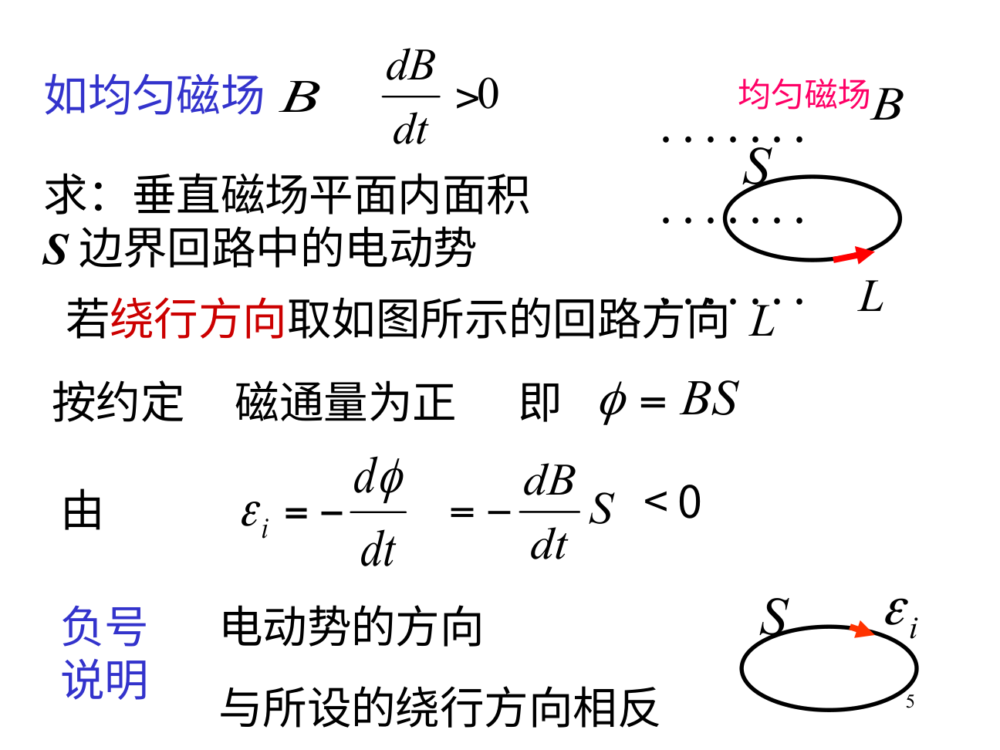
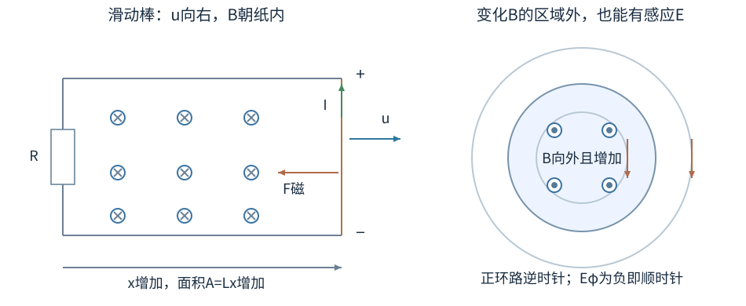
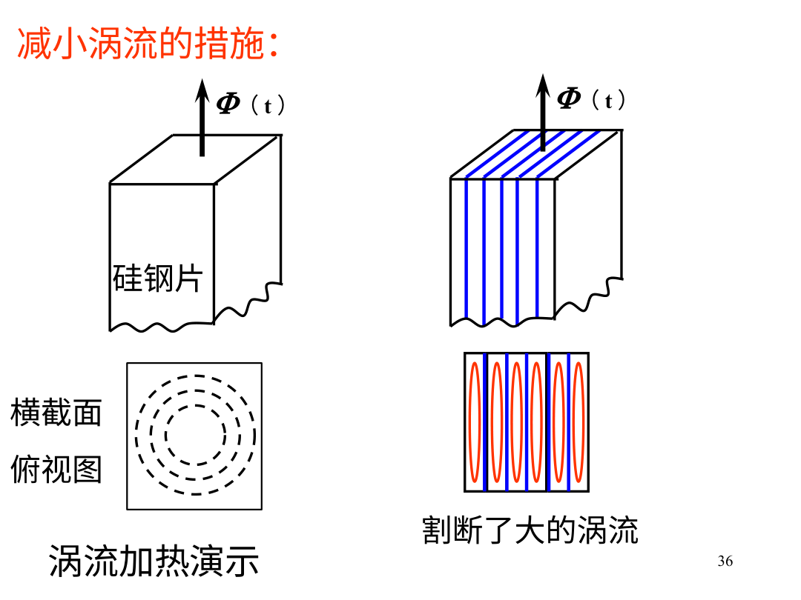

# 磁通在变时，先约定方向，再判断电动势

移动导体棒可以发电，固定线圈旁的磁铁移动也可以发电。两种装置都能让磁通变化，产生电动势的局部机制不同。做题时先认清线圈有没有动，再写磁通、方向与能量，能避免把所有现象都塞成一句“切割磁感线”。

## 磁通有正负，线圈匝数不藏进面积

先取一个面积0.010m²的单匝平面回路。磁场垂直纸面朝外，大小0.20T。我们选逆时针为回路正向，右手四指沿这个方向弯曲时拇指朝纸外，便把朝外定为面积法向。磁场与法向同向，穿过回路的磁通是$+0.20\times0.010=+0.0020$Wb；把B反向，磁通是−0.0020Wb。回路没有转动时，正负只反映磁场穿过所选面的方向。

若B仍朝外，在0.10s内从0.20T均匀增加到0.22T，磁通增加$0.00020$Wb，变化率为$+0.0020$Wb/s。法拉第实验给出的感应电动势为这一变化率的负值，即−0.0020V：实际驱动方向是顺时针。用这一具体方向作为参照，再写一般式。

选定回路正向，用右手规则配对曲面法向。磁通 $\Phi_B=\int_S\mathbf B\cdot d\mathbf S$，单位韦伯Wb=T·m²。平面回路处在均匀场中，才可简化为 $\Phi_B=BA\cos\theta$，θ是B与面法向夹角。

N匝相同线圈的磁链为 $\Psi=N\Phi_B$。如果每匝磁通不同，要把各匝分别相加，不能一概乘N。线圈本身面积A与匝数N是两件事：把A也乘N、公式外面再乘N，会重复计数。

固定回路的法拉第定律为

$$\mathcal E=\oint_C\mathbf E\cdot d\mathbf l=-\frac{d\Phi_B}{dt}.$$

这里的E包含感应电场；它的环流可以不为0，所以不能为整个感应场定义一个与路径无关的静电势。负号的方向含义由事先选好的环路与法向读出。

原图来自《电磁感应.ppt》PDF第5页。黑点表示B朝纸外，且B增强。上图红箭头选了一个回路正向，对应朝外正法向；于是磁通变化率为正，算出的电动势为负，实际驱动方向与所选正向相反。看图时先找黑点、再找参考红箭头，不能直接把下图的箭头当成任意题都适用的方向。

## 算例一：固定线圈里磁场增强

圆线圈N=50匝，半径r=0.10m，总电阻R=5Ω，均匀B垂直纸面向外，变化率0.20T/s。选逆时针为回路正向，法向朝外，$d\Phi/dt=\pi r^2dB/dt>0$。电动势

$$\mathcal E=-N\pi r^2\frac{dB}{dt}\approx-0.314\,\mathrm V.$$

实际电流顺时针，大小约0.0628A。顺时针电流产生朝纸内磁场，反对原磁通的增加。若B向外但正在减小，感应电流反而逆时针，试图维持向外磁通。楞次定律反对的是磁通的变化，不是无条件反对原来的磁场。

这个电流值忽略线圈自感；若变化很快、自感不可忽略，应写含 $L\,di/dt$ 的电路方程。先说明模型，才知道什么时候能用I=ε/R。

## 运动导体：磁力先把电荷分开

一根导体棒以速度u运动，内部载流子随棒运动，受到 $q\mathbf u\times\mathbf B$。正负电荷向两端分离，形成电场。开路稳定时棒内满足 $\mathbf E+\mathbf u\times\mathbf B=0$，两端出现电势差。若棒、u、B互相垂直，大小为BLu。

运动回路更一般地写

$$\mathcal E=\oint_{C(t)}(\mathbf E+\mathbf u\times\mathbf B)\cdot d\mathbf l=-\frac{d}{dt}\int_{S(t)}\mathbf B\cdot d\mathbf S.$$

右边的导数既包括场随时间变，也包括面积与方向随回路运动变。固定回路的 $\oint\mathbf E\cdot d\mathbf l$ 不能不加运动项就拿来描述滑动棒。

## 算例二：导轨上的棒与外力功

左图固定导轨在上下，棒在右侧，电阻闭合左侧。取逆时针为正回路，正法向朝纸外；实际B朝纸内，因此磁通是−BLx，不是+BLx。棒向右，x增大，磁通变得更负，$d\Phi/dt=-BLu$，故$\mathcal E=+BLu$沿逆时针，右棒中正电流向上。再做$\hat{\mathbf y}\times(-\hat{\mathbf z})=-\hat{\mathbf x}$，磁力朝左，楞次方向与载流导线叉乘相符。

两平行导轨间距L=0.20m，滑动棒向右以u=3.0m/s运动，B=0.50T朝纸内，总电阻R=2.0Ω。回路面积随时间增加，纸内磁通绝对值增加。按楞次方向，电流应产生纸外场，因此从纸外看电流逆时针；棒中电流向上。

运动电动势大小BLu=0.30V，电流0.15A。棒受磁力大小 $F=BIL=0.015$N，方向向左，阻碍运动。若保持匀速，外力需向右0.015N，功率 $Fu=0.045$W。电阻热功率 $I^2R=0.045$W，恰好相等。

磁力对单个自由电荷的瞬时功率仍为0，机械能经外力维持导体运动、通过电磁作用传到电路。不能因为“磁力不做功”就认定磁发电机违反能量守恒；这里计算的是整根棒与载流子、电场之间的能量交换。

## 不闭合也可能有电压，闭合才谈持续回路电流

开路棒中可以产生端电压，但电荷分离达到平衡后不持续输出回路电流。开路线圈有感应电动势，也不意味着电流就是ε除以某个随手写的零电阻。电动势描述驱动能力，电流还依赖闭合路径、阻抗和初始状态。

在有感应场的空间中，用不同路径接电压表，测到的结果可能因引线包围的变化磁通而不同。此时必须说明测量回路，不把所有电压都当作某两点唯一的静电势差。

### 单根棒的端电压与整个测量回路

磁通定律天然针对闭合回路。只有一根移动棒时，可直接沿棒积 $\mathbf u\times\mathbf B$ 求运动分离作用，再用开路平衡求端电势差。如果为了用面积变化法补一条想象返回路径，要检查补充部分是否运动、是否有电场贡献，保证整个闭合积分与真正测量电路对应。

例如棒平移时两端接一个静止高阻电压表，引线怎样布置会决定所围回路面积如何变。若整个闭合框连同电压表一起在均匀B中匀速平移，净磁通不变，整回路电动势可为0，尽管某一段棒内部仍有电荷分离效应。局部端电压、沿运动导体的电动作用和整个闭合回路电动势，不能无条件视为同一个数。

## 算例三：转动线圈的交流电动势

N匝面积A的平面线圈，在均匀B中绕位于线圈平面内、且垂直B的轴匀速转动。设t=0时法向与B同向，以恒角速率ω转动，因此$\theta=\omega t$，磁链$\Psi=NBA\cos(\omega t)$。cos求导变−sin，再乘内部ω，最后Faraday公式前面还有一个负号，所以

$$\mathcal E=NBA\omega\sin(\omega t).$$

N=100、A=0.010m²、B=0.20T、转速50圈/s时，$\omega=2\pi\times50$rad/s，电动势峰值约62.8V。有效值对正弦波为峰值除以√2，约44.4V；平均值在完整一周期为0，不能用平均值0断言没有发电功率。

法向与B平行时磁通最大，但该瞬间变化率为0，电动势为0；线圈平面与B平行时磁通过零，变化最快，电动势达到峰值。“磁通大”与“变化快”是两种读图信息。

### 把磁通图逐段转换成电动势图

若Φ(t)是一条直线上升，ε为恒定负值；若Φ是正弦，ε与它相差四分之一周期；若Φ在某时刻有极大值，斜率0，该刻ε=0。不要拿纵坐标Φ最大的位置当成ε最大。

若图画的是分段直线，拐点两边的斜率可跳变，ε在理想化里也会跳。磁通连续并不保证导数连续。若Φ突然不连续，模型会要求冲击式巨大电动势，现实装置中变化速度和寄生效应会限制；题目若只给理想分段函数，要按其数学意义并说明瞬态。

举例Φ=at²，a>0，t≥0，则ε=−2at，方向保持负、绝对值线性增加。Φ=Φ₀−at²时ε=+2at，磁通即便仍为正，电动势也与前例反向，因为变化趋势相反。这个最小图像练习能检验你是否真正围绕导数而非原B方向判断。

## 感应电场：导线不是它存在的前提

圆柱区域内均匀B随时间变化，圆周对称允许对同心半径r环路求感应E。若变化磁场只分布在半径R内，r<R时

$$E_\phi2\pi r=-\pi r^2\frac{dB}{dt},\qquad E_\phi=-\frac r2\frac{dB}{dt}.$$

r>R时包围磁通只到R，$E_\phi=-R^2(dB/dt)/(2r)$。例如R=0.10m，向外B以0.20T/s增加。取逆时针为Eφ正向，r=0.050m时Eφ=−0.0050V/m；r=0.20m时Eφ=−0.0050V/m，两处都顺时针。后者虽然位于变化B的区域外，环路仍包着$\pi R^2$面积内的变化磁通。两数恰相同只是选定半径的结果，不表示内外场普遍等大。

外部即使局部B近似为0，也可存在感应电场。必须依据包围磁通来积分，不能见观察点处B=0便说E=0。

金属块中的感应场可驱动绕圈涡流，造成热与阻尼。变压器铁芯用绝缘薄片叠成，是为了切断大面积闭合电流路径、降低涡流损耗；并不是为了让每片内部完全没有感应场。

### 把导线换成一个受约束的粒子

仍取前例，在讨论的一整圈运动期间保持$dB/dt=0.20\,\mathrm{T/s}$恒定。r<R时$E_\phi=-(r/2)dB/dt$，此时感应电场不随时间变。在半径r的圆形轨道上，粒子切向电场力为qEφ；若沿约定的逆时针正向绕行一圈，电场功为$q\oint\mathbf E\cdot d\mathbf l=-q\,d\Phi/dt$。取r=0.050m、q=e，结果为$-e\pi r^2(0.20\,\mathrm{T/s})\approx-2.52\times10^{-22}\,\mathrm J$，负号说明电场阻碍这一次逆时针运动；同一恒定场中若顺时针走一圈，功反号。

这里不要求预先有一圈金属导线，导线只是提供可流动电荷和路径约束。还要分清两种积分：Faraday环流在同一时刻沿整个闭合路径取场；真实运动的功沿粒子先后到达的位置与时刻累计。若dB/dt也随时间改变，一圈中的E就会变，应计算$\int q\mathbf E(\mathbf r(t),t)\cdot\mathbf v(t)dt$，不能将某一时刻的环流直接乘q当作整圈实际功。

感应电场线可成闭合环，静电场线则不能在无奇异稳恒静电条件下形成非零环流的闭圈。把“电场线总从正电荷出发、到负电荷结束”只适用于单纯静电图景，不覆盖所有时变电场。

图源：《电磁感应.ppt》兼容PDF第36页。左图横截面的大闭合虚线表示整块铁芯内可能形成的涡流；右图蓝色绝缘分层把大回路切开，下方红线只在各薄片里绕小圈。图中向上的Φ箭头表示穿过截面的磁通方向，不能当作电流方向。

## 转动导体棒不是每一小段都以同一速度运动

长度L的棒在均匀B中绕一端、以角速度ω在垂直B的平面转动。距转轴r的小段线速度u=ωr，方向与棒垂直；运动磁力沿棒，微小电动势 $d\mathcal E=B\omega r\,dr$。从0积到L得

$$|\mathcal E|=\int_0^LB\omega r\,dr=\frac12B\omega L^2.$$

若把末端速度ωL乘整根长度L，会多一倍，因为靠轴处速度更小。取B=0.20T、ω=100rad/s、L=0.30m，电动势0.90V。哪端电势高，需按ω方向和B做u×B逐点判断。

若B与角速度ω都沿+z，棒在某瞬间沿+x，则它每个点速度沿+y，$\mathbf u\times\mathbf B$沿+x，把正电荷推向远端。开路平衡电场朝−x，故远端相对转轴的电势差$V(L)-V(0)=-\int_0^L E_rdr=+\int_0^LB\omega r\,dr$，远端电势更高。方向与积分中的正负都已确定，而不是只报0.90V大小。

若棒绕中心转，两半末端相对于中心可能同为高势或同为低势，对称两端之间电势差可能为0。不能只把棒全长塞进“绕一端”的公式；首先认转轴和积分上下限。

## 磁场不均匀时，磁通积分不能偷换成BA

矩形回路宽w、沿x从x₁到x₂，垂直纸面的场为Bz(x)=bx。磁通 $\Phi=w\int_{x_1}^{x_2}bx\,dx=bw(x_2^2-x_1^2)/2$。若整个回路以u向正x平移，宽度ℓ=x₂−x₁不变，两个边界都变，求导得 $d\Phi/dt=bw\ell u$。

回路面积没有改变，局部场也不显含时间，仍因回路移入更强场区而有感应。写成−A dB/dt却不说明B是哪一点，就容易把这个效应漏掉。用运动项逐边积分，靠两条竖边的BLu贡献不等，相减也能得到同样结果。

## 涡流制动与能量守恒

导体板进入局部磁场、或磁铁在导管中下落，磁通变化产生涡流，涡流反过来产生阻碍相对运动的力。机械能经感应转成热，使运动衰减。力方向不是材料“记得之前位置”，而是楞次负反馈与电阻耗散共同结果。

若把导体切缝，闭合大电流路径受阻，制动往往减弱。教师《电磁感应.ppt》PDF第36页的叠片示意图，上方画分片方向，下方俯视显示原大涡流被分割为较小回路。蓝色片间绝缘要沿能切断大环流的方向安排；随便在任何方向切一刀不一定达到相同效果。

超导环电阻近0时，感应电流可主要建立并维持磁通约束，过程可能以储能而非普通焦耳热为主。看到“感应”不能自动把全部能量都算成I²R热；先看回路中电阻、电感和外部机械边界。

## 练习与解答

练习一：均匀磁场B=0.40T，矩形线圈面积随时间以 $dA/dt=-0.020$m²/s缩小，法向与B同向，单匝电动势是多少？方向如何解释？

解：磁通导数B dA/dt=−0.0080Wb/s，电动势为+0.0080V，沿预定正回路。它产生同向B，补偿正在减少的原磁通。题目中B没有随时间改变，仍因面积改变产生感应，说明只写−A dB/dt会遗漏运动效应。

练习二：理想滑动棒电阻不变，匀速u变成2u，电流、阻力和外力功率分别变多少？

解：ε=BLu变2倍，I变2倍，磁阻力BIL变2倍，功率Fu变4倍。热功率I²R也变4倍，两种功率计算一致。若外力保持不变而非速度保持不变，速度会随动力学演化，不能继续假定u任意翻倍。

若回路电阻也随运动改变，I=ε/R中的R应使用当时的回路总值，动力学阻力可能不再简单正比速度。先列ε(t)、R(t)与运动方程，再判断是否还有指数解。

线圈匝数、总电阻和面积应逐项核对，尤其多匝绕组不能只增加电动势却始终假定导线电阻完全不变，除非题目已经明确给定总R。
