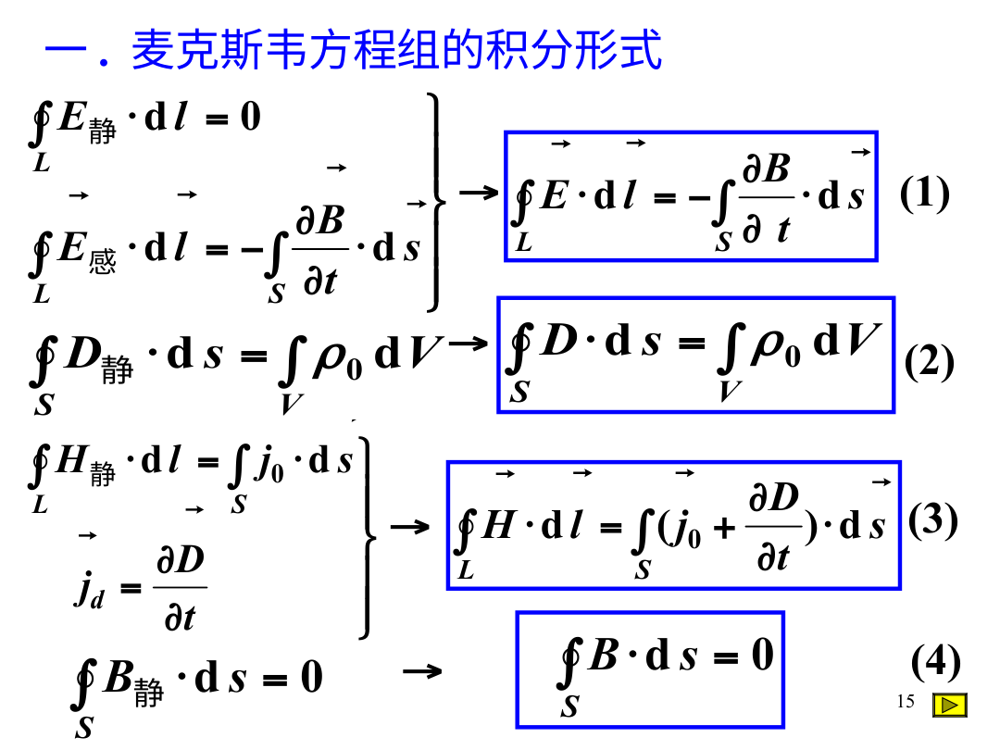

# Maxwell方程：电容间隙没有导线，磁场为什么还接得上

给平行板电容充电时，导线中有传导电流，极板间的绝缘空隙却没有相同电荷流过去。如果只用旧的稳恒安培定律，同一个环路换两张曲面，可能算出两个不同磁场。解决这个问题需要把变化电场也纳入环路账，而不是坚持“没有导线就没有任何磁效应”。

## 位移电流怎样修补连续性

导线电流给电容极板增加电荷，$I=dQ/dt$。理想平行板中 $D=Q/A$，所以穿过间隙面积的电位移通量为Q，对它求导同样得到I。定义位移电流密度 $\mathbf j_D=\partial\mathbf D/\partial t$，修正环路式为

$$\oint_C\mathbf H\cdot d\mathbf l=I_f+\frac d{dt}\int_S\mathbf D\cdot d\mathbf S.$$

曲面穿导线时主要计自由传导电流，鼓进电容间隙时主要计位移电流。两者给同一环路相同结果。位移电流不是断言真空中有电子跨板飞过，它是变化D对磁场的贡献，单位仍为安培。

图源：《电磁场.ppt》兼容PDF第15页。四个蓝框从上到下是感应环流、D通量、含位移电流的H环流、零磁通。第一和第三框积分路径为闭线，第二和第四框为闭面；把所有积分号都画成同一种面，会丢掉方程各自约束的几何对象。

## 四条方程逐条读

在宏观介质描述中，对固定曲面与固定环路，Maxwell方程积分形式为

$$\oint_S\mathbf D\cdot d\mathbf S=Q_f,\qquad\oint_S\mathbf B\cdot d\mathbf S=0,$$

$$\oint_C\mathbf E\cdot d\mathbf l=-\frac d{dt}\int_S\mathbf B\cdot d\mathbf S,$$

$$\oint_C\mathbf H\cdot d\mathbf l=I_f+\frac d{dt}\int_S\mathbf D\cdot d\mathbf S.$$

第一条记录自由电荷与D通量；第二条记录磁通没有单极源；第三条说变化磁通产生环形电场；第四条说自由电流和变化D通量产生环形H。第三条的负号必不可少，教师第五版勘误表第47条专门补上了它。

还需要材料关系才能闭合问题，例如真空D=ε₀E、B=μ₀H，欧姆材料j=σE。方程不是只给出四个口号就能解一切；电荷、电流、材料、初始条件与边界条件必须具体给定。

## 算例一：充电圆极板间的磁场

圆形极板半径R，电荷均匀增加，充电电流I，忽略边缘。取板间半径r<R的同心圆环。极板间均匀D变化，所包位移电流为 $I_D=Ir^2/R^2$。真空中B沿环向且大小恒定，故

$$B(r)=\frac{\mu_0Ir}{2\pi R^2},\qquad r<R.$$

r>R时包围全部位移电流I，得 $B=\mu_0I/(2\pi r)$。R=0.10m、I=0.20A，在r=0.05m处B= $2.0\times10^{-7}$T。场沿同心圆切向，不朝极板法向；教师勘误第92条提醒的就是这种方向。

真实极板附近有边缘场，这个均匀模型在接近边缘处有近似误差。对于电流变化快得使尺寸与波长可比的装置，还要考虑传播延迟，不能始终把整个电容视为同一时刻同步。

## 变化电场和变化磁场怎样组成波

在均匀、线性、无自由电荷无电流的区域，取波沿x传播，E沿y、B沿z。Maxwell方程让E的空间变化与B的时间变化相联系，也让B的空间变化与E的时间变化相联系。再求一次导数并消去另一个场，可得

$$\frac{\partial^2E_y}{\partial x^2}=\mu\epsilon\frac{\partial^2E_y}{\partial t^2}.$$

这是波动方程，波速 $v=1/\sqrt{\mu\epsilon}$。真空中v=c≈ $3.00\times10^8$m/s。像 $E_y=E_0\cos(kx-\omega t+\phi)$ 这样的函数满足方程，要求ω/k=v。k=2π/λ是波数，ω=2πf是角频率；别把电学库仑常数k也带进来。

单个理想行进平面波中，E、B与传播方向两两垂直，E和B同相，$E_0=vB_0$。传播方向由E×B给出。这些结论属于这种平面行波，驻波、近场或多波叠加处不一定还能说E和B处处同相、幅值比处处固定。

## 算例二：补齐电磁波的三个箭头

一束真空平面波向x正向传播，某时某处E沿y正向，幅值E₀=300V/m。要使E×B朝x正向，B必须沿z正向，因为y×z=x。B幅值 $B_0=E_0/c=1.0\times10^{-6}$T。

频率f=100MHz时，波长λ=c/f=3.0m，角频率约 $6.28\times10^8$rad/s。若把相位写成kx+ωt，等相位点随时间往负x移动，传播方向与题目相反；相位里的加减号可以用“固定kx−ωt”求x(t)来判断。

## 能量密度与Poynting矢量

真空电场能量密度 $u_E=\epsilon_0E^2/2$，磁场能量密度 $u_B=B^2/(2\mu_0)$。理想平面行波E=cB，使两者相等。能流密度

$$\mathbf S=\mathbf E\times\mathbf H=\frac1{\mu_0}\mathbf E\times\mathbf B,$$

单位W/m²，表示每秒通过单位垂直面积的能量。对正弦波，平均强度 $I=\langle S\rangle=\epsilon_0cE_0^2/2$；若用的是有效值 $E_{\text{rms}}=E_0/\sqrt2$，则没有额外二分之一。

电磁能量守恒还可写成局部形式 $\partial u/\partial t+\nabla\cdot\mathbf S=-\mathbf j\cdot\mathbf E$。右边是场对物质做功的功率密度。导线电阻发热时，电能经周围电磁场流入耗散区，不必想象“能量一定只能装在单颗电子里沿线跑”。

## 算例三：光照、接收功率与辐射压

均匀光束强度I=1000W/m²，垂直照到面积A=0.020m²的完全吸收板。接收功率IA=20W。每份光能携带动量，完全吸收时辐射压p=I/c，约 $3.33\times10^{-6}$Pa，力pA约 $6.67\times10^{-8}$N。

若完全镜面反射且正入射，动量反向，压强变成2I/c。若斜入射，投影面积与法向动量变化都要重新考虑，不能保持同一力值。反射增强压力来自动量变化加倍，不是平板吸收了双倍能量；理想镜面可几乎不吸收能量，却承受力。

由强度还可反求电场幅值，$E_0=\sqrt{2I/(\epsilon_0c)}$，I=1000W/m²时约868V/m。这个振荡场的瞬时值正负交替，不能把它当成长期固定朝一个方向的静电场。

## 频谱、介质和近似条件

无线电、微波、红外、可见光、紫外、X射线都是电磁波，不同名称主要按频率或产生机制区分。介质里波速v=c/n，单色波穿过静止界面时频率连续、波长改变为λ₀/n；光子能量hf随频率，不因进入介质就简单变成原来的n倍。

材料可能色散、吸收、各向异性，n会依赖频率与偏振。课程里先用透明、无耗、均匀线性介质建立基本模型，碰到真实材料数据再逐项修正。

## 把波动方程的两次求导写出来

设E沿y、B沿z、只依赖x和t。在真空无源区，Faraday方程给 $\partial E_y/\partial x=-\partial B_z/\partial t$；安培—Maxwell方程给 $-\partial B_z/\partial x=\mu_0\epsilon_0\partial E_y/\partial t$。第二式的负号来自旋度y分量，而非手动补来配结果。

对第一式再求x导数，得 $\partial_x^2E_y=-\partial_t\partial_xB_z$。把第二式的 $\partial_xB_z=-\mu_0\epsilon_0\partial_tE_y$ 代入，两个负号抵消，得到 $\partial_x^2E_y=\mu_0\epsilon_0\partial_t^2E_y$。这一步说明电场和磁场的互相变化能支持传播形式。

再取 $E_y=E_0\cos(kx-\omega t)$，由第一式匹配可得 $B_z=(k/\omega)E_0\cos(kx-\omega t)=E_y/c$。若B选了相反号，能流方向也反了，应同时检查相位传播方向与E×B，不让两者各说各话。

## 波动、源与传播延迟

“变化E产生B、变化B产生E”是方程的局部联系，不能理解成两个波互相追着、谁先谁后在真空里自己无限放大。给定初始与边界条件，整个场共同满足波动方程，幅度与能量由源输入和传播决定。

源突然变化后，远处不会瞬间收到所有新信息。电磁扰动以有限速度传播。电路尺寸远小于相关波长、传播时间远小于变化时间时，可以把元件当作集总R、L、C；频率高、导线长时，传输线与辐射效应会重要。把每段导线始终当“同一个瞬时节点”也有近似范围。

例如长1m导线的真空传播时间尺度约3.3ns，若信号变化在毫秒级，延迟通常可忽略；若上升沿在1ns量级，就不能仅靠频率标签说它仍是简单静态节点。实际介质中的传播速度还会降低。

## 频率改变与强度改变在光子图景里不同

平面波平均强度I给每秒每平方米能量通量，频率f给单光子能量hf，因此单色光子通量 $\dot N/A=I/(hf)$。相同I下频率越高，每颗光子越贵，数量通量越少；相同f下I翻倍，数量通量翻倍。

若某束λ=600nm、功率1mW的光，单光子约 $3.31\times10^{-19}$J，数率约 $3.0\times10^{15}$个/s。这个数率是平均统计量，不是规定每一秒绝无涨落。后面光电效应与激光都要区分光子能量、数率和模式相干性。

## 原课件的激光冷却例子怎样接到动量

教师《电磁场.ppt》PDF第29页用反向传播、红失谐激光说明原子更容易吸收迎面光子。吸收带来单个光子动量h/λ，方向沿光传播，因此对朝激光迎面运动的原子有减速作用；随后自发发射的方向平均较分散，许多次循环可形成速度相关阻尼。

一次吸收改变原子动量的量级是h/λ，若原子质量m，速度改变量约h/(mλ)。这不是所有原子温度能无上限降到0的完整理论，随机反冲、能级与激光配置会给冷却极限和条件。这里的用途是把电磁动量从“辐射压公式”接回可见的粒子受力机制。

## 边界处的场反射，别只给折射率一个箭头

平面波遇界面，切向E与H的边界条件要由入射、反射、透射三束共同满足。由此得反射透射幅度与偏振依赖。相同折射率近似匹配时反射可小；折射率突变通常会有反射，不能把光波画成只有一束折过去就完成能量分配。

无吸收平面界面应满足法向平均能流守恒：入射功率分成反射与透射。透射强度不是普遍等于透射电场振幅比的平方，还含介质阻抗与传播角等因子。它与量子散射中“透射概率比较概率流”的提醒形式类似：振幅是中间变量，物理通量另有权重。

## 电磁波的电场平均为零，平均能量却不为零

正弦场E=E₀cosωt，在一周期内正负面积相消，平均E=0；能量含E²，平均cos²=1/2，故平均能量正。拿“电场平均0”推出“不产生任何光压、没有加热”是把一阶平均与平方平均混用。

电阻受到交变场时，欧姆模型j=σE，功率密度j·E=σE²，始终不小于0，正负半周都可发热。导线中电子位移可能只是来回的小振荡，能量却持续从源流入热。这与第08章“电子不必沿电路跑完一圈”互相补足。

## 驻波与行波要区分

两束等强反向平面波叠加可形成驻波。某些位置电场幅度大、磁场幅度小，另一些位置相反，E与B的时间相位也可不再相同。总平均净能流可为0，但空间储存着交替变化的电磁能量。

因此测某点E很大不能普遍用I=ε₀cE₀²/2推断该处有同样大小单向传播功率；这条强度式针对单个行进平面波。微波腔、反射近场中先确认波形，再用Poynting矢量直接计算能流更可靠。

## 真空光速公式不是靠单位碰巧拼出来

1/√(μ₀ε₀)具有速度单位，这只能说明它有资格是候选尺度。真正证明它是电磁扰动传播速度，要由Maxwell方程导出波动方程并读出系数。量纲分析能检查和猜测关系，不能确定所有无量纲系数或替代动力学推导。

同样，电场能量密度εE²的单位正确，不足以自动证明前因子是1/2；那一半来自逐步建立线性场的能量积分。把单位、守恒、极限、方程这些检查各自作用说清，才不会把某一项检查通过当成整段物理已经证明。

## 练习与解答

练习一：真空平面波电场幅值翻倍，频率不变。磁场幅值、平均强度、单个光子能量各变多少？

解：B₀=E₀/c翻倍，强度正比E₀²变4倍；单光子能量hf不变。更强的同频光主要对应更大的光子通量，而不是每颗光子的能量都增4倍。波幅与频率携带不同信息。

练习二：波从真空进入折射率1.5的透明静止介质，真空波长600nm。介质中频率、波长、速度各是多少？

解：频率f=c/λ₀= $5.0\times10^{14}$Hz，不变；速度c/1.5= $2.0\times10^8$m/s，波长400nm。用v=fλ检查： $5.0\times10^{14}\times400\times10^{-9}=2.0\times10^8$，单位与数值一致。
