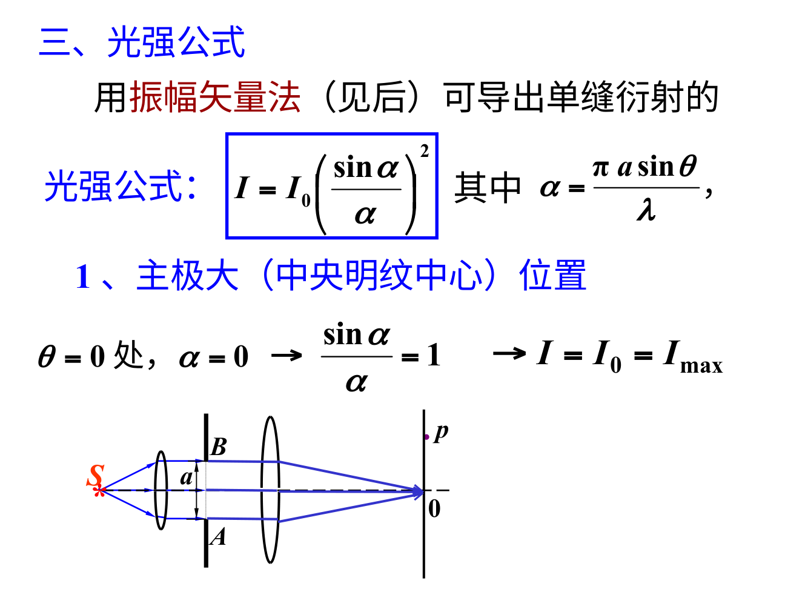
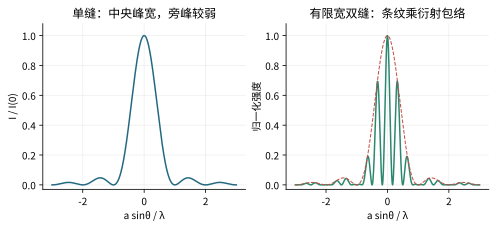

# 衍射：同一条缝内部，不同位置也会互相干涉

## 单缝为什么有宽中央亮纹

缝宽a，远场观察角θ，上下端光程差a sinθ。把缝划成两半，若差为λ，则对应两点相差λ/2、相互抵消，出现第一暗纹。一般暗纹$a\sin\theta=m\lambda$，m为非零整数。

均匀照明单缝的强度为

$$I(\theta)=I(0)\left(\frac{\sin\beta}{\beta}\right)^2,\quad \beta=\frac{\pi a\sin\theta}{\lambda}.$$

β=0时取极限1，不是0/0“没有定义所以没有光”。中央亮纹在两侧第一暗纹之间，小角度屏上宽约2λL/a。侧亮纹中心不严格位于半整数λ的位置，精确极值满足tanβ=β；半波带给的是近似位置。

## 两缝也有衍射包络

实际双缝各有宽度a、间距d，整体强度是单缝包络乘多缝干涉因子。干涉预测的某个明级若恰落在单缝暗点，会消失，叫缺级。不要把“看不见这个明纹”误解成光栅方程失效；是两种条件同时起作用。

## 多缝光栅把主峰变窄

N条等间距同宽缝，光栅常数d，主极大$d\sin\theta=m\lambda$。缝数增加主要让峰更锐，不是把同级中心位置随意推走。理想均匀光栅的分辨本领$\lambda/\Delta\lambda\approx mN$，需同一衍射级、相应分辨判据与实际有效照明缝数。m=0时不能靠该级分开不同波长。

例：m=2、N=5000，理论分辨本领10000，λ=500 nm附近最小可分波长差约0.05 nm。实际像差、狭缝宽和照明等会降低效果。

## 圆孔与瑞利判据

直径D圆孔的Airy斑第一暗环小角度约$\theta=1.22\lambda/D$。瑞利判据把一源主峰放在另一源第一暗处作为常用分辨界。它是明确成像与噪声条件下的判据，不是所有测量任务绝对不能超过的自然禁令。

**自测。** 单缝宽度减半，中央亮纹宽度怎样变？答：远场小角度条件下翻倍，且整体通过光量也会变化；不能只谈图样几何不谈照明与透过能量。
