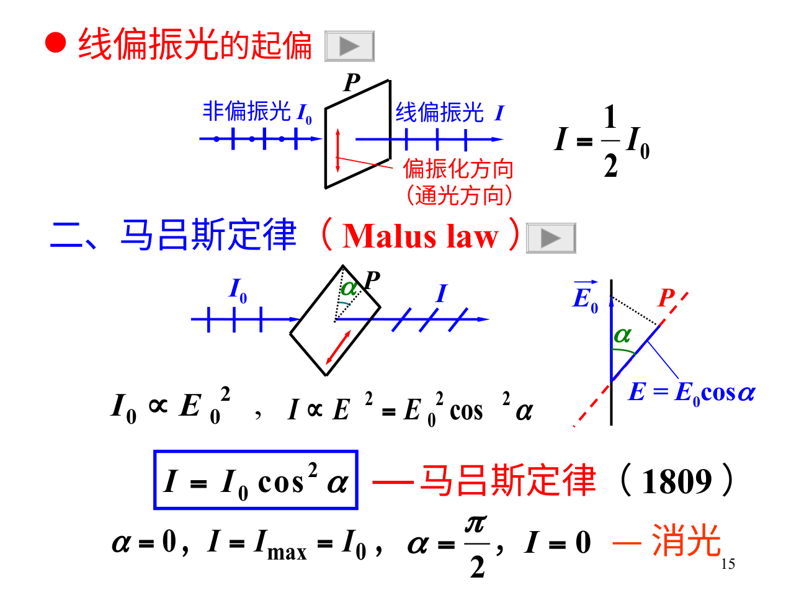

# 偏振：光往前走，电场可以怎样摆动

## 看的是垂直传播方向的电场轨迹

单色平面波沿z传播，横向Eₓ、Eᵧ的振幅与相位差决定偏振。相位差0或π，端点走直线；等振幅且相位差±π/2，走圆；一般情况走椭圆。自然光是快速随机变化的统计态，不是“每一瞬间完全没有电场方向”。

## 第一片减半，后面的才用cos²

理想自然光过线偏振片，平均强度减半；已经线偏振的入射光与透光轴夹角α，出射$I=I_0\cos^2\alpha$，这是Malus定律。I₀是该片前的强度，不能每过一片都再无条件乘1/2。

例：自然光强I，依次过0°、45°、90°三片：I/2→I/4→I/8。若去掉中间45°片，0°与90°正交，理想结果0。增加一片反而从0变I/8，并非能量增加；它改变了中间偏振态，各步仍只损失或保留输入的一部分。

## Brewster角

透明非磁、合适理想界面中，p偏振反射在Brewster角消失，$\tan\theta_B=n_2/n_1$，此时反射光与折射光方向正交。空气入n=1.5玻璃，θ_B≈56.3°。反射光变成s偏振，不表示透射光也只剩一种分量。

## 双折射与波片

各向异性晶体使两个本征偏振分量经历不同折射率/相速度，称o/e等模式。厚t的波片给相对相移$\delta=2\pi\Delta n\,t/\lambda_0$。四分之一波片δ=π/2，把与轴成45°的线偏振变成圆偏振；若分量不等，通常成椭圆。半波片δ=π，可旋转线偏振方向，转角与入射方向、晶轴关系需按分量重组推得。

## 仅转检偏片，分不清所有情况

检偏片旋转后有完全消光，可判断线偏振；强度变化但不灭，可能是部分偏振或椭圆；强度恒定可能是自然光，也可能圆偏振。加入合适波片再检偏，才能进一步区分。不要看到“亮度不变”就直接判自然光。

**自测。** 圆偏振过理想线偏振片，输出强度随透光轴转动变化吗？答：理想情况下不变且为原强度一半；但输出已经是沿该轴的线偏振。
