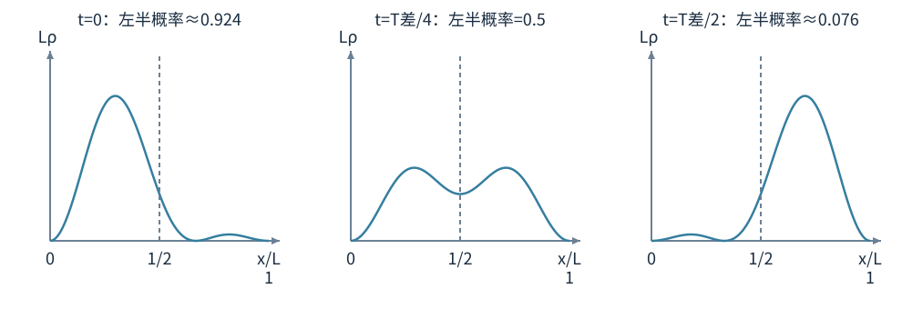

# 波函数怎样变成可以预测的概率

电子的波不是一条在空间里晃动的细绳。我们用波函数记录概率幅，通过它计算探测位置、动量、能量的概率分布。波函数可能含虚数，真正的概率必须为实数且不小于0。本章先把“幅”和“概率”分开，再看方程怎样控制它。

## 复数、共轭与模，先算一个最小例子

复数写成a+ib，i满足i²=−1，a和b是实数。它的共轭a−ib把虚部反号，模平方为(a−ib)(a+ib)=a²+b²，所以总是不小于0。例如Ψ=3+4i时，Ψ*=3−4i，模平方25。物理波函数的系数还带相应长度单位，不能把这个纯数字练习直接当作已经归一化的真实态。

写成极形式 $re^{i\phi}$ 时，r是模，φ是相位。把复数想成平面上一个箭头，模是长度、相位是角度，这里 $e^{i\phi}=\cos\phi+i\sin\phi$，所以实部为r cosφ、虚部为r sinφ。复数相加仍像箭头相加；但这个平面是表达幅与相位的数学平面，不是电子真实位置的xy轨道。后面所有概率先取模平方，就是把这个箭头长度平方。

## 波函数与概率密度

一维波函数 $\Psi(x,t)$ 一般是复数。概率密度 $\rho(x,t)=|\Psi|^2=\Psi^*\Psi$，单位1/m；在区间[a,b]找到粒子的概率是 $\int_a^b|\Psi|^2dx$。概率密度不是某个点的概率：连续分布中，一个精确点的区间长度为0，概率为0，但该处密度可以非零。

归一化要求 $\int_{-\infty}^{\infty}|\Psi|^2dx=1$。一维Ψ单位 $\mathrm m^{-1/2}$，三维则为 $\mathrm m^{-3/2}$。整体乘 $e^{i\alpha}$ 不改变密度，称全局相位不影响常见观测；两部分之间的相对相位会改变干涉，不能因此把所有相位都丢掉。

## 算例一：一个能真正积到1的波函数

设Ψ在0<x<L内为Ax，外面为0，先只把它作为某时刻的归一化练习。则

$$1=|A|^2\int_0^Lx^2dx=|A|^2\frac{L^3}{3},\qquad |A|=\sqrt{3/L^3}.$$

在右半区找到粒子的概率要重新积密度：$P=(3/L^3)[x^3/3]_{L/2}^L=(L^3-L^3/8)/L^3=7/8$。若把概率密度误写为Ax，会得到不同答案，甚至无法保证非负。这个分段函数在边界的光滑性未必满足某个具体势能的有限能量要求，所以不把“可做归一化练习”当成“已经是任意势阱定态”。

对对称指数波函数 $\psi=Ae^{-|x|/a}$，归一化给 $2|A|^2\int_0^\infty e^{-2x/a}dx=|A|^2a=1$，故A可取1/√a。找到|x|<a的概率为 $1-e^{-2}\approx0.865$，不是把曲线高度拿来直接比较。

## 薛定谔方程里的负号从哪里检查

非相对论单粒子、无显式磁矢势的一维方程为

$$i\hbar\frac{\partial\Psi}{\partial t}=\left[-\frac{\hbar^2}{2m}\frac{\partial^2}{\partial x^2}+U(x,t)\right]\Psi.$$

左边控制时间变化，右边包含动能与势能。U是势能，不是电势；电子在静电势V中有U=−eV。将V以伏特直接当作U以焦耳代进去，会漏电荷因子。

用自由平面波 $\Psi=Ae^{i(kx-\omega t)}$ 检查：时间导数给ℏω，空间二阶导数给−k²；动能前再有一个负号，最终 $E=\hbar\omega=\hbar^2k^2/(2m)$ 为正。教师第五版勘误第76条补的正是动能项前的负号。

方程在假设范围内预言概率幅的演化，不是把经典轨迹x(t)换个复杂写法。知道Ψ通常能预测各种测量分布，而非在测量前同时给出每次确定位置和动量。

## 定态：密度不变不等于相位不动

势能不随时间变时，尝试分离变量 $\Psi(x,t)=\psi(x)e^{-iEt/\hbar}$。先把求导展开：$\partial_t\Psi=\psi(x)(-iE/\hbar)e^{-iEt/\hbar}$，左边$i\hbar$乘它给$E\psi e^{-iEt/\hbar}$；空间导数只作用于ψ，给$\psi''e^{-iEt/\hbar}$。两边共同的复指数永不为0，可以约去，于是得到定态薛定谔方程

$$-\frac{\hbar^2}{2m}\frac{d^2\psi}{dx^2}+U(x)\psi=E\psi.$$

定态概率密度 $|\Psi|^2=|\psi|^2$ 不随时间变，时间相位仍在旋转。不同能量定态叠加时，相对相位随时间变化，密度一般也会变化。

### 算例二：叠加态的干涉项会动

两个正交归一定态ψ₁、ψ₂，能量E₁、E₂，组成等权叠加

$$\Psi=\frac1{\sqrt2}\left(\psi_1e^{-iE_1t/\hbar}+\psi_2e^{-iE_2t/\hbar}\right).$$

若ψ₁、ψ₂取实，密度为 $[\psi_1^2+\psi_2^2]/2+\psi_1\psi_2\cos[(E_2-E_1)t/\hbar]$。这个展开可直接做共轭相乘：两项各自平方给$\psi_1^2/2$与$\psi_2^2/2$，交叉项为$\psi_1\psi_2[e^{i(E_2-E_1)t/\hbar}+e^{-i(E_2-E_1)t/\hbar}]/2$，用$e^{i\phi}+e^{-i\phi}=2\cos\phi$得到上式。最后一项随时间变，频率由能级差而非某个单独能级决定。对全空间积分，交叉项因正交而为0，总概率始终1；局部概率可以流来流去。

图里取下一章宽L方阱的前两态，$\psi_1=\sqrt{2/L}\sin(\pi x/L)$、$\psi_2=\sqrt{2/L}\sin(2\pi x/L)$。定义$T_{\text{差}}=2\pi\hbar/(E_2-E_1)$。纵轴画无量纲$L\rho$，每幅在$x/L$轴下的总面积仍为1；不是峰变高就多了一颗电子。

左半区概率可真正算出来。两单态各自在左半积分1/2，所以它们的等权非干涉部分仍为1/2。交叉项的空间积分，令u=x/L，有

$$\begin{aligned}
\int_0^{L/2}\psi_1\psi_2\,dx
&=2\int_0^{1/2}\sin(\pi u)\sin(2\pi u)\,du\\
&=4\int_0^{1/2}\sin^2(\pi u)\cos(\pi u)\,du
=\frac4{3\pi}[\sin^3(\pi u)]_0^{1/2}=\frac4{3\pi}.
\end{aligned}$$

最后一步用v=sinπu，dv=πcosπu du。因此$P_{\text{左}}(t)=1/2+[4/(3\pi)]\cos[(E_2-E_1)t/\hbar]$，三个时刻约0.924、0.500、0.076。概率在左右之间转移，但能量测量的两个概率始终各1/2。

测量能量时得到E₁或E₂的概率各1/2，平均能量 $(E_1+E_2)/2$；通常不能把平均值当成每次都会测到的第三个能量。平均是很多次结果的统计量。

## 算符、本征态与平均值

位置表象里位置算符为乘x，动量算符 $\hat p_x=-i\hbar\,d/dx$。算符作用后若得到原函数乘一个常数，例如 $\hat p\psi=p\psi$，ψ是动量本征函数，p是相应确定测量值。

平均位置 $\langle x\rangle=\int\Psi^*x\Psi dx$，平均动量 $\langle p\rangle=\int\Psi^*(-i\hbar\partial_x)\Psi dx$。计算方差要用 $\Delta x=\sqrt{\langle x^2\rangle-\langle x\rangle^2}$，不是只用平均位置。对左右对称分布，平均位置可以为0，分布仍很宽。

### 算例三：两束反向平面波组成驻波

$\psi=A\cos(kx)=A(e^{ikx}+e^{-ikx})/2$。它包含动量+ℏk与−ℏk两部分。对合适归一化区域与对称权重，平均动量为0，但 $\langle p^2\rangle=\hbar^2k^2$，动能为 $\hbar^2k^2/(2m)$，并不为0。

“平均动量0所以粒子静止、动能0”把平均值的平方与平方的平均混了。它们之差正是动量方差。后面势阱中的实驻波也会反复用到这个区别。

## 边界条件为什么不能少

方程是二阶微分方程，通常有许多数学解，实际势能与边界决定留下哪些。有限、非奇异势能台阶处，ψ及其一阶导数连续；可以把方程在很薄区间积分，检查导数不能无缘无故跳变。无限高势垒是极限模型，边界通常要求ψ为0，但不能把有限台阶的所有说法不加说明地搬到无限极限。

束缚态要求波函数在无穷远衰减、可归一化；散射平面波在无限空间不能普通归一到1，可用波包或特殊归一化处理。课堂使用平面波计算流与反射时，不是在假装常数密度积满无限空间也等于1。

式子中的 $\operatorname{Im}(a+ib)=b$ 表示取虚部。概率流描述每单位时间朝正方向穿过某位置的净概率量，一维单位为1/s，可以为负表示净向左。一维公式为 $j=(\hbar/m)\operatorname{Im}(\Psi^*\partial_x\Psi)$，与密度满足 $\partial_t\rho+\partial_xj=0$。它把“粒子概率不会凭空少一块”写成局部守恒。透射概率应比较流，而不总是单比较振幅平方。

## 平均位置与最可能位置，不要互相代替

对前面的归一化线性分布ψ=√(3/L³)x，密度3x²/L³。平均位置

$$\langle x\rangle=\frac3{L^3}\int_0^Lx^3dx=\frac{3L}4.$$

平方的平均 $\langle x^2\rangle=3L^2/5$，所以方差 $3L^2/5-9L^2/16=3L^2/80$，标准差 $\Delta x=\sqrt{3/80}L\approx0.194L$。密度最大的位置却靠近x=L端，而非3L/4。平均与峰的区别来自整个分布加权，不只看最高点。

若你在作业里得到平均位置超出0到L，就已和概率支持范围矛盾，应回看积分、归一化或单位。标准差为负也不可能；出现 $\langle x^2\rangle<\langle x\rangle^2$ 通常是算错，而不是“量子方差很奇怪”。

## 两个本征态为什么正交

这里的内积是把一个态的共轭乘另一个态并全空间积分。内积为0称正交；自身内积为1称归一。厄米算符指在允许的函数与边界条件下，将它从内积的一侧移到另一侧并取共轭后，内积关系保持一致的算符。用允许的任意两个函数φ、ψ写出，就是 $\int\phi^*\hat H\psi\,dx=\int(\hat H\phi)^*\psi\,dx$。这里H是前面动能加势能的哈密顿算符。这种性质保证相应可观测量本征值为实数。

设同一满足边界的厄米（Hermitian）哈密顿算符有 $\hat H\psi_1=E_1\psi_1$ 与 $\hat H\psi_2=E_2\psi_2$，E₁≠E₂。把第一式乘ψ₂*积分，第二式共轭乘ψ₁积分，用厄米性质让H可移到另一侧，得到 $(E_1-E_2)\int\psi_2^*\psi_1dx=0$，因此内积为0。

这一步使用边界保证分部积分的边界项消失。算符长得像−d²/dx²不自动保证任何随便选的函数都构成合格物理问题；定义域与边界条件也是算符的一部分。初学题里老师已经给了方阱边界，你要做的是保留它们，不需要把所有函数空间理论一起学完。

正交不表示ψ₁(x)ψ₂(x)在每一点都为0，通常许多位置乘积非零，只是全空间正负或复相位贡献积分抵消。因此叠加态局部可有干涉项，总概率积分却仍是系数模平方之和。

## 测量概率从展开系数读，平均值另外算

把归一态展开为 $\Psi=\sum_nc_n\psi_n$，正交归一基下 $\sum|c_n|^2=1$。测量对应能量Eₙ的概率为|cₙ|²。若某能量简并，得到这个能量的总概率要把该能量对应各正交态的概率相加，而不是只看一个标签。

例：$\Psi=(\sqrt3/2)\psi_1+(i/2)\psi_2$，能量测量概率为3/4与1/4，平均能量 $3E_1/4+E_2/4$。第二项多一个i不改各能量概率，却改变与第一项在位置分布中的相对相位，因此两态的空间干涉可改变。把“i对模平方没影响”推广为“这段i完全无作用”，会忽略交叉项。

若你只知道平均能量，不能唯一反推所有cₙ。例如许多不同分布都可能有同一个加权平均。就像平均分80分不能恢复全班每个人成绩，平均观测值不是完整量子态的信息。

## 势能台阶：反射不仅发生在经典回头条件

设x<0势能0，x>0势能U₀，粒子从左以E>U₀入射。左边写 $\psi=Ae^{ik_1x}+Be^{-ik_1x}$，分别表示入射与反射；右边无从右来的束流，写 $\psi=Ce^{ik_2x}$。其中 $k_1=\sqrt{2mE}/\hbar$、$k_2=\sqrt{2m(E-U_0)}/\hbar$。

在x=0匹配ψ连续，得A+B=C；匹配导数，得k₁(A−B)=k₂C。先从第一式得$B=C-A$，代入第二式得$k_1(2A-C)=k_2C$，移项为$2k_1A=(k_1+k_2)C$。因此先解出C/A，再回代求B/A，得反射振幅比 $r=B/A=(k_1-k_2)/(k_1+k_2)$，透射振幅比 $t=C/A=2k_1/(k_1+k_2)$。

将右行$Ae^{ikx}$代入流公式，$\psi^*\psi'=ik|A|^2$，所以$j=\hbar k|A|^2/m$；左行$Be^{-ikx}$则为负的$-\hbar k|B|^2/m$。透射流与入射流相除，正好出现波数比。于是反射率R=|r|²，透射率 $T=(k_2/k_1)|t|^2=4k_1k_2/(k_1+k_2)^2$，两者相加1。E明明高于台阶，也仍有非零波反射；经典“能爬上去所以百分百通过”不再完整。

取E=4U₀/3，则k₂=k₁/2，R=1/9，T=8/9。透射振幅t=4/3，大于1，却不意味着概率16/9，因为右边传播速度较低，流权重k₂/k₁=1/2后恰得8/9。这道数值题是“振幅平方不一定就是透射概率”的直观反例。

E<U₀时，右侧波数成为虚数，解为衰减指数，半无限台阶远处无传出流，R=1。右侧近边界仍有非零密度，但不等于存在穿过无限远厚度的净透射流。有限宽势垒才有另一侧透射行波，两种边界问题要分开。

## 全局相位与相对相位，拿两狭缝做核对

设到某观察点的两路幅为a与b，总概率与|a+b|²成正比。若全部乘i，总幅i(a+b)，概率不变；若只把第二路乘i，总幅a+ib，交叉项改变。

取a=b=1，原概率相对值4；全乘i仍4；只把第二路乘i，|1+i|²=2；只把第二路乘−1，|1−1|²=0。三个运算都没改变单独两路幅的模，却改变了部分组合的相对相位。这个简单复数算例把“相位有时重要、有时不重要”的条件说清，不需要把虚数本身神秘化。

## 读波函数图的检查清单

先辨认纵轴画的是ψ还是|ψ|²。ψ可穿过横轴变号，密度不可为负；节点处两者都为0，但峰值位置与曲线形状不同。再看横轴是位置还是能量；能级线图里的高度表示E，波函数叠画在能级线附近的振幅不一定与能量用同一标度。

波函数图若整体竖直抬高，看起来像“基线变了”，在数学上通常等于加常数，会改变物理态；不能像势能零点一样任意抬。势能整体加常数可使所有能级一起平移、动力学只多全局时间相位，波函数本身加常数则是另一回事。图示为了清楚把波形画在各能级旁时，要按图注理解，别把绘图偏移当实际ψ。

## 归一化不随时间丢失，方程怎样保证

设实势能U，令$c=\hbar^2/(2m)$。薛定谔式给$i\hbar\partial_t\Psi=-c\Psi''+U\Psi$，共轭式给$-i\hbar\partial_t\Psi^*=-c\Psi^{*\prime\prime}+U\Psi^*$。前式乘Ψ*，后式乘Ψ，再用前者减后者：

$$i\hbar\partial_t(\Psi^*\Psi)
=-c(\Psi^*\Psi''-\Psi\Psi^{*\prime\prime})
=-c\partial_x(\Psi^*\Psi'-\Psi\Psi^{*\prime}).$$

第二个等号是乘积求导，两个$\Psi^{*\prime}\Psi'$项相消。除以$i\hbar$并把空间导数移左，得到$\partial_t\rho+\partial_xj=0$，其中$j=\hbar(\Psi^*\Psi'-\Psi\Psi^{*\prime})/(2mi)$；括号是一个复数减其共轭，等于$2i\operatorname{Im}(\Psi^*\Psi')$，便恢复前面的流公式。对整个空间积分，$d\int\rho dx/dt=-[j(\infty)-j(-\infty)]$。束缚波包远处无净流出时，右边0，总概率保持1。

有限盒中若墙不允许概率流穿过，也得到同样守恒。若只观察一个局部区间，它的概率可以随时间变，因为两端有流入流出；不能把“全空间归一化守恒”读成“每个小区间概率都固定”。叠加态密度会动而积分不动，正由这条局部守恒连接。

## 经典力学能否从量子描述里出现

在合适条件下，平均位置随时间的变化与平均动量有关，平均动量变化与平均力有关。若波包足够窄、势能在包宽范围内变化平滑，可以近似让平均值走接近经典轨迹。若波包分裂、显著展宽或势能变化强烈，单一轨迹可能不够描述分布。

因此量子方程不要求宏观世界突然失去经典规律，也不保证任何微观状态都能压成一个小球路径。遇到教师课件里“对应原理”，应读成有条件的极限联系，不是把所有概率效应简单宣布在n大时消失。

## 练习与解答

练习一：已归一化ψ乘以2，是否还是同一个合格归一态？乘以i呢？

解：乘2后密度变4倍、总积分4，需要重新归一化才可解释概率；重新除以2又回原态。乘i的模为1，总密度不变，是整体相位变化。若只给叠加态中一部分乘i，那是相对相位变化，可能改变局部干涉。

练习二：在0到L均匀概率密度1/L下，求平均位置与位置标准差。

解：$\langle x\rangle=\int_0^Lx\,dx/L=L/2$；$\langle x^2\rangle=L^2/3$。方差L²/3−L²/4=L²/12，所以Δx=L/√12。平均位置落在中央，不意味着粒子每次都在中央；这个分布在任意等长小区间概率都相同。

归一化常数的整体正负或共同复相位不改变单态概率；相对符号仍须保留。
