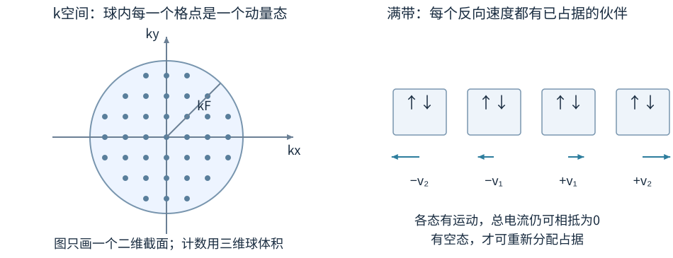
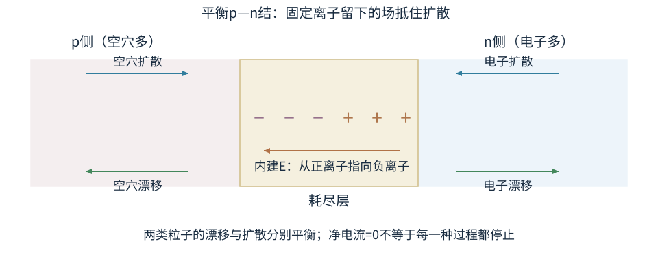
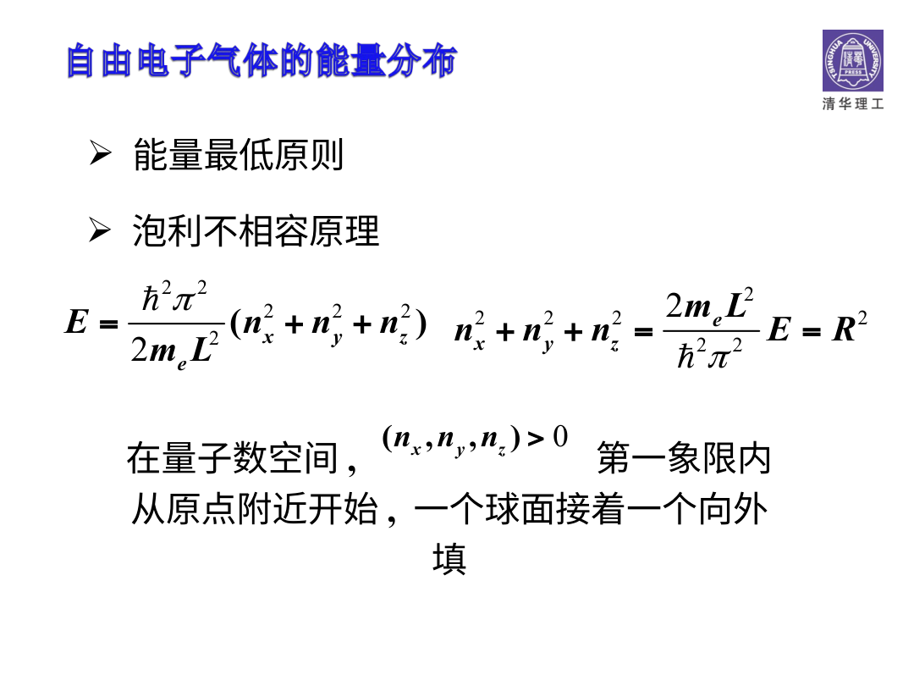

# 电子挤在固体里：为什么满带反而不容易导电

金属里有很多电子，但不是把所有电子都放进零动量最低态。泡利原理让它们从低能向上填，哪怕温度趋近0，也有很高动量的电子。原子靠在一起还会让离散能级分裂成能带。导电与否要看“占了哪些态、附近还有没有能迁移过去的空态”，不能只数总电子有多少。

## 自由电子气的填充

把一群电子近似成在体积V的盒中运动、彼此作用先忽略的费米气。每个空间动量态最多容两种自旋。0K时从低能开始填满，到最高占据能量EF，称费米能。

三维电子数密度n=N/V。把填充边界的波数记为kF，称费米波数；对应动量pF=ℏkF，称费米动量；mₑ是电子质量。自由电子模型给

$$k_F=(3\pi^2n)^{1/3},\quad p_F=\hbar k_F,\quad E_F=\frac{\hbar^2}{2m_e}(3\pi^2n)^{2/3}.$$

幂次来自三维动量空间中态数正比球体积k³。若只在一维或二维运动，态数增长与密度关系不同，不能照搬三维公式。教师《固体中的能带结构.ppt》PDF第15页用量子数空间第一象限的球壳计数，计数还要同时包括自旋简并，避免漏2。

## 费米能的三分之二次幂，亲手数一次态

取边长L的立方盒，V=L³，先用周期边界减少墙面效应。平面波沿x的因子是$e^{ik_xx}$；要求$x$与$x+L$处同一个态，需$e^{ik_xL}=1$，所以$k_x=2\pi n_x/L$，$n_x$可取正、负、0的整数。y、z相同，因而k空间格点每方向间距$2\pi/L$，一个空间动量态占小格体积$(2\pi/L)^3=(2\pi)^3/V$。图只画二维截面，真实计数用三维球。每个格点再允许两个自旋完整态。

当宏观盒子有很多格点时，用球体积除小格体积近似态数，边缘误差相对减小。k空间每个态占体积(2π)³/V，半径kF球内体积4πkF³/3，再乘两自旋，电子数

$$N=2\frac{V}{(2\pi)^3}\frac{4\pi k_F^3}{3}=\frac{Vk_F^3}{3\pi^2}.$$

所以 $k_F=(3\pi^2n)^{1/3}$，$E_F=\hbar^2k_F^2/(2m)$，得密度的2/3幂。若采用硬壁只数第一象限，允许k间距与球体份额会一起改变，最终宏观体积主项一致；不能把周期边界的态间距与硬壁的第一象限份额拼错。

用$k=\sqrt{2mE}/\hbar$代回累计态数，得到

$$N(E)=\frac{V}{3\pi^2}\left(\frac{2m}{\hbar^2}\right)^{3/2}E^{3/2}.$$

在[E,E+dE]内有$g(E)dE$个完整态，所以态密度是累计数的导数：

$$g(E)=\frac{dN(E)}{dE}=\frac{V}{2\pi^2}\left(\frac{2m}{\hbar^2}\right)^{3/2}\sqrt E.$$

它单位为1/J，是整块体积V的态密度；若除以V才是每立方米每焦耳的态密度。本章g已含两种自旋，后续不再额外乘2。为了求0K平均能量，把不随E变的系数记为G，则总电子数$N=G\int_0^{E_F}E^{1/2}dE=(2G/3)E_F^{3/2}$，总能量$U=G\int_0^{E_F}E^{3/2}dE=(2G/5)E_F^{5/2}$。相除给

$$\frac UN=\frac{(2G/5)E_F^{5/2}}{(2G/3)E_F^{3/2}}=\frac35E_F,$$

不是EF，也不是0。EF是最高占据能量，平均还要把下面全部已填态加权。

以EF=7.1eV估算，平均约4.3eV，依然远大于室温kBT≈0.026eV。这是量子填充产生的简并能量，不要误解释成金属必须释放大量热才能冷到室温。

## 算例一：室温相对费米尺度有多小

取金属自由电子密度n= $8.5\times10^{28}$m⁻³。代入得EF约7.1eV，费米速度 $v_F=\sqrt{2E_F/m_e}\approx1.6\times10^6$m/s。费米温度TF=EF/kB约 $8.2\times10^4$K，远高于300K。

这不表示金属“实际温度八万度”，TF是把费米能换算成温度单位的尺度。大多数占据来自泡利填充，而非室温热激发。电子的高随机速度也不等于大电流，平衡时各方向流动相抵；电流来自占据分布的微小不对称漂移。

## 有限温度的费米分布

这里的完整单粒子态包含自旋标签，每个态最多占一个电子；f的最大值是1。若先只数空间动量态，需另外数两种自旋。一个完整态能量E被占据的平均概率

$$f(E)=\frac1{e^{(E-\mu)/(k_BT)}+1},$$

μ是化学势，低温金属中常接近0K费米能。E=μ时f=1/2；远低于μ通常接近1，远高于μ接近0。f(E)本身是占据概率，不是单位能量区间电子数；后者还要乘态密度g(E)。

300K时kBT约0.0259eV。对低温金属，相比数eV的EF，主要热激发发生在费米面附近约kBT的窄带，而不是所有电子都按经典每颗3kBT/2增加能量。把每颗金属电子都当成经典理想气体，会得到错误的电子热容估计。

### 算例二：高于化学势几倍热能

E=μ+2kBT时，f=1/(e²+1)≈0.119；E=μ−2kBT时，f≈0.881，两者相加1。E高于μ并不等于绝不占据；有限温度把0K台阶抹开。若E−μ固定为0.10eV，在300K约3.86kBT，f约0.0206。单位要先统一，不能把eV与以J/K表示的kB直接混算。

## 从孤立原子能级到能带

孤立原子有离散轨道。N个相同原子靠近，原先相同能量的轨道互相耦合，分裂成许多非常密的能级，宏观数量下形成能带。某一原子s轨道演化来的带可容约2N电子；p轨道一组有三个空间方向，可容6N，具体固体还会有杂化与晶体对称性影响。

不同能带之间可能有不允许的能量区间，称带隙。电子态在周期晶格里也不是简单真空自由平面波，可用Bloch形式理解周期性；初学阶段先抓住“允许能量区间”和“占据情况”，不要把画满的色块当作材料内部真的有一条高低台阶道路。

价带通常指与价电子相关、较低的占据带，导带是较高、可参与输运的带。名字在金属与复杂多带系统里有更具体语境，不要求所有材料都只能有一条价带和一条导带。

## 满带为什么净电流难改变

完全填满的能带里，晶体动量相反的态通常产生相互抵消的速度贡献。弱电场要让分布稍偏移，需要附近有可用空态。也可以用一维周期能带具体检验：每态速度$v(k)=(1/\hbar)dE/dk$，满带对整个布里渊区$-\pi/a\le k\le\pi/a$都占满。总速度正比$\int v(k)dk=[E(\pi/a)-E(-\pi/a)]/\hbar=0$，因为能带在区的两端周期相接。a是晶格周期，k是晶体波矢，不是电子在晶体里的实际坐标。满带在无跨带激发的理想情况下没有这种同带重新分配空间，净直流贡献消失；部分填充带有费米面附近空态，因此容易响应。

不能说“满带电子完全不动”。许多占据态本身有非零速度，整体相抵；导电关心外场下是否能形成净流。绝缘体与半导体常有满价带和空导带，区别与带隙大小及温度、掺杂有关，不存在对所有材料都通用的精确一条eV分界。

带重叠或部分填满通常带来金属行为；实际电阻还受散射、缺陷、电子关联与维度等影响。基础能带图是模型起点，不是对所有材料性质的一句终审结论。

## 非简并是什么意思：费米分布什么时候能近似成指数

导带底E_c若比化学势μ高出好几个kBT，导带占据f远小于1，分母的加1相对指数可忽略；价带顶E_v若比μ低好几个kBT，空穴占据1−f同样很小。这里的“非简并”是在说占据远离费米饱和，并非前章“不同原子态有相同能量”的那一种能级简并。这就是本节近似条件：$E_c-\mu\gg k_BT$、$\mu-E_v\gg k_BT$。

把态密度积分吸收进有效态密度N_c、N_v后，可写 $n=N_c e^{-(E_c-\mu)/(k_BT)}$、$p=N_v e^{-(\mu-E_v)/(k_BT)}$。相乘时μ抵消，得到 $np=N_cN_v e^{-(E_c-E_v)/(k_BT)}=n_i^2$。这条质量作用关系因此有热平衡与非简并等条件，重掺杂让μ靠近或进入能带时，不能继续只用简单指数。

例如E_c−μ=5kBT，导带底精确占据约1/(e⁵+1)=0.00669，指数近似e⁻⁵≈0.00674，差约0.7%；若E_c=μ，精确为1/2，指数却给1，近似已明显失效。用这一对数值，可以把“离带边要足够远”的抽象条件变成可检查误差。

## 本征半导体：电子和空穴成对出现

热激发可把价带电子送到导带，留下一个空态。把许多价带电子的重新填补运动合并描述，这个空态表现得像带正电的载流子，称空穴。空穴不是材料里突然多了一颗真实质子，也不是任意空间里没电子的一点都叫半导体空穴。

本征材料中导带电子浓度n与空穴浓度p相等，记ni。简单非简并近似下 $n_i\propto T^{3/2}e^{-E_g/(2k_BT)}$，有效态密度与材料有效质量等也参与。电导率

$$\sigma=e(n\mu_n+p\mu_p),$$

μn、μp是迁移率，单位m²/(V·s)，与前面磁导率或化学势同字母但含义不同。电子与空穴的电荷符号相反，漂移方向也相反，因此对同向习惯电流的贡献相加。

## 算例三：从浓度和迁移率算电导

材料n= $10^{21}$m⁻³、p= $10^{15}$m⁻³，电子迁移率0.10m²/(V·s)，空穴迁移率0.05m²/(V·s)。代入得电子项约16S/m，空穴项约 $8.0\times10^{-6}$S/m，总约16S/m，电阻率约0.0625Ω·m。

电场100V/m时j=σE≈1600A/m²。若横截面积1mm²，I约1.6mA。依次从微观浓度到电导、再到电流密度、再乘面积，能看清每个单位如何衔接。别把迁移率与粒子数浓度混作一个“导电能力系数”。

## 掺杂：n型没有整体带负电，p型也没有整体带正电

硅等四价材料中掺适量五价施主，可提供较易热激发的电子，形成n型，多数载流子为电子。施主电离后留下带正的固定离子，与自由电子在整体上维持近似电中性。三价受主可接受价带电子、形成空穴，成为p型；固定受主离子带负，与空穴共同保持整体中性。

非简并、热平衡近似常有np=ni²。n型n远大于p，但少数空穴不为严格0；p型同理。温度变化、掺杂冻结、强注入、简并重掺杂等会改变简单近似的适用性。

### 算例四：少数载流子和电中性

假设ni= $10^{16}$m⁻³，充分电离的施主浓度ND= $10^{22}$m⁻³，无受主且ND远大于ni。近似n≈ND，再由np=ni²得p≈ $10^{10}$m⁻³。固定正离子浓度约ND，自由电子浓度也约ND，因此样品不因叫n型就整体净负。这里浓度差距很大，近似合理；若ND接近ni，应联立电中性和质量作用关系，不再直接n=ND。

## p—n结把扩散和漂移接在一起

图固定p在左、n在右。电子从右侧高浓度向左扩散，留下右侧不能随之移动的正施主离子；空穴从左向右扩散，留下左侧负受主离子。于是内建E从右侧正离子指向左侧负离子。电子带负电，场驱动漂移向右，抵住它向左的扩散；空穴漂移向左，抵住它向右的扩散。说“平衡”是两种输运各自抵消，不是所有电子静止。

接触后，电子与空穴因浓度差扩散，并在交界处复合，留下不易移动的电离施主与受主，形成耗尽层和内建电场。这个场驱动的漂移与扩散在热平衡时相互平衡，净电流为0。内建电场不等于可以从一个单独平衡结无限取电，外部接触也须满足整个回路的电化学平衡。

正向偏置通常降低势垒、增强注入；反向偏置通常抑制多数载流子跨越，但仍可能有少数载流子电流与击穿。理想二极管指数式需要额外输运假设，不把“一张能带倾斜图”当作已经证明全部电路特性。

## 空穴速度与电流符号，拿满带缺一态看

一个满带原本各态速度贡献相消。假设移走一颗电荷−e、速度v的电子，剩余总电流相当于从0减去它原来的贡献(−e)v，变成+ev。于是缺失态可以当成带正电的空穴，运动学变量按相应带结构定义。

空穴表示一条原本填满的能带中缺少的电子态，输运仍由电子的占据变化产生。正的霍尔系数或p型输运可以用空穴描述，但微观仍是电子在量子态之间重新分配。学习空穴时先确认它属于哪条带、有效质量近似在哪一段成立。

## 本征浓度的指数为何只含半个带隙

跨带激发一个电子—空穴对需要约Eg，但电子和空穴两套态的占据要同时满足统计与电中性。非简并热平衡下有 $np=N_cN_v e^{-E_g/(k_BT)}$；本征时n=p=ni，开方得 $n_i=\sqrt{N_cN_v}e^{-E_g/(2k_BT)}$。分母2不是说每次激发只需半个带隙，它来自成对浓度乘积再开方。

NC、NV是导带与价带有效态密度，通常随温度和有效质量改变。温度升高提高载流子浓度，同时散射可能降低迁移率，最终电导σ由二者共同决定。不能只把一个指数取值乘到固定常数上，跨很大温区仍声称精确。

## 平衡p—n结的内建电势数量级

在理想非简并、突变结、充分电离等近似下，内建电势可写 $V_{bi}=(k_BT/e)\ln(N_AN_D/n_i^2)$。把这个对数也拆开。非简并时$n=N_c e^{-(E_c-\mu)/(k_BT)}$。同一材料平衡时μ相同，而导带边随电势移动为$E_c=\text{常数}-eV$，所以两侧浓度比为$n_{\text{右}}/n_{\text{左}}=e^{e(V_{\text{右}}-V_{\text{左}})/(k_BT)}$。取自然对数，$V_{\text{右}}-V_{\text{左}}=(k_BT/e)\ln(n_{\text{右}}/n_{\text{左}})$。充分电离、远离结区时$n_{\text{右}}\approx N_D$，p侧$p\approx N_A$且$n_{\text{左}}=n_i^2/N_A$，比值才变成$N_AN_D/n_i^2$。这是一组平衡和统计假设的结果，不是“结面固定有0.7V”的定义。

举例T=300K，kBT/e≈0.0259V，NA=ND= $10^{22}$m⁻³，ni= $10^{16}$m⁻³，则比值10¹²，Vbi≈0.716V。材料、温度和掺杂一换就会改变。常见硅二极管某电流下的外加正向压降也不等同于任何条件下都固定的内建电势。

拿电压表跨平衡结外部两端，不能忽略金属接触与整个回路的电化学平衡，直接宣称能读出并持续提取这一内建电压的能量。真正输出功率需要非平衡源，例如光照、温差或外加电源。

## 多数载流子更多，不等于少数载流子永远无用

n型材料平衡时电子多、空穴少，直流电导通常由电子主导；光照、正向注入、结区复合或反向漏电里，少数载流子却可能决定响应时间与电流。基础计数可以忽略很小一项，只在那个所求量确实不敏感时忽略，不能把p直接定义成0。

同一材料在电阻测量、霍尔测量、光电探测中，相关参数权重也不同。做完一套σ数值题后，最好保留n、p、μ各自的含义，下次实验改变时就知道需要重算哪一项，而不是只记住一个“n型所以导电好”的结论。

## 练习与解答

练习一：两个材料带隙相同，能否断言室温电导率相同？

解：不能。载流子浓度还受态密度、掺杂、缺陷与化学势影响，迁移率还受散射和有效质量影响。σ=e(nμn+pμp)明确给出多个变量。带隙只提供跨带激发的一个重要能量尺度。

练习二：某本征半导体n=p= $10^{16}$m⁻³，μn=0.14、μp=0.05m²/(V·s)，求电导率和电阻率。

解：σ=e ni(μn+μp)≈ $3.04\times10^{-4}$S/m，电阻率约 $3.29\times10^3$Ω·m。两种载流子都贡献习惯电流，所以迁移率相加，不是相减；空穴正电与电子负电并不会让电导率抵消。

图源：《固体中的能带结构.ppt》兼容PDF第15页。这页的第一象限应理解为三维量子数空间中全为正的那一部分，几何上是第一卦限。球面内格点对应低于某能量的态，外推时还需数两种自旋。画的是状态标签空间，不是电子都堆在真实盒子的某个角。
