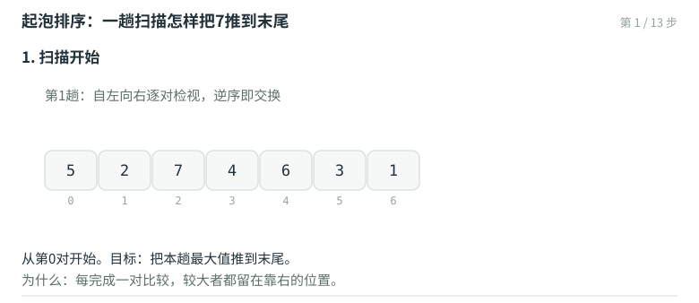
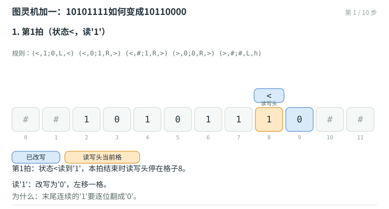
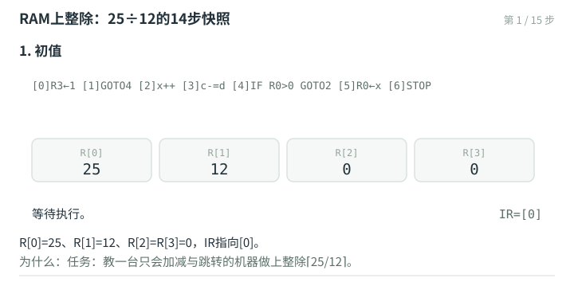

# 算法的要素、计算模型与正确性

计算是人类认识和改造世界的基本方式之一，与理论、实践并列。对计算的原理和过程给出形式化的定义与描述，得到的产物就是**算法**；执行算法的工具与平台，就是**计算机**。计算机的性能年年翻新，但一件计算任务能否真正高效完成，根本因素仍在人对问题本质的理解：设计出合乎问题内在规律的算法，再选用或定制支撑它的数据结构。本章把"算法"这个词的每一层含义拆开落实：它由什么构成、依赖什么工具、怎样证明它正确、又怎样在机器上逐步执行。

## 一杆足够大的秤：曹冲称象

大象是称不动的：没有那样大的秤，也没有谁抬得动它。据《三国志》记载，曹操收到孙权送来的一头大象，想知道重量，众人无计可施，年幼的曹冲却轻松设计了一个"分而称之"的算法：

```text
weight( elephant )
输入：一头大象
输出：大象的重量
1. 置象大船之上        //将大象牵上一艘船
2. 刻其水痕所至        //在吃水线处刻下标记，然后牵象下船
3. 称物以载之          //把称过重的石块装上船，直到船沉回同一刻痕
4. 校可知矣            //累计石块总重，即为输出
```

曹冲用水和船组成一杆足够大的秤：秤星是吃水线，秤砣是一堆石块。这套装置与现代电子计算机相去甚远，本质却毫无差别——都是支持和实现计算过程的物理机制。不妨就叫它"船石计算机"，上述过程则称为"曹冲算法"。它的正确性由阿基米德原理与质量的可加性保证：吃水深度只取决于总载荷。

## 尺规计算机：不许量长度的三等分

再来看一个几何界的算法。欧几里得几何是公理系统的鼻祖，它为大量几何问题提供基于作图的解法，使用的工具只有两件：足够长但不带刻度的直尺，以及半径不限的圆规。不妨称之为"尺规计算机"。它支持的基本操作不外乎五类：过两点作一直线；确定两直线的交点；以任一点为中心作任意半径的圆；确定直线与圆的交点；确定两圆的交点。

给定线段 $AB$，怎样只用这五类操作把它三等分？量出 $|AB|/3$ 标记两个点就完了，可直尺没有刻度，除法无从做起。尺规计算机给出的解法是算法1.2：

```text
trisect( AB )
输入：线段AB
输出：三等分点C、D
1. 从A发出一条与AB不重合的射线
2. 在射线上依次取C'、D'、B'，使|AC'|=|C'D'|=|D'B'|
3. 联接B'B
4. 过C'作B'B的平行线，交AB于C
5. 过D'作B'B的平行线，交AB于D
```

由平行截线定理（或《几何原本》卷六命题二），$|AC|:|CD|:|DB|=|AC'|:|C'D'|:|D'B'|=1:1:1$，三等分完成。其中第4、5步都要用到"过直线外一点作平行线"，这本身也是一件尺规可完成的操作：它是相对于三等分问题的**子问题**，其解法称为**子算法**。复杂的原问题分解为简单的子问题，子算法组合起来构成功能更强的算法——这个模式将贯穿整本书。

两件工具、五类操作，量不了任何长度，却完成了除法。所谓**计算模型**，就是这类"工具加规则"的组合：曹冲算法的模型由船、水、刻刀和石块构成，trisect的模型由直尺和圆规构成。模型决定了哪些操作可以直接兑现、每步代价几何；同一个问题换一个模型，可行性与成本都可能改变。

## 算法的要素

**算法定义**：在特定计算模型下，旨在解决特定问题的指令序列。

由此可以逐项列出算法应当满足的要素。

**输入与输出**。待计算问题的任何一个具体实例，都要以适当方式描述后才能交给算法，这类描述称为**输入**（input）；经计算得到的信息，即实例对应的答案，需要以适当方式呈现，称为**输出**（output）。曹冲算法的输入是"一头大象"，输出是"大象的重量"；trisect的输入是"一条线段"，输出是"两个三等分点"。

**明确性**（definiteness）。每条指令必须语义明确，而非模棱两可。菜谱里"加盐少许""加糖适量""煮至半熟"都不是明确的：多少算少许，多熟算半熟，两个人照做会得到两锅不同的菜。算法的每一步无歧义，同一输入重复执行，中间过程与输出都应一致。

**可行性**（effectiveness）。每条指令对应的操作在计算模型中都能兑现。"把大象装进冰箱"之所以可笑，是因为第二步不可行；但牵象上下船、刻吃水线、堆石块、累计总和都可以兑现。同样，"取长度比为1:√2的两条线段"在尺规模型下不可行，而作射线、取等距点、作平行线、联接两点都可以兑现。注意各条指令涉及的操作未必都是基本的——"累计一堆石块的总重量"本身就是一个计算问题，需要子算法来完成。

**有穷性**（finiteness）。对任何输入，算法在执行有限次基本操作后终止并给出输出。这一条最容易出事，下一节专门讨论。

**确定性**与随机性。算法的执行流程应当由指令唯一决定。随机性会破坏这一点，但它带来的麻烦比想象中微妙，也放到下一节。

## 有穷性：看起来正常的循环可能停不下来

考察著名的Hailstone序列：从任意正整数 $n$ 出发，偶数折半，奇数变成 $3n+1$，反复进行。比如 $Hailstone(42) = \{42, 21, 64, 32, 16, 8, 4, 2, 1\}$，8步就到了1；又如 $Hailstone(7)$ 经过17个数抵达1。写成程序：

```c
int hailstone( int n ) {
   int length = 1;                 //作为递归基，Hailstone(1) = {1}
   for ( ; 1 < n; length++ )       //偶数n：Hailstone(n) = {n} + Hailstone(n/2)
      n = n % 2 ? 3 * n + 1 : n / 2;   //奇数n：Hailstone(n) = {n} + Hailstone(3*n+1)
   return length;                  //返回序列总长度
}
```

这段代码语法正确，可以通过编译、链接并顺利运行，对已尝试过的每个 $n$ 都能终止。可"对任何正整数都终止"是另一回事：$n=27$ 的序列在半空中一路翻涨，冲到过峰值 $9232$，绕了远路才折回1，全程112个数。是否存在某个 $n$ 使序列永不到达1？截至本书写作，数学尚无定论，也没人找到反例；Erdős的评价是：数学还没有准备好对付这类问题。于是在定义层面出现了一件严肃的事：`hailstone()`暂且只能称作**程序**，不能称作**算法**——它的正确性与可行性都满足，唯独有穷性悬而未决。

随机性带来另一种微妙情况。假设`rand()`是理想的随机整数发生器，产生奇数与偶数的概率各为 $1/2$，考查

```c
void toss() { while ( rand() & 1 ); }   //rand()为奇数就继续循环
```

循环体为空，作用是反复掷硬币，直到掷出背面。这段程序每一步语义明确，符合明确性；但计算流程取决于随机数，不具备**确定性**（determinism）。对任何 $k$，循环至少迭代 $k$ 步的概率是 $2^{-k}$，恒为正，所以"永远不停"始终可能。不过从统计角度看，迭代恰好 $k$ 步（前 $k-1$ 步全为正面、最后一步背面）的概率是 $\left(\tfrac12\right)^k$——这是典型的几何分布（geometric distribution），其数学期望为

$$\sum_{k \ge 1} k \cdot \Big(\tfrac12\Big)^k = 2,$$

平均两次判定就会停止，迭代次数期望为1，是常数。一般地，若一次判定遇到背面的概率为 $p$，同样求和得期望 $1/p$；只要 $p$ 是固定正常数，期望就是常数。这类迭代步数随机、数学期望有限的程序，本书约定仍归入算法之列；但要知道，按最严格的字面定义，它的有穷性只有概率意义上的保证。

Hailstone与toss从两个方向说明了同一件事：一段代码够不够格称作算法，取决于有穷性（和确定性）能否成立。证明了的算数，没证明的存疑。

## 正确性：把"排好序"变成可以论证的命题

算法首先必须功能正确（correctness）。曹冲算法的正确性靠阿基米德原理，trisect的正确性靠平行截线定理；更复杂算法的正确性论证需要专门的方法。这里用一个排序算法做一次完整的示范。任务：把存于数组 $A$ 的 $n$ 个整数调整为非降序。

```c
void bubbleSort( int A[], int n ) {
   while ( 1 < n-- )                  //做n-1趟起泡扫描
      for ( int i = 0; i < n; i++ )   //自前向后，逐对检视相邻元素
         if ( A[i] > A[i+1] )         //一旦发现逆序
            swap( A[i], A[i+1] );     //随即交换
}
```

`while ( 1 < n-- )`先判断`1 < n`是否成立，再将`n`减1。初始 $n=7$ 时判断用的是7，判断后`n`变为6，本趟扫描检视下标0至5的六对相邻元素。用具体数组执行一遍，取

$$A = \{\,5,\ 2,\ 7,\ 4,\ 6,\ 3,\ 1\,\}$$

**第1趟**（扫描范围为下标0至5）。逐对比较，逆序即交换：

|比较对|结果|动作|交换后的数组|
|---|---|---|---|
|(0,1)|5 > 2|交换|[ 2, 5, 7, 4, 6, 3, 1 ]|
|(1,2)|5 < 7|不动|[ 2, 5, 7, 4, 6, 3, 1 ]|
|(2,3)|7 > 4|交换|[ 2, 5, 4, 7, 6, 3, 1 ]|
|(3,4)|7 > 6|交换|[ 2, 5, 4, 6, 7, 3, 1 ]|
|(4,5)|7 > 3|交换|[ 2, 5, 4, 6, 3, 7, 1 ]|
|(5,6)|7 > 1|交换|[ 2, 5, 4, 6, 3, 1, 7 ]|

盯着7的位置看：它一路向右换位，每换一次前进一格，最后停在末尾。原因在于，扫描中每处理完一对 $(i, i+1)$，二者中较大者总位于 $i+1$ 处；下一对又以这个较大者为左项继续比较。于是"当前见过的最大者"始终骑在扫描前线上，扫完全部相邻对后必然落到末尾——连贯地看，各元素如同水中的气泡逐个上浮，算法由此得名。第1趟结束时数组为

```text
下标    0   1   2   3   4   5   6
       [2] [5] [4] [6] [3] [1] [7]
        └─────── 无序前缀 ───────┘ └ 已就位 ┘
```

**第2趟至第6趟**做同样的扫描，只是每趟的扫描右端缩短一格：已就位的元素不再参与比较。各趟结束后的完整状态：

|趟|扫描范围|趟结束时的数组|新就位的元素|
|---|---|---|---|
|1|0–5|[ 2, 5, 4, 6, 3, 1, **7** ]|7|
|2|0–4|[ 2, 4, 5, 3, 1, **6**, 7 ]|6|
|3|0–3|[ 2, 4, 3, 1, **5**, 6, 7 ]|5|
|4|0–2|[ 2, 3, 1, **4**, 5, 6, 7 ]|4|
|5|0–1|[ 2, 1, **3**, 4, 5, 6, 7 ]|3|
|6|0|[ 1, **2**, 3, 4, 5, 6, 7 ]|2|

起泡的一趟扫描，逐步演示如下（同一数组，可与上表逐行对照）：



第6趟之后判断`1 < 1`不再成立，算法停止，排序完成。以上验证了一次运行，下面论证任何输入都正确。

将数组在任何时刻分成两段：前缀 $[0, s)$ 与后缀 $[s, n)$。称一个状态满足**序列模式**，若后缀已经非降序，且后缀中的每个元素都不小于前缀中的任何元素。初始取 $s=n$，后缀为空，模式平凡成立。此后每做一趟扫描：

**实质**：前缀中的最大元素（若有多个，取最靠后者）必然被推到前缀末尾，即 $s-1$ 处，称为就位。第1趟的逐对比较过程已经演示了这个推进机制，对任意前缀同理。

**不变性**（loop invariant）：一趟扫描后序列模式依然保持。新进入后缀的元素是原前缀的最大者，它不小于新前缀中的任何元素；后缀其余部分未动，仍非降序。

**单调性**（monotonicity）：每趟扫描使 $s$ 减1，后缀长度加1，问题的实质规模持续削减。

单调性保证至多 $n-1$ 趟后 $s$ 减到1；此时后缀 $[1,n)$ 非降序且每个元素都不小于 $A[0]$，而最后剩下的 $A[0]$ 正是最小元素，自然就位——整个数组非降序，正确性得以确立。这个论证的结构值得记住：一条贯穿循环、始终保持的性质（序列模式），加上"每次迭代保持它"（不变性），加上"迭代次数有穷"（单调性），缺一不可。之后各章凡是说明"这样做是对的"，用的都是同一套推理骨架。

这套版本的比较次数与运气无关：每趟比较的相邻对从 $n-1$ 对递减到1对，总计恒为 $n(n-1)/2$，$n=7$ 时恰是21次，与上面的表格一致；交换次数才随输入的混乱程度浮动，最坏（完全逆序）也达到 $n(n-1)/2$。这些数字属于什么量级、算快算慢，下一册笔记有专门的度量工具。

## 鲁棒与复用

正确的算法要成为实用的算法，还要经受两类考验。

**鲁棒性**（robustness）：除常规情况外，还能应对各种极端输入。刚才的`bubbleSort()`值得逐项检验：数组存在重复元素（甚至全体相等）时，严格不等号`>`保证相等者不交换，算法照常终止；输入已经有序或完全逆序时，扫描照做，结果正确；元素总数只有2、1甚至0时，`while`的首次判断就会结束一切，不会越界。碰巧安全的入口条件也不能依赖：若传入的 $n$ 超过数组实际容纳的元素数，循环照样越界读写——接口的前提应在入口处检查，发现违背就明确报告，而不致异常退出。

**复用性**（reusability）：算法的总体框架能否便捷地用于不同类型的对象。`bubbleSort()`的原理、逻辑和过程与元素类型没有实质关系：无论`float`、`char`还是别的什么，只要元素之间可以比较大小，整体框架就能沿用。更进一步，待排序元素只要在逻辑上构成一个序列，即便不以数组形式给出，算法也依然可以施行。第2、3章将让起泡排序等算法摆脱这些约束，实现真正的复用。

在满足以上要求之后，评判算法优劣最主要的标准毕竟是运行效率。要实现高效率的计算，就不能只研究算法：高效率的算法需要高效率的数据结构支撑，反过来强大的数据结构也往往是一组强大算法的汇集体。Wirth把程序概括为"算法 + 数据结构"，本课程在此之上还乘一个效率因子：

$$(\text{Algorithms} + \text{Data Structures}) \times \text{Efficiency} = \text{Computation}$$

效率怎么度量、怎样在不同算法之间公平比较，必须先约定统一的账本。计算模型为此再次出场。

## 图灵机：把"一步"拆到不能再拆

要统计算法执行了多少次基本操作，前提是"基本操作"本身有明确定义。为解决希尔伯特判定问题，图灵（Alan Turing）于1936年提出了一个形式化模型，即图灵机（Turing Machine, TM）。它把物质世界简化并抽象为一维离散空间，把"万物之灵"抽象为一个读写头：她有"情绪"，任何时候处于某种**状态**（state）；有"视觉"，总"盯着"某个单元，读出其中的符号；有"手"和"笔"，能改写当前单元；有"腿脚"，能沿纸带移动，尽管每次只能移动一格。

**构成**。一条纸带（tape），水平放置、长度无限，均匀划分为一系列方格单元（cell），每格存有一个符号；符号取自某个有限字母表，未写过的格子统一记作`#`。任何时刻，纸带上的内容、读写头的位置及状态合起来构成图灵机的一个**快照**（snapshot）。给定初始快照（相当于给定输入实例）后，机器便从一个快照转换到下一个快照，所有转换依照事先设定的一组**转换函数**（transition function）进行。每条转换函数是一个五元组：

$$(\text{当前状态}\ q,\ \text{当前符号}\ c;\ \text{覆写符号}\ d,\ \text{移动方向}\ s,\ \text{新状态}\ p)$$

若读写头处于状态 $q$ 且读取符号 $c$，则将 $c$ 改写为 $d$，按 $s$ 是L或R向左或向右移动一格，转入状态 $p$。一旦转入状态 $h$，随即停机（halt），纸带上以约定方式呈现输出。一组互不冲突、整体完备的转换函数，就构成一个图灵机上的算法。从启动到停机经历的快照数量即计算时间 $T(n)$，它同时等于读写头累计移动的步数。图灵机的访问是**顺序访问**：想到达第1000格，必须一步步挪过去，没有捷径。

**实例：二进制加一**。纸带上存有一个非负二进制整数（其余单元均为`#`），读写头对准个位，将其加一。加一的实际过程：末尾连续的'1'（可能没有）全部翻成'0'，原先的最低位'0'（或一路翻到头的'#'）翻成'1'，比如 $10101111+1=10110000$。五条转换函数构成完整的算法，`<`表示左行、`>`表示右行：

```text
LMOVE: (<, 1; 0, L, <)   //左行，1->0
UTURN1:(<, 0; 1, R, >)   //掉头，0->1
UTURN2:(<, #; 1, R, >)   //一路翻到头（原数全为1），补最高位
RMOVE: (>, 0; 0, R, >)   //右行
HALT:  (>, #; #, L, h)   //复位并停机
```

UTURN2不可省略：输入形如 $111$（全'1'）时，左行扫描越过所有'1'直达'#'，必须由这条规则写入新的'1'，否则进位丢失，而且机器在状态`<`读到'#'时将无规则可用。HALT里对'#'的"改写"等于没动、左移也只为进一步——它真正的作用是给出停机信号，并让读写头回到初始位置。

取纸带内容`##10101111##`。整条纸带共12格，下标0至11：下标0、1与10、11是四个`#`边界，数据占据下标2至9，即八位二进制数10101111（十进制175）。读写头对准个位，即下标9，初始状态`<`。逐拍执行：

|拍|状态|读到|动作|此后纸带|头位置（下标）|
|---|---|---|---|---|---|
|1|`<`|1|改0，左移|`##10101110##`|8|
|2|`<`|1|改0，左移|`##10101100##`|7|
|3|`<`|1|改0，左移|`##10101000##`|6|
|4|`<`|1|改0，左移|`##10100000##`|5|
|5|`<`|0|改1，右移，转`>`|`##10110000##`|6|
|6|`>`|0|不动，右移|`##10110000##`|7|
|7|`>`|0|不动，右移|`##10110000##`|8|
|8|`>`|0|不动，右移|`##10110000##`|9|
|9|`>`|0|不动，右移|`##10110000##`|10|
|10|`>`|`#`|不动，左移，停机|`##10110000##`|9|

先看一遍完整的走带演示，再对照下表读细节：



10拍之后纸带上是`10110000`，即十进制176，恰为175加一，而且读写头回到初始位置——这个算法可以反复执行，让纸带上的二进制数不断递增。这里 $n=8$ 是输入位数，$T(8)=4+1+4+1=10$：左行翻转四个'1'用4拍，翻转'0'并掉头1拍，右行越过四个'0'用4拍，停机1拍。一般地，若数长为 $n$、末尾连续 $r$ 个'1'，左行耗 $r+1$ 拍、右行耗 $r+1$ 拍，$T(n)=2r+2\le 2n+2$，仍是输入规模的线性函数。

## RAM：把"按编号访问一次"当成一步

图灵机外形朴素、操作原始，与我们今天使用的计算机差异不小。为得到更贴近实际的模型，人们提出了随机访问机（Random Access Machine, RAM）。与图灵机无限长的纸带相仿，RAM拥有无穷多个寄存器，各自存放一个整数；除功能特定的指令寄存器IR（instruction register）外，其余寄存器顺次编号，构成无限长的序列 $R[0], R[1], R[2], \ldots$。

RAM算法的描述方式接近高级程序设计语言，支持以下指令，且每条都可直接完成，故称为基本操作：

```text
R[j] <- c            //将常数c存入j号寄存器
R[i] <- R[j]         //将j号寄存器的内容转入i号寄存器
R[i] <- R[R[j]]      //将R[j]号寄存器的内容转入i号寄存器（间接寻址）
R[R[i]] <- R[j]      //将j号寄存器的内容转入R[i]号寄存器
R[i] <- R[j] + R[k]  //加法
R[i] <- R[j] - R[k]  //减法
GOTO x               //无条件跳转到第x行指令
IF R[i] = 0 GOTO x   //条件跳转（相等）
IF R[i] > 0 GOTO x   //条件跳转（大于）
STOP                 //算法终止
```

每个RAM算法由若干条上述指令构成，从第0行开始顺序执行，遇GOTO跳转；当前正在执行的指令由IR指示。可直接按编号访问任意寄存器，即按秩调用（call-by-rank），正是日后数组与向量访问的原型。在这类模型中，算法的运行时间就是它执行的基本操作次数；$T(n)$ 按惯例取规模为 $n$ 的所有实例中成本最高者——为什么必须取最坏，下一册笔记有专门讨论。

**实例：向上整除**。这台机器的指令表里没有除法，我们要教一台只会加减与跳转的机器做除法。正整数 $c$ 存于 $R[0]$、正整数 $d$ 存于 $R[1]$，求上整除 $\lceil c/d \rceil$。思路很直接：反复从 $R[0]$ 中减去 $R[1]$，统计在下溢（减成负数）之前减了多少次。程序共七条指令：

```text
[0] R[3] <- 1             //常数增量
[1] GOTO 4                //若R[0]为0，跳过循环
[2] R[2] <- R[2] + R[3]   //x++
[3] R[0] <- R[0] - R[1]   //c -= d
[4] IF R[0] > 0 GOTO 2    //c仍为正则继续减
[5] R[0] <- R[2]          //否则将计数复制到R[0]
[6] STOP                  //返回R[0]
```

取 $c=25$，$d=12$。四个寄存器的初值依次为25、12、0、0；下表每行记录一步执行，刚被写入的寄存器给出新值并带`^`，其余寄存器以`^`表示保持不变：

|步|IR|$R[0]$|$R[1]$|$R[2]$|$R[3]$|本步动作|
|---|---|---|---|---|---|---|
|0|[0]|25|12|0|1^|置增量为1|
|1|[1]|^|^|^|^|无条件跳至[4]|
|2|[4]|^|^|^|^|25>0成立，转[2]|
|3|[2]|^|^|1^|^|$x=1$|
|4|[3]|13^|^|^|^|$c=25-12$|
|5|[4]|^|^|^|^|13>0成立，转[2]|
|6|[2]|^|^|2^|^|$x=2$|
|7|[3]|1^|^|^|^|$c=13-12$|
|8|[4]|^|^|^|^|1>0成立，转[2]|
|9|[2]|^|^|3^|^|$x=3$|
|10|[3]|-11^|^|^|^|$c=1-12$|
|11|[4]|^|^|^|^|非正，顺序执行|
|12|[5]|3^|^|^|^|$R[0]\leftarrow x$|
|13|[6]|^|^|^|^|停机|

14步快照的逐步演示：



输出3存于 $R[0]$，而 $\lceil 25/12\rceil=3$，正确。《荀子·礼论》说"三年之丧，二十五月而毕"——守丧"三年"其实二十五月，按年折算正是向上取整：$\lceil 25/12\rceil = 3$。循环恰好数出上整除的原因：$k$ 次减法后 $R[0]=c-kd$，循环在第 $k$ 次减法后停止，当且仅当 $c-kd\le 0$ 且 $c-(k-1)d>0$，即 $k$ 是满足 $k\ge c/d$ 的最小整数，这正是上整除的定义。$c=0$ 时指令[1]直接跳过循环返回0，与 $\lceil 0/d\rceil=0$ 一致。

时间成本等于快照表的高度，即各条指令累计执行次数之和。七条指令分别执行1、1、4、3、3、1、1次，合计14次：

$$T(25,12) = 1 + 1 + 4 + 3 + 3 + 1 + 1 = 14$$

同一问题在图灵机上需要来回走带，步数按格子距离计；在RAM上只需14次指令执行。模型给"一步"定价，也决定了哪种算法在哪台机器上是聪明的。用C++之类高级语言描述的算法，可以仿照RAM算法的分析方法：分别统计每一行代码的执行次数，总和就是时间复杂度。

## 两种模型说明了什么

模型改变了"一步"的价格，不改变"算法是基本操作的指令序列"这一本质。两者共同的要点有三条。

其一，模型把平台差异关在门外。同一算法无论用什么语言书写、在什么机器上编译运行，固定模型下的基本操作次数是同一个数，效率评价因此可以客观进行。

其二，时间与空间可以用同一把尺子度量。算法对规模为 $n$ 的所有实例所需的时间量、空间量的最大值，分别称作**时间复杂度**与**空间复杂度**。空间复杂度不计输入数据本身——那属于固有消耗，与算法优劣无关；计入的是转储、缓冲、中继、索引、变换等辅助空间。

其三，模型中的基本操作对应真实机器的真实动作。RAM的call-by-rank就是数组访问，图灵机的纸带是顺序介质的极限情形。后文设计数据结构时，"这项操作要花多少次基本运算"在每个模型下都有确定含义，正是这些模型在背书。

下一册笔记在这个账本上引入大 $O$ 记号：成本数出来了，还要看它随规模增长的趋势。

## 本章要点

- 算法定义在特定计算模型之上，是旨在解决特定问题的指令序列；计算模型由工具与规则构成（船石计算机、尺规计算机、图灵机、RAM）。
- 算法要素：输入、输出、明确性、可行性、有穷性，执行流程还须确定（期望有限、约定可归入算法的随机程序除外）。Hailstone说明有穷性可能悬而未决，这样的代码只是程序。
- 复杂算法可分解为子问题与子算法；正确性靠"一条始终保持的性质＋每步保持＋步数有穷"来论证（序列模式、不变性、单调性）。
- 实用的算法还要鲁棒（经得起极端输入）与可复用（框架适用于可比较大小的任何类型）。
- 图灵机以快照和顺序访问定义"一步"；RAM以十条基本指令和按秩访问定义"一步"；固定模型之后，运行时间才可以客观地数。
