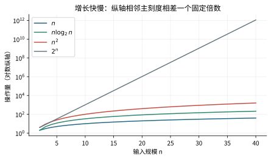

# 复杂度：把循环次数真正加出来

## O、Ω、Θ 分别承诺什么

$f(n)=O(g(n))$ 表示足够大时 $f(n)\le Cg(n)$，C 是固定常数；Ω 给下界；Θ 是上下界同时成立。$n=O(n^2)$ 也对，只是不紧。小 o 表示比值趋于 0，小 ω 表示比值趋于无穷。说一个算法“O(n²)”不能自动推断它最好也要 n² 步。

常数只能独立于输入规模。`n/1000` 仍是 Θ(n)，`n/log n` 不能把分母当“一个常数”。两层循环也不总是 n²：必须看每轮各执行多少次。

## 常见级数，给你把来历写出来

|计数式|数量级|原因|
|---|---|---|
|$1+2+\cdots+n$|Θ(n²)|首尾配对，每对约 n|
|$1+2+4+\cdots+2^k$|Θ(2^k)|和为 $2^{k+1}-1$|
|$1+1/2+\cdots+1/n$|Θ(log n)|与 $\int_1^n dx/x$ 上下夹住|
|$\sum_{i=1}^n\log i$|Θ(n log n)|等于 log(n!)；后半项均至少 log(n/2)|
|$\sum_{i\ge1}1/i^2$ 的前 n 项|Θ(1)|积分尾部收敛|

分数可以估算整数操作次数：$\sum\lfloor n/i\rfloor$ 夹在 $nH_n-n$ 与 $nH_n$ 之间，所以是 Θ(n log n)。不是说机器做了半次操作，而是我们用连续或分数界来估总数。

例：外层 i 从 1 到 n，内层 j 从 i 到 n、步长 i，执行约 n/i 次。总量是 $\sum_i\lfloor n/i\rfloor$，不是 n²。

## 递归树怎么数

归并型递推 $T(n)=2T(n/2)+cn$：每层总工作 cn，共约 log₂n 层，叶层 O(n)，所以 Θ(n log n)。若总是分成 n/4 与 3n/4，每层总规模仍 n，深度介于两个常数倍 log n 之间，依然 Θ(n log n)。若分成 1 与 n-1，就可能退化为 Θ(n²)。

主定理常用形式 $T(n)=aT(n/b)+f(n)$，比较 $f(n)$ 与 $n^{\log_ba}$。当 $f(n)=\Theta(n^d)$ 时：d 小于临界值，叶子主导；等于时多乘 log n；大于时顶层主导，得到 Θ(n^d)。一般形式的“顶层主导”还需正则条件 $af(n/b)\le cf(n)$，c<1，不能随意省略。

Akra–Bazzi 处理不等分递推：在满足适用的增长与平滑条件、$\sum a_ib_i^p=1$ 时，$T(x)=\Theta\bigl(x^p(1+\int_1^x g(u)/u^{p+1}\,du)\bigr)$。它不是对所有递推都能硬套的口诀。对 $T(n)=T(n/4)+T(3n/4)+n$，p=1，积分为 log n，再次得 Θ(n log n)。

**自测。** `for(i=1;i<n;i*=2)` 嵌套一个执行 i 次的循环，总量多少？答：$1+2+4+\cdots<n$，为 Θ(n)，不是 Θ(n log n)。实际代码还需防 i 翻倍溢出。
