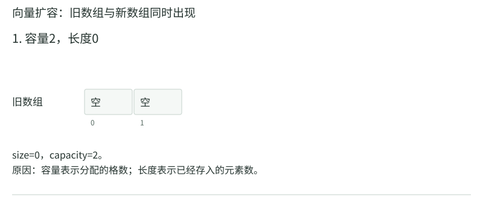
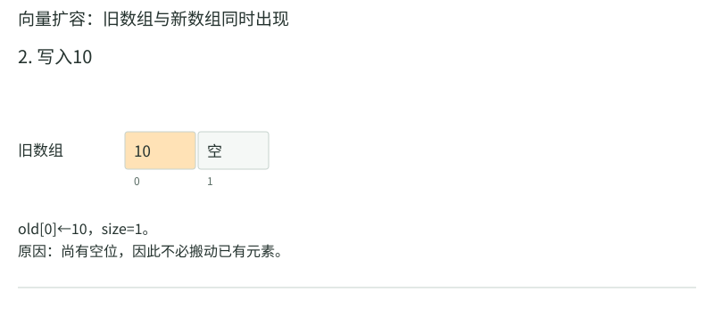
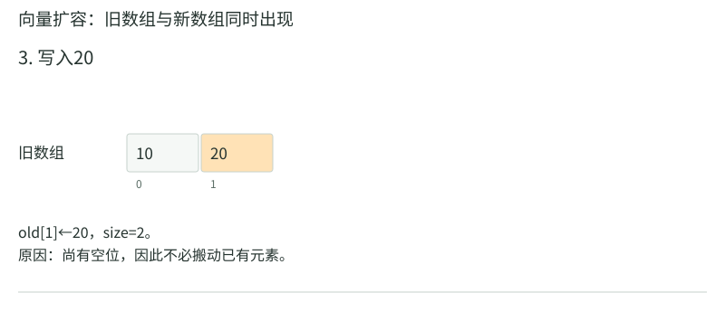
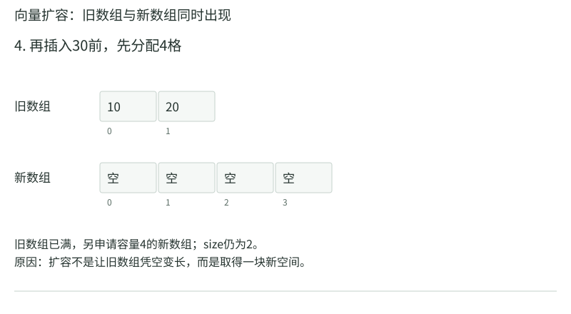
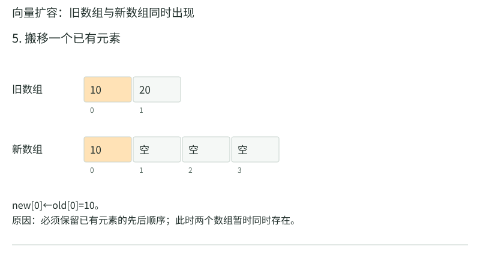
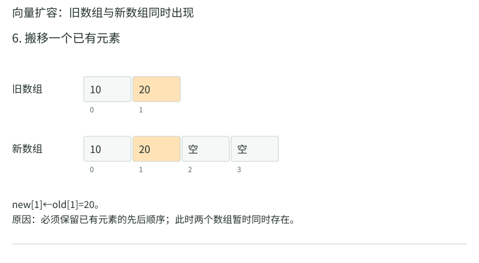
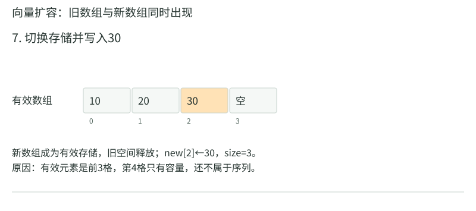
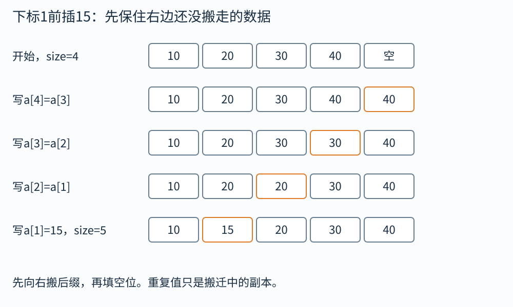
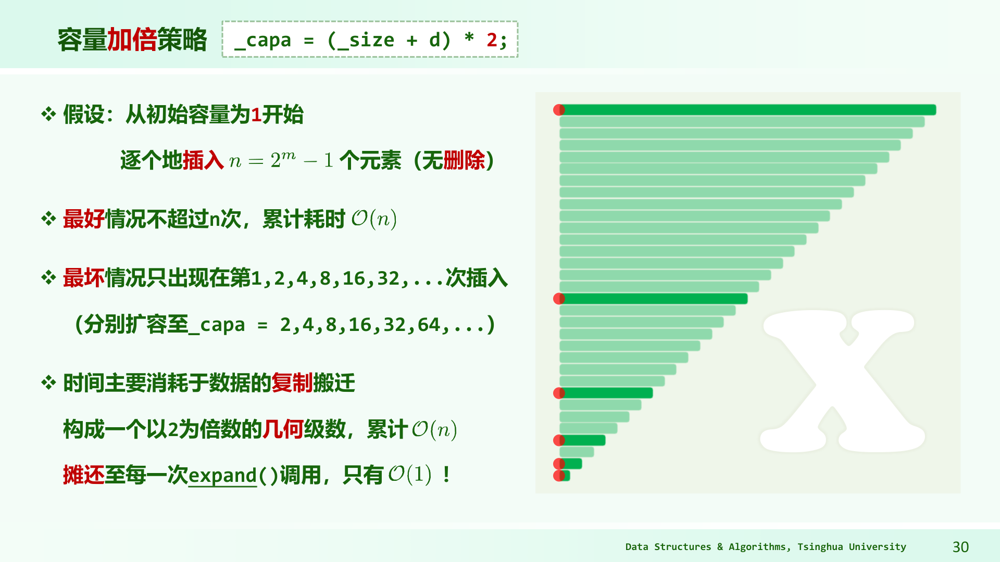

# 向量：存储、插入和动态扩容

程序要逐次接收一串数据，输入结束前不知道总数。申请两格数组，可以先保存10、20，但第三项30到来时，原来的内存范围就不够了。事先申请一个很大的数组也有代价：估计小了仍会装满，估计大了则长期闲置。向量采用动态数组，在需要时申请更大的连续空间，把已有元素迁移过去。使用者仍按下标访问，不必自己管理每次换空间的过程。

因此，向量除了保存底层地址，还必须区分两个数：`size`是已经进入序列的元素个数，`capacity`是目前申请的格数。比如申请4格，只写入10、20、30，便是`size=3,capacity=4`。前三格属于序列，最后一格只是备用；“已经申请”并不等于“已经有一个可读取的元素”。

“向量”在本章指动态数组，不是物理学中有方向的量。按秩访问中的“秩”就是从0开始的下标。若底层首地址为`B`，每格固定占`w`字节，下标`r`的地址为$B+rw$。例如`B=1000,w=4,r=3`，地址是1012，所以不必从第0项挨个找过去。


## 三次追加，把新旧两排都画出来

先申请2格，不放任何项：`size=0,capacity=2`。只有`[0,size)`属于有效元素，后面的格是备用空间，不能把备用格里的残留数值当作清单内容。

|动作|底层格0|格1|格2|格3|size/capacity|
|---|---|---|---|---|---|
|初始化|空|空|未申请|未申请|0/2|
|追加10，写a[0]|10|空|未申请|未申请|1/2|
|追加20，写a[1]|10|20|未申请|未申请|2/2|
|请求追加30|还没写|还没写|不能越界写|未申请|仍2/2|

此时不是“接着写第2格”：旧数组根本没有第2格。按满时加倍的规则，第三次追加分成这些动作：

```text
① 申请新数组b，容量4
   旧a: [10][20]       新b: [空][空][空][空]
② 复制a[0]到b[0]
   旧a: [10][20]       新b: [10][空][空][空]
③ 复制a[1]到b[1]
   旧a: [10][20]       新b: [10][20][空][空]
④ 迁移成功后，让向量改用b，释放旧存储
⑤ 写入新元素30到b[2]，size由2增至3
   当前: [10][20][30][空]，capacity=4
```

<!-- trace:ds-vector -->

把刚才的迁移逐帧展开。每格下方是它在所属数组内的下标；新旧两排的下标各自从0开始。















<!-- /trace:ds-vector -->

旧数据搬完前，新旧数组同时存在。旧容量2、新容量4，迁移峰值约6个元素槽，不能只算迁移完成后的4格。一般旧容量`C`扩到`2C`时，可能暂占`3C`槽。

扩容改变底层地址。外部若保存“旧数组第1项的地址”，这个地址不会自动指向新数组；旧存储释放后它失效。C++的`reserve`只改变容量，不改变有效项数；`resize`会改变逻辑长度并可能构造/销毁元素。先预留100格，不代表可以按向量接口读取第99项。

## 在中间挤入一个位置，搬的方向不能错

当前`[10,20,30,40]`，容量8。要在下标1前插15，最终20、30、40都要右移1格。先保存最右边尚未搬走的内容：

|动作|0|1|2|3|4|为什么先搬它|
|---|---:|---:|---:|---:|---:|---|
|开始|10|20|30|40|空|有效区[0,4)|
|a[4]=a[3]|10|20|30|40|40|先保住最右项|
|a[3]=a[2]|10|20|30|30|40|旧40已保存，可覆盖|
|a[2]=a[1]|10|20|20|30|40|旧30已保存，可覆盖|
|a[1]=15|10|15|20|30|40|空位留好，写新项|
|size=5|10|15|20|30|40|全部5项正式有效|



图中箭头从读的位置指向写的位置。若先`a[2]=a[1]`，旧30就被20覆盖；下一次再读`a[2]`会读到20，无法恢复旧30。暂时出现重复项不是错误，它们是搬迁中的副本；结束后有效区才表示完整结果。

教师《02向量》PDF19页的完整图将单项推广为一段长度`d=hi-lo`：先把原后缀`[r,n)`从后向前搬到`[r+d,n+d)`，再填新增区间`[r,r+d)`。我们的单项例子就是`d=1`。若插入来源与向量自身重叠，还需额外保存来源或采用支持重叠的实现，不能因上述方向正确就忽略别名问题。

删除则相反。删掉`[10,15,20,30,40]`的`[1,3)`，即删15和20：先`a[1]=a[3]`得到30，再`a[2]=a[4]`得到40，最后`size=3`，有效内容`[10,30,40]`。左移从前向后，因为写入的都是已经不再需要的左侧格。

## 一次很贵，为什么一串追加仍然便宜

只做尾部追加、初始容量2、满时加倍。把“一次迁移旧项”和“一次写新项”各算1：

|追加后项数|容量|本次迁移数|本次写新项|累计成本|
|---:|---:|---:|---:|---:|
|1|2|0|1|1|
|2|2|0|1|2|
|3|4|2|1|5|
|4|4|0|1|6|
|5|8|4|1|11|
|6|8|0|1|12|
|7|8|0|1|13|
|8|8|0|1|14|
|9|16|8|1|23|

第9次操作需要迁移8项，再写入新项，成本是9，确实不是最坏常数时间。但要判断连续追加是否昂贵，必须把前面的便宜操作一并计算。前n次操作各写一个新项，共n次；迁移只发生在容量装满时，规模依次为2、4、8……。设最后一次迁移规模为C，则前面的迁移总数为

$$2+4+8+\cdots+C=2C-2.$$

等式可以把两倍和式与原和式相减得到；若尚未扩容，迁移总数直接为0。发生规模C的迁移，说明随后至少写入了第C+1项，所以`C<n`。故全部迁移少于2n次，加上n次新项写入，总成本小于3n。这里的常数针对“一次元素迁移或写入各算1”的模型，比较、申请和对象构造有另外的固定单价。

把任意这样一串操作的总成本除以操作数，得到常数上界，称为摊还常数时间。它允许某一次操作很贵，限制的是整串总成本；证明没有对输入取随机平均。若题目要求任意一次追加都在固定时间内响应，这份摊还保证还不够，便需要预留空间或另外设计逐步迁移。



这张老师原图采用`(_size+d)*2`，还会保留额外槽位，准确触发点与简化的“容量2装两项”不同。读图应认出不断翻倍的迁移规模，而不能把本章表中的容量序列直接当成老师源代码的逐行输出。固定比例增长保证几何总成本，具体常数依实现改变。

如果每次只加2格，容量2、4、6、8……，迁移数2+4+6+8……成为等差和，`n`次追加会有平方级总迁移。相反，提前知道要放多少项时一次预留足够空间，可以省去后续这些扩容，但估计过大又会长期占用备用内存。

## 精确看一个扩容边界

初始容量1，满时加倍，做n次追加。若n恰为`2^k`，旧元素复制总数为1+2+…+`2^(k−1)`=n−1；若n=`2^k`+1，刚触发下一次扩容，复制总数变为`2^(k+1)`−1，接近2n。累计曲线会在边界跳跃，却始终被2n包住。某次实验看到n只多1而耗时接近翻倍，不与总成本线性矛盾。

不同语言的标准容器未必严格加倍，常数因子可能不同，标准也可能只保证摊还性质而不指定具体增长公式。要分析教师实现，就用教师实际代码；要依赖标准库行为，就依接口保证，别把某次观察出的容量序列当跨版本承诺。

## 缩容别在同一条线反复开关

精确定义一个坏规则：“size降到capacity的一半就立即缩半，满时下一次追加就扩倍”。从容量8、size5开始，删除一项变4，马上缩到4；追加一项前因满而扩到8，size变5；再删又缩4。两次很小的操作反复搬动4项。把8换成很大的容量，这份成本就不能摊成常数。

可以把缩容阈值改为四分之一：满时扩倍，size降到不超过容量四分之一时才缩半，并保留最低容量。容量16、size4缩到8后仍半满，离再次扩容或再次缩容都隔着若干普通操作，避免刚才的两步来回。阈值用“低于”还是“不超过”会改变一个边界触发点，分析时应固定一种规则。

## 去重也体现了数据布局的成本

无序向量去重，可以逐个查看当前项以前是否出现，发现重复就删除。但每次删除要搬后面的元素，查找本身也可能线性，整体最坏平方时间。若允许改变顺序，可以将待删位置与末项交换后弹出，删除便宜了，但顺序不再保留。

有序向量的相同值相邻，可以用读指针扫描、写指针压紧。例如`[1,1,2,2,2,5]`：保留第一个1；第二个1跳过；第一次遇2写入下标1；其余2跳过；遇5写入下标2，最后有效区间为`[1,2,5]`。每项读一次，总时间Θ(n)，没有逐次删除带来的反复搬移。改变维护的信息，算法就能省下一大段工作。

有序去重的每一步可以同样按格子核对。输入`[1,1,2,2,2,5]`，先保留首项，`write=1`：

|read与当前值|与最后保留项比较|动作|write变化|有效去重前缀|
|---|---|---|---|---|
|1，1|1等于a[0]的1|跳过|仍1|[1]|
|2，2|2不同于a[0]的1|a[1]=2|1→2|[1,2]|
|3，2|2等于a[1]的2|跳过|仍2|[1,2]|
|4，2|同上|跳过|仍2|[1,2]|
|5，5|5不同于a[1]的2|a[2]=5|2→3|[1,2,5]|

`write<=read`保证只覆盖已经读过的位置；最后把逻辑长度改为3，后面残留格不是新的有效项。空输入应先返回0，不能先读取`a[0]`。筛掉偶数也是同一读写路线，只是保留条件换成“当前是奇数”，不需要输入有序。

## 一次批量删除，怎样避免反复搬相同元素

要删掉向量里所有偶数，逐次调用remove可能每次都搬整个后缀，最坏平方。可用read从左扫、write标记下一个保留位置：遇奇数就写到a[write]并write加1，遇偶数只前进read。输入[2,7,4,9,6,1]最终前缀为[7,9,1]，逻辑长度改为3。每项读一次、保留项写一次，总线性，且保留相对顺序。

不变式是已读前缀中的所有应保留项，按原顺序恰好在[0,write)；write≤read保证写入不会破坏尚未读取的后缀。这个证明同时说明为什么可以原地压紧。它与有序去重的双指针相似，但“是否保留”的判断来自不同条件，不能把两者混成只适合相邻重复的算法。

```python
def keep_odd(a):
    write = 0
    for read in range(len(a)):
        if a[read] % 2 != 0:
            a[write] = a[read]
            write += 1
    del a[write:]
    return a
```

第一次遇7时，`read=1,write=0`，把7写到下标0；遇9时，把9写到下标1；遇1时，把1写到下标2。循环结束前，物理列表可能仍有`[7,9,1,9,6,1]`这些旧值，但有效结果只是前三项，最后一行删除无效后缀。用教师向量实现时，应按元素类型销毁被删除的对象并更新`_size`，不能只在旁边返回数字3，却让容器继续报告长度6。

## 复制、移动与引用，扩容时元素身份怎样变化

设向量中放三条大字符串，底层格子保存字符串对象。扩容会在新数组中构造相应对象，再销毁旧对象；语言可能采用移动以转交内部缓冲区，也可能复制全部字符。若每条字符串长度L，一次元素迁移不再必然只花与L无关的时间。通常分析向量时把“一次元素复制或移动”作为单位，再由元素类型决定单价。

异常也可能在迁移中发生。健壮容器不能复制到一半就丢掉旧数组，应该保证失败时仍能恢复一个合法状态，或明确接口提供的异常保证。教学伪代码省略内存申请失败，并不意味着真实实现可以忽略对象生命周期。

对字符串等非平凡对象，备用空间尚未构造有效元素，对象生命周期也不等于一块内存是否已经申请。`reserve`与`resize`的区别因此不只是长度数字不同，还决定哪些对象已经存在、哪些析构工作必须执行。

## 练习与答案

练习1。 容量4、size4、内容`[2,4,6,8]`，在秩2插入5。按加倍策略写出扩容、搬移与结果，哪些已有迭代器可能失效？

解答：先分配8格，将4个旧元素迁移。再从后往前搬8到下标4、6到下标3，写5到下标2，得到`[2,4,5,6,8]`，size5。扩容换了底层地址，指向旧数组元素的指针、引用和迭代器通常全部失效。即使没有扩容，插入点及其后的元素也发生位移，不能继续假设旧迭代器仍代表原逻辑元素；具体失效规则依容器语言规范。

练习2。 已知接下来会追加10000项，提前分配10000格和每次加倍有什么差别？

解答：提前预留使后续追加无需扩容迁移，容量申请一次，适合规模可靠且内存足够的情况。每次加倍不要求预先知道总数，仍有线性总搬迁保证，却可能多申请空位和产生数次迁移。提前预留改变的是容量，不应误把size直接变成10000；否则容器中会多出10000个逻辑元素。若预估远大于实际需求，会长期浪费空间。

练习3。 给有序向量`[2,2,3,3,3,4]`原地去重，写指针初值为何可以设1？空向量又如何？

解答：非空时第0项必然保留，令write=1；从read=1开始，若`a[read] != a[write-1]`，就把当前值写到a[write]并增加write。扫描完成得到前3项`[2,3,4]`。空向量没有第0项，必须先判断n=0并返回0，不能读取`a[0]`或`a[write-1]`。不变式是已扫描前缀的不同值，按原顺序恰好保存在`a[0:write]`。
