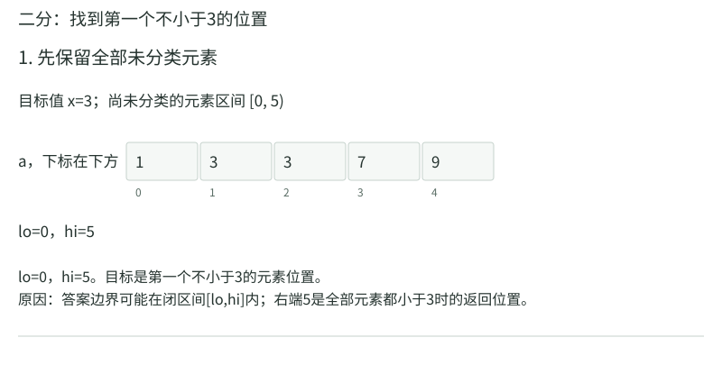
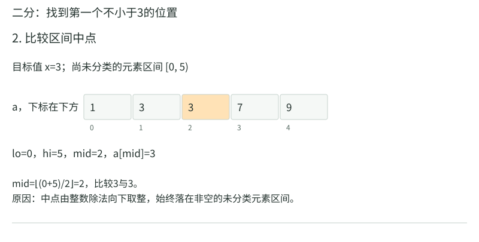
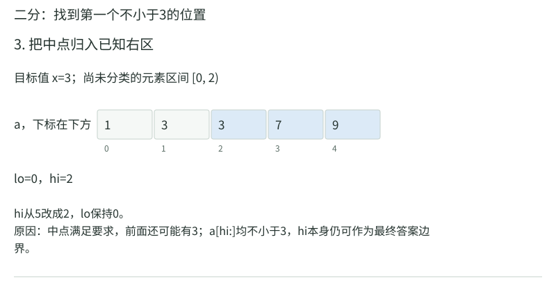
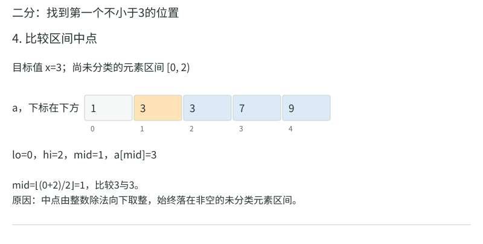
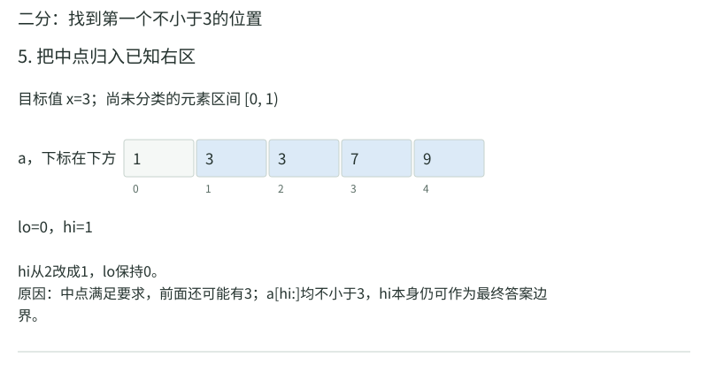
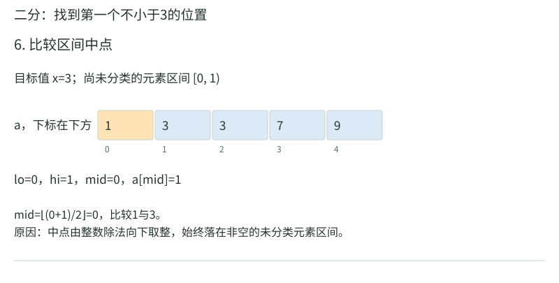
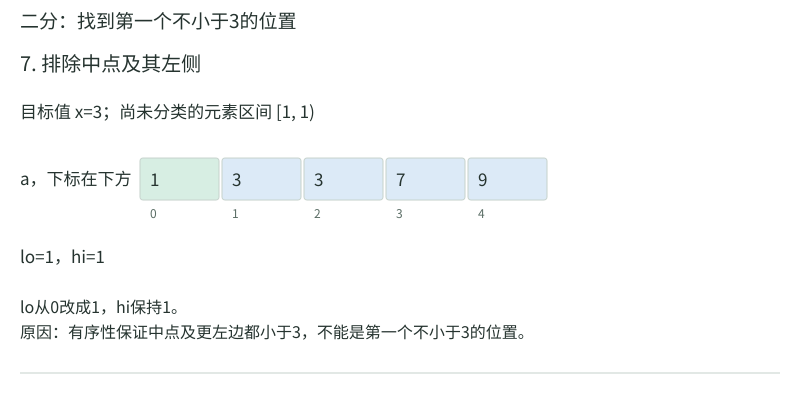
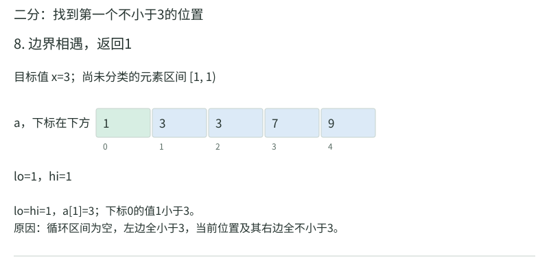

# 有序查找与位图：边界、下标和状态

在`[1,3,3,7,9]`中查找3，“找到一个3”与“找到第一个3”答案可能不同。我们先固定后者：返回第一个不小于3的位置。这个接口称`lower_bound`，即下边界。即使3不存在，也返回插入3后仍有序的最左位置。


## 先把每个格子变成一个判断

对目标`x=3`，逐项判断“这一项是否不小于x”：

```text
下标       0    1    2    3    4
数值       1    3    3    7    9
a[i]>=3    假   真   真   真   真
                ↑ 目标：第一个真
```

这条假真序列只转一次，是因为数组非降。非降允许相等，要求左边不大于右边。一旦某项已经不小于3，它右边所有项也不小于3。二分利用的是这项保证。

`lo,hi`是尚未分类区间的左右边界，写`[lo,hi)`，左含右不含。所有下标小于`lo`的项已确认太小；下标不小于`hi`的项已确认足够大。答案边界的可能位置是闭区间`[lo,hi]`，允许位于`hi`，所以“尚未分类的元素”与“可能的边界位置”要分清。

```python
def lower_bound(a, x):
    lo, hi = 0, len(a)
    while lo < hi:
        mid = lo + (hi - lo) // 2
        if a[mid] < x:
            lo = mid + 1
        else:
            hi = mid
    return lo
```

`//2`取整数除法的下整。例如5//2是2。只在`lo<hi`时访问，`mid`必在真实下标范围内。写成`lo+(hi-lo)//2`也便于在非负固定宽下标模型中避免`lo+hi`的溢出。

## 三次比较，每个被排除的格子都说明理由

|比较前lo,hi|mid怎么来|读取并比较|可以确认哪些格|更新|
|---|---|---|---|---|
|0,5|0+(5−0)//2=2|a[2]=3，3<3是假|2、3、4都不小于3；但2可能就是第一项|hi=2|
|0,2|0+(2−0)//2=1|a[1]=3，3<3是假|1及其右边都足够大；1仍可能为答案|hi=1|
|0,1|0+(1−0)//2=0|a[0]=1，1<3是真|0及其左边全太小|lo=1|
|1,1|区间为空，不算mid|不再读数组|左边全小于3，右边全不小于3|返回1|

<!-- trace:ds-binary -->

下面把比较和边界更新分成两步。橙色标当前比较项，绿色表示已确认小于3，蓝色表示已确认不小于3；空白格仍未分类。

















<!-- /trace:ds-binary -->

绿色表示已确认“小于3”，蓝色表示已确认“不小于3”，白色仍未知。蓝色出现并不表示已经可以返回：它左边可能还有更早的蓝色。`a[mid]<x`时，`mid`已经排除，所以`lo=mid+1`；否则保留`mid`这个可能边界，让`hi=mid`。把两个更新都机械写“加1”或“减1”会丢答案。

`hi-lo`是非负整数，每轮变小，只有一个未知格时也会变成0，因此会结束。结束`lo=hi`，恰好是一边全假、一边全真的分界。时间随对数增长，额外只用几个变量。

## 查不到时，不要把合法边界读成非法元素

同一数组查`x=10`：

|lo,hi|mid|比较|更新|
|---|---:|---|---|
|0,5|2|3<10|lo=3|
|3,5|4|9<10|lo=5|
|5,5|无|结束|返回5|

5是“插在末尾”的合法边界，数组却没有`a[5]`。要查是否存在，先`p=lower_bound(a,x)`，再判断`p<len(a) and a[p]==x`。短路条件先检查范围，范围不合法时不执行右边的读取。

查`x=0`会逐步把`hi`降到0，返回0；空数组初始`lo=hi=0`，一次也不读取。查`x=2`返回1，但`a[1]=3`，说明2不存在。返回了一个数组内位置，也不一定就是目标值。

找第一个严格大于目标的位置`upper_bound`，仅把分支改为“`a[mid]<=x`时`lo=mid+1`”。对3逐步是：(0,5)读下标2的3，lo变3；(3,5)读下标4的9，hi变4；(3,4)读下标3的7，hi变3；返回3。因此3占据`[1,3)`，共有2项。最后一个不大于3的位置是`upper_bound−1=2`；若upper为0，前驱为−1，表示不存在，不能用它读数组。

这也对应教师《02向量》版本C的返回值：它寻找的分界是“第一个严格大于e的位置”，最后返回分界减1，即最后一个不大于e的元素位置。沿用本例查3，边界为3，教师接口返回2；本章开头的`lower_bound`则返回1。两个结果都正确，分别服务于不同插入规则。在位置`search(e)+1`插入新3，会把它放在旧的两个3之后，保留已有等值记录的顺序。

|要回答的问题|在[1,3,3,7,9]中查3的结果|是否一定可读数组|
|---|---:|---|
|第一个不小于3的边界|1|须先检查小于长度|
|第一个大于3的边界|3|须先检查小于长度|
|最后一个不大于3的位置|2|须先检查非负|
|任意一个等于3的位置|1或2均可能|失败标记另行约定|

写答案前先固定本题要哪一种结果，后面再选代码。尤其不能将`lower_bound(e)-1`误写成最后一个不大于e；它得到的是最后一个严格小于e的位置。


对第一个真位置，所有项都假时返回n；所有项都真时返回0。两端都不需要读取虚拟元素。若你为了简化证明假设a[−1]小于所有值、a[n]大于所有值，那是数学哨兵，不等于代码真的可以访问越界位置。程序只在lo<hi时计算mid，因而mid<n，读取始终位于真实数组内。

许多二分错误来自把“候选答案位置”与“可访问元素下标”混为一谈。返回p以后先检查p<n，再读a[p]；查前驱返回−1以后先检查非负。一个函数能用n表示尾后边界，另一个接口可能用null或可选类型，调用者也要相应转换，不能只因值都是整数就直接当作数组下标。

算mid时`(lo+hi)/2`在固定宽度有溢出风险，常写`lo+(hi-lo)/2`。但若lo、hi可分别为极大正负数，hi−lo也未必安全；常见数组下标0≤lo≤hi≤n的前提才让差值范围受控。边界类型若混有有符号与无符号，−1前驱也需明确表示，不能让它绕成巨大正数。

## 数字不是数组元素，也能找同一种分界

运输重量`[2,3,4,5]`，保持顺序，最多分成2批，求每批容量最小值。容量至少5，否则5装不下；最多14，一批全装。给一个容量C，顺序装，下一件装不下才另开一批：

|容量C|逐件装法|批数|够不够|
|---:|---|---:|---|
|8|[2,3]；[4]；[5]|3|不够|
|9|[2,3,4]；[5]|2|够|
|10|[2,3,4]；[5]|2|够|

增加容量不会让原有装法失效，因此判断从“不够”转成“够”。在整数容量`[5,15)`找第一个真：mid10够，hi10；mid7不够，lo8；mid9够，hi9；mid8不够，lo9；结束答案9。这里15是尾后边界，不会被当作候选容量检查。

检查函数也需要理由：每批尽可能装向右，在相同批数后不会比其他合法方案停得更早，因此所需批数最少。若货物必须重新排序或成本有复杂限制，这个贪心前提可能失效，不能只看外层二分正确。


例如判断整数x的平方是否至少十六，在非负整数区间上是假后真，可二分第一个真得到四；若范围包含负数，结果会是真、假、真，不再是一个单边界。公式相同，搜索域不同，二分资格也不同。先证明题目实际搜索范围内单调，再设置上下界。

## 一次比较和两次比较，不要藏进同一个词

教师版本A依次判断`e<A[mi]`、`A[mi]<e`，若两者都假才确认相等；向右或命中的路径会对同一元素做两次大小比较。lower_bound式写法每轮只用一个大小关系，结束后若要确认存在再判断一次。它们都为O(log n)，但比较次数的主项或常数可能不同。

成功与失败的平均查找长度也需要区分。成功在元素节点上停止；失败在相邻元素之间的n+1个间隙中停止。不同树形、n是否为2的幂减1、成功目标分布与失败间隙分布，都会影响精确均值。即使两者都为Θ(log n)，也不能写成“精确平均次数总相等”。

举n=3且平衡地先比中间元素。成功所需大小判定层数为1、2、2，等概率均值5/3；失败的4个间隙都需要走完2层，均值2。这个例子已经足以否定“总是精确相等”。若教材把等值判断另计，需按同一成本口径重新统计，不能混用。

## 比较查找长度，先固定树和计费方式

对7项的理想中点二分，比较层分别有1项深1、2项深2、4项深3。若成功目标等概率、每层算一次主比较，平均成功层数为(1+4+12)/7=17/7。8个失败间隙在这棵满分支决策结构里都需要走完3层，失败均值3。它们均为Θ(log n)，主导增长一致，精确均值不同。

若算法每层先判等再判大小，成功在根只判一次，失败或向下路径可能判两次；此时应该将每条路径的实际判断逐条加起来。所谓平均查找长度有时按“访问节点数”，有时按“关键码比较次数”，两种教材口径不能直接相减。

## Fibonacci查找：为什么把切分点向右移

本节采用官方《数据结构（第3版）》代码2.22的版本A，接口是在`[lo,hi)`内找任意一个等于e的元素，找到返回下标，找不到返回−1。遇到重复值不保证最左或最右。它与前文的lower_bound、教师二分版本C各有自己的返回约定。

先看教师版本A每次如何比较：先问`e<A[mi]`。若真，一次比较就能转向左段；若假，还要问`A[mi]<e`，才能转向右段或确认相等。向左需要一次大小比较，向右需要两次。若左右段一样长，比较较贵的右段没有得到补偿。Fibonacci查找把左段适当加长、右段适当缩短，以调整这项不均衡。

Fibonacci数列从`F₁=1,F₂=1`开始，后项等于前两项之和：`1,1,2,3,5,8,13,…`。先考虑数组长度恰为`Fₖ−1`。选`mi=lo+Fₖ₋₁−1`，就会形成下面三部分：

```text
整个区间有 Fₖ−1 项
lo                     mi                         hi
[ 左段：Fₖ₋₁−1 项 ][ 探测项 ][ 右段：Fₖ₋₂−1 项 )
     向左只需1次比较                  向右需2次比较
```

左段长度直接由探测下标减lo得到。右段长度则是总长减去左段和探测项，即`(Fₖ−1)−(Fₖ₋₁−1)−1=Fₖ−Fₖ₋₁−1=Fₖ₋₂−1`。两侧又都是“某个Fibonacci数减1”，可以继续用同一方法切分。随着项数增大，两个相邻Fibonacci数之比接近黄金比例，因而得名黄金分割查找；实现依据的是整数数列，不需要用浮点数乘0.618去猜下标。

### 在七项数组里，完整走一次查找11

数组是`[1,3,5,7,9,11,13]`。7等于8−1，第一探测项的相对下标是5−1=4，即数值9。每次比较后只缩小区间，数组本身不搬动。

```text
下标       0   1   2   3   4   5   6
原数组     1   3   5   7   9  11  13
第1次     [  左段4项    ]  ↑ [右段2项]
                          9
第2次                         [11  13]
                                  ↑13
第3次                         [11]
                               ↑11
```

为了兼容任意长度，教师代码维护当前Fibonacci项f：先把它设成不小于区间长度的最小Fibonacci数；每轮探测前向前退，直到`f≤hi−lo`，然后取`mi=lo+f−1`。只保留仍可能命中的元素，不填充数组，也不访问虚拟格子。

|比较前区间|区间宽度|Fibonacci项如何调整|探测下标和值|比较及下一步|
|---|---:|---|---|---|
|[0,7)|7|初始8太大，退到5|0+5−1=4，值9|11<9为假，9<11为真；lo=5|
|[5,7)|2|5太大，依次退到3、2|5+2−1=6，值13|11<13为真；hi=6|
|[5,6)|1|2太大，退到1|5+1−1=5，值11|两次小于判断均假，返回5|

这里第二次比较的是13，不是11：宽度2选择f=2，探测的是这一段的最后一项。照着“黄金分割”凭感觉选中间格，很容易写出另一套过程。

查3会转向另一侧：`[0,7)`比较下标4的9，令hi=4；`[0,4)`把f从5退到3，比较下标2的5，令hi=2；`[0,2)`把f退到2，比较下标1的3，返回1。查12则先排除9及其左侧，再排除13，再排除11，最后区间为空，返回−1。每次排除都有有序性作保证。

### 不把数列更新藏在辅助类里

下面写出与教师区间版本相同的Python实现。`previous,current`保存相邻两项。向后生成用`(current,previous+current)`；向前回退用`(current−previous,previous)`。同时赋值时右侧都取旧值。例如从(3,5)回退得到(2,3)，不是先改一个变量再用新值相减。

```python
def fib_search(a, e, lo=0, hi=None):
    if hi is None:
        hi = len(a)
    if not 0 <= lo <= hi <= len(a):
        raise ValueError("查找区间越界")
    previous, current = 1, 1
    while current < hi - lo:
        previous, current = current, previous + current
    while lo < hi:
        while hi - lo < current:
            previous, current = current - previous, previous
        mi = lo + current - 1
        if e < a[mi]:
            hi = mi
        elif a[mi] < e:
            lo = mi + 1
        else:
            return mi
    return -1
```

非空区间宽度至少1，内层回退只需退到1就能停止，所以`1≤current≤hi−lo`，保证`lo≤mi<hi`。两种未命中分支都会删掉探测项，区间严格缩小。空区间一开始就跳过访问，返回−1。

还要解释为什么没有隐藏的线性循环。设本轮宽度w，所用f是最大的不超过w的Fibonacci项。下一项等于f加前一项，且大于w；前一项不大于f，所以`w<2f`。向右时新宽度w−f小于w/2；向左时新宽度f−1，下轮使用更早的Fibonacci项。每轮未命中至少使所用数列项向前退一项；项数随长度按对数增长，故总探测次数与全部回退次数都是O(log n)。初始化生成数列也是O(log n)，额外保存固定个数的整数。这里按课程的机器字运算成本模型计费。

Fibonacci查找与中点二分的渐进时间同为O(log n)。教师比较的是这套特定代码里大小比较的次数，不能据此断言它在所有机器、所有分布下都更快。若主问题是找插入边界，lower_bound往往更直接；若题目要求分析教师版本A，就应按上面的真实分支计数。

## 插值查找：用数值间距猜位置

插值查找额外利用数值间距，猜目标在范围内的比例。例`[10,20,30,40,50]`找40，按$(40-10)/(50-10)=3/4$猜到下标3，直接命中。分子是目标离左端数值的距离，分母是两端数值差，得到比例以后乘下标跨度4。

若数组换成`[1,2,4,8,16]`找8，初次比例为`(8−1)/(16−1)=7/15`，乘下标跨度4再向下取整，只猜到下标1，值为2；应将左界移到2。剩下`[4,8,16]`中比例为`(8−4)/(16−4)=1/3`，乘跨度2向下取整为0，仍探测左端下标2的4；再移左界到3。剩下`[8,16]`比例为0，终于在下标3命中。

每次探测后仍须像查找一样排除一段，不能只做一次比例计算就结束。重复值可能使分母为0，目标越过端点也要先拒绝；算出的下标必须落在当前区间内。数值分布适合比例估计时可以减少探测，最坏仍可能线性，不能从等距数组的一次命中推出普遍保证。

## 位图：用一位回答“有没有”

当键来自较小整数范围`[0,U)`，只需要保存是否出现，可以给每个可能值分配一位。键k对应字节下标k//8，以及该字节内偏移k%8。若约定低位在前，掩码为`1 << (k%8)`。设置用按位或，测试用按位与，清除用与上反掩码。位次约定必须统一，与机器大端小端是不同层面的概念。

U=16，要标记2、5、13：第0字节置第2位与第5位，二进制为00100100；第1字节置第5位，为00100000。查询5读第0字节与00100000相与，非0，存在；查询6与01000000相与为0，不存在。标记相同值两次不会计成两份，位图保存的是集合而非出现次数。

把两个字节从全0开始逐次改写，能看清“下标对应键”与“位的数值”是两回事。每个字节的二进制数都按高位在左、低位在右书写，最右位编号0，依次向左编号1到7。

|动作|先算字节号与位号|本次掩码|第0字节|第1字节|
|---|---|---|---|---|
|初始化|两个字节各有8位|无|00000000|00000000|
|加入2|2//8=0，2%8=2|00000100|00000100|00000000|
|加入5|5//8=0，5%8=5|00100000|00100100|00000000|
|加入13|13//8=1，13%8=5|00100000|00100100|00100000|
|再次加入5|仍是第0字节第5位|00100000|00100100|00100000|
|删除2|第0字节第2位清0|保留掩码11111011|00100000|00100000|

掩码只在要操作的那一位放1。按位或`|`逐位执行“至少一边为1就写1”，所以置位不会抹掉同字节其他键；按位与`&`逐位执行“两边都为1才写1”，所以测试时只留下被问的那一位。清除时反过来，让保留掩码在目标位为0、其他位为1，才能只清掉目标位。最后两字节虽然都是`00100000`，分别代表键5与键13，因为字节位置不同。

下面用Python的`bytearray`保存字节。`U+7`再整除8实现向上取整，例如U=10仍须两个字节；最后6个多余位不代表合法键。

```python
def new_bitmap(U):
    if U < 0:
        raise ValueError("范围大小不能为负")
    return bytearray((U + 7) // 8)

def bitmap_change(bits, U, k, present):
    if not 0 <= k < U:
        raise ValueError("键不在范围内")
    byte, bit = k // 8, k % 8
    mask = 1 << bit
    if present:
        bits[byte] |= mask
    else:
        bits[byte] &= 255 ^ mask

def bitmap_contains(bits, U, k):
    if not 0 <= k < U:
        return False
    return (bits[k // 8] & (1 << (k % 8))) != 0
```

255的八位表示全为1，`255 ^ mask`只把掩码的那一位翻成0，得到表中的保留掩码。函数约定`bits`由同一个U创建；更换U不能只改参数而不重新准备足够存储。这里一位只保存真假。若要求重复键的次数，还须计数数组或其他结构；重复设置一位不会自动累加。

空间约U/8字节，设置与查询为O(1)。但清空整个新位图需要Θ(U)位操作或Θ(U/w)机器字操作。若U巨大而实际只出现少量键，位图可能比散列表浪费得多。某些“快速初始化”技巧用已初始化前缀与互相校验的索引，避免每次全清，但实现需要额外数组与合法性判断，不等于未初始化内存可以随便读取。

## 位图快速清空的一个可实现替代

若每轮只标记少量键，可额外记录本轮真正从0变1的键列表，结束时仅清这些位。比如U很大，本轮只置2、5、13，记录这三个键，清空只做三次。若重复置5，不要重复记录，否则列表可能随操作数增长。这个方法的清空成本与本轮不同键数有关，但第一次申请与初始化底层位图仍可能花Θ(U/w)。

另一做法为每键保存时间戳，当前轮号为epoch，时间戳等于epoch视为已出现。清空只增加epoch；但每键不再是一位，内存增大，epoch溢出时要真实重置。将清空从每轮移到偶尔一次，并不等于完全没有初始化或溢出成本。

## 用位图筛质数，标记从哪里开始

寻找2到30的质数。开始把所有数设为未合成，0和1另排除。处理2时标记4、6、8……；处理3时标记9、12、15……；处理5时标记25、30。处理到⌊√30⌋=5即可，剩余未标记者为2、3、5、7、11、13、17、19、23、29。

从p²开始，是因为小于p²的p的倍数p×k中k<p，早已被更小的质因子标记。只处理尚未标记的p，经典埃拉托斯特尼筛的时间O(U log log U)，空间O(U)位；证明这个更精细的时间界需要质数倒数和估计，不能把“每个数只被标一次”当理由，合数实际上可能被多个质因子标记。

实现时用`p <= U//p`判断p²≤U，可以避免固定宽度整数中的p*p溢出；枚举倍数前也要确保起点可表示。

对0到30的标记写入不必藏在省略号里：

|当前p|为什么处理/跳过|实际尝试置为合数的下标|
|---:|---|---|
|2|尚未标记，p²=4|4,6,8,10,12,14,16,18,20,22,24,26,28,30|
|3|尚未标记，p²=9|9,12,15,18,21,24,27,30|
|4|已经由2标记|跳过，不把4当质数重复筛|
|5|尚未标记，p²=25|25,30|
|6|6²>30|停止检查p|

12、18、30等会再次被置为真，重复写同一标记不产生重复元素。0、1在初始化就单独排除，不能因为“没被筛掉”而混入质数输出。扫描最终未标记的2到30，得到正文列出的十个质数。

## 练习与答案

练习1。 a=`[2,2,4,6,6]`，分别求lower_bound(6)、upper_bound(6)、lower_bound(5)和≤1的最后位置。

解答：依次3、5、3、−1。6的范围是`[3,5)`，有2项；5不存在，但插入下标3前仍有序；≤1的元素没有，所以前驱为−1。若把upper_bound(6)的结果5拿去读a[5]就越界；它表示边界，不表示一个可读取元素。

练习2。 数组`[1,5,3,7]`能否使用同一二分查找3？写一个失败过程。

解答：按lower_bound代码，lo0,hi4,mid2，a[2]=3，hi变2；接着mid1，a[1]=5，hi变1；mid0，a[0]=1，lo变1，返回1，a[1]=5，误判3不存在。算法依赖的“a[mid]≥x则右半都不小于x”在乱序输入中不成立。二分不是对任意数组都有效的机械折半。

练习3。 U=10⁹、实际只有1000个整数，要做存在查询。位图是否总比散列表好？

解答：位图需要约125MB，还可能花时间初始化；1000个键的散列表通常只需远少于这个空间。位图适合范围可控、键较密集或位运算批处理有价值的场景。也可先将出现的键排序，查询用二分，空间与实际键数相关。选择应比较范围U、实际数n、更新频率与可用内存。
