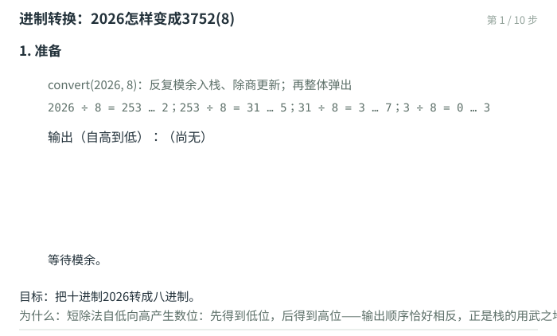
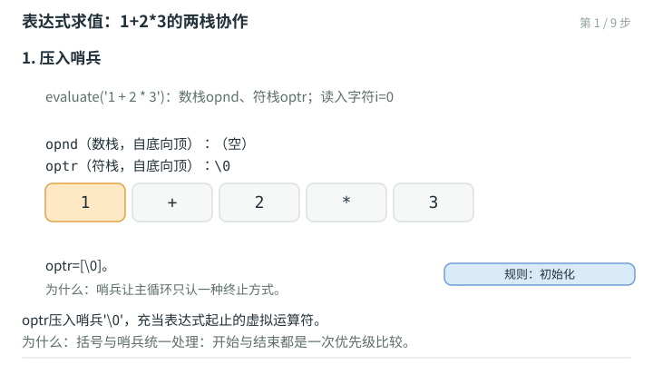

# 栈：调用栈、表达式求值与栈混洗

栈（stack）是受限的序列：只允许在栈顶（top）操作——`push()`入栈、`pop()`出栈、`top()`查询栈顶，外加`empty()/size()`。先进后出（LIFO）的限制换来一条铁律：**任何时刻，可访问的元素只有栈顶一个**。本章沿讲义04章的主线走五站：调用栈（递归的隐式栈与尾递归消除）、进制转换（显式手工栈的第一个应用）、括号匹配（单种括号的计数器为何不够）、表达式求值（双栈协作与优先级表），最后以栈混洗收束——把n个元素按一个栈的规矩重排，恰好对应Catalan数。

## 调用栈：递归的隐式栈

程序运行时，每次函数调用都会在**调用栈**（call stack）上压入一帧：局部变量、参数、加上返回地址。以课件的三层调用为例——`main()`调用`funcA()`（返回地址1000），`funcA()`调用`funcB()`（返回地址1500），`funcB()`又递归调用自己（返回地址1820）——栈帧自底向顶依次为main、funcA、funcB、funcB，每帧记录各自的局部变量与返回地址；函数返回时弹出一帧，跳回该帧记录的地址。递归算法的空间复杂度主要取决于**递归深度**（同时活着的帧数），而非递归实例总数——第03章忒修斯绳线的比喻，在这里落实为具体的栈帧。

**尾递归**（tail recursion）：线性递归的特例，唯一的那句递归恰好位于函数末尾（return之前）。第03章的数组倒置就是一例。它的性质耐人寻味：一旦抵达递归基，会触发一连串返回地址相同的return，调用栈连续pop瞬间清空；而且每有新帧入栈，老帧随即废弃——何不直接复写老帧？越来越多的编译器能自动识别并做**尾调用优化**（TCO）：时间复杂度有常系数改进，空间复杂度或有渐近改进（$O(n) \to O(1)$）。手工消除尾递归也只三步：把递归形式改写为转向标志`next:`，把递归调用改为`goto next`，把参数更新移到goto之前——`reverse()`由此从$O(n)$空间降到$O(1)$。头递归（如进制转换的递归版）没有这份幸运：它必须在下潜到最深处之后才开始做事，调用栈无法省略——要消除，只能显式地请出一章真正的栈。

## 进制转换：手工栈的第一课

给定十进制非负整数，转换为b进制的表示。回忆短除法：反复整除取商、模余取数位，即可自低而高得出各位——比如$2026_{(10)}$：$2026 = 3 \times 8^3 + 7 \times 8^2 + 5 \times 8 + 2$，即$3752_{(8)}$（讲义另举$12345_{(10)} = 30071_{(8)}$；作为文化背景，巴比伦楔形文字使用60进制，正方形对角线记作$1°24'51''10'''$，即$1 + 24/60 + 51/60^2 + 10/60^3 \approx 1.41421296$，误差小于$0.6 \times 10^{-6}$，即便边长1公里误差不足1毫米）。

问题在输出次序：数位自低向高产生，却要自高向低打印。递归版用头递归的调用栈完成这一反转：

```cpp
void convert( uint64_t n, int base ) {              //递归版：隐式调用栈
   static const char digit[] = "0123456789ABCDEF";
   if ( n < 1 ) return;                             //递归基
   convert( n / base, base );                       //头递归：先输出所有高位
   output( digit[ n % base ] );                     //再输出最低位
}  //时间、空间均为O(logn)
```

迭代版把隐式的调用栈换成显式的手工栈——模余入栈、除商更新，最后整体弹出：

```cpp
void convert( uint64_t n, int base ) {              //迭代版：显式手工栈
   const char digit[] = "0123456789ABCDEF";
   Stack<char> S;
   while ( 0 < n ) { S.push( digit[ n % base ] );  n /= base; }
   while ( !S.empty() ) output( S.pop() );          //按常规次序输出各数位
}  //同为O(logn)，常系数更小
```

逐步演示（$2026 \to 3752_{(8)}$）：



## 括号匹配：计数器为何不够，栈又为何够

表达式`{[()]}`里，读到`)`时应配对最近一个尚未闭合的`(`。原则：**消去一对紧邻的成对括号，原表达式匹配与否不受影响**——减而治之。实现只扫一趟、绝不回头：左括号一律进栈暂存；右括号弹栈核对。

先看一种括号的简化情形：其实只需一个计数器——左括号加一、右括号减一，中途转负即失配，终了归零即匹配。可惜多种括号并存时，多个计数器仍可能误报：`([)]`会让两个计数器同时归零，配对关系却是错的。还须回头求助于栈：左括号一律进栈；右括号必须与**栈顶**左括号同类：

```cpp
bool paren( const char A[], Rank n ) {              //多类括号匹配：一趟扫描
   Stack<char> S;                                   //无论多少种括号，只需一个栈
   for ( Rank i = 0; i < n; i++ )
      switch ( A[i] ) {                             //左括号一律进栈
         case '(': case '[': case '{': S.push( A[i] ); break;
         case ')': if ( S.empty() || '(' != S.pop() ) return false; break;
         case ']': if ( S.empty() || '[' != S.pop() ) return false; break;
         case '}': if ( S.empty() || '{' != S.pop() ) return false; break;
      }
   return S.empty();                                //最终栈空，当且仅当匹配
}
```

原理是栈的一条天然性质：**任何时刻，栈内运算符（此处是左括号）的滞留次序与配对次序严格对应**——栈顶永远是"最急需配对"的那个。这一性质还能推广：XML支持自定义元素，等于自定义无数种括号，一个栈依然够用。

![逐步演示：括号匹配：{[()]}怎样通过一个栈](图片/演示-ds08-paren-01.svg)

## 表达式求值：双栈协作

求算术表达式的值是编译器、shell、电子表格的共同需求。求值策略仍是减而治之：优先级最高的局部先计算，并以其数值替代——洋葱芯一趟顺序扫描即可找到，但要保证"洋葱芯"随时可见、随手可剥，还须借助栈：**已扫到、但尚待处置的部分用栈缓存**。用两个栈分工——运算数栈`opnd`、运算符栈`optr`——关键的一条不变式是：任何时刻，optr内运算符的优先级必然自底向顶渐次升高。于是栈顶部分能否立即计算，只取决于栈顶运算符与当前运算符的**相对优先级**。

各种优先级情况被归纳为一张$9 \times 9$的表（栈顶运算符×当前运算符，取$+ - * / \ ^ !\ ( )$与哨兵$\$ $九种），并用**完美散列**压缩为长度347的一维数组：

```cpp
const char Prio[] =                  //栈顶 \ 当前：+ - * / ^ ! ( ) $
   "~<  >   >  >       < .   >     <"
" <  .>   >      >        <>     "
"    .   >< <           >    x< <"
"         >    <        >  >  < <"
" . >   >      >  <   <   <      "
"  .<  >< < <        >   <       "
"x   >  >>  >         >  >  <    "
"            >< <   >   >      <<"
". <   >           .  >      ~ < "
" .   x   <<<           >  <";
char prio( char t, char c ) { return Prio[ ( 37*t + 47*c ) % 347 ]; }   //完美散列
```

主算法随之水落石出。逐个处理各字符，遇操作数（可能多位、含小数）读入数栈；遇运算符则查`prio(栈顶, 当前)`，按四种结果处置：

- **`'<'`：推迟计算，静待时机**——当前运算符进符栈（如`PRIO('-', '^') = '<'`：乘方优先级更高，减号只能等）；
- **`'>'`：时机已到，执行计算**——弹出栈顶运算符与所需操作数，计算结果压回数栈（如`PRIO('!', '/') = '>'`：阶乘必须先行）；
- **`'~'`：终须了断**——左右括号相遇则脱去括号（`PRIO('(', ')') = '~'`）；双哨兵`\$`相遇则求值结束（`PRIO('\0', '\0') = '~'`，"从创世纪到世界末日"）；
- **`'='`**：当前运算符与栈顶同级（如连续加减），按结合性处理。

以`1 + 2 * 3`走一遍：数1进栈；`+`与哨兵比得`<`进符栈；数2进栈；`*`与`+`比得`<`进符栈（乘号更高，加号等得起）；数3进栈；读到`\$`，`*`与`\$`比得`>`，弹出`*`与2、3算得6压回；`+`与`\$`比得`>`，算得7压回；`\$`与`\$`相会，弹出唯一的7。逐步演示：



## 逆波兰表达式：擦去左括号

**逆波兰表达式**（RPN, Reverse Polish Notation）由Lukasiewicz提出：运算符置于操作数之后（故称后缀式），不使用括号即可表示带优先级的运算关系；作为补偿，须额外引入分隔元字符（空格）。比如`0 1 2 + + 3 ^ 4 5 + / 6 ! * 7 8 + 9 * -`。

它与本章的求值算法血缘极深：**中缀转后缀，就是把转换过程中输出的所有左括号擦掉**。`evaluate()`已经同时生成RPN——把读入的操作数、以及每次`'>'`执行的运算符顺序接入RPN串即可（代码中`append(RPN, ...)`两处）。反过来，RPN自身的求值更简单：**只需一个运算数栈**——遇操作数入栈；遇运算符弹出所需个数的操作数、计算、结果压回；扫完后栈中唯一剩值即结果。练习：手工把`( 0 + ( 1 + 23 ) / 4 * 5 * 67 - 8 + 9 )`转为RPN并求值（讲义实例：结果2025）。

## 栈混洗：Catalan数

给定输入序列$A = [1, 2, \ldots, n]$（只许从A端弹出），借助一个中转栈S，通过两类操作重排为输出序列B：**A操作**=A顶弹入S，**B操作**=S顶弹入B。这样得到的B称作A的一个**栈混洗**（stack permutation）。同一输入可有多种混洗：$[1,2,3,4\rangle$、$[4,3,2,1\rangle$、$[3,2,4,1\rangle$……但$[3,1,2,\ldots\rangle$必然不行。混洗总数$SP(n) = ?$——既然$[3,1,2\rangle$不可生成，$SP(n) < n!$，更精准的呢？

两次原理计数。考查排头的元素1：混洗之后它将居于第$k$位，共$n$类可能（**加法原理**）；第$k$类如何生成？无非四步：1之前的$k-1$个元素先于1入栈、1入栈、1即刻弹出居第k位、其余$n-k$个元素完成各自的混洗——前后两个子问题相互独立（**乘法原理**）。于是

$$SP(n) = \sum_{k=1}^{n} SP(k-1) \cdot SP(n-k), \qquad SP(0) = 1$$

这正是**Catalan数**的递推公式，通项$cat(n) = \dfrac{(2n)!}{n!\,(n+1)!}$，且$cat(n) = \Theta(4^n / n^{1.5})$：$SP(3) = 5 < 3! = 6$，$SP(4) = 14 < 4! = 24$。

哪些排列不是栈混洗？**禁形**：对任何$1 \le i < j < k \le n$，模式$\{\ldots, k, \ldots, i, \ldots, j, \ldots\}$（k在i之前而j在最后）必非栈混洗——$[3,1,2\rangle$就是$n=3$的唯一禁形。反过来，不含任何禁形的序列一定是栈混洗，于是有$O(n^3)$乃至$O(n^2)$的甄别算法。但返璞归真，借助栈直接模拟只需$O(n)$：逐个检视目标元素，若它在（或能腾挪至）S顶部则执行B操作，否则无法完成：

```cpp
Rank spCheck( Vector<Rank>& B ) {        //B = unsort[1,n]
   Stack<Rank> S;  Rank A = 1;           //中转栈、输入栈（后者只记栈顶）
   for ( Rank n = B.size(), r = 0; r < n; S.pop(), r++ )
      if ( S.empty() || S.top() != B[r] )
         if ( n < A || B[r] < A )        //A已空，或不含B[r]
            return r;                    //卡住：不是栈混洗
         else
            do S.push( A++ );            //连续A操作
            while ( S.top() != B[r] );
   return B.size();                      //成功
}  //O(n)
```

用禁形$[3,1,2\rangle$走一遍即知它为何卡住：

![逐步演示：栈混洗甄别：[3,1,2]为什么卡住](图片/演示-ds08-stackperm-01.svg)

栈混洗还有一副对称的面孔：每个混洗对应于n次A操作与n次B操作构成的序列，且任一前缀中A操作不少于B操作——把A、B对应于左、右括号，n个元素的栈混洗与n对括号的匹配表达式一一对应（第08章开头刚讲过它的判定）。Catalan数在这里第二次现身。

## 本章要点

- 栈＝只许栈顶操作的受限序列；调用栈是递归的隐式栈，空间取决于递归深度；尾递归可被TCO消除，或手工三步转迭代。
- 进制转换：短除法自低向高产生数位，手工栈反转输出次序，$O(\log n)$。
- 括号匹配：单种括号计数器足矣，多类括号必须用栈——栈顶永远是"最急需配对"的左括号；可推广至XML。
- 表达式求值：opnd/optr双栈，优先级表完美散列压缩，四种情形`< > ~ =`；不变式：符栈优先级自底向顶递增。
- RPN：中缀转后缀＝擦去左括号；RPN求值只需一个数栈。
- 栈混洗计数$SP(n)$为Catalan数；禁形$\{k, i, \ldots, j\}$刻画非混洗；直接模拟$O(n)$甄别；混洗与括号匹配一一对应。
