# 队列、单调结构与候选维护

任务A、B、C依次到达，要求先处理A，再处理B、C。若用栈，弹出顺序会变成C、B、A；若每次删除数组第一项又将全部后缀前移，虽然顺序正确，每次处理却可能多搬许多元素。队列要保留到达顺序，同时让头部删除和尾部插入都便宜。先看数组怎样复用已经空出的格子，再看如何用两个栈实现同样的接口。

`enqueue`把新项接到尾部，`dequeue`从头部取走，空队列不能出队。先到者先离开称为先进先出。后面的单调队列还会主动删掉不再可能胜出的候选，那需要额外证明；普通队列不会擅自丢掉仍在等待的任务。


## 环形数组的“顺序”要从队头读

数组有5格，记容量`C=5`，`front`指队头物理下标，`size`记有效项数。删除头部时，只将front推进一格，不搬后面的内容。但若一直向右追加，很快又会到数组末尾，即使左边已有空位也用不上。环形数组把末格的下一个位置定义为第0格，让这些位置可以重复使用。

从队头开始的第`k`项采用零编号，即`0<=k<size`，其物理下标为`(front+k)%C`。这里`%`取非负整数除法余数，例如`6%5=1`，表示越过末格后绕回。因为同时最多只有C项，不同的逻辑项不会占同一格。

```text
物理格子：  0   1   2   3   4
初始内容： [空][空][空][空][空]    front=0,size=0
```

入队位置是`(front+size)%C`，先写值再加`size`。出队先读`a[front]`，再`front=(front+1)%C`并减`size`。用下表做完一圈：

|操作|算出的读取/写入格|物理数组|front,size|逻辑队列|
|---|---|---|---|---|
|入A|写(0+0)%5=0|A,空,空,空,空|0,1|A|
|入B|写1|A,B,空,空,空|0,2|A,B|
|入C|写2|A,B,C,空,空|0,3|A,B,C|
|入D|写3|A,B,C,D,空|0,4|A,B,C,D|
|出A|读0，front变1|A,B,C,D,空|1,3|B,C,D|
|出B|读1，front变2|A,B,C,D,空|2,2|C,D|
|入E|写(2+2)%5=4|A,B,C,D,E|2,3|C,D,E|
|入F|写(2+3)%5=0|F,B,C,D,E|2,4|C,D,E,F|

格1的B仍可能留着旧数值，但已不在有效逻辑区间。不能把物理数组从0打印到4就当队列。空为`size=0`，满为`size=C`。另一种只存头尾、留一个空槽的设计只能放`C-1`项，满空判断不同，不要把两个版本混用。

## 两个栈翻一次，最早入队的就到顶

准备`in`、`out`，每个栈都从底写到顶。入队只向`in`压入。出队先看`out`：非空直接弹；空时才把`in`全部倒进`out`。入A、B、C再出A的每一次栈动作如下：

|动作|in（底→顶）|out（底→顶）|局部变量/返回|
|---|---|---|---|
|入A，push in|A|空|无|
|入B，push in|A,B|空|无|
|入C，push in|A,B,C|空|无|
|请求出队，out空|A,B,C|空|开始转移|
|pop in|A,B|空|暂存C|
|push out|A,B|C|C移完|
|pop in|A|C|暂存B|
|push out|A|C,B|B移完|
|pop in|空|C,B|暂存A|
|push out|空|C,B,A|A来到out顶|
|in空，结束转移；pop out|空|C,B|返回A|

<!-- trace:ds-queue -->

每次弹出后，元素先在局部变量x中，随后才压入另一栈。第三排把这个暂存状态也画出来，避免转移途中看起来丢失元素。

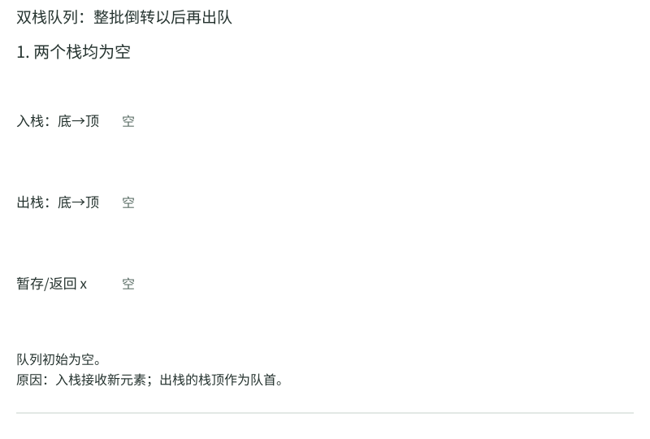

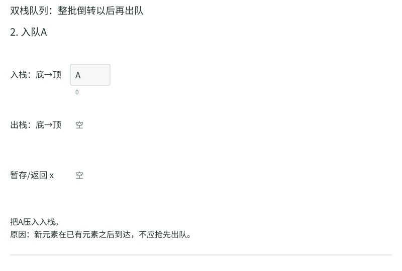

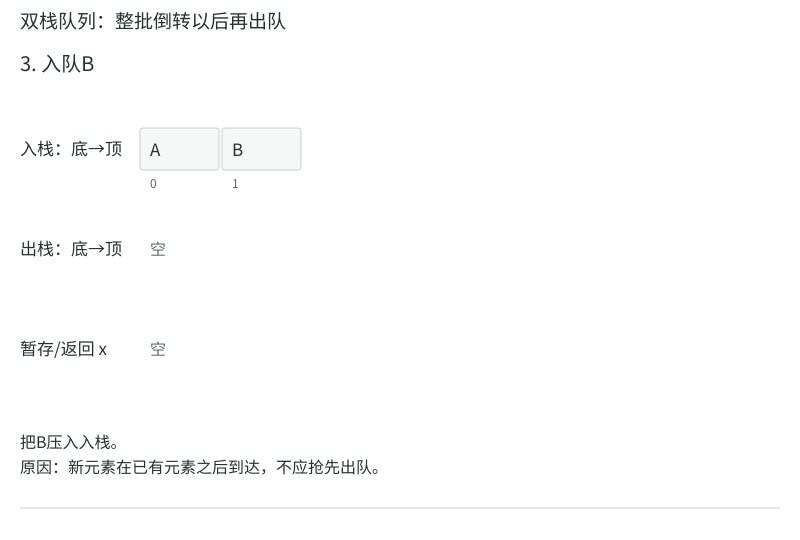

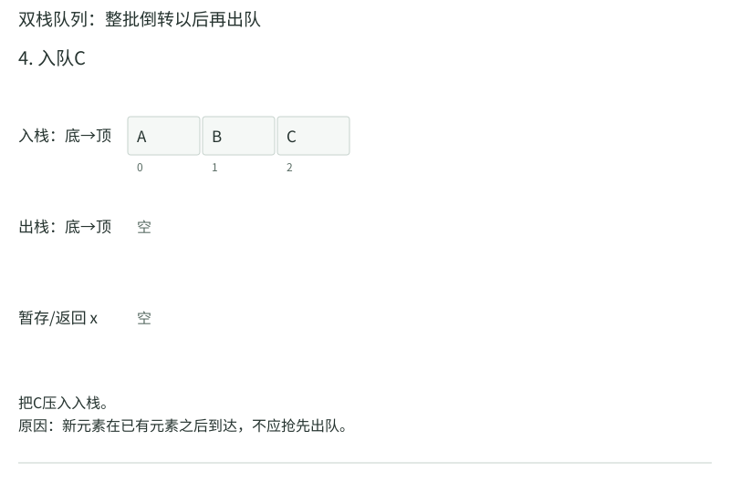

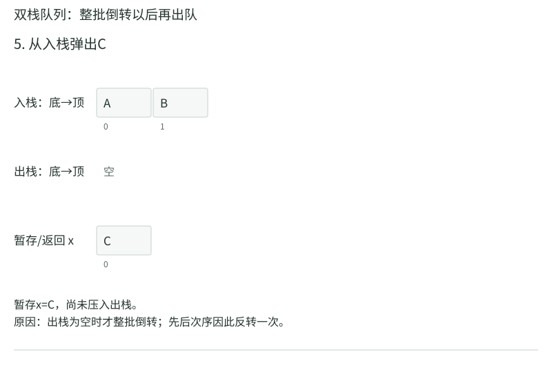

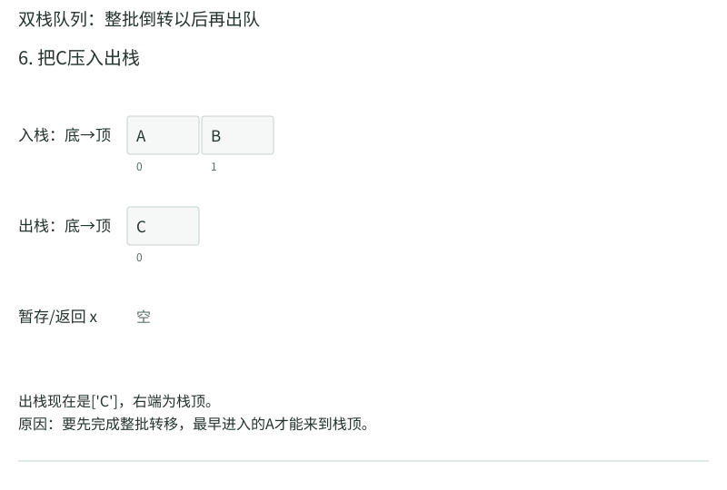

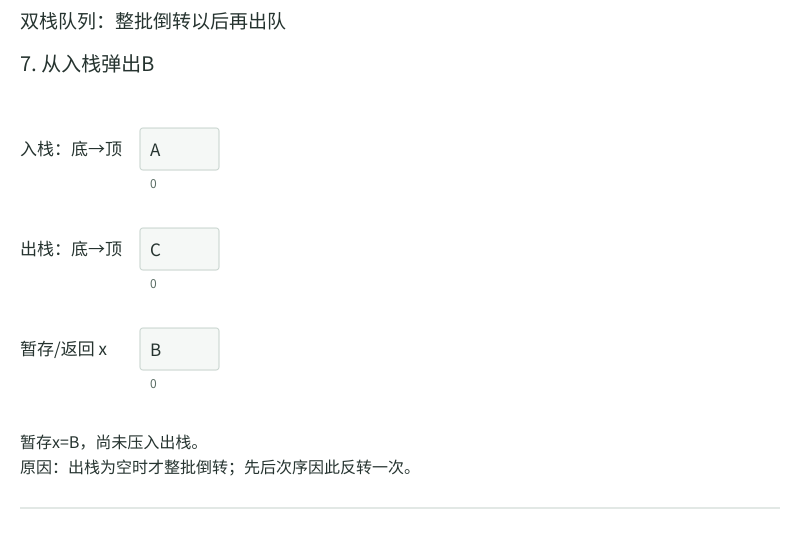

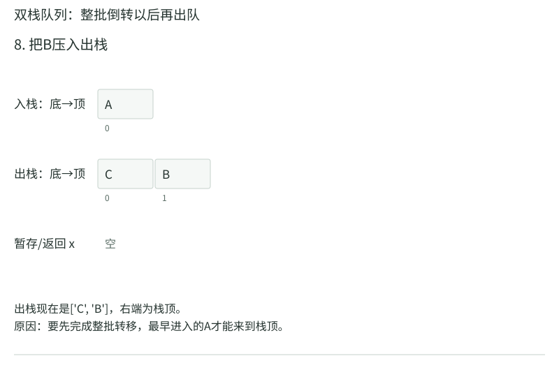

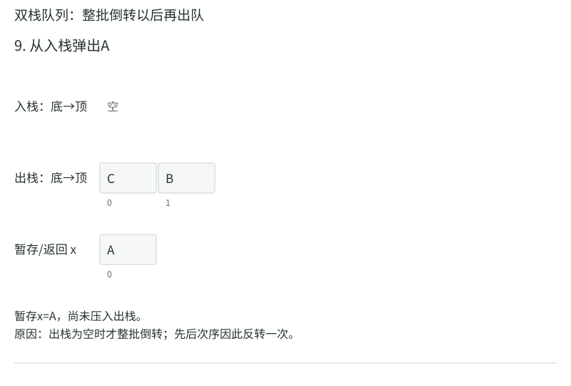

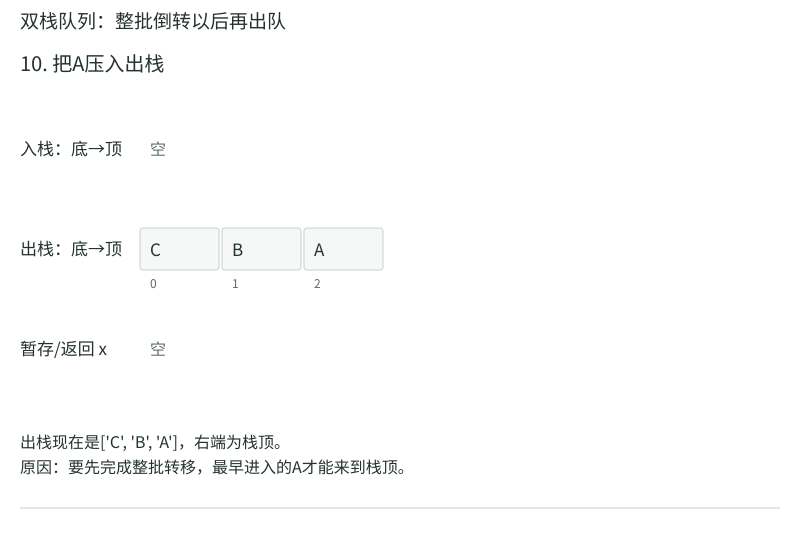

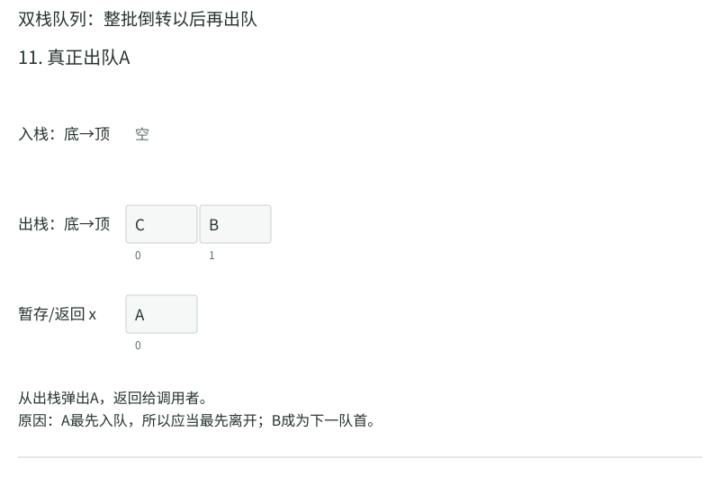

<!-- /trace:ds-queue -->

此时再入D，`in=[D],out=[C,B]`。下一次出队必须弹B，不能把D再压到out顶，否则新项会抢在旧项前。逻辑队列始终是“out从顶到底，再接in从底到顶”。

单次出队可能一次转移很多项，最坏线性；但每个元素只经历入in、一次转移、出out这条路线，总共常数次栈操作。所以从空队列开始`m`次合法操作总成本`O(m)`，摊还常数。它对每条操作序列都成立，不靠平均运气。

## 轮转调度，用队列模拟一段真实过程

任务A需3单位、B需1、C需2，时间片为1。初始队列A3,B1,C2。执行A一单位后剩A2，接到尾，队列B1,C2,A2；执行B完成，队列C2,A2；执行C后剩C1，队列A2,C1；执行A后剩A1，队列C1,A1；执行C完成，再执行A完成。完成时刻分别B为2、C为5、A为6。

队列只管理轮到谁，不决定每个任务的总需求。若新任务在执行中到达，应明确入队时刻与当前任务重新入队的先后规则；相同时刻的约定可能改变精确等待时间。用一个时间轴与队列状态同步写，就不会把先进先出误读成每个任务一口气执行完。

## 窗口最大值：丢旧候选必须有可检验的理由

对`[2,1,5,3,4,2]`，每次看连续3项，窗口依次为`[2,1,5]`、`[1,5,3]`、`[5,3,4]`、`[3,4,2]`，最大值应是5、5、5、4。

只保存一个最大值不够：它离开窗口后，需要知道剩下谁能接班。保存所有窗口项虽正确，却还要重新找最大。我们用双端队列保存仍有资格的候选下标：下标递增，值严格递减。头尾都可删除，叫双端队列；“单调”是我们对它施加的维护规则，不是容器自己会做。

每到下标`i`，当前左边界为`i-w+1`，`w=3`。先从头删除小于左界的下标，再从尾删除值不大于新值的候选，最后加入`i`。小于左界才过期，等于左界仍在窗口。

|输入步骤|具体动作|候选下标（头→尾）|候选值|是否输出|
|---|---|---|---|---|
|i=0，值2|无过期、无尾项，入0|[0]|[2]|未到3项|
|i=1，值1|头0未过期；2>1不删；入1|[0,1]|[2,1]|未到3项|
|i=2，值5|左界0，头0未过期|[0,1]|[2,1]|先不输出|
|同一步|尾1的值1<=5，删1|[0]|[2]|继续比尾|
|同一步|尾0的值2<=5，删0|[]|[]|继续到空|
|同一步|入2|[2]|[5]|输出5|
|i=3，值3|左界1，头2未过期；5>3；入3|[2,3]|[5,3]|输出5|
|i=4，值4|左界2，头2未过期|[2,3]|[5,3]|先不输出|
|同一步|尾3的值3<=4，删3|[2]|[5]|5>4停止删尾|
|同一步|入4|[2,4]|[5,4]|输出5|
|i=5，值2|左界3，头2<3，删头2|[4]|[4]|旧最大终于过期|
|同一步|4>2，不删尾；入5|[4,5]|[4,2]|输出4|

为什么新5可以删除旧2、旧1？它更大，而且位置更晚，在未来任何仍含旧项的窗口里，新5都还在，旧项都赢不了它。新5离开时，旧项早已离开。两个条件必须同时有：只比较大小而不比较新旧到达位置，证明就断了。

相等时也删旧项能正确输出最大值；若还要求最早最大值下标，则应保留旧的等值候选。下标不能随便换成数值，因为相同值可能来自不同位置，要靠下标判断谁过期。

```python
from collections import deque

def window_maximum(a, w):
    if not 1 <= w <= len(a):
        raise ValueError("窗口宽度必须在1到数组长度之间")
    q = deque()
    answer = []
    for i in range(len(a)):
        while q and q[0] < i - w + 1:
            q.popleft()
        while q and a[q[-1]] <= a[i]:
            q.pop()
        q.append(i)
        if i >= w - 1:
            answer.append(a[q[0]])
    return answer
```

每个下标进一次，最多从头或尾出一次，两重while累计删除也不超过`n`次，总时间$\Theta(n)$，最多保留`w`个候选。某一轮删很多，不等于每轮都删同一批项。宽1时应逐项输出自身，宽`n`时只输出全局最大；这些边界可直接检验过期条件有没有差1。

## 最大栈：同时保存当前前缀的最大值

如果需要栈在push、pop以外还能O(1)查询最大值，可以每项保存`(值,压入此项后栈内最大值)`。依次压2、5、3，节点记录为(2,2)、(5,5)、(3,5)。弹3以后，顶部(5,5)仍给最大值5；再弹5，顶部(2,2)给2。

这需要每项多存一个最大值，总空间仍O(n)。也可以只在最大值变化时保存“影子记录”，但重复最大值要计数或允许重复压入，避免弹出一个5就误以为所有5都离开。用两个最大栈组成队列时，队列最大值为两栈最大值的较大者，空栈另行处理。

单调队列更积极地删除被支配的候选，空间在随机输入下可能较小；但最坏递减窗口会保存w项。固定一个随机连续分布的窗口，其候选数期望约H_w，不能据此声称无限长运行过程的峰值也只有O(log w)。28章会解释观察时间为何影响峰值。

## 直方图最大矩形：栈中保存尚未结算的柱子

柱高`[2,1,5,6,2,3]`，每柱宽1。最大矩形可以取高度5、覆盖第2与第3柱，面积10。枚举每个区间求最低高度会很慢；单调栈维护高度不降的候选柱，一旦遇到更矮柱，就能确定若干旧柱的最远右边界。

用下标栈，开始压一个虚拟下标−1，结束补高度0。处理过程：

- i=0，高2，压0，栈为−1,0。
- i=1，高1，比2矮，弹0；弹后左边界−1，宽度`1-(-1)-1=1`，面积2。再压1。
- i=2，高5，压2；i=3，高6，压3。
- i=4，高2，先弹3，高6，左侧剩2，宽`4-2-1=1`，面积6；再弹2，高5，左侧剩1，宽`4-1-1=2`，面积10。高1低于2，停止，压4。
- i=5，高3，压5；i=6补0，依次弹5得3，弹4得8，弹1得6，最大仍10。

宽度为什么是`i-left-1`？i是右边第一个严格更矮柱，不能包含；弹出后栈顶left是左边尚留的不高于当前柱的候选位置，本次先不包含它。中间从left+1到i−1，共i−left−1根柱子，它们都至少与当前弹出高度一样高。若left与当前柱等高，本次结算的只是较窄范围，不是当前高度能向左延伸的最终最大范围；更靠左的等高代表随后弹出时会覆盖完整宽度。例如[2,2,0]先弹右侧2只得面积2，再弹左侧2得到面积4。因此保留等高的版本不能把每次弹后的left都称作“严格更矮”。

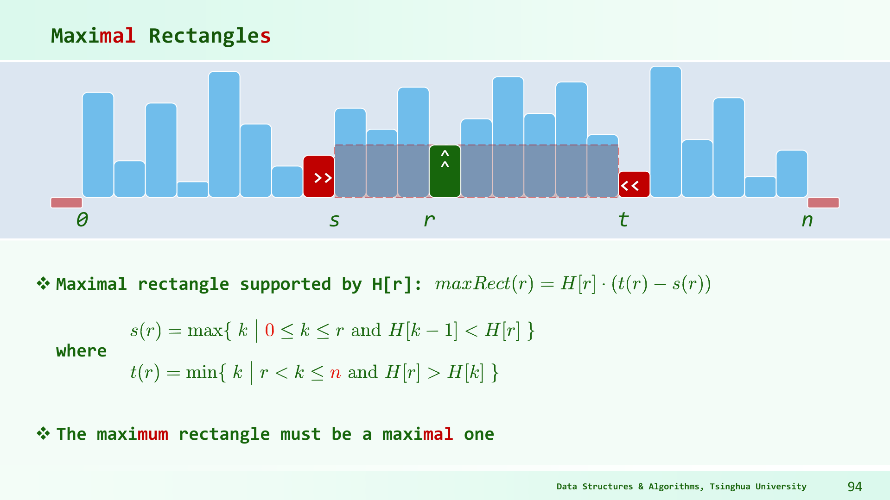

图中绿色柱r给出矩形高度，左侧红柱比它矮，右侧红柱也比它矮；中间被阴影覆盖的所有柱都不低于绿色柱。原图把左端第一个可用位置记s，因此宽为t−s；对图中这组严格更矮边界，若将左侧不可用柱下标记left、右侧记i，则同一完整范围宽为i−left−1。算法保留等高柱时，某次弹出的left可能等高，需按上段先结算较窄候选、再由左侧等高代表取得完整宽度的规则理解，不能把每次栈顶都套成图中的严格更矮边界。单调栈的用途是及时找到这些边界，弹出时先结算矩形面积，再移除候选。

相同高度可采用“仅在更高时弹”或“相等也弹”的不同版本，宽度处理与保留代表项的规则需要配套。上面采用严格更高才弹，多个等高项会保留，后面较左者最终获得更宽范围。每项入栈一次、出栈一次，时间Θ(n)，最坏空间Θ(n)。

下面把同一过程中的栈也写全，`-1`始终留在底部，后面依次为真实柱下标：

|读到i与高度|动作|动作后的下标栈|这一步结算的面积|累计最大|
|---|---|---|---:|---:|
|0，高2|压0|[-1,0]|无|0|
|1，高1|弹0|[-1]|2×1=2|2|
|同一步|压1|[-1,1]|无|2|
|2，高5|压2|[-1,1,2]|无|2|
|3，高6|压3|[-1,1,2,3]|无|2|
|4，高2|弹3|[-1,1,2]|6×1=6|6|
|同一步|弹2|[-1,1]|5×2=10|10|
|同一步|压4|[-1,1,4]|无|10|
|5，高3|压5|[-1,1,4,5]|无|10|
|6，补0|弹5|[-1,1,4]|3×1=3|10|
|同一步|弹4|[-1,1]|2×4=8|10|
|同一步|弹1|[-1]|1×6=6|10|

可运行版本与表一致，保留等高柱，只在栈顶严格更高时弹出：

```python
def largest_rectangle(a):
    if any(h < 0 for h in a):
        raise ValueError("柱高必须非负")
    stack = [-1]
    best = 0
    for i in range(len(a) + 1):
        current = a[i] if i < len(a) else 0
        while len(stack) > 1 and a[stack[-1]] > current:
            top = stack.pop()
            left = stack[-1]
            width = i - left - 1
            best = max(best, a[top] * width)
        if i < len(a):
            stack.append(i)
    return best
```

`len(stack)>1`保证不弹出虚拟下标−1，也不读取`a[-1]`。补的0只在局部变量current中，并没有写进原数组；最后也不把尾后下标n压进栈。结算时先弹出柱子，再读新的栈顶left，正是宽度公式所需的左边候选位置。若先读旧栈顶当left，读到的会是柱子自己，宽度就算错了。空数组只检查一次补0，返回0。


以柱高[3,1,3,2,2]为例。高度1可以覆盖所有5柱，面积5；左端3只能宽1，面积3；下标2的3右边遇2，宽1面积3；高度2可以覆盖下标2到4共3柱，面积6。最大为6。单调栈会在读到第一个2时结算高3，在末尾0时结算高2，让某一个等高代表获得完整宽3。

若实现弹出条件为>=，新来的等高柱会替换旧代表，则必须让它继承旧代表能向左延伸的起点。例如处理第二个2时，不能把可用左界重设到自己，否则漏掉下标2的高3与前一个2构成的宽范围。下标栈的某些版本通过前一个更矮元素自然保留该信息，显式(高度,起点)版本则要手动继承。相等分支可以不同，配套边界不能断。

面积用高度乘宽度，宽度最大n。即使高度、n各在32位内，乘积可能超过32位。末尾哨兵0只适用于柱高非负；如果题目允许负高度，“矩形面积”本身的几何语义要重新定义，不能默认同一个补0规则覆盖。

## 前缀和是另一种复用，不要见窗口就只想单调队列

若求每个宽w窗口的和，维护当前和，右端新值加上，左端旧值减去即可，时间Θ(n)、额外空间O(1)，前提能访问即将离开的旧项。若是多次任意区间求和，前缀P[0]=0，P[i+1]=P[i]+a[i]，则`sum([l,r))=P[r]-P[l]`。

最大值没有一般的“减去离开者”逆运算，所以需要维护候选或额外结构。不同聚合量拥有不同代数性质，直接决定可以怎样压缩状态。

## 练习与答案

练习1。 宽3窗口扫描`[4,4,2,5]`，相等时删旧候选，写出每步候选下标。

解答：读第0个4，队列[0]；读第1个4，旧4被新4支配，删0后为[1]；读2，得[1,2]，第一个窗口最大4；读5，先检查窗口为下标1到3，1尚未过期；再从尾删2、1，得[3]，第二个窗口最大5。若要最早最大值下标，第一个窗口应答0，当前删旧规则无法提供它，需要调整相等分支。

练习2。 柱高`[2,2,2]`最大矩形多少？用严格更高才弹的版本追踪结尾。

解答：依次将0、1、2压栈，补i=3高度0。弹2时左1，宽1，面积2；弹1时左0，宽2，面积4；弹0时左−1，宽3，面积6。相等高度并未使算法错误，只是最大宽度在最左代表项弹出时才结算。

练习3。 双栈队列操作为入A、入B、出、入C、出、出。写出出队顺序及每个元素转移次数。

解答：第一次出队把B、A从in倒到out，弹A；入C仅进in；第二次出队直接弹out的B；第三次out空，倒C后弹C。顺序A、B、C，每个元素只从in转到out一次。若每次出队先无条件倒in，C可能越过B，这正是转移条件不可省的原因。
