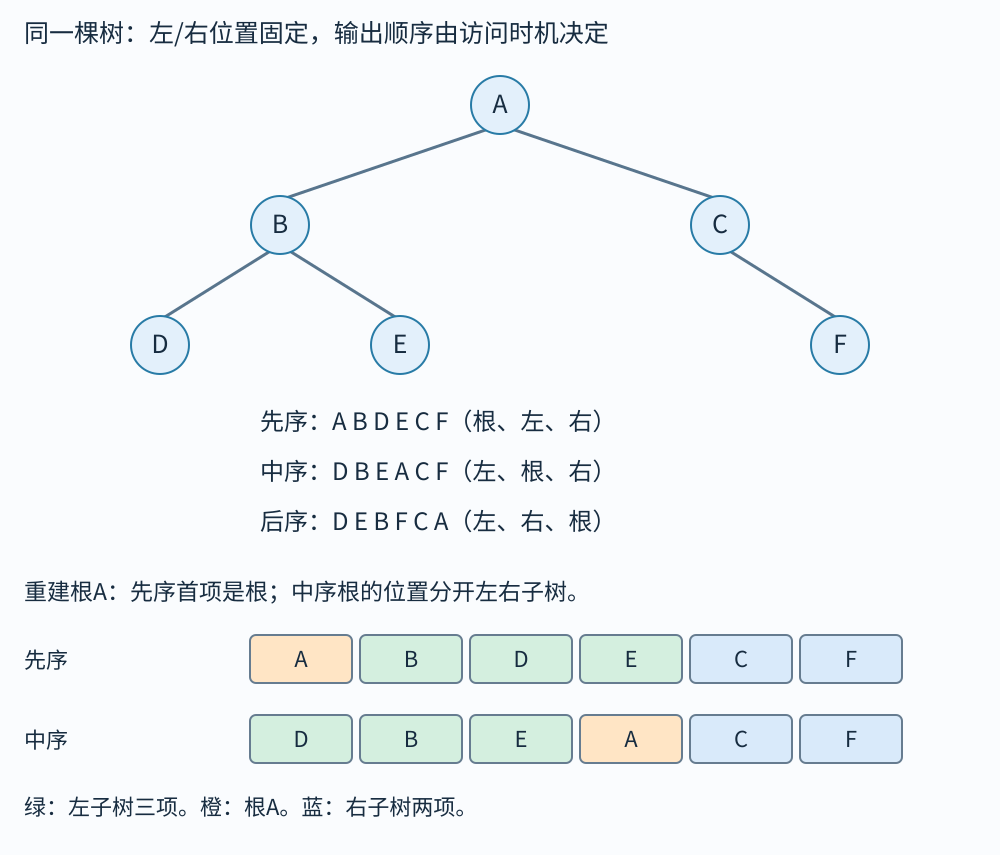

# 二叉树：走进一条分支以后，怎样找回没做完的事

一棵树从根开始向下分叉。除根外，每个节点有唯一父节点，沿父链接向上最终到根，没有环。二叉树规定每个节点有左、右两个孩子位置，某个位置可以为空；“只有一个孩子”也必须说是左还是右。

我们一直使用这棵六节点树，不在解释遍历的途中更换输入：



```text
        A
       / \
      B   C
     / \   \
    D   E   F
```

A是根，D、E、F没有真实孩子，叫叶节点。B子树含B、D、E三个节点；C的左孩子是空，右孩子F。边是相邻父子的一条连接，整树6节点5边。即使内存中还存了反向parent指针，数学上A到B仍只是一条边。

深度是从根走到节点经过的边数：A深0，B/C深1，D/E/F深2。节点的高度是从它向下到最远叶的边数：叶高0，B/C高1，A高2；空树约定高−1。根的深度与整树高度不同，画图时别只背同一个“层数”。

## 一次递归调用有三个停靠点

访问一个节点指执行用户动作，比如把它的标签写进输出；“走到这个节点”与“访问输出它”可以发生在不同时间。

```text
walk(x):
    如果x为空：返回
    停靠点①
    walk(x.left)
    停靠点②
    walk(x.right)
    停靠点③
    返回
```

在①输出是先序，根在左右孩子之前；在②输出是中序，左子树后、右子树前；在③输出是后序，两个孩子之后。每个调用都有自己的参数x，递归返回会回到那个调用里被暂停的位置。

拿中序从头走，空孩子也不能凭空跳掉：

|事件顺序|具体动作|已经输出|尚待完成的外层|
|---:|---|---|---|
|1|进入A，先调用左B|空|A待左完成后访问|
|2|进入B，先调用左D|空|A；B待左完成|
|3|进入D，调用空左，立即返回|空|A；B；D|
|4|D左已完，访问D，再调用空右返回|D|A；B；D|
|5|D返回B，B访问自身|D,B|A；B待右完成|
|6|B调用右E，E调用空左返回|D,B|A；B；E|
|7|访问E，空右返回，E返回B|D,B,E|A；B|
|8|B左右已完，返回A|D,B,E|A|
|9|A访问自身，调用右C|D,B,E,A|A待右完成|
|10|C调用空左返回，访问C|D,B,E,A,C|A；C|
|11|C调用右F，F空左返回后访问F|D,B,E,A,C,F|A；C；F|
|12|F空右返回；F返回C；C返回A；A返回|D,B,E,A,C,F|无|

中序不是从纸上最左边一路读过去的空间顺序，而是每个子树都执行“左、自己、右”。只有额外满足二叉搜索树关键码规则时，中序输出才按值有序。本章A/B等标签不承诺搜索树次序。

同一棵树的三个结果为：先序`A B D E C F`，中序`D B E A C F`，后序`D E B F C A`。可以在图中每个节点旁写①②③，手指沿递归路线走，每次只在指定停靠点记下标签。这样能独立复现三个序列，不必背字母串。

## 把“返回以后再做”放进显式栈

中序栈保存“左子树完成后轮到我”的节点。`cur`表示接下来向下进入的节点，栈从底写到顶。

```python
def inorder(root):
    stack = []
    cur = root
    result = []
    while cur is not None or stack:
        while cur is not None:
            stack.append(cur)
            cur = cur.left
        cur = stack.pop()
        result.append(cur.data)
        cur = cur.right
    return result
```

|动作|cur变成|栈|输出|
|---|---|---|---|
|初始|A|[]|[]|
|压A，向左|B|[A]|[]|
|压B，向左|D|[A,B]|[]|
|压D，向左|空|[A,B,D]|[]|
|左链到空，弹D访问，再转右|空|[A,B]|[D]|
|弹B访问，再转右|E|[A]|[D,B]|
|压E，向左|空|[A,E]|[D,B]|
|弹E访问，再转右|空|[A]|[D,B,E]|
|弹A访问，再转右|C|[]|[D,B,E,A]|
|压C，向左|空|[C]|[D,B,E,A]|
|弹C访问，再转右|F|[]|[D,B,E,A,C]|
|压F，向左|空|[F]|[D,B,E,A,C]|
|弹F访问，再转右|空|[]|[D,B,E,A,C,F]|
|cur空且栈空|无|无|退出|

外层条件用“或”：cur空但栈非空时还有祖先待办，不能退出。内层cur空后必须弹栈，不能继续访问空节点。每节点压一次、弹一次，总时间线性；同时最多存根叶路径，空间$O(h+1)$，`h`为树高。退化链的高为`n-1`，不能一概把空间写成对数。

后序要保存“已经展开过孩子了吗”。初见x时把“x待输出”压回，再压右孩子、左孩子；因为后进先出，左先处理。对本树，弹栈事件如下：

```text
[A初见]
弹A初见 → 压A待输出、C初见、B初见
弹B初见 → 压B待输出、E初见、D初见
弹D初见 → 压D待输出（没有真实孩子可压）
弹D待输出 → 输出D
弹E初见 → 压E待输出
弹E待输出 → 输出E
弹B待输出 → 输出B
弹C初见 → 压C待输出、F初见
弹F初见 → 压F待输出
弹F待输出 → 输出F
弹C待输出 → 输出C
弹A待输出 → 输出A，栈空
```

不记录初见/待输出就无法区分“刚到B，该去孩子”和“孩子完了，该输出B”。这两种情况节点地址相同，缺的是阶段信息。

## 层次遍历按先发现先处理

队列存已经发现、尚未访问的节点：

|出队访问|再入队哪些孩子（先左后右）|队列头→尾|
|---|---|---|
|初始无访问|根A入队|[A]|
|A|B,C|[B,C]|
|B|D,E|[C,D,E]|
|C|F|[D,E,F]|
|D|无|[E,F]|
|E|无|[F]|
|F|无|[]，结束|

输出`A B C D E F`。新孩子都在队尾，因此浅层待办一定先于更深层。时间线性，队列峰值取决于宽度；链很高但队列只需1，完美树很宽时队列可占线性空间。

## 先序和中序怎样一起确定每一根边

先序`A B D E C F`的首项A是根。在中序`D B E A C F`里找到A，左侧`D B E`三项必属左子树，右侧`C F`两项必属右子树。因先序先走完整左子树，A后紧跟的三项`B D E`就归左，不能随便从中序挑三项。

|当前任务的先序|当前任务的中序|取根并定位|左任务|右任务|
|---|---|---|---|---|
|A B D E C F|D B E A C F|根A，中序位置3|先B D E / 中D B E|先C F / 中C F|
|B D E|D B E|根B，段内位置1|D/D|E/E|
|D|D|根D，两侧空|空，返回空|空，返回空|
|E|E|根E，两侧空|空|空|
|C F|C F|根C，段内位置0|空|F/F|
|F|F|根F，两侧空|空|空|

下层创建的D、E先返回给B，B连好两边后返回给A；F先返回给C，再由C返回给A。全部左右连接与上方原树一致。先序首项决定根，中序分界决定子树大小，这两个信息缺一不可。

标签互异才可用“标签→中序下标”字典唯一定位。每次线性找根在退化情形会平方；一次建字典、递归传区间而非复制序列，可以做到线性时间。输入还要校验标签集合、重复、根是否落在当前区间、是否恰好用完所有项，不能从“合法输入下唯一”推成“任意两串都能构造”。

后序加中序同样能重建，只是根取后序末项。例如本树后序`D E B F C A`，末项A；中序A左边3项，所以后序的前3项`D E B`归左，接着2项`F C`归右。左段末B、右段末C，继续按同一规则分。若代码从后序末尾倒着消耗，读完根A后应先构造右子树C，再构造左子树B；若仍先构造左边，会把C错接到左侧。

先序加后序通常不够：`A B`与`B A`不能区分B在A左边还是右边。若额外限定每个内部节点恰有两个孩子且标签互异，则能增加足够约束；不能把这个限定版本的唯一性搬到一般二叉树。

## 空孩子也记录，序列才没有丢位置

单靠先序`A B`，既可能A左为B，也可能A右为B。把每个空孩子写成记号`^`，A左空、右B的完整先序变成`A ^ B ^ ^`。解析时，普通标签创建节点并递归读左、右；空标记直接返回空。

```text
读A：创建A，等待左、右
  读^：A左返回空
  读B：创建B，等待左、右
    读^：B左空
    读^：B右空
  B创建完成，返回给A作为右孩子
A完成，输入恰好用完
```


老师《05二叉树》PDF87页用灰三角画空孩子。红色叶b、e、g、j后面各有两个空标记，对应局部`x ^ ^`；把这三项缩成一个空位，就能自底向上缩整树。图中的增强中序始终为空标记与标签交替，仍不能定出根分界；不要因为记号数量一样就认为三种序列信息一样多。

初始有一个待填根槽。普通节点占一槽、新增左右两槽，待填槽净加1；空标记占一槽、净减1。`A ^ B ^ ^`的槽数为1→2→1→2→1→0，恰好结束。`A ^ ^ B ^ ^`在前三项后已经归零，后面还来B，因此是多余输入，不能接受。

## 中序后继：不用重走整棵树

若节点x有右子树，中序后继是右子树里最左节点。若没有右子树，沿parent向上走，直到第一次从某个祖先的左边返回，该祖先就是后继；若一直从右边向上到根，还没有找到，x就是最后节点，无后继。

小树中E无右子树，先从E到B，E是B右孩子，继续；从B到A，B是A左孩子，所以后继A。C有右子树F，后继就是F。单次后继最坏O(h)，但顺着后继遍历整树，边只会被上下经过常数次，总时间O(n)，不能把每次最坏h机械乘n得到唯一结论。

## 外部空叶与普通叶子，数的是两类对象

把每个缺失孩子都补成一个外部叶，包括原来叶节点缺少的两个孩子。原树n节点有2n个孩子槽，已占n−1，缺n+1，因此扩充后有n+1个外叶，每个原节点都变成恰有两个孩子的内部节点，内部节点数为n。若原双孩子节点n₂、单孩子n₁、原叶n₀，则原树n₀=n₂+1；n=2n₂+n₁+1，所以外叶n+1=2n₂+n₁+2。

例如原树根A只有左孩子B，n=2。A右边补一个外叶，B左右各补一个，共3个；A和B都变双分支内部节点，共2个。只给A补右孩子会漏掉B的两个空槽，得到的是另一种变换，不能拿来解释增强先序中的空标记。

## 后序求子树大小，走一个依赖完整的例子

固定小树中，D、E、F为叶，size各1；B处理完两个孩子后得1+1+1=3；C左空大小0、右F大小1，得2；A最后得1+3+2=6。若在先序访问A时就读孩子尚未更新的size，可能拿到旧值。遍历顺序的选择来自数据依赖，不是偏好。

同样的后序可以求height=max(左高,右高)+1，空高−1；求表达式值则先求左右操作数再施运算；释放整树也通常先释放孩子，再释放父，避免父被释放后找不到孩子地址。一个遍历模式能复用，但访问动作必须符合对象生命周期。

## 叶数与双孩子节点数，从边数推出

设无孩子节点数为n零，一个孩子为n一，两个孩子为n二。节点总数n=n零+n一+n二，边数一方面为n减一，另一方面每个父贡献孩子数，所以为n一加二倍n二。两式相减得n零=n二加一。

这个关系对任意非空二叉树成立，单孩子节点多少不影响等式。链有一个叶和零个双孩子节点，成立；完美七节点树有四叶、三个双孩子节点，也成立。空树不属于这一非空计数前提，不能把零等于一当作公式错误。

完全二叉树数组的最后一个非叶下标是长度除二取下整再减一。只有一项时没有非叶节点，建堆下滤循环应直接跳过。

访问空孩子时直接返回。

## 练习与答案

练习1。 先序`R P Q S`，中序`P Q R S`，求后序并画出左右关系。

解答：根R，中序左段P Q、右段S；左子树根P，中序P Q说明P左空、右Q。右子树只有S。后序左子树为Q P，右子树S，再根R，得到`Q P S R`。写出P右Q这条边很重要，不能因为只有两个节点就随意画在左侧。

练习2。 增强先序`A ^ B ^ ^`代表什么？`A ^ ^ B ^ ^`为何非法？

解答：第一串表示A左空、右孩子B，B左右空。第二串前三个记号已经形成一棵完整的单节点A树，后面又多出B，无法属于同一棵树的先序编码。只检查每个节点后有没有两个空标记不够，应按待填槽解析：开始1槽，普通节点占1槽并新增2槽，净增1；空标记占1槽，减1；过程中不得提前归零后继续读，结束必须恰好归零。

练习3。 一棵10000节点的退化树，递归中序与层序的辅助空间各多少？

解答：若每个节点只有一个孩子，树高9999，递归调用栈Θ(10000)，有栈溢出风险；层序队列中通常只有1个待处理节点，空间O(1)。二者访问时间都Θ(n)。算法同样正确，空间却受树形影响。

## 用节点数检验形状边界

非空二叉树高为`h`，最长根叶路径有`h+1`个节点，因此$n\geq h+1$。深度0最多1项，深度1最多2项，深度2最多4项，一直到深度`h`最多$2^h$项，全部相加得$n\leq2^{h+1}-1$。这些是两种不同形状达到的边界：链达到下界，所有层填满的完美树达到上界。

“完全二叉树”要求除末层外都满、末层从左向右连续填。按层序从下标0放数组，节点`i`的左位置`2i+1`、右位置`2i+2`，存在与否再看是否小于`n`；非根父位置为$\lfloor(i-1)/2\rfloor$。向下取整$\lfloor x\rfloor$取不大于x的最大整数。7项时根0孩子1、2，节点1孩子3、4，节点2孩子5、6。稀疏一般树用相同编号会留空格，不能保证存储紧凑。

“满二叉树”有的资料指每个内部节点都有两个孩子，有的指所有层都填满。后者本书叫完美树，老师本章原图也使用“同高度规模最大”的含义；做题以题面的定义为准。
