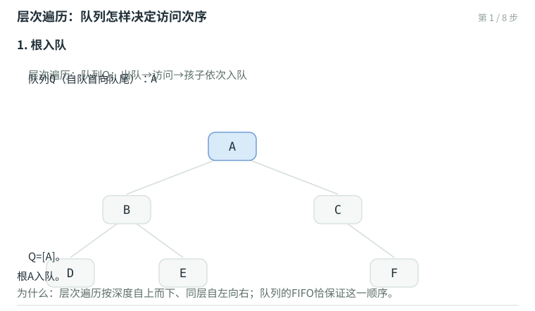

# 二叉树：遍历、重建与层次结构

树是有根的层次结构：除根外每个节点有唯一的父节点，沿父链接上溯必达根、无环。**二叉树**（binary tree）进一步规定每个节点至多两个孩子，且左右位置分明——"只有一个孩子"也必须说明是左是右。这条看似苛刻的限制换来极高的结构规整性：本章的遍历、重构与计数，几乎每条结论都带一个漂亮的常数。

## 概念与记号

树的要素：节点与联边；指定根之后即为**有根树**。任给若干棵有根子树，引入新节点r并向各子树根发出一条边，即得更大的树——r与各子树根互称**父**（parent）、**子**（child），一个节点的子节点数为其**度**（degree）；零度节点称**叶**（leaf），其余为**内部节点**。从任一祖先沿边下溯到后代，沿途边数为**路径长度**；若起点是根，该长度即节点的**深度**（depth）。节点所有后代的最大深度减去自己的深度，是该节点的**高度**（height）；全树的高度即根的高度，空树高度约定为 $-1$。

**真二叉树**（proper binary tree）：每个节点度数为0或2。任何二叉树都可以"补齐"成真二叉树——为所有度数为1的节点补上一个空的叶。这个规范化在重构问题里马上会用到。

## BinNode与BinTree

```cpp
template <typename T> using BNP = BinNode<T>*;   //二叉树节点位置
template <typename T> struct BinNode {
   T data;                        //数值
   BNP<T> parent, lc, rc;         //父、左孩子、右孩子
   int height;                    //高度
   Rank size();                   //子树规模
   BNP<T> insertLc( const T& e ); //作为左孩子插入
   BNP<T> insertRc( const T& e ); //作为右孩子插入
   BNP<T> succ();                 //（中序意义下）直接后继
};
template <typename T> int BinNode<T>::updateHeight()          //O(1)
{ return height = 1 + max( lc ? lc->height : -1, rc ? rc->height : -1 ); }
template <typename T> void BinNode<T>::updateHeightAbove()    //O(n = depth(x))
{ for ( BNP<T> x = this; x; x = x->parent ) x->updateHeight(); }
```

BinTree持有`_root`与`_size`，`insert`在孩子位置挂新节点并`updateHeightAbove()`，`attach`把整棵子树接入某节点的空位——这些操作本身 $O(1)$，高度更新沿父链 $O(\text{depth})$。

## 遍历：三种深度优先 + 一种广度优先

访问节点的次序不同，便得到不同的遍历。深度优先的三种只在"访问根的时机"上不同：**先序**（根-左-右）、**中序**（左-根-右）、**后序**（左-右-根）。递归实现各三行；不依赖递归的迭代版才是本节的重头。

**先序遍历的藤路径**。沿着最左侧藤（起始于根的长子通路）观察：整个遍历可分解为——自上而下访问藤上节点，再自下而上遍历各右子树。各右子树的遍历彼此独立、自成子任务，于是手边需要一个容器把右子树"存起来待办"——栈。迭代版：沿藤访问并入栈；弹栈取右子树重复：

```cpp
template <typename T, typename V> void visitAlongVine( BNP<T> x, V& visit, Stack<BNP<T>>& S ) {
   while ( x ) { visit( x->data );  S.push( x->rc );  x = x->lc; }   //当前藤自顶向下
}
template <typename T, typename V> void preorder( BNP<T> x, V& visit ) {
   Stack<BNP<T>> S;
   while ( true ) {
      visitAlongVine( x, visit, S );   //访问藤上节点，右子树入栈暂存
      if ( S.empty() ) break;
      x = S.pop();                     //弹出下一棵右子树的根
   }
}  //O(n)
```

**中序遍历的藤路径**。中序的访问时机在左子树之后——于是沿最左侧藤下潜时只入栈不访问，抵达藤根（最深的节点）才开始访问并转向右子树：

```cpp
template <typename T, typename V> void inorder( BNP<T> x, V& visit ) {
   Stack<BNP<T>> S;
   while ( true ) {
      while ( x ) { S.push( x );  x = x->lc; }   //沿藤下潜，逐步入栈
      if ( S.empty() ) break;
      x = S.pop();  visit( x->data );            //弹出并访问藤根
      x = x->rc;                                 //转向右子树
   }
}  //O(n)
```

**直接后继与统一范式**。中序意义下节点x的**直接后继**`succ()`：若x有右孩子，则是右子树中**最左**的节点（右子树藤的终点）；否则是x的**最低左祖先**——沿父链上溯，第一个作为左孩子进入的祖先。有了`first()`（最左下潜）与`succ()`，中序遍历可以写成极简的

```cpp
for ( x = first(x); x; x = x->succ() ) visit( x->data );
```

任何遍历都可套用这个范式，只要写好各自的`first()`与`succ()`。最坏情况下单次`succ()`需 $O(h)$，但整个遍历摊还 $O(n)$——每条边至多被走过两次。

**后序遍历**：访问时机最靠后，迭代版需要记住"从哪条边返回"（左孩子还是右孩子），栈中需要存标志位，思路与中序藤一致。

**层次遍历**。深度优先三兄弟用栈；按层访问则用**队列**：出队→访问→孩子依次入队。FIFO恰保证"先访问者的孩子先访问"，同层次序由入队次序自然保证：



以 $A(\,B(D,E),\ C(-,F)\,)$ 为例：$Q=[A]$ → 访问A、BC入队 → 访问B、DE入队 → 访问C、F入队 → 访问D、E、F。序列AB CDEF，同层次序与子层次序都严格保持。

## 重构：中序是关键

遍历序列能否唯一还原一棵二叉树？**先序或后序单独都不够**——它们丢失了"空子树在哪"的信息。**中序 + 任一先序/后序**则可以唯一重构（元素互异时）。分治论证：先序的首元素必为根；在中序中定位它，左侧即左子树的中序、右侧即右子树的中序；数出左子树规模 $k$，先序中随后的 $k$ 个元素即左子树的先序、其余为右子树的先序——递归至空区间。后序同理，只是根在末尾。

算法实现时为快速定位，需先对中序建**散列表**（第15章）或按元素查表 $O(n)$；分治递归总体 $O(n)$（互异元素、散列表定位时）。

**真二叉树的中序 + 层次**也可唯一重构：层次序列首元素为根；在中序中定位后，左右子树的规模即层次序列中相邻两段的长度。非真二叉树时该法可能歧义——这正是"补齐成真二叉树"这一规范化的用武之地。

## 计数：n个节点的二叉树有多少棵

借道栈混洗的结论：$n$ 个节点的二叉树形态数 = Catalan数 $cat(n) = \frac{(2n)!}{n!(n+1)!}$——每棵二叉树对应一个中序-先序对，而n个节点的中序遍历次序与栈混洗一一对应。这也解释了为何"先序单独"无法重构：一棵先序序列平均对应约 $cat(n)$ 棵不同的树。

## 本章要点

- 树的记号：度、叶/内部节点、深度、高度（空树−1）；二叉树左右分明，可补齐为真二叉树。
- BinNode：data/parent/lc/rc/height；updateHeightAbove沿父链O(depth)。
- 四种遍历：先序/中序/后序/层次；先序迭代=藤上访问+右子树入栈；中序迭代=藤上下潜只入栈、弹出即访问；层次遍历用队列。
- succ()直接后继：有右孩子取右子树最左，否则取最低左祖先；中序遍历可写成 for(first; x; x=succ())，摊还O(n)。
- 重构：中序+先序（或后序）唯一；真二叉树中序+层次唯一；先序或后序单独不够。
- n节点二叉树形态数 = Catalan数cat(n)，与栈混洗一一对应。
