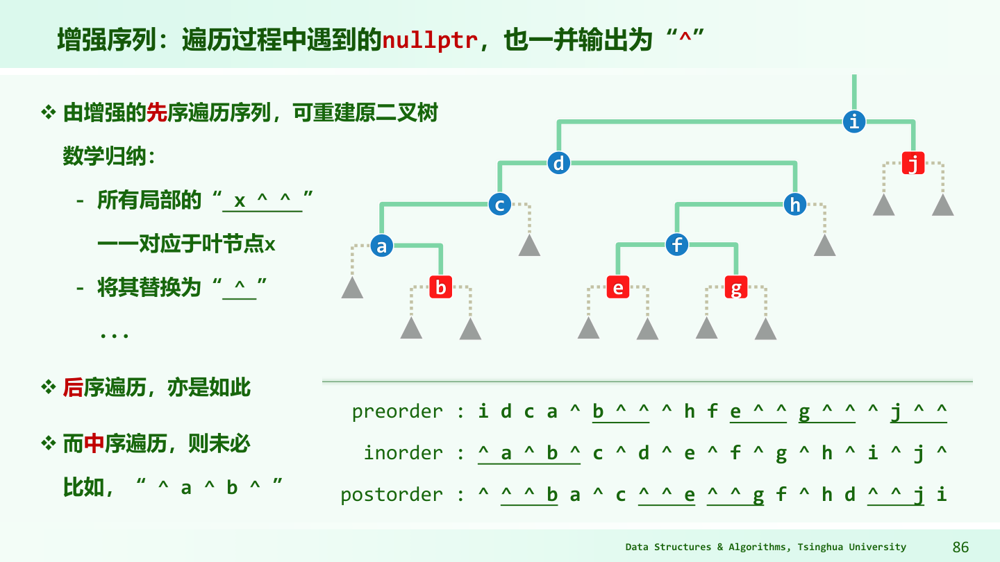

# 二叉树：每一棵子树都还是同一种问题

## 先统一高度的定义

本书路径长度按边数计，根深度为0，叶高度为0，空树高度为-1。节点高度等于 $1+\max(h_L,h_R)$。若有 n 个节点的非空树，边数 n-1；树高为 h 时最多 $2^{h+1}-1$ 个节点，所以 $h\ge\lceil\log_2(n+1)\rceil-1$。

设二叉树叶节点 n₀、单孩子节点 n₁、双孩子节点 n₂。按节点数算边为 n₀+n₁+n₂-1；按孩子数算为 n₁+2n₂；两式相等得 $n_0=n_2+1$。这条对所有非空二叉树成立，不必先假设没有单孩子节点。

## 三种遍历，只看“什么时候访问根”

对根 A、左子 B、右子 C：先序 A B C，中序 B A C，后序 B C A。先序适合先处理父再处理子；后序适合子结果先算好，再汇总到父，比如计算高度或安全释放整棵树。

迭代中序：沿左链把节点压栈，左边走尽后弹一个访问，再转向其右子树。栈记录“左边处理完后，还要回来做的事”。每节点入出各一次，时间 O(n)，辅助栈 O(h)。层次遍历用队列，队列内节点来自相邻层，空间与最大层宽同阶，最坏 O(n)。

## 中序后继怎么找

有右子树：后继是右子树最左节点；没有右子树：沿 parent 向上，直到第一次从某祖先的左子树返回，该祖先就是后继；若一直从右侧返回至根外，则不存在后继。最后一个中序节点的后继必须是空，而不是绕回根。

## 哪些遍历能重建

节点标签互异时，先序+中序、后序+中序能唯一重建：根在先序首或后序尾，再用中序位置把左右规模分开。普通二叉树先序+后序通常不唯一，例如只有 A、B 两点，B 是左孩子或右孩子，序列都相同。若限制为真二叉树（每个内部节点恰有两个孩子），歧义可消除。

加入空指针标记的先序序列能重建一般二叉树：读一个标记，空则返回，否则建节点，再递归读左右。只给中序空标记仍不能一般唯一重建，不能把所有“增强序列”都看成一样。

多叉树可用左孩子右兄弟表示：左指针连第一个孩子，右指针连下一个兄弟。对有序森林，也可把各根当兄弟串起来。此时二叉边中的“右边”不再表示原树的孩子，解释深度时要回到原语义。

**自测。** 删除一片叶子后，某祖先高度没变，更高祖先还要更新高度吗？答：若其他结构不变且只维护由孩子高度定义的高度，更高处也不变，可停止；若还维护 size 等属性，不能一起停止。

图里每个 `^` 表示一个空孩子。按先序读到真实标签就建节点，再依次读取两个孩子；空标记让“这个孩子到底不存在，还是还没读到”不再含糊。中序的 `^ a ^ b ^` 反例说明，标记本身还不够，读取次序也很重要。
