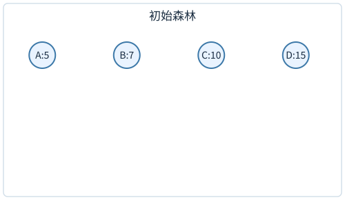
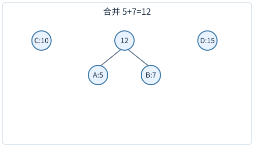
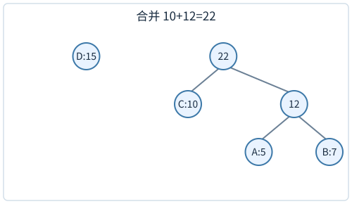
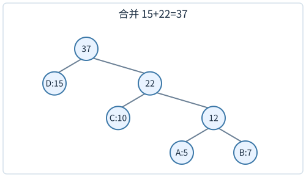
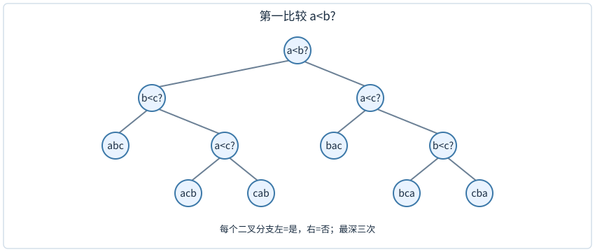

# Huffman编码：为什么总把最轻的两个合在一起

四个符号A、B、C、D的出现次数分别为5、7、10、15。若每个符号统一用2位编码，总长度为2×37=74位。频率高的符号若能用更短编码，通常可以减少总位数；但编码必须能被无歧义地解读。

前缀无关编码要求：任何符号的编码都不是另一个符号编码的前缀。比如`0,10,110,111`符合；`0,01,11`不符合，因为读到0时不知是否已经完成一个符号，还是后面还有1。将0、1分别当作树的左、右边，所有符号放在叶子，根到叶的路径就是编码，自然具有前缀无关性。

## 从四棵单节点树合成一棵编码树









图中的每个圆是一个树根，A:5这类标签同时写符号和权重；每一格保存当时整片森林。第一步只把A与B接在12下面，C、D仍各自独立。第二步新根22接C与12，A和B随12一起下移一层。第三步37接D与22，所有符号才落在同一棵树里。

初始权重为5、7、10、15。取最小5与7合并成12，森林剩10、12、15；取10与12合成22，剩15、22；再合成37。若左边记0、右边记1，可得到D=0、C=10、A=110、B=111。

编码长度分别为A3、B3、C2、D1，带权路径长度为

$$5\times3+7\times3+10\times2+15\times1=71.$$

也等于每次合并权重之和：12+22+37=71。因为合并两棵子树，相当于让其中所有叶子深度加1，新增位数恰好是这两棵树的权重总和。每个叶子的权重会在它到根的每次合并中各算一次，所以两种记账一致。

解码`0110111`：从根读0到D，回根；再读110到A，回根；再读111到B，得到DAB。每到叶子立即完成一个符号，无需在符号之间额外加分隔符。若只剩一个符号，数学上可用长度0编码，但实际文件格式通常还需保存消息长度，或约定用一位码；这一边界需由格式规定。

## 贪心选择的理由，要先证明“存在一棵最优树这样做”

对正权重的最优前缀编码树，内部节点不需要只有一个孩子：若存在这种节点，将它绕过，其后所有叶子都少走一条边，总成本严格减小。所以可以考虑每个内部节点恰有两个孩子的树。

先仍用A5、B7、C10、D15。假如一棵候选树把A放深1，C放深2，B与D放深3，它的成本是$5+20+21+45=91$。只交换A与D的标签，树形和所有码字位置都不改，成本变成$15+20+21+15=71$。高频D少走两条边，省30；低频A多走两条边，多10，合计省20。此时最轻的A与B恰好占最深的兄弟位置。

一般交换也只需计算这两片叶子的贡献。设x较轻、z较重，权重分别为$w_x\le w_z$；原来x在较浅位置$d_x$，z在较深位置$d_z$，故$d_x\le d_z$。交换前、后的两项成本分别为

$$C_{\text{前}}=w_xd_x+w_zd_z,\qquad C_{\text{后}}=w_xd_z+w_zd_x.$$

两式相减并提取公因子：

$$C_{\text{后}}-C_{\text{前}}
=w_x(d_z-d_x)+w_z(d_x-d_z)
=(w_z-w_x)(d_x-d_z)\le0.$$

第一个因子非负、第二个非正，因此交换不会增加成本。刚才的数值就是$(15-5)(1-3)=-20$。

现在取任意一棵最优真二叉编码树。最深叶子的兄弟不可能是内部节点，否则兄弟下面还会有更深的叶子；所以存在最深的一对兄弟叶。将全局最轻两符号依次放到这两个位置，原先占位置的符号换到它们原来的位置。每次都是轻者去不浅的位置，成本不增；第一项已经放好时，第二次选择另一个兄弟位置，不再移动第一项。最优树无法再变得更好，所以交换后仍最优。由此得到的是“至少存在一棵最优树把这两项配成兄弟”，足以支持第一步合并。

将这对兄弟收缩成权重w_x+w_y的一个伪符号，原树成本减去w_x+w_y。收缩后的树必须对缩小后的权重集合也最优；否则用一棵更便宜的树替换它，再展开x、y，便得到比原最优更便宜的树，矛盾。

于是原问题可安全地先合并最小两个，再递归处理。注意证明说的是“至少有一棵最优树具备这个结构”，并没说所有最优树形完全相同。频率相同、左右孩子互换，都可能产生不同编码而总成本相同。

## 同一个总权重，合并顺序仍会改变成本

权重1、2、8、9。Huffman先合1+2=3，再合3+8=11，再合11+9=20，总成本34。若先合8+9=17，再合1+2=3，最后合17+3=20，总成本40。

第二种把高频8、9一起埋到更深层，每出现一次都多花位数。这个反例说明“任意两棵合起来最后总权相同”不意味着总编码成本相同。根权重总是20，但叶子的深度不同。


原图把两棵取出的最小权树接到新根下，新根权重等于两者之和。注意图中接口名可能写`delMax`，而注释说取最小，这是通过比较器或权重优先级的定义实现的；读程序应核对比较规则。若直接用默认最大堆取最大的两个，就变成上面的错误策略。

## 构造的时间，取决于怎样找最小

用无序表，每次扫一遍找最小两项，剩余项数从n、n−1一直降到2，每轮要看遍这些项，总工作与n+(n−1)+…+2同阶。首尾配对或用等差求和得n(n+1)/2−1，因此n−1次合并共Θ(n²)。用二叉最小堆，初始建堆O(n)，每轮两次删除最小、一次插入，各最多走树高O(log n)的一条路径；共n−1轮，所以总时间O(n log n)，树节点O(n)。每次输出完整编码串还要计入输出位数，不能把所有字符串复制成本都塞进常数。

已经有序的输入还可以不用堆。教师《05.二叉树》PDF84至85页使用一个栈S与一个队列Q：原符号按频数逆序入栈，使栈顶是尚未使用的最轻原符号；新合成的树放到Q尾，使Q首是尚未使用的最轻合成树。每次比较S顶与Q首，取较轻者，连续做两次，再把合成树入Q。原输入的容器只会弹出，因此也可等价地写成一个从小到大读取的队列；下面先用Q1/Q2的可见顺序走过程，再给与教师S/Q方向对应的实现。

## 两个有序来源，每次都重新比较最前项

权重`[2,3,7,8]`已经非降排序。Q1保存尚未用的原权重，Q2保存已经合成但尚未用的树根；表中左端都是队头。每取一次都重新比较两队头，取出的项立即出队。

|轮次|取第一项之前Q1 / Q2|第一项|第二项|合并后Q1 / Q2|本轮增加成本|
|---|---|---|---|---|---|
|1|[2,3,7,8] / []|Q1的2|Q1的3|[7,8] / [5]|5|
|2|[7,8] / [5]|Q2的5|Q1的7|[8] / [12]|12|
|3|[8] / [12]|Q1的8|Q2的12|[] / [20]|20|

最后只剩根20，停止，总成本5+12+20=37。第一轮的两个最小项都来自Q1，所以每轮固定从两个队列各拿一个会在第一轮就出错。

最小两个可能同来自Q1、同来自Q2，或者一边一个。不能每轮固定取“一个原符号、一个合成符号”。统一比较两个队头，才与全局取最小两项一致。

新合成权重为什么也有序？本次取出的最小两项记为$a\le b$，生成$a+b$。剩下的旧候选都不小于b，新生成的$a+b$也不小于b，因为频数非负。下一轮取出的$c\le d$便都至少为b，于是$c+d\ge2b\ge a+b$。从第一轮归纳，合成树进入Q的顺序非降，队首始终是其中最轻者。S顶与Q首因此包含整个森林的最轻候选，不用扫描内部。若允许负权，a+b可能小于b，这个队列论证和编码最优性的正频数前提都需要重新检查；实际出现次数不会为负。零频符号可按文件格式约定省去或保留，本程序先固定正频数接口。

下面是完整参考程序。`Node`保存一棵树的根，`weight`是它所含叶子频数之和，`symbol`只在原符号叶上非空，`left/right`是孩子。Python的列表末端作S顶，`deque`左端作Q首；这两个方向与教师的栈、队列接口一致。例中频数为正整数，同频时任取一种顺序即可得到某棵最优树。

```python
from collections import deque
from dataclasses import dataclass

@dataclass
class Node:
    weight: int
    symbol: str | None = None
    left: object = None
    right: object = None

def huffman(records):
    if not records:
        return None
    if len({symbol for symbol, weight in records}) != len(records):
        raise ValueError("符号不能重复")
    if any(weight <= 0 for symbol, weight in records):
        raise ValueError("本程序接收正频数")
    stack = [Node(weight, symbol) for symbol, weight in records]
    stack.sort(key=lambda node: node.weight, reverse=True)
    queue = deque()

    def take_min():
        if not stack:
            return queue.popleft()
        if not queue or stack[-1].weight <= queue[0].weight:
            return stack.pop()
        return queue.popleft()

    while len(stack) + len(queue) > 1:
        left = take_min()
        right = take_min()
        queue.append(Node(left.weight + right.weight, None, left, right))
    return take_min()

def codewords(root):
    if root is None:
        return {}
    answer = {}
    pending = [(root, "")]
    while pending:
        node, bits = pending.pop()
        if node.symbol is not None:
            answer[node.symbol] = bits
        else:
            pending.append((node.right, bits + "1"))
            pending.append((node.left, bits + "0"))
    return answer

records = [("A", 5), ("B", 7), ("C", 10), ("D", 15)]
root = huffman(records)
codes = codewords(root)
print(codes)
print(sum(weight * len(codes[symbol]) for symbol, weight in records))
```

这次输出D的0、C的10、A的110、B的111，总长71，与前面的树一致。构造时每次合并使森林棵数减1，因此恰好做n−1次；每次取两项、入一项均为常数容器操作，排序以后的合成阶段为$\Theta(n)$。若原频数无序，程序开头排序仍需$O(n\log n)$；若输入已经按要求排序，可以直接建立S，构造才是全程线性。输出全部码字另计路径字符串的总长度，不能与返回n个叶子的树混为同一成本。

## 比较排序下界：为什么不能靠比较把所有输入都线性排好

n个互异元素有n!种可能的大小次序。这里n!读作n的阶乘，等于n×(n−1)×…×2×1：第一名可从n项里选，第二名剩n−1项可选，直到最后一项，所以要连乘。比如3!=3×2×1=6。只允许两项大小比较的确定性算法，每次比较最多产生两个结果，可画成二叉决策树。不同输入次序必须到达能区分它们的叶子，否则同一输出次序至少会对一种输入错误。

高度h的二叉树最多`2^h`个叶子，所以`2^h`≥n!，有h≥log₂(n!)。后半约n/2个因子都至少n/2，因此`log₂(n!) >= (n/2)log₂(n/2)=Ω(n log n)`。这给最坏比较次数下界。



图中每条左分支表示“是”，右分支表示“否”。比如先发现a<b，再发现b不小于c，此时还分不清acb和cab，必须再比较a<c。走a<b、b<c的输入只用了两次；另一些输入会走三次。叶标签abc表示三个元素的从小到大顺序，三个比较问句不是在交换数组。

n=3时有6种次序，2次比较最多区分4种结果，故至少某些输入要比较3次。它并没说每一个输入都一定3次，也没说所有非比较算法都需要3次；模型限制是论证的一部分。

若输入是均匀随机排列，平均深度同样有Ω(n log n)下界，可以用前缀码的Kraft不等式证明。若输入分布偏向少数有序情况，平均下界要改用其信息量，不能直接继续套log(n!)。

## 归约时，箭头方向必须读对

若问题A能用O(n)时间转成问题B，并能从B的答案O(n)恢复A的答案，就说A可线性归约到B。若B有线性算法，A便也有线性算法；因此已知A有n log n下界时，可以将下界传给B。

要证明Huffman构造在任意未排序实权重的比较模型下有相应下界，必须明确你要求输出的对象、从中恢复排序的成本及相关归约细节；不能只因为常用实现先排序，就宣布所有算法必先排序。排序好的权重可线性构造已经说明条件会改变复杂度。本节先给比较树与归约方向；[PS05第37题](26-PS05逐题导航.md)用强分离权重构造至少n!/2类可区分带标签输出，进一步展开Huffman特定下界。阅读时仍应保持该题的比较模型、输入权重范围与输出对象约定。

## 权重相同，树不唯一却仍可严格核对

四个符号权重全1，先任取两项合2，再取另两项合2，最后合4，总成本2+2+4=8，每项深2。若第二步错误地合1与刚产生的2，得到3，再与剩1合4，总成本2+3+4=9，比最优差。即使初始权重相同，“每次最小两项”仍有实质约束。

在最优成本固定的情况下，左右交换、相同权重叶子互换会改变码字。自动检查不应只与某一份码字文本完全相等，应验证前缀无关、每个符号都编码、解码可还原、带权长度达到要求。如果题目指定规范Huffman码，才额外按长度与符号顺序生成确定的码字。

## 输出码字也是工作

如果某个Huffman树退化得很深，逐叶输出完整0/1字符串的总字符量可达平方级，即使构造树本身用堆只有n log n。只返回树的节点链接与权重，是O(n)规模的输出；打印所有根叶路径，是另一种输出要求。复杂度陈述应写清你构造了什么，而不是让“编码”一词同时代指树、长度表与所有完整字符串。

## 编码树中的未使用叶子，可以怎样理解

前缀无关编码不一定把整棵二叉空间占满。例如只有编码零与一零，仍可解码，但一一对应的分支空着。若两个符号权重都正，将第二个码缩为一，总成本会下降；所以最优二进制编码可去掉无用单孩子分支，得到真二叉树。

若权重为零，缩短它可能不改变成本，最优树仍可能有多种无成本差异的形状。实际压缩格式还需传送码表、频率表或树结构，这部分头部开销不在单纯带权路径长度中。只有很短的消息时，省下的正文位数可能还不够支付头部；算法优化的目标量要与文件总大小区分。

Huffman针对已知符号频率的逐符号码最优，不说明它能捕捉任意跨符号相关性。例如两个字符总成对出现，把一对作为一个复合符号建模可能得到另一种压缩效果；模型变了，最优性范围也随之改变。

两个符号频率分别九与一，最优前缀码仍各一位，总十位；不能给常见符号空码、罕见符号一位，因为空串是任何字符串的前缀，解码会丢失符号边界。单符号的空码约定不能推广到两个符号。

## 练习与答案

**练习1。** 权重2、2、3、6，写合并序列、总成本和一种编码长度。

解答：2+2=4，3+4=7，6+7=13，总成本24。权6叶深1，权3叶深2，两项权2叶深3，所以6×1+3×2+2×3+2×3=24。左右路径可互换，因此具体码字不唯一，长度与成本在该构造下如上。

**练习2。** 只给码字长度1、2、2，能否安排前缀无关二进制编码？长度1、1、2呢？

解答：前者可为0、10、11，成立；后者若两项长度1，已占0和1，任何更长二进制串都以其中一个为前缀，无法再放第三项。也可用Kraft和检查：前者1/2+1/4+1/4=1，后者1/2+1/2+1/4>1。

**练习3。** 有人拿已经排序权重的O(n)Huffman算法，声称推翻比较排序下界，为什么不成立？

解答：算法接收的输入已含顺序信息，省去了原本必须确定的n!种顺序。比较排序下界讨论任意未排序互异输入。使用更强的输入前提，并没有解决原来同一个问题。任何复杂度冲突，先检查模型、输入范围与输出要求是否一致。
