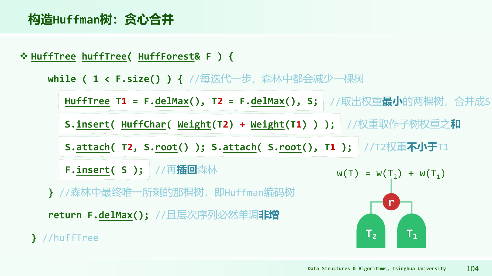

# Huffman编码：为什么总把最轻的两个合在一起

四个符号A、B、C、D的出现次数分别为5、7、10、15。若每个符号统一用2位编码，总长度为2×37=74位。频率高的符号若能用更短编码，通常可以减少总位数；但编码必须能被无歧义地解读。

前缀无关编码要求：任何符号的编码都不是另一个符号编码的前缀。比如`0,10,110,111`符合；`0,01,11`不符合，因为读到0时不知是否已经完成一个符号，还是后面还有1。将0、1分别当作树的左、右边，所有符号放在叶子，根到叶的路径就是编码，自然具有前缀无关性。

## 例1：完整合并一次，看两种成本怎样相等

初始权重为5、7、10、15。取最小5与7合并成12，森林剩10、12、15；取10与12合成22，剩15、22；再合成37。若左边记0、右边记1，可得到D=0、C=10、A=110、B=111。

编码长度分别为A3、B3、C2、D1，带权路径长度为

$$5\times3+7\times3+10\times2+15\times1=71.$$

也等于每次合并权重之和：12+22+37=71。因为合并两棵子树，相当于让其中所有叶子深度加1，新增位数恰好是这两棵树的权重总和。每个叶子的权重会在它到根的每次合并中各算一次，所以两种记账一致。

解码`0110111`：从根读0到D，回根；再读110到A，回根；再读111到B，得到DAB。每到叶子立即完成一个符号，无需在符号之间额外加分隔符。若只剩一个符号，数学上可用长度0编码，但实际文件格式通常还需保存消息长度，或约定用一位码；这一边界需由格式规定。

## 贪心选择的理由，要先证明“存在一棵最优树这样做”

对正权重的最优前缀编码树，内部节点不需要只有一个孩子：若存在这种节点，将它绕过，其后所有叶子都少走一条边，总成本严格减小。所以可以考虑每个内部节点恰有两个孩子的树。

在任意这样的最优树中，取最深的一对兄弟叶子。将最轻的两个符号x、y交换到这两个叶子上，不会增加成本。为什么？若w_x≤w_z、深度d_x≤d_z，交换后成本变化为`(w_z-w_x)(d_x-d_z) <= 0`。把较轻者放得更深，不会变差。重复交换，可得到一棵仍最优、且最轻两符号为最深兄弟的树。

将这对兄弟收缩成权重w_x+w_y的一个伪符号，原树成本减去w_x+w_y。收缩后的树必须对缩小后的权重集合也最优；否则用一棵更便宜的树替换它，再展开x、y，便得到比原最优更便宜的树，矛盾。

于是原问题可安全地先合并最小两个，再递归处理。注意证明说的是“至少有一棵最优树具备这个结构”，并没说所有最优树形完全相同。频率相同、左右孩子互换，都可能产生不同编码而总成本相同。

## 例2：不按最小两项合，成本会变多少

权重1、2、8、9。Huffman先合1+2=3，再合3+8=11，再合11+9=20，总成本34。若先合8+9=17，再合1+2=3，最后合17+3=20，总成本40。

第二种把高频8、9一起埋到更深层，每出现一次都多花位数。这个反例说明“任意两棵合起来最后总权相同”不意味着总编码成本相同。根权重总是20，但叶子的深度不同。

原图把两棵取出的最小权树接到新根下，新根权重等于两者之和。注意图中接口名可能写`delMax`，而注释说取最小，这是通过比较器或权重优先级的定义实现的；读程序应核对比较规则。若直接用默认最大堆取最大的两个，就变成上面的错误策略。

## 构造的时间，取决于怎样找最小

用无序表，每次扫一遍找最小两项，n−1次合并共Θ(n²)。用二叉最小堆，初始建堆O(n)，每轮两次删除最小、一次插入，总时间O(n log n)，树节点O(n)。每次输出完整编码串还要计入输出位数，不能把所有字符串复制成本都塞进常数。

如果输入权重已经非降排序，可用两个队列。一个放尚未使用的原权重，另一个放新合成权重；每次从两个队头中取较小者两次，合并后放到第二队尾。新合成权重会非降出现，因此第二个队列也有序。所有权重进出常数次，构造为O(n)。如果原输入无序，先排序通常要O(n log n)，不能把这一步悄悄删掉。

## 例3：两个有序队列怎样执行

权重`[2,3,7,8]`。原队列Q1为2,3,7,8，合成队列Q2为空。取2、3得5，Q1剩7,8，Q2为5；下一次先取Q2的5，再取Q1的7，合成12，Q1剩8，Q2为12；再取8、12合20，总成本5+12+20=37。

最小两个可能同来自Q1、同来自Q2，或者一边一个。不能每轮固定取“一个原符号、一个合成符号”。统一比较两个队头，才与全局取最小两项一致。

## 比较排序下界：为什么不能靠比较把所有输入都线性排好

n个互异元素有n!种可能的大小次序。只允许两项大小比较的确定性算法，每次比较最多产生两个结果，可画成二叉决策树。不同输入次序必须到达能区分它们的叶子，否则同一输出次序至少会对一种输入错误。

高度h的二叉树最多`2^h`个叶子，所以`2^h`≥n!，有h≥log₂(n!)。后半约n/2个因子都至少n/2，因此`log₂(n!) >= (n/2)log₂(n/2)=Ω(n log n)`。这给最坏比较次数下界。

n=3时有6种次序，2次比较最多区分4种结果，故至少某些输入要比较3次。它并没说每一个输入都一定3次，也没说所有非比较算法都需要3次；模型限制是论证的一部分。

若输入是均匀随机排列，平均深度同样有Ω(n log n)下界，可以用前缀码的Kraft不等式证明。若输入分布偏向少数有序情况，平均下界要改用其信息量，不能直接继续套log(n!)。

## 归约时，箭头方向必须读对

若问题A能用O(n)时间转成问题B，并能从B的答案O(n)恢复A的答案，就说A可线性归约到B。若B有线性算法，A便也有线性算法；因此已知A有n log n下界时，可以将下界传给B。

要证明Huffman构造在任意未排序实权重的比较模型下有相应下界，必须明确你要求输出的对象、从中恢复排序的成本及相关归约细节；不能只因为常用实现先排序，就宣布所有算法必先排序。排序好的权重可线性构造已经说明条件会改变复杂度。本节先给比较树与归约方向；[PS05第37题](26-PS05逐题导航.md)用强分离权重构造至少n!/2类可区分带标签输出，进一步展开Huffman特定下界。阅读时仍应保持该题的比较模型、输入权重范围与输出对象约定。

## 权重相同，树不唯一却仍可严格核对

四个符号权重全1，先任取两项合2，再取另两项合2，最后合4，总成本2+2+4=8，每项深2。若第二步错误地合1与刚产生的2，得到3，再与剩1合4，总成本2+3+4=9，比最优差。即使初始权重相同，“每次最小两项”仍有实质约束。

在最优成本固定的情况下，左右交换、相同权重叶子互换会改变码字。自动检查不应只与某一份码字文本完全相等，应验证前缀无关、每个符号都编码、解码可还原、带权长度达到要求。如果题目指定规范Huffman码，才额外按长度与符号顺序生成确定的码字。

## 交换论证中的成本差，再代一组数

权1的x在深度1，权5的z在深度3，原贡献1×1+5×3=16。互换后1×3+5×1=8，下降8。一般变化为(w_z−w_x)(d_x−d_z)，这里4×(−2)=−8。先用数看清符号，再写不等式，就能避免把“轻的放深”证明反了。

把最轻两项放到最深兄弟位置时，可能一次涉及两个已有符号交换，应逐次应用不增成本原则；若它们本来已占其中位置，就少做一次。证明不要求每次严格下降，因为相等权重或深度相同可能使变化0，仍保留最优。

## 两队列线性构造，为何新合并权重不会倒退

本次取出的最小两项为a≤b，合并a+b。剩余项都不小于b，下一轮取出的两项c≤d至少满足c≥b；若其中包含刚生成的a+b，也仍不小于b。因为上次a≤b，下一次合并总值c+d≥2b≥a+b，因此合成队列非降。

这个不变式保证只看两个队头就够。若允许负权，a+b可能小于a，使队列顺序与编码最优化解释都需要重审；普通频率与出现次数为非负，正权证明可将零频符号按格式约定先处理或保留，不要直接把带负权的“成本”套入同一贪心定理。

## 输出码字也是工作

如果某个Huffman树退化得很深，逐叶输出完整0/1字符串的总字符量可达平方级，即使构造树本身用堆只有n log n。只返回树的节点链接与权重，是O(n)规模的输出；打印所有根叶路径，是另一种输出要求。复杂度陈述应写清你构造了什么，而不是让“编码”一词同时代指树、长度表与所有完整字符串。

## 编码树中的未使用叶子，可以怎样理解

前缀无关编码不一定把整棵二叉空间占满。例如只有编码零与一零，仍可解码，但一一对应的分支空着。若两个符号权重都正，将第二个码缩为一，总成本会下降；所以最优二进制编码可去掉无用单孩子分支，得到真二叉树。

若权重为零，缩短它可能不改变成本，最优树仍可能有多种无成本差异的形状。实际压缩格式还需传送码表、频率表或树结构，这部分头部开销不在单纯带权路径长度中。只有很短的消息时，省下的正文位数可能还不够支付头部；算法优化的目标量要与文件总大小区分。

Huffman针对已知符号频率的逐符号码最优，不说明它能捕捉任意跨符号相关性。例如两个字符总成对出现，把一对作为一个复合符号建模可能得到另一种压缩效果；模型变了，最优性范围也随之改变。

两个符号频率分别九与一，最优前缀码仍各一位，总十位；不能给常见符号空码、罕见符号一位，因为空串是任何字符串的前缀，解码会丢失符号边界。单符号的空码约定不能推广到两个符号。

## 练习与答案

**练习1。** 权重2、2、3、6，写合并序列、总成本和一种编码长度。

解答：2+2=4，3+4=7，6+7=13，总成本24。权6叶深1，权3叶深2，两项权2叶深3，所以6×1+3×2+2×3+2×3=24。左右路径可互换，因此具体码字不唯一，长度与成本在该构造下如上。

**练习2。** 只给码字长度1、2、2，能否安排前缀无关二进制编码？长度1、1、2呢？

解答：前者可为0、10、11，成立；后者若两项长度1，已占0和1，任何更长二进制串都以其中一个为前缀，无法再放第三项。也可用Kraft和检查：前者1/2+1/4+1/4=1，后者1/2+1/2+1/4>1。

**练习3。** 有人拿已经排序权重的O(n)Huffman算法，声称推翻比较排序下界，为什么不成立？

解答：算法接收的输入已含顺序信息，省去了原本必须确定的n!种顺序。比较排序下界讨论任意未排序互异输入。使用更强的输入前提，并没有解决原来同一个问题。任何复杂度冲突，先检查模型、输入范围与输出要求是否一致。
