# 搜索树：每次比较之后，往哪边走

有序向量查找快，却可能为一次插入搬动很多项。链表局部插入快，却很难快速找到按键值的位置。二叉搜索树把“有序”放进分叉关系：每个节点左子树的所有键较小，右子树的所有键较大。为了先讲清关系，本章假设键互异；重复键可以用计数，或统一放某一侧，但接口和证明要配套。

## 查找与插入，共用同一条比较路径

依次插入8、4、12、2、6、10、14。开始root为空，插8时新节点直接成为根。此后每次从根比较，直到到达空链接，再把新节点接在那里。三张图保留了每次插入后的整棵树；已有节点的键和孩子无需重排。

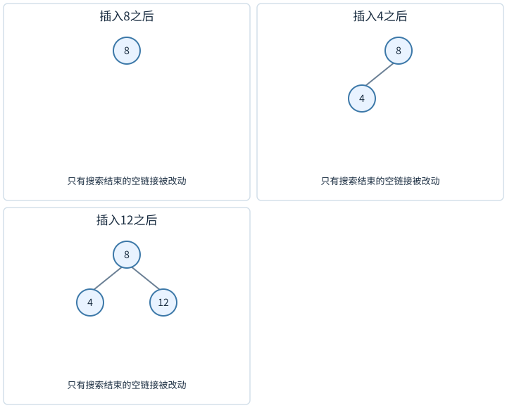

插2时沿8左、4左到空；插6沿8左、4右到空；插10沿8右、12左到空。每个“左”表示目标小于当前键，每个“右”表示目标较大。

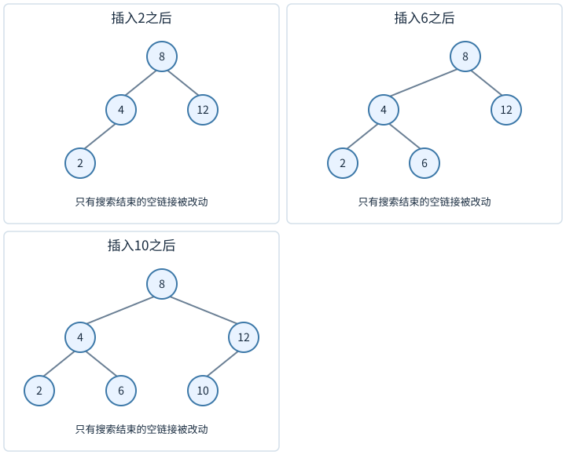

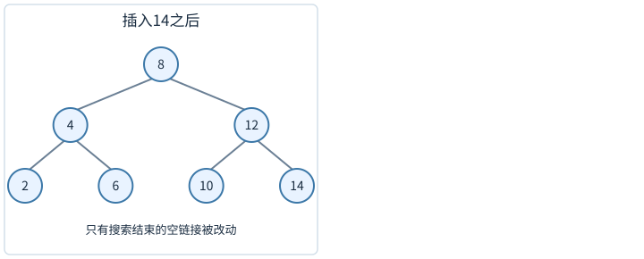

查找6：6<8向左到4；6>4向右到6，找到。查找5：向左到4，向右到6，再向左到空，失败。这个空槽正是插入5的位置。路径上每个比较都排除另一侧的整棵子树，因为那里的所有键都不可能等于目标。

不变式是“若目标存在，则它仍在当前子树内”。每步进入一个严格更小的子树，最终到目标或空槽。时间O(h)，h为树高。若树退化成链，h=n−1，查找最坏线性；仅仅名字叫“树”不保证对数级。

中序遍历先列左侧小键，再根，再右侧大键，所以BST中序严格递增。反过来，若二叉树中所有互异键的中序严格递增，也能推出每个节点左右满足搜索性质。因此旋转是否保序，可以通过中序序列检查。

## 删除节点，要分清它有几个孩子

删叶子2，直接断开父4的左链接。删只有一个孩子的节点，让父直接接到它的唯一孩子。两个孩子都在的节点，不能把左右孩子随便挤在同一个位置。

先独立考虑删叶子2：把父4的左链接置空，其他链接不动。再独立考虑只带右孩子11的节点10：把父12的左链接从10改到11，令11.parent指向12，然后释放10。下面的两孩子例特意保留这个11，避免把后继误当成必定是叶子。

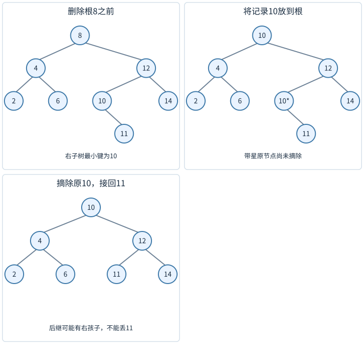

要删根8，先从其右孩子12一路向左，遇10，再向左为空，故后继为10。把10的完整记录复制到根位置，暂时有两个位置显示10；然后摘除原10，用它的右孩子11接替原位置。最后根为10，左边仍4带2/6，右边12带11/14。图中的星号标记的是待摘除的旧位置，不是重复键插入。

若节点存`(学号,成绩)`记录，替换时必须复制整个对应记录，不能只改学号却留下旧成绩。若外部持有节点身份，复制记录与真正交换节点也有不同语义；接口应说明外部引用会怎样变化。

后继为何没有左孩子？它已是右子树最左节点，有左孩子便还能向左走，与“最左”矛盾。为何替换后仍保序？后继是所有大于原根键的键中最小者；左子树所有键小于原根，也小于它；右子树去掉后继后其余键仍大于它。

删除总路径长度O(h)，还可能需要沿祖先更新高度或子树大小。若有父指针，删除后孩子的parent也必须更新，不能只改向下链接。

## 平衡是在控制高度，不要求左右节点数相等

按1、2、3、4、5顺序插入普通BST，会形成一路向右的链。AVL树要求每个节点的左右子树高度差绝对值不超过1。平衡因子可定义为`height(left)-height(right)`，合法值−1、0、1。

现在具体看，这条要求怎样限制高度。用`h`表示树高，仍按边数计：叶子的高度是0，空树高度是−1。用`N(h)`表示“高度恰为h的合法AVL树，最少需要多少个节点”。我们先数出几个小高度，再推一般关系。

一棵高度为h的非空树，至少有一棵孩子子树高h−1，否则整棵树达不到h。另一棵子树可以矮一些，但AVL只允许差1，因此它至少高h−2。要用最少节点达到这个高度，就让两棵子树分别采用各自最少节点的形状，再加上根的1个节点：

$$N(h)=1+N(h-1)+N(h-2),\qquad h\ge1.$$

这个式子的三项依次是根、较高的孩子子树、较矮的孩子子树。空树没有节点，所以N(−1)=0；叶子只有自己，所以N(0)=1。代入时可以一行一行算：

|高度h|最少节点数怎样算|N(h)|
|---:|---|---:|
|−1|空树|0|
|0|单独一个叶子|1|
|1|1+N(0)+N(−1)=1+1+0|2|
|2|1+N(1)+N(0)=1+2+1|4|
|3|1+N(2)+N(1)=1+4+2|7|
|4|1+N(3)+N(2)=1+7+4|12|

高度不能随意增加：从高度3增到4，即使用最省节点的形状，也要从7个增到12个。下面给一个不必记住这串数列名称的上界证明。

为消掉递推中的常数1，另记$M(h)=N(h)+1$。把两侧都加1，再将N换成M：

$$M(h)=N(h)+1=2+N(h-1)+N(h-2)=M(h-1)+M(h-2).$$

M的初值为正，递推中每项又是两个正数相加，所以每一项都比前一项大；于是$M(h-1)\ge M(h-2)$，从而

$$M(h)\ge2M(h-2).$$

也就是说，高度每增加两层，所需节点数加1后的数值至少翻倍。基础值为M(−1)=1、M(0)=2。从这两个起点反复使用上式，可得

$$M(h)\ge2^{(h+1)/2}.$$

逐步代一次就能看出指数怎样增加：若$M(h-2)\ge2^{(h-1)/2}$，则$M(h)\ge2\cdot2^{(h-1)/2}=2^{(h+1)/2}$；两个基础高度也都满足这个不等式。

实际的AVL树若有n个节点、高度h，节点数至少是N(h)，所以$n+1\ge M(h)\ge2^{(h+1)/2}$。对两边取以2为底的对数，再移项，得到

$$\log_2(n+1)\ge\frac{h+1}{2},\qquad h\le2\log_2(n+1)-1.$$

因此高度最多按log n的速度增长。查找沿一条根到叶的路径向下走，每层只比较一次，时间便受这个高度界约束。这里的常数还可以改进，但已经足以证明AVL查找的最坏时间为O(log n)，不会像那条单链一样增长到线性。

## 一次右旋，为什么不破坏大小关系

```text
旋转前          旋转后
      g              p
     / \            / \
    p   C          A   g
   / \                / \
  A   B              B   C
```

旋转前的键关系是A里的键<p<B里的键<g<C里的键，旋转后这条中序关系完全相同。改动是让p升上去，g成为p的右孩子，B转接成g的左孩子。不能丢掉B，也不能把它接到g右边。

若g原来不是整树根，g原父节点指向这棵局部树的链接要改成p；若g是根，要更新root。再更新B的parent、g的parent、p的parent。高度必须先更新降下去的g，再更新升上来的p，因为p的新高度依赖g。

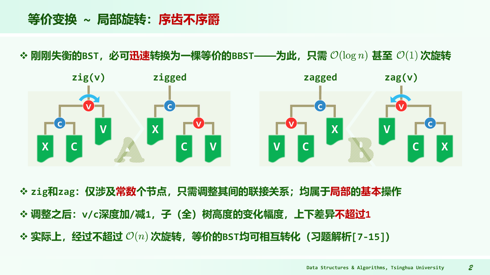

图中左右两幅互为逆操作，X、C、V等方块代表整棵子树，不是单个值。旋转只改少量链接，整块子树内部不动，所以一次旋转O(1)。中间子树在两个节点之间重新挂接，是保持中序不变的关键。

## 四种插入失衡，跟着三个节点的方向判断

下面四次实验各从空树开始，空树高度定为−1、叶高度0。新节点加入后，沿它的父链重算高度，发现平衡因子绝对值达到2的最低祖先g；从g到较高孩子p、再到新节点所在孙子v的两次转向决定处理顺序。

插30、20、10：30左子树高度1、右空高度−1，相差2。路径左左，所以在30右旋，20升根，10/30成为两孩子。

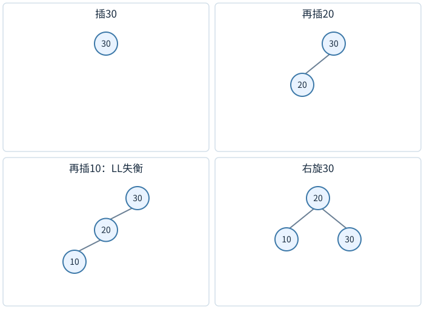

插10、20、30：10右侧过高，路径右右，在10左旋。这个实验的每次状态与上一例左右镜像。

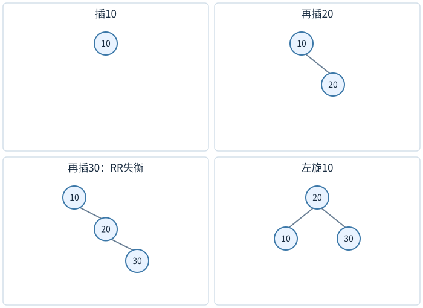

插30、10、20：30仍左重，但10右重。先左旋10，20升到30左边，10成为20左孩子；再右旋30，20升局部根。

<!-- trace:ds-avl -->

对输入30、10、20，把两次旋转分别停下来看。图上方的父节点连向下方的孩子；橙色标出本步改变关系的节点。


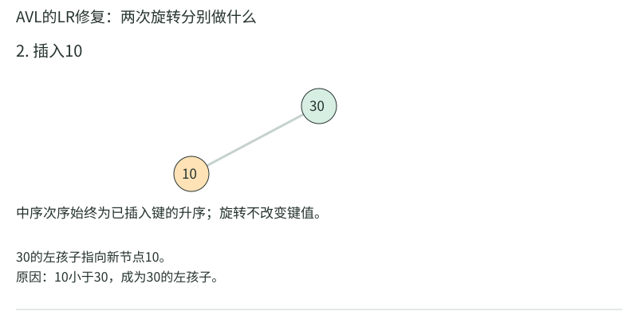

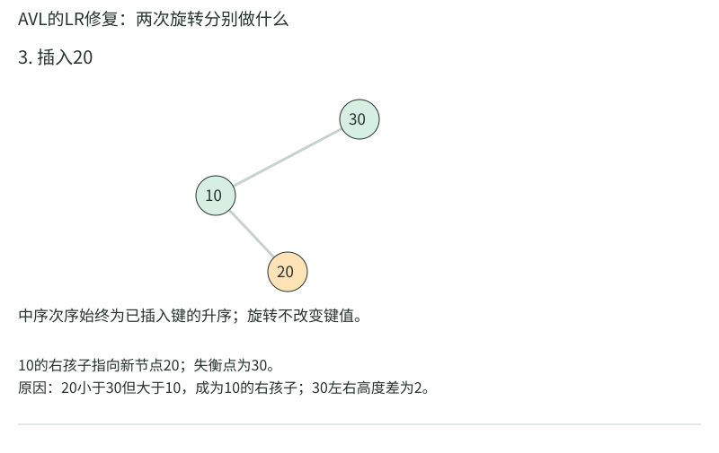

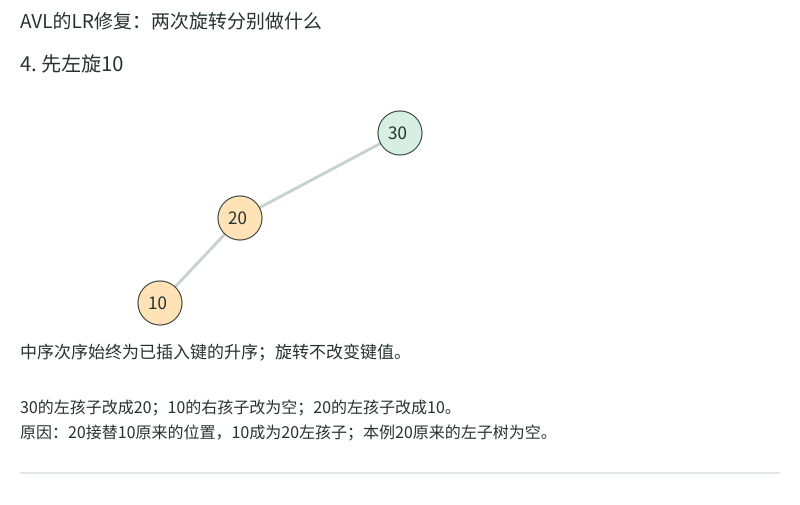

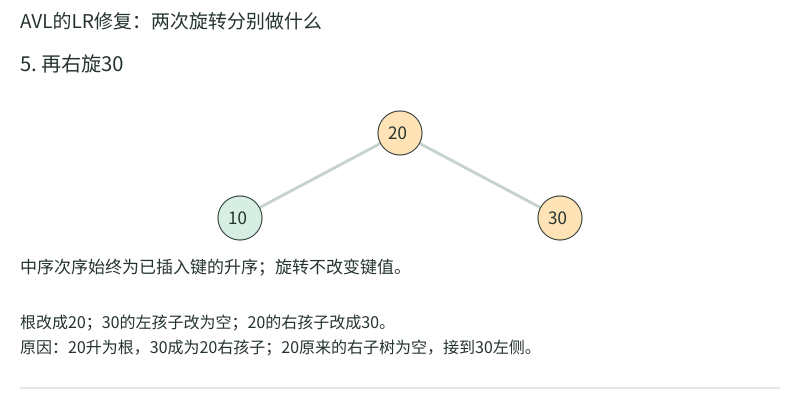

<!-- /trace:ds-avl -->

插10、30、20：先右旋30，使20成为10右孩子，30成为20右孩子；再左旋10，20升根。第一旋仅把内折改成外侧，不能在第一旋后就停止修复。

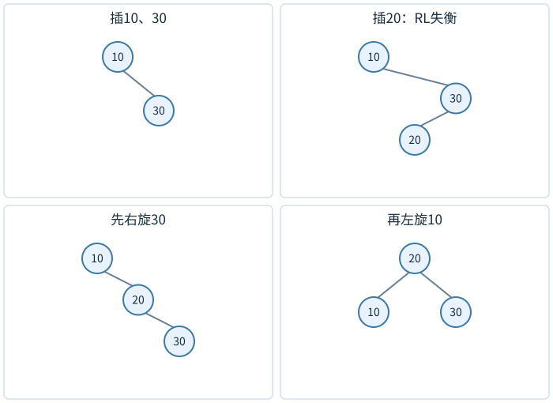

三个关键节点都能按中序排成a<b<c，最终b为局部根；真正带侧子树的情况必须保留四块值域，不能只背三节点形状。

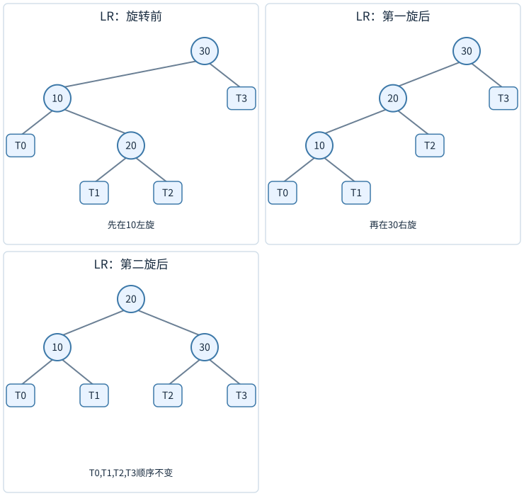

插入修复从新节点向根回溯，找最低失衡祖先。修复后这棵子树高度恢复到插入之前，故更高祖先不会因这次插入继续失衡；需要更新沿路高度，但旋转修复次数为常数。

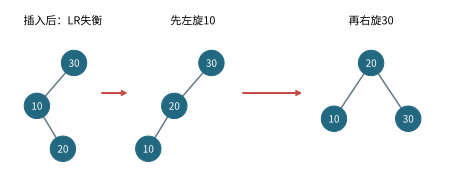

左图三十的左孩子是十，十的右孩子是二十，形成内折。第一根箭头表示先在十处左旋，使二十上升；第二根箭头表示再在三十处右旋，最终二十成为局部根。三个节点的中序始终是十、二十、三十，图只省略了空子树；真实树中还要按值域接回四棵侧子树。

## 删除修复与插入不同

删除可能让子树高度减少1，修复后仍比原来矮，因此失衡可能继续向上传播，最坏需要O(log n)层的旋转修复。不能把“AVL插入最多一次局部重构”直接套到删除。

先看一次确实需要两处修复的删除。下面每个数是互异键，孩子的左右位置按BST规则排列，未画的孩子均为空。原树每个节点都平衡；根12左高3、右高2，高度4。

```text
                 12
              /      \
             6        20
           /   \     /  \
          3     9   16   22
         / \   / \  /
        2   4 8  10 14
       /
      1
```

删除叶22，父20的左高1、右高−1，相差2。较高孩子16向左偏，因此在20右旋。16升到原20位置，左仍14，右接20，局部高度从原来的2变为1：

```text
                 12
              /      \
             6        16
           /   \     /  \
          3     9   14   20
         / \   / \
        2   4 8  10
       /
      1
```

20附近已经平衡，但12看到的右高度真的少了1。它现在左高3、右高1，自己也失衡。较高孩子6的左高2、右高1，同样外侧偏左，于是对12右旋：6升为根，12降为其右孩子，原6的右子树9转接到12左边。最终全树如下：

```text
                 6
              /     \
             3       12
            / \     /  \
           2   4   9    16
          /       / \   / \
         1       8  10 14 20
```

按实际回溯顺序检查高度，便能决定是否还需向上走：

|被检查的入口|删除前高度|孩子修改后的高度|修复后局部根/高度|上方接下来看到什么|
|---|---:|---|---|---|
|20|2|左1、右−1，失衡|16，高1|右子树入口由20变16，且高度减1|
|12|4|左3、右1，失衡|6，高3|根入口由12变6，全树高度减1|

第一处旋转之后立刻返回会留下第二幅图中失衡的12。反过来，也有旋转后高度恢复的情况，不能把“删除总会一路改变高度”当规则。下面的等高孩子例正好显示差别。

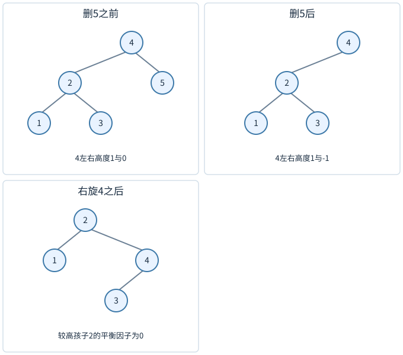

考虑根4，左子树为2带孩子1、3，右孩子5为叶。删5后，4的左高1、右高−1，平衡因子2；较高孩子2的左右等高。对4右旋后根2，左1，右4且4左3，树重新平衡。这里孩子平衡因子为0，是删除中需要特别覆盖的一种情况；若只写插入时的LL/LR判断，可能遗漏。

每次回溯先重新计算高度，再判断因子，旋转后继续从新局部根的父节点向上。实现最好将“更新高度”“重新连接父链接”“局部旋转”分别封装，避免四种情况各写一份不一致的指针操作。

教师《06.二叉搜索树》PDF43至45页把这项差别放在删除实现中。较高孩子p若两边等高，选择与p相对于g同侧的孙子v，做单旋；不能照搬插入时由新节点路径决定v的办法。只有在高度已经恢复时才可停止高度传播。若还维护size，即使height不变，节点数量也确实少了1，仍须沿剩余祖先更新size。

把BST物理摘除与AVL回溯分开，控制过程可写成以下伪代码。`entry`表示父节点中指向局部根的孩子槽，整树根则用root槽；`rotate`完成前面已经展开的单/双旋，并返回新局部根。片段的前置状态是BST删除已完成，`g`为真正被摘除节点的旧父亲，不是任意取最初指定的键所在位置。

```text
while g 非空:
    oldHeight = g.height       // 仍是删除前缓存的高度
    updateHeight(g)
    if abs(height(g.left) - height(g.right)) > 1:
        p = g 的较高孩子
        v = p 的较高孩子；两边等高时选与 p 同侧的一边
        entry = 原来指向 g 的槽
        g = rotate(g, p, v)    // 先更新降下的节点，再更新新根
        将 entry 所指的槽写为 g // 新局部根接回原父亲或 root
    parent = g.parent         // 必须取旋转后的父亲
    if g.height == oldHeight:
        高度传播可以停止；其他发生变化的摘要另行更新
        break
    g = parent
```

在两次修复的例子中，第一次oldHeight为2，新根16高1，不停；第二次oldHeight为4，新根6高3，也确实减少。等高孩子例中，单旋后的局部高度与删除前相同，便不必再让更高祖先重新检查height。每次循环至少向上一层，每层至多一次常数规模重构，所以删除最坏$O(h)=O(\log n)$；这项界由实际回溯路径得到。

## 子树大小还能支持第k小

每个节点额外存size=1+左size+右size。要找从0起的第k小，令L为左子树大小：k<L就去左边；k=L返回当前节点；k>L就去右边，新的k减去L+1。每次只走一条根叶路径，在AVL中O(log n)。

例如原7节点树找零起秩4（通常所说第5小），根8左边3项，4>3，去右子树，k改为0；节点12左子树含10一项，0<1，去10，返回10。旋转不改变局部元素总数，但改变各节点子树范围，所以必须像更新高度一样更新size，先下后上。

## 三节点四子树重构，把双旋展开成一次有序接回

设按中序排序的三个关键节点为a<b<c，它们之间四棵子树T₀、T₁、T₂、T₃也按值域依次排列。重构后b为局部根，a为左孩子、c为右孩子；a左右接T₀、T₁，c左右接T₂、T₃。先更新a、c的height与size，再更新b，最后把b接回原祖父。

例如LR结构根30，左10，10右20。若10左T₀、20左T₁、20右T₂、30右T₃，则重构根20，左10挂T₀,T₁，右30挂T₂,T₃。四个值域从未改变相对顺序，所以搜索性质保留；中间两子树不再依原父节点身份挂接，而依它们数值区间挂接。这比只画10、20、30三个圆更接近真实指针操作。

## 有序统计的rank查询，和第k小方向相反

若问键x之前有多少键，比起查第k小，需要沿查找路径累计。当前节点键小于x时，它的整个左子树和自己都可计入，答案增加左size+1，再去右侧；当前键≥x时去左侧，不增加。不存在x也能得到它的插入秩。

原树键1、3、6、8、10，查x=7：根8太大去左，节点3<7，计左1及自己，共2；去6，6<7再计1，总3。恰有1、3、6三个键小于7。若重复键以计数保存，当前节点贡献是count而非1，size也应统计所有记录数，接口到底返回不同键秩还是记录秩要先说明。

## 搜索失败不代表没有可用信息

BST查找5最终停在6的空左槽，路径已经给出前驱与后继范围。可在下降时保存“最后见到的小于目标节点”与“最后见到的大于目标节点”，失败后仍能返回边界。平衡树除了是否存在，还能回答lower_bound、upper_bound与范围遍历，这些能力来自全局顺序，不是散列桶可以直接提供的。

## 等值键保存为计数，删除一个与删除全部不同

若节点键五的count为三，removeOne只将count减到二，树形无需改变，但路径上size都要减一；removeAll才需要物理删除节点，并将相关记录数量从增广size里扣除。若size统计不同键数，而查询要求含重复的第k小，两者就不匹配。

例如键一一份、键五三份、键九一份，记录序列为一、五、五、五、九。第五小是九，第三小是五；在节点五处，左边记录数一，自身覆盖接下来的三个秩。用左size加一替代左size加count，会把后面秩算错。多重集合不是只允许重复插入这一个改动，查找、秩与删除语义都需一致。

搜索树的键应满足一致的比较顺序。若同一对键这次比较小于、下次又大于，或者键在树内被外部修改，原来指向左子树的范围可能不再成立。修改键通常应先删除旧记录，再按新键重新插入；只改节点字段而不重新定位，会让查找沿错误分支走失。浮点特殊值也可能不满足普通全序假设，比较器需明确定义它们怎样排列。

旋转前后还应核对总记录数不变，局部根接回以后，原祖先的孩子指针与新根的父指针必须互相对应。

## 练习与答案

**练习1。** 依次插入40、20、30，写出失衡类型与两次旋转后结构。

解答：40左孩子20，20右孩子30，是LR。先20左旋，让30挂到40左边、20成为30左孩子；再40右旋，让30成为根，左20、右40。中序始终20、30、40，旋转后高度1，左右高0。

**练习2。** 删除BST中有两个孩子的节点时，能否用前驱而非后继？

解答：可以。前驱是左子树最右节点，它不可能有右孩子，所以替换后也归约到0或1孩子删除。左右论证对称。应复制完整记录并更新原前驱位置的链接、parent与增广信息。若重复键策略不同，前驱或后继替换需与等值放置规则一致。

**练习3。** 左右子树节点数为7与3的节点，能否是AVL合法节点？

解答：可能。7节点子树若高度2，3节点子树若高度1，高度差1，合法。AVL约束高度，不约束节点数相等。反过来，节点数相近也不保证高度接近：某侧若退化为链仍可能很高，但它本身就违反AVL递归平衡条件。判断时必须检查每个节点的高度关系。
