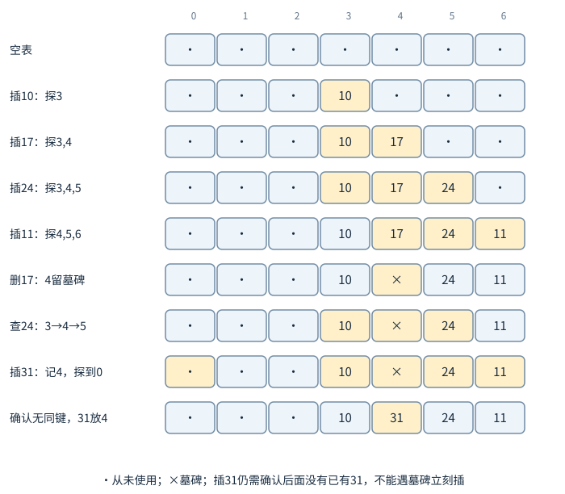
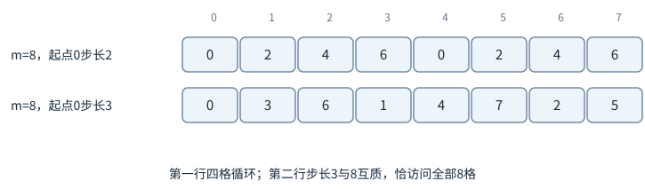
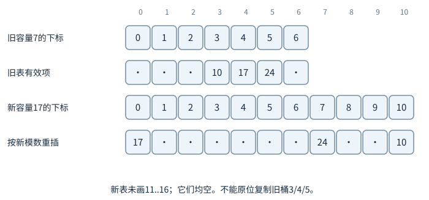
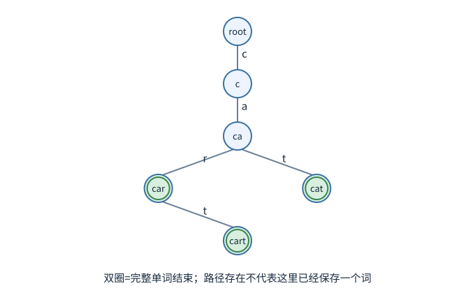
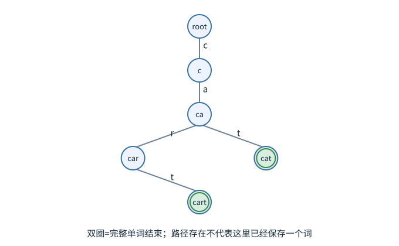
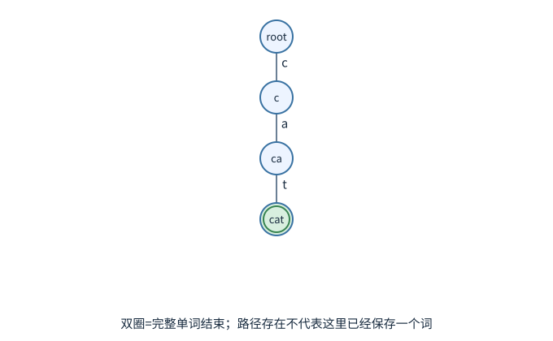

# 散列表：算出一个位置以后，还要确认是谁

希望用学号查成绩，且不要求按学号排序输出。直接用学号当数组下标可能浪费巨大空间；散列函数把键映射到较小的桶号，例如`h(k)=k mod 7`。不同键可能得到同一桶，叫冲突。冲突不是偶然的程序错误，只要键范围比桶数大，就不可避免。

散列表首先通过哈希值缩小候选，最终仍要比较真实键是否相等。两个对象哈希相同，不代表对象相等；若对象相等，则哈希必须相同。键若在入表后改变参与哈希的字段，后续按新值查找可能找不到原位置，因此通常要求键在表内保持相应不可变性。

## 同桶候选连起来，先核对真实键

桶数m=7，插入10、17、24、11。前三者都余3，进入桶3；11余4，进入桶4。每次插入后的桶3依次是[10]、[10,17]、[10,17,24]；插11不再改变桶3，桶4成为[11]。本例统一尾插，让手算比较次序可复现。若实现采用头插，最后会是24→17→10，正确性不变，但逐次比较的顺序要随之改写。

查17，先算余3，再沿桶3比较10、17，找到。查31也余3，要比较10、17、24后失败。

## 为什么随机选哈希函数能帮助，而不是把输入称作随机

上面的固定取模已经说明最坏可能很长。所谓“平均很快”必须再给一个随机模型。先用三桶、三个固定不同键x、y、z理解：假设从所有映射函数中等可能抽一个h，每个键各自等概率落到0、1、2。给定x所在桶，y有3种位置，其中1种与x同桶；z同理。9种等可能组合中，两者都不同桶有4种，恰有一个同桶有4种，两者都同桶有1种。

|x所在桶的候选数|对应组合数|概率|乘上概率的候选数|
|---:|---:|---:|---:|
|1，只含x|4|4/9|4/9|
|2|4|4/9|8/9|
|3|1|1/9|3/9|

加权平均为$15/9=5/3$，并非每次都恰有5/3个候选。也可从每个键分别计数：x必在，贡献1；y与x碰撞的概率1/3，z也1/3，合计$1+1/3+1/3$。这两种计算对应同一个平均，后一种避免枚举全部组合。

一般地，不需要真的存储“所有函数”。我们要求所用随机函数族满足：任意两个不同键，随机选h后冲突概率不超过$1/m$。固定要查的键x，以及已经存入的n个不同键，为每个其他键y记$I_y$：与x同桶为1，否则0。那么桶中候选数为$1+\sum_{y\ne x}I_y$，每个$I_y$的平均就是相应碰撞概率，所以平均候选数至多$1+(n-1)/m$。各碰撞事件即使相关，逐项求平均仍可相加；这里并未把n个输入键本身假设成均匀随机。链上查找至多比较这批候选再付常数接口成本，才得到相应期望上界。

这个模型将随机性放在哈希函数选择上。若始终使用固定简单取模，输入恰好全是m的倍数，就不能引用上述随机函数族保证。若对手能看见h以后专门选键，假设也可能改变；课程一般散列分析与面向恶意输入的哈希设计需区分。这里要学的是概率到底对哪个对象取，而非把“随机”当万能形容词。

装载因子α=n/m表示平均每桶有多少元素。在散列足够均匀等假设下，拉链查找期望O(1+α)。当α保持常数，称期望O(1)；若所有键都挤在同一桶，最坏O(n)。不能只背“散列表O(1)”而删掉概率条件与最坏情况。

字符串键的哈希计算还要读取字符，长度L的键通常至少O(L)处理成本；若已缓存哈希值，可复用一部分，但相等性比较也可能读到很多字符。字典操作的常数时间结论常默认键本身可在常数时间哈希与比较。

删除某一键时只删对应节点，不影响同桶其他键。若支持相同键更新值，插入前需要先在桶内确认已有键，不能每次直接追加而产生多个相同逻辑键，除非接口本来就是多重映射。

## 在线性数组中继续找位置



图中最上方是槽下标，不是键值。圆点表示从未使用，叉表示曾用过但已删除。每行黄色格是这次操作检查过的位置，插31的倒数第二行还没写入，最后一行才把它放回首个墓碑。

开放定址把所有记录放在数组中。桶m=7，线性探测依次试`h(k),h(k)+1,...`对m取模。插10放3；插17先看3被占，放4；插24再看3、4，放5；插11的本位4已占，再看5，放6。

查24沿3、4、5找到。若删除17后把4直接设成“从未使用”，查24会在4提前停止，误判不存在。因此删除槽通常标成墓碑：查询遇墓碑继续，遇从未使用槽才知道这条探测链上不可能有目标。

插入可记住沿途第一个墓碑作为候选空位，但仍需继续查到真正空槽或确认不存在已有同键。否则可能在墓碑处先插一个17，而后面其实已有17，造成重复键。若扫描一整圈都无从未使用槽，也要有明确终止条件，避免满表无限探测。

墓碑不算有效记录，却会增加查找路径。重建触发条件往往不仅看有效装载因子，还看有效记录加墓碑占据的比例。桶数远大于n也不必然快：若几乎所有槽都被墓碑覆盖，失败查找仍可能走很长。

把这套生命周期写成固定容量的整数键映射，关键是每次最多检查m个槽；即使没有“从未使用”槽也能结束。下面`None`表示从未使用，独有对象`DELETED`表示墓碑，两者都不能作为本程序的用户键。`get`在不存在时抛出`KeyError`，不把合法值None与失败混淆。`put`找到墓碑只保存位置，继续确认后面有没有同键；查完一圈仍有墓碑时可以复用它，没有任何空位才报告表满。

```python
DELETED = object()

class LinearMap:
    def __init__(self, m):
        if m <= 0:
            raise ValueError("容量必须为正")
        self.m = m
        self.keys = [None] * m
        self.values = [None] * m
        self.size = 0

    def get(self, key):
        for step in range(self.m):
            i = (key % self.m + step) % self.m
            old = self.keys[i]
            if old is None:
                break
            if old is not DELETED and old == key:
                return self.values[i]
        raise KeyError(key)

    def put(self, key, value):
        first_deleted = None
        for step in range(self.m):
            i = (key % self.m + step) % self.m
            old = self.keys[i]
            if old is DELETED:
                if first_deleted is None:
                    first_deleted = i
            elif old is None:
                target = i if first_deleted is None else first_deleted
                self.keys[target], self.values[target] = key, value
                self.size += 1
                return
            elif old == key:
                self.values[i] = value
                return
        if first_deleted is not None:
            self.keys[first_deleted] = key
            self.values[first_deleted] = value
            self.size += 1
            return
        raise OverflowError("固定容量表已满")

    def remove(self, key):
        for step in range(self.m):
            i = (key % self.m + step) % self.m
            old = self.keys[i]
            if old is None:
                break
            if old is not DELETED and old == key:
                value = self.values[i]
                self.keys[i], self.values[i] = DELETED, None
                self.size -= 1
                return value
        raise KeyError(key)

table = LinearMap(7)
for key in [10, 17, 24, 11]:
    table.put(key, str(key))
table.remove(17)
print(table.get(24))             # 穿过墓碑，得到24对应的值
table.put(31, "new")             # 最后复用槽4
table.put(11, "updated")         # 更新原键，不新增同键
print(table.keys)                 # [None,None,None,10,31,24,11]
print(table.size, table.get(11))  # 4 updated
```

查询为何能在从未使用槽停下？目标若曾沿同一探测顺序插入，遇到当时第一个从未使用槽就会落在那里，不可能越过它存到更后面；删除只造墓碑，不会把历史中间槽伪装成从未使用，所以这条证据仍成立。墓碑恰好保存了“探测链曾经经过这里”，让这项停止理由一直有效。有限一圈的上限又覆盖了满表和全墓碑边界。

## 线性聚集与其他探测方式

以上生命周期继续：删17以后，查24仍检查槽3的10、槽4墓碑、槽5的24。插31的本位也为3，依次检查3、4、5、6、0；先记住4，但直到0的从未使用槽才确认后面不存在31，再把31放到4。此后槽4已是31，不再是墓碑。

另从“刚删17、还未插31”的状态看更新11：先遇槽4墓碑，不能立即在这里插一个11；继续探测5、6，在6找到已有11，只更新该记录。这个分支说明为什么记住墓碑后仍要继续找同键，和插31完成后的表不是同一时刻。

线性探测形成连续占用块，新键撞到块中任一位置都会并入这个块，使块越来越长，这叫主聚集。二次探测用平方偏移，双重散列用第二个函数给步长，试图分散探测位置。

双重散列`(h1(k)+i*h2(k)) mod m`要确保步长与m互质，才能遍历全部桶。例如m=8、步长2只会访问0、2、4、6，另一半槽即使全空也到不了；m为质数且步长介于1与m−1，则互质。二次探测是否能找到空位也依桶数与装载条件，不能把“改变步长”当作完整正确性证明。



二次探测也应真走一个输入：容量7，本位0，偏移i²，i=0至6访问0、1、4、2、2、4、1，只覆盖0/1/2/4四格。若这些位置都满，即使3、5、6空也找不到。因此实现必须配合能保证成功的容量/负载条件，或明确检测探测周期后重建。

在理想均匀探测模型下，失败查找期望探测数可由装载率估计为不超过约1/(1−α)。α接近1时成本急剧上升。这个上界可以按“还没找到空位”的概率求和：检查j个槽仍全满的概率不超过$\alpha^j$，所以期望探测数不超过$1+\alpha+\alpha^2+\cdots=1/(1-\alpha)$。这里假设探测次序是理想均匀的随机排列，剩余空槽占比只会让后续全满概率更小。α=1/2时上界2，α=0.9时上界10；它没有说每次查询恰好这么多步。线性探测的具体期望公式与均匀独立探测模型不同，不能把一个模型的公式搬给所有冲突策略。

## 扩容时重新定位每个有效键

旧桶数7，键10在3、17在4、24在5。扩成17桶以后，h(k)=k mod17，三者本位分别10、0、7。若只是把旧数组复制到新数组前三格相同位置，查10会先去10而找不到。



重散列需要新建空表，遍历所有有效记录，按新桶数重新插入，不复制墓碑。若表内n项且新表规模O(n)，重建成本O(n)期望或与具体散列规则相应的成本。按固定比例扩容并控制装载阈值，可以把这种昂贵重建摊还到之前的多次插入。

它同时包含两层不同分析：冲突处理的成本通常是期望界；扩容总账是摊还界。因此完整说法可能是“期望摊还O(1)插入”，而不是两种条件被一个O(1)遮住。

取模前的哈希也会影响分布。若整数键都为某个因子的倍数，桶数选择可能造成大量冲突。字符串多项式哈希按字符顺序累积，例如`h = h*b + code(c)`，比简单相加能区分换位字符，但仍可能碰撞。密码学抗攻击要求另有安全设计，课程普通哈希不能自动承担密码学用途。

## Trie：键是字符串时，沿字符路径找

用car、cart、cat建立一棵Trie。空根不代表字符，每条边消费一个字符，节点另记“是否到这里就结束一个完整词”。

|插入词|复用已有前缀|新建边/节点|新增词尾标记|
|---|---|---|---|
|car|无|根-c-a-r三条边|r处标词尾|
|cart|c-a-r|从r新建t|t处标词尾，保留r词尾|
|cat|c-a|从a新建另一分支t|新t处标词尾|



查ca：从根读c，再读a，路径存在，但a未标词尾，因此不是保存的完整词；查前缀ca则成功。查cart：依次走c/a/r/t，在最后t的词尾标记为真，找到。查cab：c/a仍可走，但a没有b孩子，立即失败，不必扫描car和cat的完整字符串。

时间与键长L有关，而非词典总词数n的对数；每步孩子若用固定字母表数组查找，则L步为O(L)。若每个孩子集合用平衡树或散列表，字符转移的成本也要相应计入。所有词的总输入字符数若为S，新建节点至多S+1（包括根），共享前缀只会减少数量。

字母表很大时，每节点开全套孩子数组很浪费，可用压缩分支、映射或基数树。路径压缩把只有一个孩子的连续路径合成一条带字符串片段的边，节省节点，但查找需逐字符比较该片段。

## 计数以后是否还要有序输出

输入`[4,2,4,7,2,4]`，依次更新计数：4→1，2→1，4→2，7→1，2→2，4→3，最后映射{4:3,2:2,7:1}。若只问4出现几次，直接查4。若要按数值从小到大输出频数，普通散列表不提供这种顺序，还需把键排序，得到2:2、4:3、7:1。

若键范围只有0到9，数组计数可能更直接；若还要找前缀相同的字符串，Trie更贴合；若要随时问最小键和前驱，平衡搜索树更方便。字典只是接口，底层结构应按需要选择。

## 重新散列也要检查删除后的负载

假设表容量16，最多容纳某阈值比例有效项。大量删除后只有2项，却留下12个墓碑。只看α=2/16似乎很空，但失败查询可能穿过连续墓碑长链。重建到一个新空表，重新插入这2项，才清除历史探测痕迹。

如果每次有一个墓碑就立即重建，会让频繁删插序列反复支付全表成本。可在有效加墓碑比例过大、墓碑相对有效项过多时触发，并与容量增长、收缩阈值配合留缓冲。每条策略都需要总账，不是只说“偶尔重建”就得到摊还常数。

## 装载因子同样大，冲突形状仍会影响成本

容量8、4项，α=1/2。若占位为0、2、4、6，各新失败探测可能很快遇空；若为0、1、2、3，哈希到0的失败查找会检查5格才遇空。α描述全局密度，不完整描述具体簇形。期望公式依赖散列与探测的随机模型，单个具体表仍可能偏离期望。

拉链法α可以大于1，因为每桶可有多个节点；开放定址有效项不能超过容量，α接近1时探测成本暴涨。把两种结构的相同字母当作相同使用范围，会得出满表仍能常数插入之类错误结论。

## Trie删除与前缀报告，逐项保留仍有用途的节点


词典含car、cart、cat。删除car只清car末节点的结束标记，不能删其节点，因为cart仍沿它向下。

再删cart后，t节点无孩子且不结束任何词，可删；向上car的r节点也无孩子且已非词尾，可删；到a节点仍有通往cat的t分支，停止。每层检查是否仍被别的词需要，才不会拆掉共享前缀。



图中双圈表示单词在这里结束。第一张的car、cart、cat都是双圈；第二张car不再双圈，但r和它的t仍在；第三张只剩cat，a仍不能删。

报告前缀ca下所有词，先用两步走到ca，再遍历它的后代并在词尾输出；时间至少包括输出字符总数。若每次拼接复制整个前缀字符串，成本可能超过只按节点数算的界，通常用可回退字符缓冲区记录当前路径。

## 迭代顺序也是接口承诺的一部分

普通散列表遍历通常不按键大小，扩容重散列后内部顺序还可能改变。有些语言字典另外承诺插入顺序，那是实现额外维护的关系，不是哈希函数自动产生有序。

若程序依赖按成绩从低到高输出，应显式排序键或选择搜索树，不能拿一次本地桶顺序碰巧递增当保证。相同集合经过不同插入、删除历史，内部布局也可能不同，但存在查询仍应给同样结果。

墓碑保留的是探测历史，不是一个仍然存在的用户键，计数与遍历都应跳过它。

## 练习与答案

**练习1。** m=5，线性探测插入1、6、11，再删6。查询11访问哪些槽？随后插16应怎样利用墓碑？

解答：1在1，6在2，11在3，删6后2为墓碑。查11从1到2再到3，不能在2停。插16从1开始，记住2为首墓碑，仍继续检查3以免后面已有16；到4发现从未使用槽，确认不存在后将16放回2。有效记录仍沿同一探测规则可达。

**练习2。** 相同对象的哈希能否不同？不同对象的哈希能否相同？

解答：按相等性定义判为相同的键必须产生相同哈希，否则它们会被送到不同桶而无法正确更新和查找。不同键可以同哈希，这正是冲突，需要真实相等比较处理。哈希值只用于定位候选，不能单独证明键相等。

**练习3。** Trie中已存`a`与`ab`，删除a能否直接删掉字符a对应的节点？

解答：不能，那会同时断掉ab的路径。先清除a节点的结束标记；只有节点不再标记单词且没有孩子时，才可向上回收无用节点。一个节点可以同时是某个单词的终点和另一个单词的内部路径。
