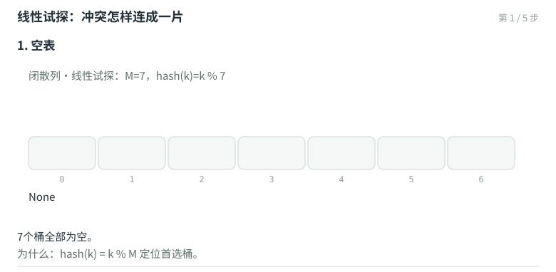

# 散列：循关键码访问、冲突排解与重散列

向量靠秩寻址、BBST靠比较寻路，散列提出第三种访问方式：**循关键码访问**（call-by-key）——只要拿到键，直接算出它的存储位置，期望$O(1)$，与数据规模无关。代价是键空间与桶空间通常不等大，冲突不可避免；本章的全部内容，可以概括为"两问"：**如何让冲突尽量少**（散列函数的设计），以及**冲突来了怎么办**（排解策略与重散列）。

## 散列原理：桶、装填因子与生日悖论

**散列表**（hashtable）是容量为M的桶（bucket）数组；**散列函数**`hash(key)`把任意键确定地映射到$[0, M)$内的桶号。词条键空间可达天文数字而桶数组有限，冲突必然发生——把在座同学按生日（月/日）散列到$M = 365$个桶，装填因子

$$\lambda = N / M = \text{在场人数} / 365$$

哪怕只有23人，"至少两人生日相同"的概率已过半：冲突是常态而非意外。于是散列策略的选取至关重要：**完美散列**（perfect hashing，两级散列模式、键集固定时可做到无冲突且$O(1)$）可期而不可求；一般情形下要降低冲突概率、并准备好冲突的排解预案。

## 散列函数：设计原则与几种配方

好散列函数的四条原则：**确定**（同一键总映射到同一地址）、**高效**（期望$O(1)$）、**满射**（充分利用整个散列空间）、**均匀**（每个键落到每个桶的概率接近$1/M$，有效避免聚集）。

**除余法**（division method）：`hash(key) = key % M`。对理想随机的键，每个桶有$1/M$的均等概率；"M取素数分布最均匀"的流传说法，需要辨析——对理想随机序列，表长是否素数无关紧要（判断标准是序列的Kolmogorov复杂度：生成它最短需要多少行代码）。真实数据远非理想随机：算术级数（单调线性）、循环级数（周期性）、自然语言（局部性）的规律普遍存在。以周期为p的一组键为例：它们只能入住间隔为$gcd(p, M)$的桶，同一桶内的键周期为$lcm(p, M)$——$gcd(p, M) = 1$时最好；为应对某一个这样的数据集可取M与p互素，为**应对所有**这样的数据集，唯有取M为素数。

**MAD法**（Multiply-Add-Divide）：`hash(key) = (a·key + b) % M`。除余法有个不动点——无论表长多少，`hash(0)=0`总成立，且相邻的键总是映射到循环相邻的桶，引发**初级聚集**（键连续的词条占据一段区间，区间内新冲突还会加剧）与**二级聚集**（连锁引发本不该有的冲突）。MAD法以线性变换打散原有次序；再配合a、b的随机选取，即得**通用散列**（universal hashing）：随机化保证任意两个键冲突的概率不超过$1/M$。

**更多配方**：平方取中（取$key^2$的中间若干位——平方把高位信息搅进中位）、折叠法（等宽分段求和，如`hash(123456789) = 123 + 456 + 789 = 1368`，或往复折返$123 + 654 + 789$）、数字分析（抽取某几位）。

## 闭散列：四个桶寻找下一个家

**闭散列**（开放定址）：冲突发生时按既定策略在表内寻找下一个空桶。实现要维护两个计数——$N$个正在使用的桶、$U$个曾使用过的桶（$N \le U \le M/2$，靠装填因子上限保证）。

**线性试探**（linear probing）：冲突就依次向后一个桶找。优点是" cache友好"；缺点是**初级聚集**：



M=7时依次插入12、26、19（都映射到桶5）：12落[5]；26试探[6]；19被[5][6]连环挡驾、落到[7%7]=[0]。三桶连成一片后，任何hash值落在这段区间的键都要连环试探。这引出**懒惰删除**（lazy deletion）的必要性：闭散列表里直接把桶清空，会切断后续键的试探链——remove只做标记，查找越过标记继续。于是 Hashtable 需要`used[]`标记数组与N、U双计数：

```cpp
template <typename K, typename V> struct Hashtable : Dictionary<K,V> {
   Entry<K,V>** ht;  Rank M;        //容量为M的桶数组
   bool* used;  Rank N, U;          //N个在用，U个曾用：N <= U <= M/2
   Entry<K,V>* get( K );  bool remove( K );  bool put( K, V );
   void rehash();                   //重散列：必要时扩充，保证装填因子低于阈值
};
```

**平方试探**（quadratic probing）：冲突后按偏移量$1^2, 2^2, 3^2, \ldots$跳跃，缓解初级聚集；但仍可能**二次聚集**（同义键走同一条试探链）。只要M为**素数**且装填因子$\lambda \le 50\%$，双向平方试探（交替取$\pm j^2$）必能终止于某个空桶——这也解释了`N ≤ U ≤ M/2`上限的来历。**再散列**（rehashing）：$\lambda$超过阈值时，开辟更大的表（通常翻倍、且仍取素数），把全部词条重新散列——虽是$O(n)$的大动作，但均摊到之前省下的每次$O(1)$操作，无伤大雅。其余变体：**再散列双函数**（冲突时换用第二个散列函数计算步长）、**公共溢出区**（冲突词条统一另开一表）。

## 拉链法：每个桶接一条链

**独立链**（separate chaining, 拉链法）：每个桶不存词条本体，而挂一个列表；冲突的词条直接接进同一桶。优点直观——删除是真正的删除（无懒惰标记）、装填因子可以超过1、实现简单；代价是指针的额外空间与内存访问的局部性损失。工程上的取舍常在闭散列（空间紧、cache友好）与拉链（删除干净、λ自由）之间按负载特征定夺。

## 词典接口与本章要点

散列表对外提供词典（Dictionary）三接口：`get(k)`按线性试探第一阶段定位（途经的第一个空桶记入`_s`，终点记入`_r`）；`put(k, v)`先查后插、必要时rehash；`remove(k)`懒惰删除并维护N、U。要点收拢：

- 散列＝循关键码访问；λ=N/M度量拥挤，冲突是常态（生日悖论：λ过半即大概率冲突）。
- 散列函数四原则（确定/高效/满射/均匀）；除余法取素数M是对抗一切周期性数据的唯一通用解；MAD法消不动点、通用散列给概率保证；平方取中/折叠各有巧思。
- 闭散列：线性试探快但初级聚集；懒惰删除保试探链（N≤U≤M/2）；平方/双向平方试探消聚集（M素数+λ≤50%必终止）；λ超阈值即rehash（均摊无伤）。
- 拉链法：桶挂列表，删除干净、λ自由，牺牲空间与cache局部性。
- 词典三接口get/put/remove全部期望$O(1)$——这就是散列的承诺。
