# 堆：只保证冠军站在最上面

任务队列要不断插入新任务，并取出优先级最高者。每次完整排序做了很多不需要的工作；只用无序数组则每次找最高都要扫描。堆维持一种较弱的顺序：父节点优先级不低于孩子，因此最高项在根，但左右子树之间不必有序。

优先级队列是接口，可以用多种结构实现；二叉堆是常见实现。最大堆取最大，最小堆取最小。本章以最大堆为主，切换到最小堆时所有比较方向都要一起反转。

## 完全二叉树的形状，让链接变成下标算式

堆按层序紧凑存在数组里，节点i左孩子2i+1、右孩子2i+2，父为⌊(i−1)/2⌋，根下标0。最后一层必须从左到右填满，形状由size唯一确定，所以无需为每节点另存孩子指针。

数组`[9,6,8,2,4,7]`是合法最大堆：9≥6、8；6≥2、4；8≥7。但数组并未有序，8在6后面，7在2、4后面。若要列出所有项从大到小，仍需反复删除最大或另做排序。

## 例1：插入，只有一条向上路径可能出错

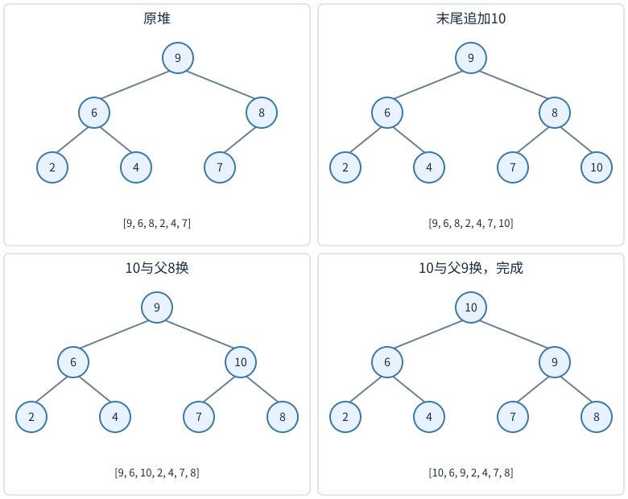

图下方的数组与树的层序一一对应。先根据数组下标确认父子，再比较键；同一层左右两项大小不同不需要交换。

在上述堆插10，先放到末尾下标6，形状仍完全，但10可能大于父8。与8交换，数组变`[9,6,10,2,4,7,8]`；10再与父9交换，变`[10,6,9,2,4,7,8]`，到根结束。

为什么不检查其他路径？新项之外所有旧父子关系未变；每次把较小父项向下移到新项原位置，该父项仍不小于原来新项的旧兄弟子树，因为它原先就在这些后代之上。唯一尚可能违反的是新项与新父之间。因此沿祖先不断修复即可。

树高⌊log₂n⌋，最多交换这么多次，最坏O(log n)。如果新值不大于父，只需一次比较，最好O(1)。底层数组还可能扩容，插入的完整账可以包含向量的摊还扩容成本。

## 例2：删除根，洞口应往哪边走

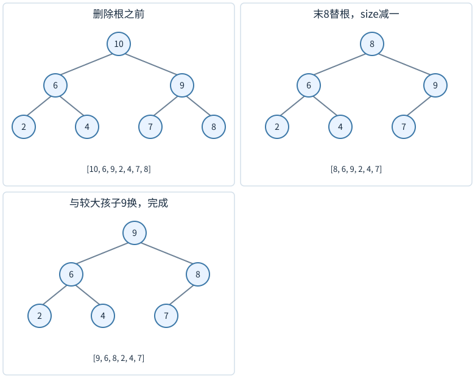

从`[10,6,9,2,4,7,8]`删除最大10。将末项8移到根并缩小size，得`[8,6,9,2,4,7]`。8小于两个孩子中的最大9，因此与9交换，得`[9,6,8,2,4,7]`；此时8只有孩子7，已不小于7，结束。

为何必须与较大的孩子交换？若8与6换，9仍在根的另一个孩子位置，根6<9，堆性质立刻失败。选择较大孩子可确保升上来的新父同时不小于两个孩子，只留下被下移项与它的新孩子之间可能冲突。

可以用“挖洞”减少交换：保存末项x，根留下洞；不断把较大孩子提上来，直到适合放x的位置，再写入x。比较逻辑相同，减少了反复交换带来的赋值次数。它仍是最坏O(log n)，修改常数不改变阶。

## 例3：自底向上建堆，为什么不是n log n

使用数组[4,1,3,2]。n=4，最后一个非叶下标为⌊n/2⌋−1=1。叶下标2和3本身各是一棵单节点堆，无需处理。

<!-- trace:ds-heap -->

逐步图把树和数组放在一起。数组下标从0开始，左右孩子下标为2i+1、2i+2；只有小于当前长度的下标才存在。

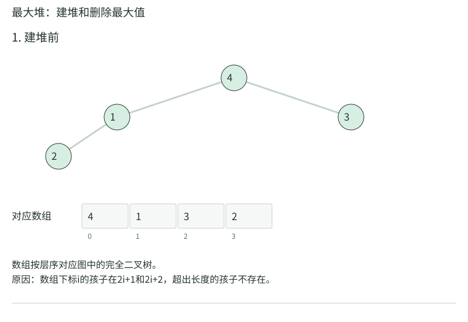

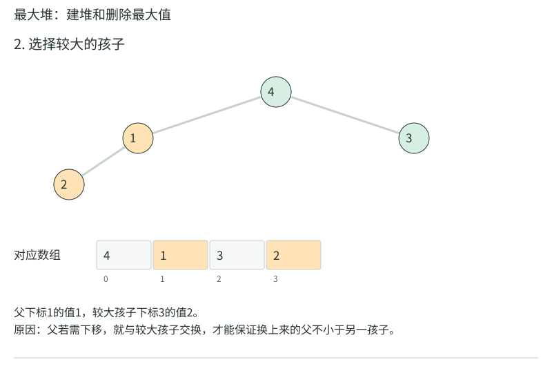

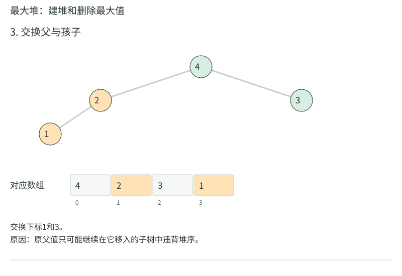

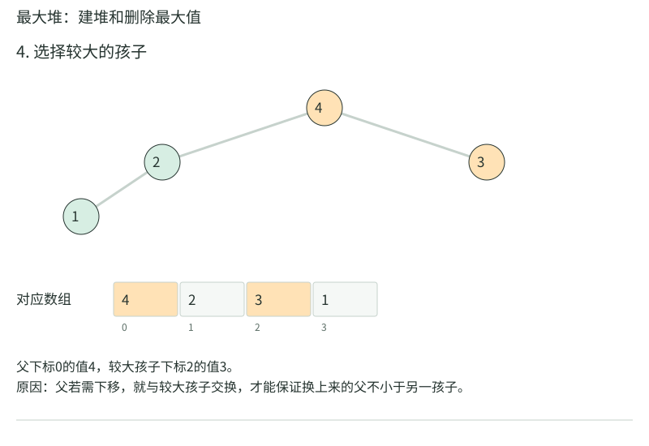

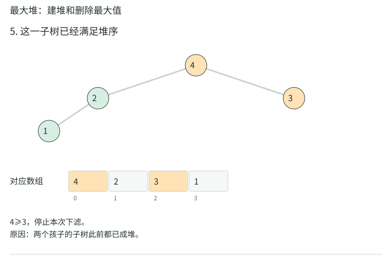

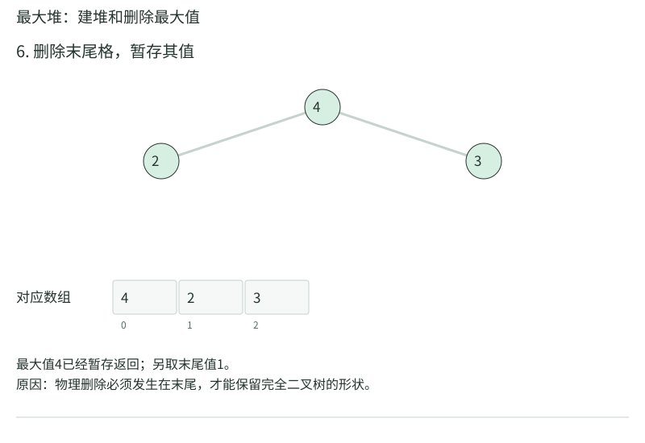

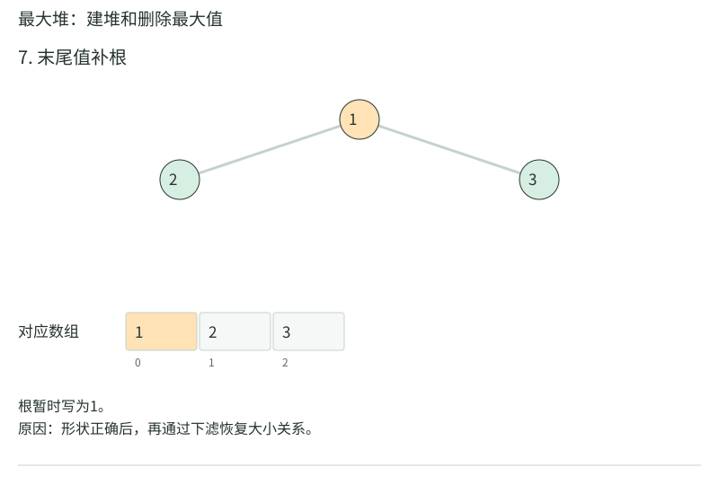

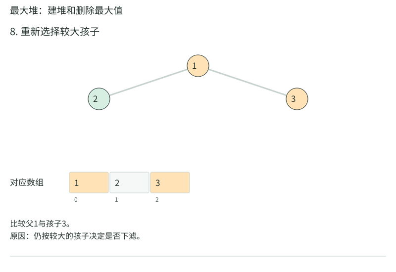

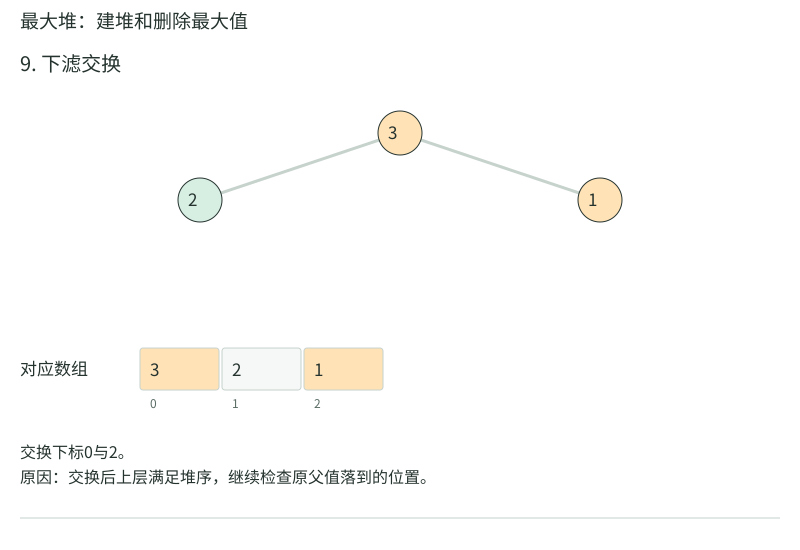

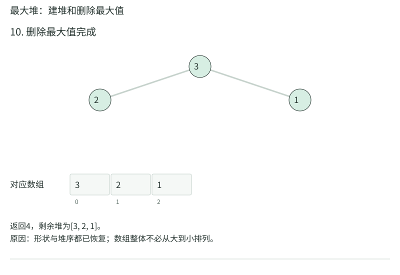

<!-- /trace:ds-heap -->

先在i=1下滤，值1只有左孩子2，1<2，交换，数组变[4,2,3,1]。i=0时根4大于孩子2和3，不动。到此建堆完成，数组就是[4,2,3,1]，不能因为“i=0没交换”而把这一步检查漏掉。

图后两幅继续对建好的堆delMax：返回4，将末项1填根并把size从4减到3，得到[1,2,3]；比较左右孩子2与3，选3升根，得到[3,2,1]。1已经到叶，结束。建堆与删除共用下滤，但起点、循环边界和当前有效size不同。

再用六项输入核对两层下滤：[3,1,6,5,2,4]，i=2的6≥4，不动；i=1时1与5换，得[3,5,6,1,2,4]；i=0时3先与6换，得[6,5,3,1,2,4]，再与孩子4换，得到[6,5,4,1,2,3]。最后一次下滤有两个交换，不是只把最大值放根便完成。

处理i时，它的左右子树都已经是堆，所以一次下滤即可使整个i子树成堆。叶子不需要下滤。若把每个节点都按最坏log n相乘，会得到O(n log n)的松上界；实际上大多数节点靠近底层，最多只下移一两层。

高度至少h的节点数约不超过n/`2^h`，因此总下移工作可按高度上界求和：

$$\sum_{h\ge1} O\!\left(\frac{n}{2^h}\right)=O(n).$$

也可将高度恰为h的节点数乘h，得到n乘收敛级数`Σ h/2^h`。所有元素至少要读一次，故建堆为Θ(n)。这里的关键是按节点实际可能下移的高度记账，而不是所有节点都支付根的成本。

## 堆排序：根与末尾交换后，缩小有效堆

最大堆根是当前最大值，与有效区间末项交换，最大值便到最终位置。有效堆size减1，对新根下滤，再重复。数组后缀逐渐变成升序的最终位置，最后得到整体升序。

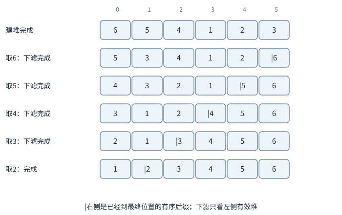

图中竖线右边已经就位，下滤不能越过它。每一步先把根与有效末项交换，再缩小size，最后只修复前缀。

对`[6,5,4,1,2,3]`：6交换到尾部，前5项下滤成`[5,3,4,1,2]`，后缀[6]；再把5移到下标4，前4项下滤；持续至剩1项。总共n−1次删除根，每次O(log n)，时间O(n log n)，加上线性建堆仍同阶。额外空间可O(1)，但通常不稳定，因为根与末项的远距离交换会改变相等记录的相对顺序。

## 第k大与前k大，不必把全部排好

先约定有限输入有n项，且1≤k≤n；k=0不表示合法名次，k>n没有第k大，应由接口明确报告不存在。数据流尚未读到k项时，也只能报告“尚不足k项”。维护一个容量k的最小堆，保存当前最大的k项。读到新值x，堆未满就插入；满后若x≤堆顶，它不可能挤进前k大，跳过；若x更大，替换堆顶再下滤。扫描n项时间可统一写O(n log(k+1))，空间O(k)。k≥2时通常简写O(n log k)，k=1时仍须扫描全部n项，成本Θ(n)，不能把log1=0代入后误判为零工作。结束时堆顶为第k大，其余堆内是前k大集合，但未按大小顺序排列。

例如k=3，输入5、1、8、3、9。以下列的是实际最小堆数组，不是把集合临时排序后的列表：

|读入|操作|堆数组|当前第3大|
|---|---|---|---|
|5|追加|[5]|项数不足3|
|1|追加并上滤|[1,5]|项数不足3|
|8|追加，无需上滤|[1,5,8]|1|
|3|替根1，3≤5/8无需交换|[3,5,8]|3|
|9|替根3，与较小孩子5换|[5,9,8]|5|

最后保存的是前3大记录，数组[5,9,8]并未升序。重复值是否分别计入名次，应由题目说明；若要不同值的第k大，还需额外去重。

## 左式堆：如果主要需求是合并两堆

二叉堆的紧凑数组很适合取极值，但合并两堆通常需要重新组织全部元素。左式堆是一种可合并的堆序二叉树，额外维护空路径长度npl：空节点记−1，非空节点`1+min(npl(left),npl(right))`，并要求左npl不小于右npl。

合并两个最小左式堆，先比较根，较小根保留；递归合并它的右子树与另一堆；回来时若左右npl次序反了，交换两孩子，再更新npl。沿右链递归，右链长度O(log n)，因为npl为r的树至少有指数于r的节点。这里平衡约束的是右链，不要求整树高度O(log n)，左侧可很深。

插入等价于与单节点堆合并，删除根等价于合并左右堆。最坏合并O(log(n+m))量级。要处理父指针、内存所有权和重复优先级，仍需与普通树一样认真检查。

## 优先级变化，不是改完数值就结束

若最大堆中某节点优先级增加，应上滤；若减小，应下滤。首先需要找到它的数组位置。只给任务ID，额外映射“ID→当前堆下标”可O(1)期望或按映射结构相应成本定位；每次堆交换都要同步更新映射。

也可以用懒删除：每次更新插一条新记录，出堆时检查版本是否过期，过期则跳过。Dijkstra常采用这种方式。它简化修改接口，却让堆里可能暂存多条旧记录，需要计入空间和总操作数。

## 左式堆合并，走完所有返回与交换

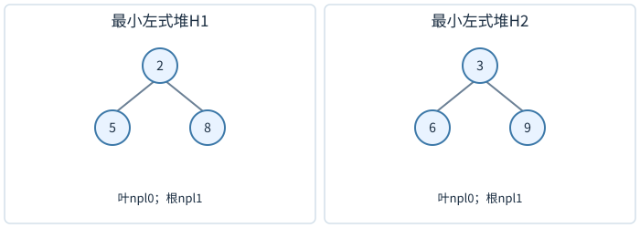

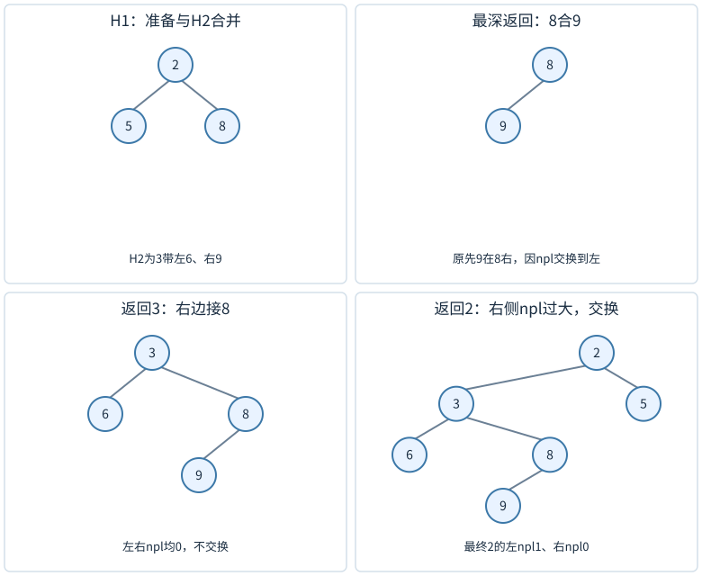

有最小左式堆H₁，根2、左叶5、右叶8；H₂根3、左叶6、右叶9。两个根比较，保留2，把它右子树8与H₂合并。8与3比，保留3，再把3的右叶9与8合并；保留8，让9成为它的右孩子，回来时左空、右非空，交换成8左9、右空。

回到3，左6的npl为0，右8的npl也为0，不必换，3的npl为1。回到2，左5的npl0，小于右3的npl1，交换左右，最终根2左3、右5，3左6右8，8左9。每处仍父≤子，而且左npl≥右npl。总节点六个，一个也没复制或丢失。

把调用和返回分开看：

|调用/返回|保留哪个根|尚待合并|返回时检查|
|---|---|---|---|
|merge(2树,3树)|2|merge(8,3树)|暂不判断2的npl|
|merge(8,3树)|3|merge(9,8)|暂不判断3的npl|
|merge(9,8)|8|merge(空,9)|把9暂接到8右|
|merge(空,9)返回|9|无|直接返回现成9子树|
|回到8|8|无|左空npl−1<右9的0，交换孩子，8.npl=0|
|回到3|3|无|左6与右8的npl同为0，不换，3.npl=1|
|回到2|2|无|左5的0<右3的1，交换，2.npl=1|

只有递归返回后才知道新右子树的npl，所以不能在递归之前盲目换孩子。

npl为r意味着最短到空路径长度为r+1；左右npl至少r−1，令L(r)为npl=r至少需要的节点数，L(−1)=0；左右子树npl都至少r−1，因此$L(r)\ge1+2L(r-1)$。从叶r=0得到1个，r=1至少3个，r=2至少7个，归纳为$L(r)\ge2^{r+1}-1$。有n个节点时，$r+1\le\log_2(n+1)$；由于左npl≥右npl，节点npl恰好等于1+右孩子npl，所以沿右边每走一步npl减1，整条右链长至多r+1=O(log n)。左链可以长，不影响合并只沿右链递归的界。若把npl误写成整树高度再强制左高右低，会维护另一种更苛刻结构，不能照搬左式堆证明。

## 自底向上建堆的下界，不是所有节点都要下移

线性建堆说总工作Θ(n)，不表示每个节点都移动一次。有些输入本来已成堆，只需比较确认；约一半节点是叶，无需下滤。但算法至少要读取并纳入全部输入，且最后非叶需要进行相应检查，总工作仍为线性量级。

按高度求和的精细版本：高度至少1的约n/2个节点，各可能付第一步；高度至少2的约n/4个，再付第二步；高度至少3的约n/8个，再付第三步。把每个节点的下移路径分成一层一层的账，所有账合为n/2+n/4+…<n。这避免了“每个节点都是根”那种重复收取log n的松估计。

## 优先级相等时的服务次序

堆本身通常不稳定，同优先级任务的出队顺序未必与入队一致。若系统要求同优先级先到先服务，可把比较键设计为(优先级,反向到达序号)供最大堆使用，或最小堆比较(负优先级,到达序号)。要小心序号溢出与比较方向，写两三个同优先级任务测试比只看说明可靠。

例如优先级均为5的A先入、B后入，最小堆键(-5,0)、(-5,1)，A先出。后来高优先级7的C键(-7,2)，C先于A、B，这同时满足主优先级与并列到达次序。额外序号改变比较关系，不改变堆的操作复杂度。

## 任意位置删除，末项替换以后可能上也可能下

删除堆中下标i，不必搬移整个后缀。取末项x填入i并缩小size；若x比新父更大，最大堆应上滤；否则可能比某孩子小，应下滤。不能无条件只做下滤，因为末项来自另一分支，未必小于i的父。

例如最大堆根一百，左分支父五十、其孩子十与二十，右分支父九十、其孩子八十与七十。删左下的十，末项七十填进去，七十大于父五十，必须上滤。堆序只约束祖先后代，不能比较不同分支推断替换方向。

## 堆数组下标变化，需要同步任何外部定位表

任务编号到下标的映射若只在插入时写一次，后续上滤交换后便过期。更新某任务优先级时，可能改到另一任务。每次交换数组项，也交换它们在映射中的位置记录；删除时清除被删编号，替入末项也更新它的新下标。

调试可对每个数组下标检查map[id]恰等于当前位置，再反向检查映射指向的记录编号相同。堆性质正确但映射错误，取最大可能一直对，按ID修改却错，必须分别验证这两份不变量。

堆空时getMax和delMax没有有效记录，应该返回失败或抛出错误，不能读数组首格。容量尚在、size为零也仍是空堆。相反，size为一时删除根后只需变空，无孩子可下滤；若代码仍拿左右孩子比较，会访问越界。单元素与双元素测试能直接覆盖这些分支，比只用大型随机堆更容易看清结构变化。

若优先级不允许改变，可省去定位映射；接口需求少一项，实现也可以更简单，不能把额外索引开销当成堆必有成本。

## 练习与答案

**练习1。** 在最大堆`[8,5,7,2,3]`插6，写出数组变化。

解答：6追加在下标5，父为下标2的7。6≤7，无需上滤，得到`[8,5,7,2,3,6]`。不能因为6比另一个孩子5大就交换，它不是5的孩子；堆约束只比较真实父子关系，不要求同一层有序。

**练习2。** 最小堆能否O(1)获得最大值？

解答：一般不能。最大值必在某个叶子，但叶子之间没有大小顺序，最坏需检查线性数量叶子。堆只承诺根极小，不承诺另一端极值。若两端都要高效查询，需要同时维护额外结构或使用双端优先级队列。

**练习3。** 维护前2大，扫描`[4,9,4,7]`，最后小根堆保存什么？

解答：前两项堆为4、9；第三项4不大于堆顶4，可跳过，仍有两个最大的记录4、9；读7替换4，保留7、9，顶7为第2大。若要求所有与第2大并列的记录，堆容量固定2不足以完整输出全部并列者，输出规格要先确认。

阅读对照：[Princeton优先级队列](https://algs4.cs.princeton.edu/24pq/)与[官方IndexMinPQ](https://github.com/kevin-wayne/algs4/blob/master/src/main/java/edu/princeton/cs/algs4/IndexMinPQ.java)可检查堆位置数组和反向定位数组怎样随每次交换一起更新；该实现用1基下标，本章用0基，孩子公式不能直接抄同一套。
