# 字符串匹配：已经比对过的字，怎样不再重读

文本T=`ABABABAC`，模式P=`ABABAC`，想找P第一次完整出现的位置。朴素法先把P对齐T下标0，前5个字符匹配，最后C对上B失败；然后右移一格，从头再比。失败之前得到的“前面若干字符相同”是一份信息，KMP会用它跳过不可能的对齐位置。

字符串是字符序列，长度n、m分别表示文本与模式的字符数量。本章先把字符看作可在常数时间比较的符号。真实UTF-8字节、Unicode码点与用户看到的字形不是同一个单位；实现查找中文时必须知道接口返回的是字节偏移还是字符下标。

## 朴素匹配为什么重读同一段文本

T=`AAAAAAAB`，P=`AAAAB`。对齐下标0，先匹配4个A，再在B处失败；对齐1，仍先匹配4个A再失败；继续右移。把这个小输入完整执行：起点0的第5次比较是P[4]=B对T[4]=A，失败；起点1同样在T[5]失败；起点2在T[6]失败；起点3时AAAA与B全部相同，得到起点3。四次对齐各比5次，共20次字符比较。文本只有8个字符，也会重读同一位置多次。

每次失败都重比大量相同A，若文本长n、模式长m，可达到Θ(nm)量级。

朴素算法并非所有输入都慢。若每次第一字符就失败，总时间近线性；模式很短、数据量小，简单实现也可能足够。KMP提供的是最坏线性保证，并避免文本指针后退。

空模式的定义要提前决定。常见约定认为空串在下标0匹配；查找所有匹配则空串可在每个边界出现。模式长于文本时无非空匹配。这些边界不应等代码崩了以后再补。

## 前缀函数：一段字符串自己与自己能重合多少

对模式P，π[i]表示`P[0:i+1]`的最长真前缀，同时也是后缀的长度。“真”指不能取整段自身。例如`ABABA`的前后都可取`ABA`，长度3；整段长度5不允许，否则失配时不会缩小。

下面表的候选j表示当前正在尝试的边界长度，比较的是新字符P[i]与P[j]：

|i|当前前缀|起始j|比较/回退|π[i]|
|---|---|---|---|---|
|0|A|无|没有真前缀|0|
|1|AB|0|B≠A，保持0|0|
|2|ABA|0|A=A，j到1|1|
|3|ABAB|1|B=B，j到2|2|
|4|ABABA|2|A=A，j到3|3|
|5|ABABAC|3|C≠B，退1；C≠B，退0；C≠A|0|

P=`ABABAC`，逐项得π=`[0,0,1,2,3,0]`。第0项只有A，没有非空真前缀，得0；`AB`没有；`ABA`前后都是A，得1；`ABAB`前后都是AB，得2；`ABABA`得3；加C后`ABABAC`没有以C结尾的非空前缀，得0。

## 计算π时，失败候选也沿着同一条链退

```python
def prefix_function(p):
    pi = [0] * len(p)
    for i in range(1, len(p)):
        j = pi[i-1]
        while j > 0 and p[i] != p[j]:
            j = pi[j-1]
        if p[i] == p[j]:
            j += 1
        pi[i] = j
    return pi
```

以P=`ABABAC`的最后C为例，上一前缀`ABABA`的最长边界长3，候选是ABA，期望再接P[3]=B，但当前为C，失败。下一候选长度π[2]=1，期望P[1]=B，又失败；再退到0，比较P[0]=A仍失败，最终π[5]=0。

为什么下一候选必须是π[j−1]，不能随意j−1？当前长度j的前缀已经等于之前的后缀，若还要缩短并继续保持前后相同，新的候选必定是这段长度j前缀自身的边界。π[j−1]给其中最长者，沿链可枚举所有可能长度，既不漏也不重试不可能项。

每次外层i只增加，j在匹配时至多增加1，在while里严格减小。总增加不超过m，总减少也不超过总增加，所以构造π为O(m)。有嵌套循环仍是线性，总账要看j的所有变化，而非每轮拿m作上界相乘。

## 失配后保留前后重合，不退文本指针

```python
def find_all(t, p):
    if not p:
        return list(range(len(t) + 1))
    pi = prefix_function(p)
    ans = []
    i = j = 0
    while i < len(t):
        if t[i] == p[j]:
            i += 1
            j += 1
            if j == len(p):
                ans.append(i - j)
                j = pi[j-1]
        elif j > 0:
            j = pi[j-1]
        else:
            i += 1
    return ans
```

<!-- trace:ds-kmp -->

固定上方文本，移动下方模式；两行纵向对齐的橙格就是当前比较的字符。i指下一待比文本位置，j指已匹配前缀长度。π表保存含当前项的最长真前后缀长度，失配时读取π[j−1]，不是直接读取π[j]。

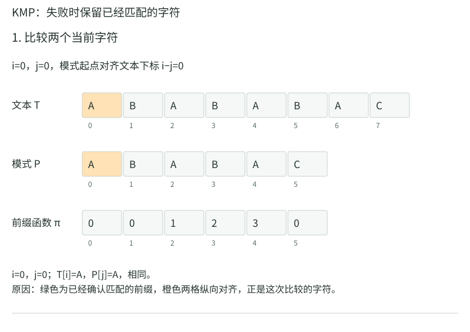

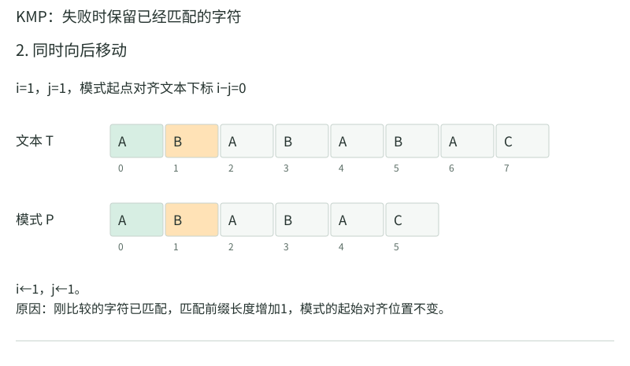

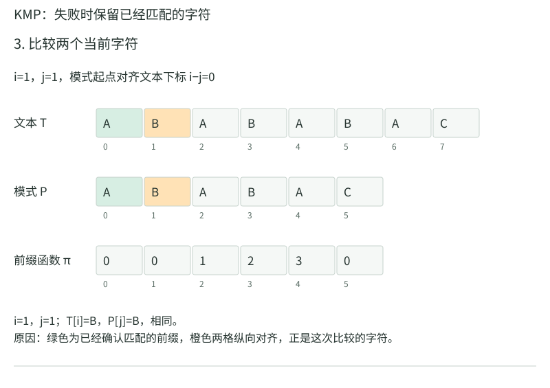

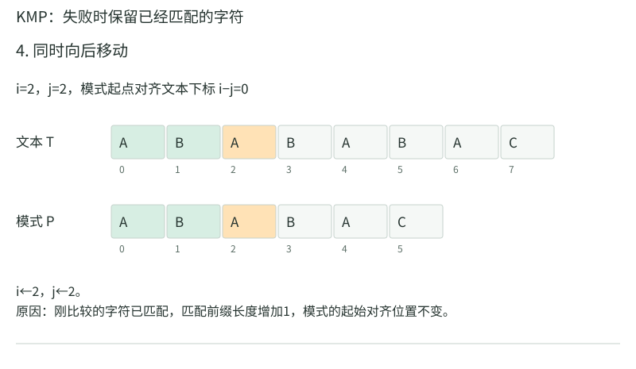

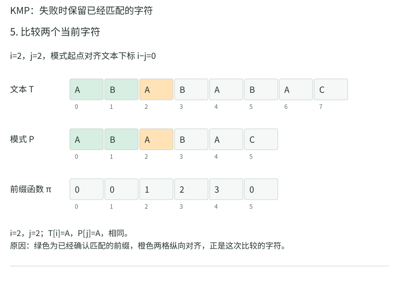

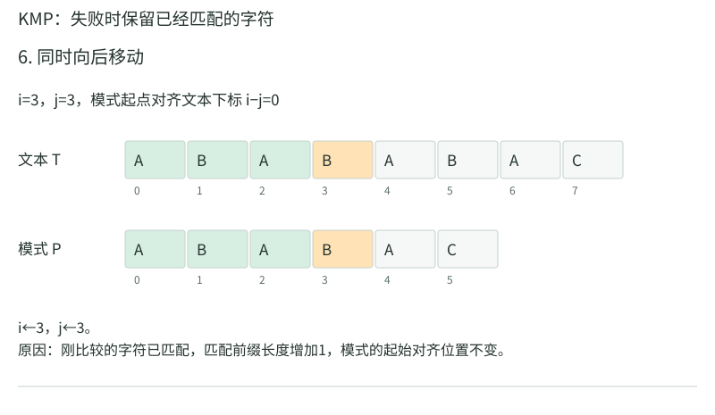

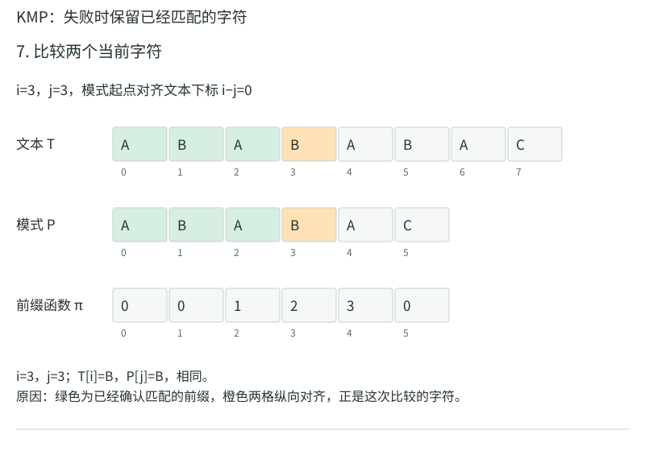

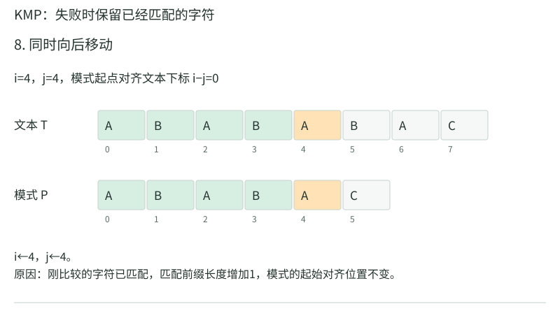

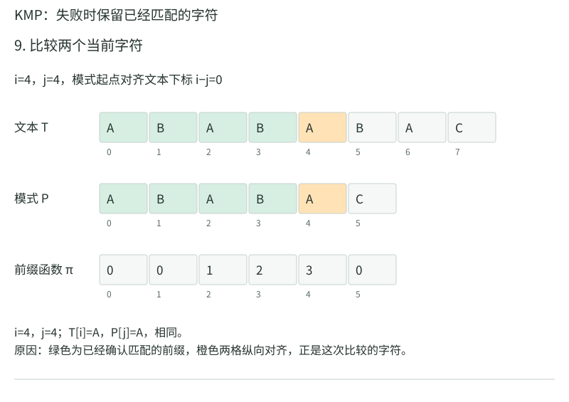

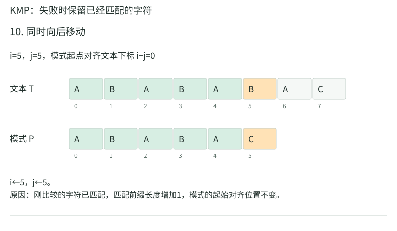

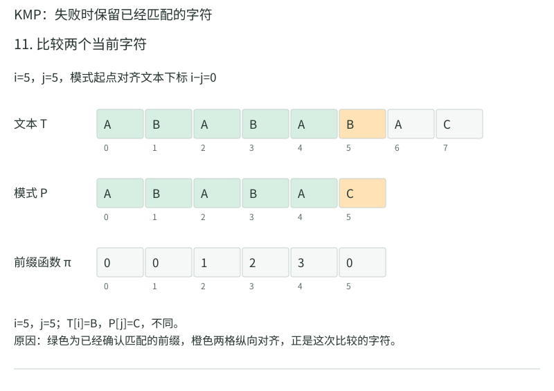

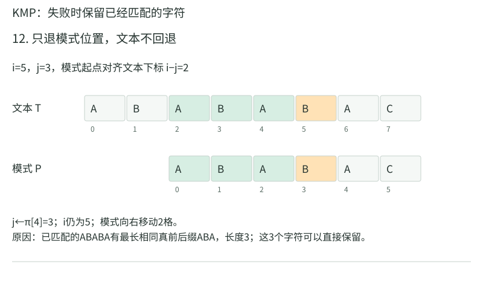

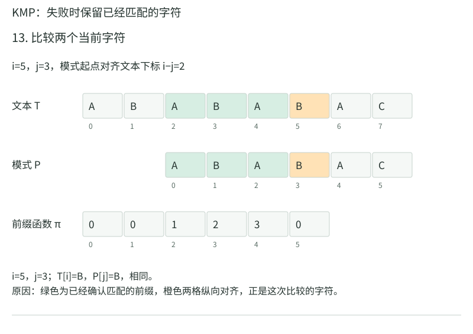

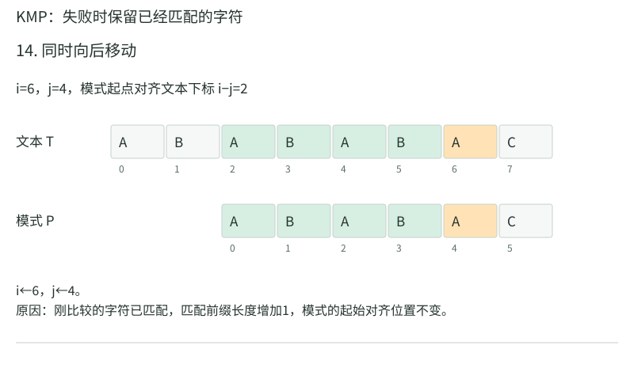

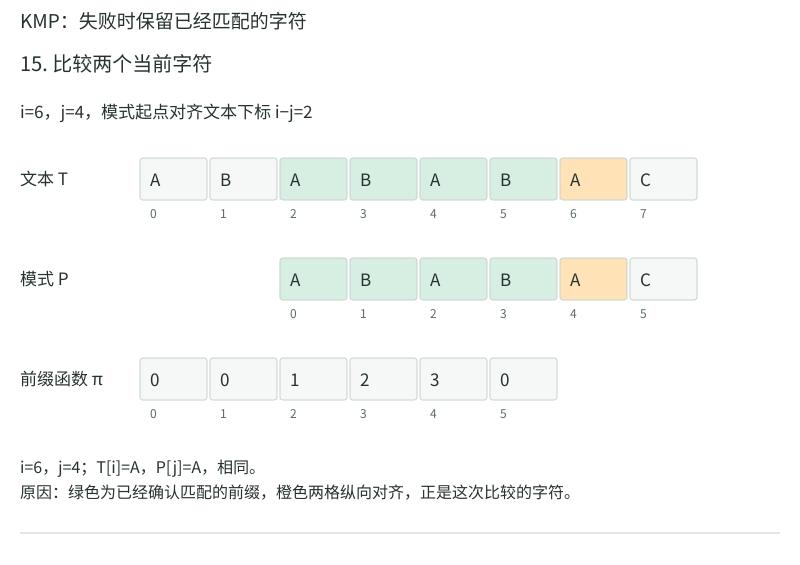

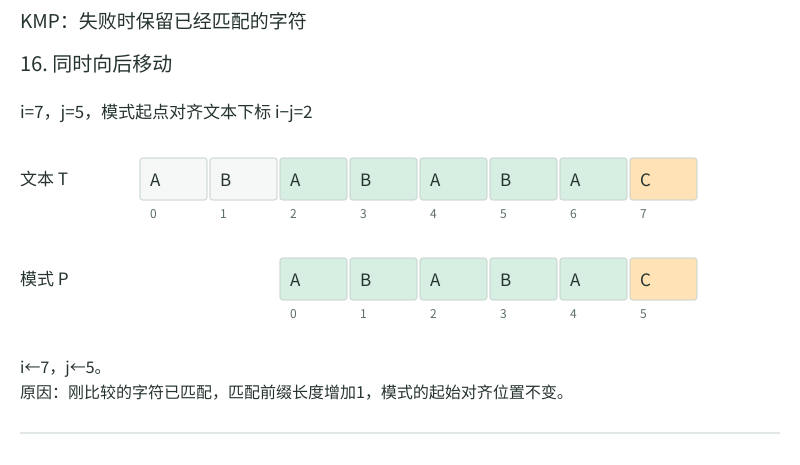

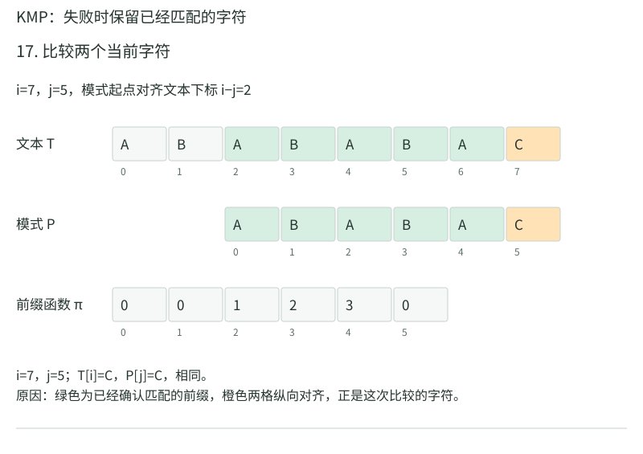

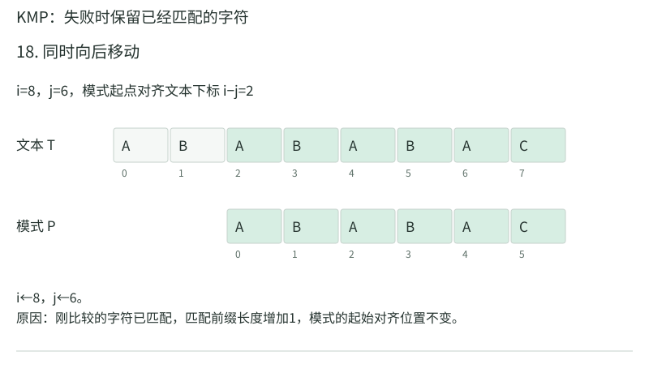

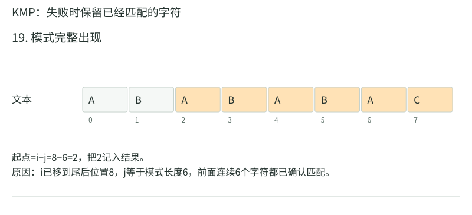

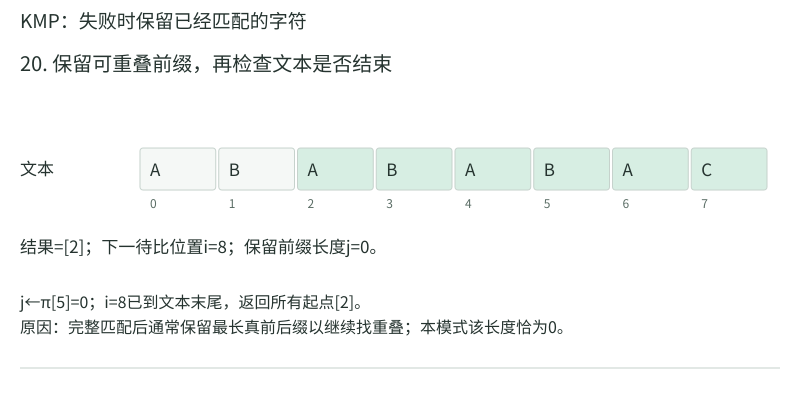

<!-- /trace:ds-kmp -->

失配时T[5]的橙格保持不动，P[5]的C被右移后的P[3]的B接替。回退后已有的三个匹配字符用绿色保留；下一步重新比较的正是刚才没能匹配的那个文本B。

本段与演示都令i指向下一次要比较的文本字符，j为已经匹配的模式前缀长度。比较相同时i、j各加1；失配且j>0时只改j，同一个文本字符留待下一次比较。

对T=`ABABABAC`、P=`ABABAC`：读前5个字符ABABA后i=5、j=5。读T[5]=B时，本来期望P[5]=C，失配；令j=π[4]=3。此时P前3项ABA等于已经读过的文本后3项，不必重比。当前B与P[3]=B匹配，i升6、j升4；接着读A后i=7、j=5；读C后i=8、j=6，完整匹配，起点i−j=8−6=2。i指向尾后位置，计算起点不再额外加1。

把每一次字符比较与j的改动列出：

|文本i/字符|比较的模式位置|结果|处理完此字符后的j|
|---|---|---|---|
|0/A|0/A|相同|1|
|1/B|1/B|相同|2|
|2/A|2/A|相同|3|
|3/B|3/B|相同|4|
|4/A|4/A|相同|5|
|5/B|先5/C，再3/B|先失败，j退3；再相同|4|
|6/A|4/A|相同|5|
|7/C|5/C|相同，输出2|先达到6，再退π[5]=0|

共9次字符比较，i没有后退。j减小只是在寻找已经匹配后缀的另一种解释。

不变式是：读过的文本前缀中，当前j为某个与其后缀相同的模式前缀长度；失配退到下一边界后仍保持这个关系。未被尝试的中间对齐位置不存在合适的前后重合，故跳过去不会漏答案。整个文本只向前读，j总上升O(n)、下降O(n)，匹配O(n)，加π构造共O(n+m)。

完整匹配后j不能无条件归0，否则会漏重叠答案。T=`AAAA`、P=`AA`，应得起点0、1、2。每匹配一次退到π[1]=1，保留末尾A作为下次模式开头，于是能继续找到重叠。

## 教师图中的next，与本章π不是同一个数组定义

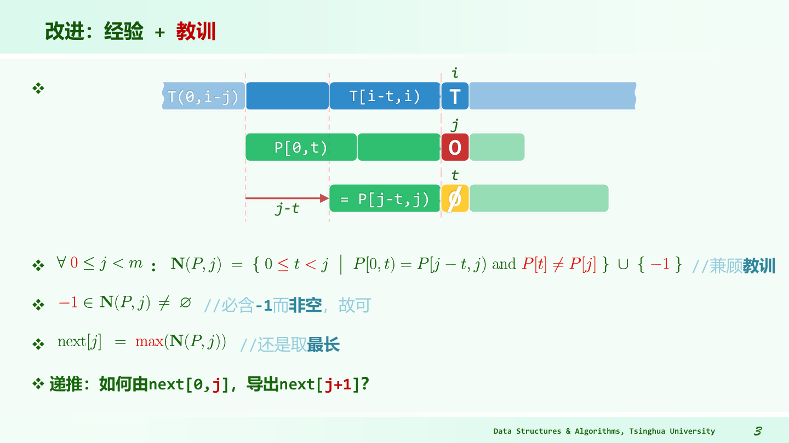

图中i是文本当前位置，j是模式中正要比较的位置。上方已知文本片段等于模式前缀；失配以后，模式滑动，把一个前缀与已知匹配后缀重合。图中特别要求候选位置t满足`P[t] != P[j]`，因为若P[t]与刚失败的P[j]相同，再拿它比同一个文本字符必然还失败，可以继续跳。

普通位置式next[j]回答的是“失配于j之前，已经匹配的P[0:j]还能留下多长前缀”。所以j>0时next[j]=π[j−1]，而next[0]=−1是额外终止哨兵，不能把π[0]=0直接当同一位置的next[0]。

例如本章ABABAC的普通位置式next（第0项用−1）为[-1,0,0,1,2,3]；若跳过与原失败字符相同的候选，改进next为[-1,0,-1,0,-1,3]。看位置4的A：普通候选2也是A，既然同一文本字符已经与位置4的A不等，再比位置2也必失败，可以继续退到位置0的A，最后退−1。位置5的C退到3的B，字符不同，必须实际比较，不能一并跳掉。−1的含义是模式开头也失败，这时推进文本一格并把j恢复0。

这是改进next的定义，常带−1哨兵；本章π[i]只是前缀`P[0:i+1]`的最长边界长度，允许下一个字符相同。两者数值不能逐项强行相等。使用课程代码时，先写清next[j]描述“位置”还是“长度”、失配时i是否增加、−1如何处理，再做对照。

### 改进next也逐项构造，不能只给最后一张表

仍用P=`ABABAC`，保留同一组下标0到5。普通位置next与改进表的差别不是把所有0换成−1，而是检查“失败后将拿哪个模式字符去比同一个文本字符”。例如失配位置4是A，普通候选2也是A，既然文本字符已经不等于A，再比2必败；继续找0仍是A，也跳过，最终给−1。失配位置5是C，候选3是B，文本字符不等于C并不能推出它不等于B，所以必须保留3。

教师《13.串》PDF29页同时维护j和t。`next[0..j]`已经算好，正准备得到`next[j+1]`；t是当前尝试接长的边界位置，当t≥0时，已有`P[0:t]`与`P[0:j]`的等长后缀相同，t=−1表示已无非空候选，需要从起点重新接长。先看P[t]能否与P[j]相同；若不能，仍在同一个j上沿next[t]退候选。能接长时，新的候选位置为t+1，再比较P[t+1]与P[j+1]：字符不同就保存t+1，字符相同就直接继承next[t+1]，避免将来重复一次必败比较。

每次循环只执行一行状态变化。下面写的是进入循环时的j、t，以及更新后的状态；字母比较都按旧下标进行。

|进入时j/t|要做的字符判断|本次动作|新j/t|新写出的表项|
|---|---|---|---|---|
|初始化0/−1|无|先定next[0]=−1|0/−1|−1|
|0/−1|可从起点接长；P[0]=A≠P[1]=B|保存新候选0|1/0|next[1]=0|
|1/0|P[0]=A≠P[1]=B|t退到next[0]=−1；j不动|1/−1|这轮不写表|
|1/−1|P[0]=A=P[2]=A|相同字符，抄next[0]|2/0|next[2]=−1|
|2/0|P[0]=P[2]，接长后P[1]=P[3]=B|抄next[1]|3/1|next[3]=0|
|3/1|P[1]=P[3]，接长后P[2]=P[4]=A|抄next[2]|4/2|next[4]=−1|
|4/2|P[2]=P[4]，接长后P[3]=B≠P[5]=C|保存新候选3|5/3|next[5]=3|
|j已到5=m−1|没有下一项要构造|停止|—|整表[-1,0,-1,0,-1,3]|

“抄next[t+1]”读的是前面已经完成的表项，因为t<j，故t+1<j+1；不会依赖正在写的自己。相等字符时跳过的是已经知道会失败的候选，不会跳过任何可能成功的对齐。候选链严格下降，−1负责终止，不会在0处来回重复。

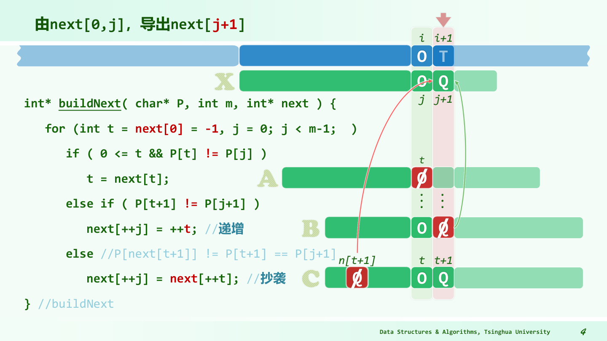

下面将教师构造主体写成显式返回数组的函数，匹配过程也使用同一套带−1的位置接口。`kmp_first`求首次匹配；与前面π版求所有匹配是不同返回要求，完整命中后直接返回，不会擅自把j清0后继续而漏掉重叠。

```python
def build_next(P):
    m = len(P)
    if m == 0:
        return []
    nxt = [-1] * m
    j, t = 0, -1
    while j < m - 1:
        if t >= 0 and P[t] != P[j]:
            t = nxt[t]
        else:
            j += 1
            t += 1
            nxt[j] = t if P[t] != P[j] else nxt[t]
    return nxt

def kmp_first(T, P):
    if not P:
        return 0
    nxt = build_next(P)
    i = j = 0
    while i < len(T) and j < len(P):
        if j < 0 or T[i] == P[j]:
            i += 1
            j += 1
        else:
            j = nxt[j]
    return i - j if j == len(P) else None

print(build_next("ABABAC"))      # [-1,0,-1,0,-1,3]
print(kmp_first("ABABABAC", "ABABAC"))  # 2
print(kmp_first("AAAA", "B"))    # None
```

在同一文本ABABABAC上，前5项相同后仍是i5、j5；T[5]=B与P[5]=C不等，改进next[5]=3，于是i仍5、j变3；继续B对B，之后A对A、C对C，得到起点2。这一处两种表执行相同，是因为P[5]与候选字符本来不同。改进真正省去的是类似模式`AAAAB`在A位置失配时重复比较A的过程；它不会改变匹配答案，也不要求每个输入都少比较。

本函数失败返回None，便于调用者区分合法起点0。教师使用显式n、m的匹配主体有时直接返回i−j，失败时该值大于n−m；按课程接口调用时应使用它的失败判断，不能无条件把返回整数当成命中。普通π、普通位置next、改进next是三种明确的数组定义；比较它们，应比较各自兑现的匹配行为，不要求数组逐项相同。

## Boyer–Moore从右向左比较，失败后跨过对齐位置

Boyer–Moore从模式右端往左比。坏字符规则利用文本中导致失败的字符在模式中的最后出现位置来跳；好后缀规则利用已经匹配的模式后缀寻找其他对齐。它常能跳过许多文本位置，但具体最坏保证依版本与附加规则，不能把经验上的快自动叫O(n)。

## 一次坏字符跳转，先把对齐下标画对

模式P=ABCD，先对齐文本T=ABXDABCD的下标0，从右向左比较。D对D相同，接着模式位置2的C对文本位置2的X失败。X在模式中未出现，最后位置记−1，坏字符规则可让模式起点向右移动j−last[X]=2−(−1)=3。新起点3不是直接就匹配，还要重新比较；随后可继续跳到起点4找到ABCD。

这个坏字符例继续走完：右移3后起点为3，窗口DABC，右端P[3]=D对T[6]=C失败；last[C]=2，位移max(1,3−2)=1，再到起点4，ABCD四个字符全部相同，找到4。第一次安全位移并不保证下一次马上成功。

如果失配字符在模式中最后出现在j右侧，j−last可能非正，至少仍需向右移1，不能让模式倒退。好后缀规则还能利用已匹配的D，可能给更大的安全位移；最终取安全规则中的较大值，但每个规则都要独立保证不漏匹配。

### 好后缀的完整例子：AAABAB中找ABAB

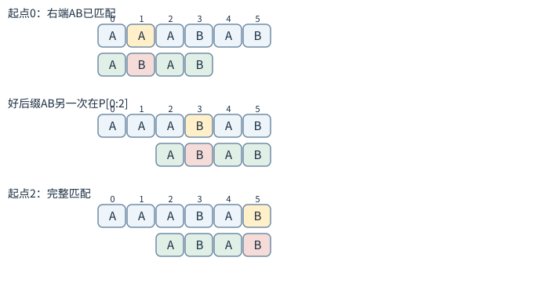

起点0，从右向左比较：P[3]=B与T[3]=B相同，P[2]=A与T[2]=A相同；P[1]=B与T[1]=A失败，已经知道文本位置2/3是后缀AB。模式中还有一段AB在位置0/1，把这一段对齐刚匹配的文本2/3，需要移动2格。由于这是模式开头，没有一个相同的前置失败字符会迫使它再次失败。起点2后窗口恰为ABAB，逐个从右比较全相同，返回2。

此时坏字符A在模式最后位置2，比失配位置j=1还靠右，坏字符规则只允许保守移动1；好后缀规则允许安全移动2，取两者较大值2。这一例才显示两张表做的工作不同。一般寻找好后缀的另一出现时，要排除“前置字符与刚失败的模式字符相同”的候选，因为同一文本坏字符对它仍会失败；若找不到，则把好后缀中最长的、也是模式前缀的部分对齐；连这一部分都为空才可跳过整段。

再看P=ABCD、文本AXCDABCD：起点0已匹配CD，在B对X处失败，模式中无另一CD，也无非空前缀等于CD的后缀，故好后缀位移4，直接到起点4匹配ABCD。预处理表把这些搜索提前完成，匹配时只查表。

### 从模式本身算出好后缀表

好后缀的位移只由模式和失配位置决定，可以预先算表。先定义ss[j]：在P[0:j+1]的所有后缀中，找一个与整个P的某个后缀相同的最长者，记其长度。比如P=ABAB：前缀A不能与以B结尾的模式后缀相同，ss[0]=0；AB本身等于模式末尾AB，ss[1]=2；ABA末尾为A，ss[2]=0；整个ABAB等于自身，ss[3]=4。所以ss=[0,2,0,4]。这里允许整段前缀被取出，与KMP的“真前缀边界”定义不同。

逐个j从右往左直接比后缀，可以正确构造ss，但最坏需平方时间。课程的线性算法再利用一段已经比过的窗口。设已知P的区间(a,b]等于模式末尾同样长的一段，向右平移d=m−b−1就对齐；a在窗口左边界之外，b包含在内。若当前j处在这段已知窗口里，就可借已经算好的ss[j+d]，不必重新比较窗口内部。

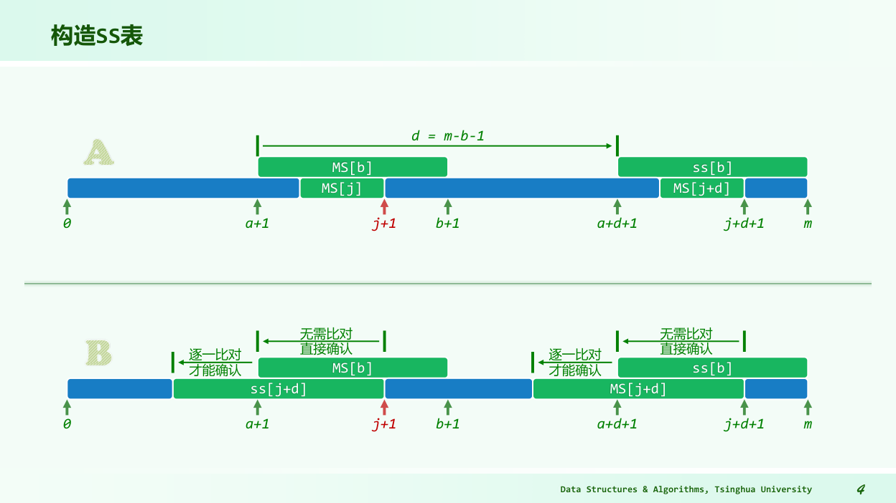

原页来自《13.串.pdf》PDF55页，页脚4。上图A中，ss[j+d]的匹配段完全落在已知窗口内部，它左边那个不等字符也还在已知范围内，因此可以直接复制长度。下图B中，借来的匹配已经碰到窗口左边界，边界外的字符尚未比过，只能从a开始再往左核对，直到不等或越过0。

```python
def build_ss(p):
    m = len(p)
    if m == 0:
        return []
    ss = [0] * m
    ss[m - 1] = m
    a = b = m - 2
    d = 1
    for j in range(m - 2, -1, -1):
        if ss[j + d] < j - a:
            ss[j] = ss[j + d]
        else:
            a = min(a, j)
            b = j
            d = m - b - 1
            while a >= 0 and p[a] == p[a + d]:
                a -= 1
            ss[j] = b - a
    return ss
```

在ABAB上从右往左完整走：

|当前j|进入时a,b,d|能直接复制吗|实际比较/更新|ss[j]|
|---|---|---|---|---|
|初始|2,2,1|先设ss[3]=4|空窗口，从右往左计算|4位于下标3|
|2|2,2,1|ss[3]=4不小于j−a=0|a=2,b=2,d=1；A与B不等，a不动|0|
|1|2,2,1|ss[2]=0不小于j−a=−1|改a=1,b=1,d=2；B=B使a到0，再A=A使a到−1|2|
|0|−1,1,2|ss[2]=0小于j−a=1|直接复制，无字符比较|0|

外层j每次减1，共m次；显式字符比较的内层中，a只会继续减小，更新a=min(a,j)也不会让它增加，因此全部成功比较合计不超过m。每个外层至多再有一次失败比较，总工作O(m)。保存窗口是为了让“已经比过的字符”不被反复收费。

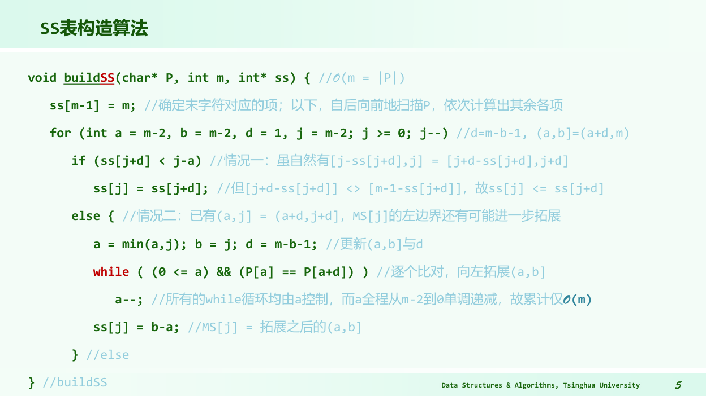

原页来自同一文件PDF56页、页脚5。先对应上面的a/b/d定义，再看原程序的区间记号；不能把a当成已经匹配的第一个字符，它始终在窗口之外。

有了ss，再构造gs[j]，它表示失配在模式位置j时好后缀允许的安全位移。先令所有gs为m，再做两遍：一遍处理“模式前缀可接上好后缀末尾”的情况，一遍处理“模式内部另有完整好后缀”的情况。

```python
def build_gs(p):
    m = len(p)
    ss = build_ss(p)
    gs = [m] * m
    i = 0
    for j in range(m - 1, -1, -1):
        d = m - 1 - j
        if ss[j] == j + 1:
            while i < d:
                gs[i] = d
                i += 1
    for j in range(m - 1):
        gs[m - 1 - ss[j]] = m - 1 - j
    return gs
```

第一遍在ABAB中：j=3时d=0，没有空位要填；j=2不满足；j=1满足ss[1]=2=j+1，说明开头AB也是末尾AB，位移d=2可用于失配位置0和1，填gs[0]=gs[1]=2；j=0不满足。此时gs=[2,2,4,4]。i只增不减，每项第一次收到的d最小，不能在每次j重新把i设0。

第二遍j=0，ss=0，对应失配位置m−1−0=3，候选位移3，gs[3]=3；j=1，ss=2，对应位置1，位移2，gs[1]=2；j=2，ss=0，又对应位置3，位移1，覆盖成1。最终gs=[2,2,4,1]。这一遍j从左往右、位移从大往小，后写入的才是较小安全位移。

这个下标m−1−ss[j]来自图的对齐：一个以位置j结尾、长度ss[j]的匹配后缀，平移d=m−1−j后恰好接到模式末尾；它前面的失配位置就在m−1−ss[j]。ss的最大性又保证其前一个字符与原失配模式字符不同，否则还能再向左多匹配一位。

可直接核对表：失配j=1时已匹配AB，另一个AB允许移2；失配j=2时只匹配末B，若移2会用模式位置0的A接替刚失败的位置2的A，同一坏字符必再失败，不能选，最小安全位移为4；失配j=3时没有好后缀，但前一个字符A与B不同，允许移1。

两遍外层各m次，第一遍的i全程最多增m次，所以ss到gs为O(m)，连同ss构造仍线性。真正匹配时，在每次从右端比较结束后，将起点增加max(坏字符安全位移,gs[j])；完整匹配后若还找后续出现，可按模式最长边界继续移动，ABAB为2，不应直接跳4漏掉ABABAB中的重叠出现。

Boyer–Moore的表格定义有多种版本，last通常以字符为下标、返回最后出现位置；KMP的π以模式位置为下标、返回长度。两个数组都叫“跳转信息”，却不是同一种输入输出函数。先写一个表项的中文含义，再抄公式，能避免把字符编码拿去索引长度m数组的越界错误。

## 滚动哈希：保存窗口值，再核对碰撞

滚动哈希把长度m窗口编码成数，窗口右移时减去旧字符贡献、乘基数、加新字符，从而O(1)更新某种固定模数哈希。哈希不相等可确定字符串不同；哈希相等仍可能冲突。若要求确定正确，应在候选处再逐字核对，最坏核对成本可能增大；双哈希降低碰撞概率，也不把概率变成数学上的0。

例如用十进制直观表示数字串，窗口123右移为234：先减1×100得到23，再乘10加4得到234。真实字符哈希常在模数下做同样操作。若模数太小，不同窗口容易碰撞；如果攻击者能选择输入，简单随机假设更需要谨慎。


以十进制数对7取模作教学哈希，串12的值12 mod7=5，串19的值19 mod7也=5。它们长度相同、哈希相同，字符却不同。真实滚动哈希基数与模数更大，只是让某些模型下碰撞概率更低，并没有改变“有限值空间可能碰撞”的事实。

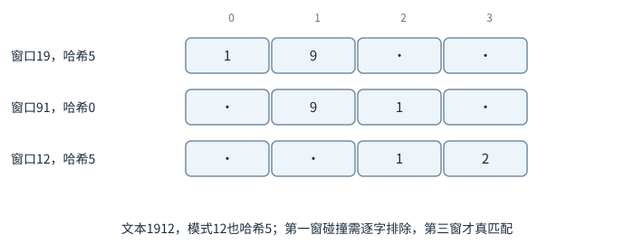

用文本1912找模式12，固定两位窗口、基数10、模数7。初窗19的哈希5与模式相同，逐字核对1=1但9≠2，排除。右移得到91，哈希0，不相同，直接跳过逐字核对；再右移为12，哈希5，核对两字都相同，报告起点2。滚动时只保留哈希即可：10在模7下为3，19→91算((5−1×3)×10+1) mod7=0；91→12算((0−9×3)×10+2) mod7=5。负中间值必须按0至6的余数规范化，不能把语言的负余数直接当数组下标。

查询模式12时若直接接受哈希5，窗口19就会成为假阳性。再逐字比较能排除它，但如果恶意构造许多碰撞窗口，核对总成本可能很大。要给严格最坏线性且确定正确的单模式匹配，KMP提供了不同性质的保证；要用哈希，便明确报告概率假设或验证成本。

## 多模式匹配：Trie加失败链接

若同时找`he,she,his,hers`，每个模式单独跑KMP会重复扫描文本。Aho–Corasick在Trie节点上加失败链接：当前前缀失配时，跳到它的最长后缀、且该后缀也是某模式前缀的节点。这个思路与KMP的边界链相通，但状态是Trie节点，不再只是一个整数前缀长度。

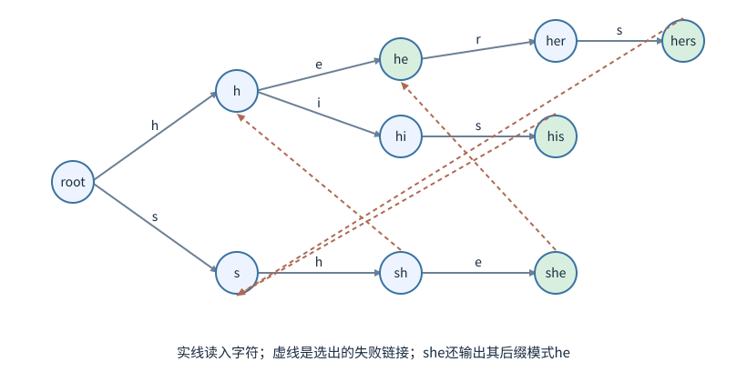

节点标签是从根走到这里得到的完整前缀，实边只消费一个新字符，虚线跳转不消费当前字符。构造失败链接可按BFS：根的孩子h、s失败都回根；处理sh时，先看s的失败根，从根能读h，故fail(sh)=h；处理she时，从fail(sh)=h继续读e到he，故fail(she)=he。his的最长可用后缀是s，hers也同样退s。

完整扫描文本ushers：u在根无边，留根；s到s；h到sh；e到she，输出she并沿失败输出he；r在she无边，先退he，再从he读r到her；最后s到hers，输出hers。各命中起点按长度回算：she从1，he从2，hers从2。跳fail时不重新消费r，否则会漏掉her状态。

输出还要处理“某个状态对应多个模式后缀”的情况。例如读到she，同时可能命中he。实现复杂度依转移表、失败构建与输出方式，若实际命中k次，至少要计入O(k)输出。先掌握单模式KMP的状态含义，再学多模式结构，会更容易检查失败链接究竟保存了什么。

## 从匹配结果恢复位置，字符单位必须一路相同

假设模式长度m=3，刚消费文本下标7的字符以后，i已经移到8、j达到3，起点为i−m=8−3=5。这与本章i指向下一待比字符的约定相同。i与m必须按同一种符号单位计数；若i按UTF-8字节数、m按Unicode字符数，公式相减就无意义。中文“数据结构”有四个常见汉字，但UTF-8通常每个占多个字节，工具返回的字节偏移不能直接当第几个汉字。

如果用户看到的一个字形由多个码点组成，按码点切片也可能切开显示单元。课程算法通常抽象为符号序列，不要求先解决所有文本规范化问题；实际应用必须在读入、比较、长度与返回偏移之间统一层次。字形看似相同也可能有不同编码序列，是否先规范化取决于产品语义。

## 模式预处理一次，多个文本可以复用

前缀函数只依赖模式，不依赖文本。固定关键词反复搜索多份文件，先构造一次π，每份文本从j为零开始扫描，节省重复预处理。如果把上一份文件的j直接带到下一份，会把两个独立文件当成拼接文本，可能报告跨文件边界的假匹配；只有明确处理连续分块的同一文本时才应保留j。

流式处理同一大文本时，块尾已匹配前缀长度正是下一块需要的状态，无需保存全部旧文本。要报告全局起点，另维护已经读过的总字符数；局部下标必须加块偏移。模式本身及π仍需保存，空间随模式长而非文本总长增长。

如果只要第一次匹配，找到即可返回，输出成本常数；若要所有匹配，结果个数可达文本长度量级，例如重复字符，输出列表也占相应空间。说算法额外空间仅为模式长度时，要说明是否把输出空间排除。

文本结束而j小于模式长，表示最后只有一个未完成前缀，不应输出匹配。模式比文本长时，即使所有文本字符都与模式开头相同，也不能把这段前缀当完整命中。

找到首次命中后立即返回，适用于只问第一次出现的接口。

## 练习与答案

**练习1。** 写出P=`AAAA`的π，并用它找T=`AAAAA`中的全部匹配。

解答：π为0、1、2、3。前4字符匹配后输出0，j退到3；读第5个A再升4，输出1。答案0、1。若匹配后归0，第二个重叠出现会漏掉。重复字符不是特殊补丁，而是边界定义自然覆盖的输入。

**练习2。** P=`ABABC`，最后字符C到来时，π构造的候选怎样退？

解答：此前ABAB的边界长2，候选下一个字符P[2]=A，与C不同；退j=π[1]=0，再比P[0]=A仍不同，最终π[4]=0。注意不是从2逐个试1再0，因为长度1不是ABAB的边界，根本不可能接上。

**练习3。** 两个窗口哈希相同，可以直接认定字符串相同吗？

解答：一般不能。有限哈希值比可能字符串少，必有不同串碰撞。若题目允许概率算法，要清楚说明随机选择与碰撞风险；若要求严格确定答案，应做足够的核对或使用无碰撞的结构。不能把“本地测了一百万次没撞”替代正确性证明。
