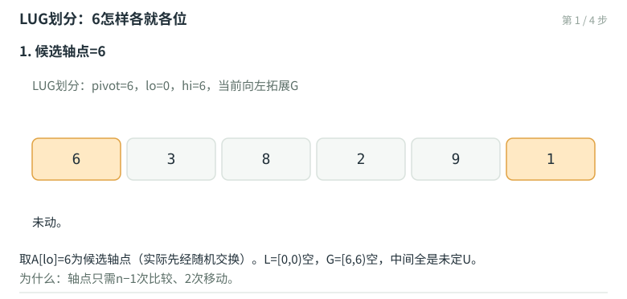

# 快速排序：轴点、划分与希尔排序

归并排序先分后合：本层便宜、合并是实质；快速排序（quicksort）反过来——**先花本层时间做划分，后层各自自然有序**。划分之后轴点（pivot）各就各位，左段全部不大于它、右段全部不小于它，递归两段即可。平均$O(n\log n)$、就地（$O(1)$辅助空间）、内层循环紧凑，使它成为工程中最快的通用排序；最坏$O(n^2)$与不稳定则是需要正视的代价。本章末尾的希尔排序则以"增量序列"为钥匙，把插入排序改造成平均高效的亚平方算法。

## 轴点与划分

轴点的定义即划分的目标：选取候选pivot后，把区间重排成$L \le pivot \le G$三段，pivot落到它的最终秩上。一次划分中轴点参与$n-1$次比较、仅2次移动——划分本身线性。

## LUG版划分：两端交替收缩

讲义给出的LUG（Less-Unknown-Greater）版本维持不变式$L = [0, lo)$、$U = (lo, hi)$、$G = [hi, n)$，两端交替向内拓展：

```cpp
template <typename T> Rank Vector<T>::partition( Rank lo, Rank hi ) {   //lo < hi
   swap( _elem[lo], _elem[ dice( lo, hi ) ] );   //随机化：任取候选轴点换到首位
   const T pivot = _elem[ lo ];                  //候选轴点
   for ( bool G = true; lo < hi; ) {             //两端交替向内，直至相遇（lo == hi）
      if ( G )   //向左拓展后缀G：遇到阻挡者则归入L，并换向
         { if ( pivot > _elem[ --hi ] ) { _elem[ lo ] = _elem[ hi ];  G = false; } }
      else       //向右拓展前缀L：遇到阻挡者则归入G，并换向
         { if ( _elem[ ++lo ] < pivot ) { _elem[ hi ] = _elem[ lo ];  G = true; } }
   }
   _elem[ lo ] = pivot;  return lo;              //轴点就位，返回其秩
}  //LUG版
```

要点有三：随机化把最坏情形的概率摊薄（固定取首元素时，有序输入正是$O(n^2)$陷阱）；空穴在L与G之间来回搬运，累计移动$O(n)$；lo/hi反向移动，故**不稳定**（相等的元素可能颠倒次序）。以$[6, 3, 8, 2, 9, 1]$、pivot=6走一遍：



划分完成：$[1, 3, 2]\ 6\ [9, 8]$，轴点就位秩3——左边全$\le 6$、右边全$>6$，递归两段。

## 平均O(nlogn)：期望分析的骨架

最坏情形（轴点总取到极值，划分出空段）递推$T(n) = (n-1) + T(n-1) = O(n^2)$。随机化后，轴点秩k在$\{0,\ldots,n-1\}$上均匀，期望递推

$$E(n) = (n-1) + \frac{1}{n}\sum_{k=0}^{n-1}\big(E(k) + E(n-1-k)\big)$$

解得$E(n) = O(n\log n)$（常系数约$2\ln 2 \approx 1.39$，优于同阶算法的平均常数）。比较操作的期望次数与划分中移动操作的期望占比，课件逐项核算过：每一次快速划分中，随机元素的期望占比使移动总量保持在$O(n)$。

## 希尔排序：增量的学问

插入排序对基本有序的输入接近$O(n)$（第07章：$\Theta(n + I)$，$I$为逆序对数）。希尔排序（Shellsort, 1959）放大这一点：按增量序列$h_1 > h_2 > \cdots > 1$，逐轮把向量分成$h_i$列、**对每列**分别做插入排序（逐列排序）；最后一轮$h = 1$即普通插入排序——此时输入已"基本有序"，收尾很轻。

```cpp
template <typename T> void Vector<T>::shellSort( Rank lo, Rank hi ) {   //0 <= lo < hi <= n <= 2^30
   for ( Rank d = 0x3D5CCDD1; 0 < d; d >>= 1 )          //PS2序列：{1, 3, 7, 15, 31, ...}
      for ( Rank j = lo + d; j < hi; j++ ) {            //对各列
         Rank k = j;  T e = _elem[j];
         for ( ; ( lo <= k - d ) && ( e < _elem[k - d] ); k -= d )
            _elem[k] = _elem[k - d];                    //列内插入排序
         _elem[k] = e;
      }
}
```

全部效力系于**增量序列**。Shell原始序列$2^k$（如1024, 512, …, 2, 1）各项不互素，甚至相邻项也非互素——奇偶位置的词条在前几轮里互不相见，最坏仍需$\Omega(n^2)$。改进序列层出不穷：PS2序列（$\{1, 3, 7, 15, 31, \ldots\}$，形如$2^k - 1$的连续项）实测表现良好；Hibbard、Sedgewick等各有界界。希尔排序至今没有紧的确界——它是"输入敏感"的最好例子：同样$O(n^2)$上界下，实际耗时随初始乱度浮动几个数量级。

## List排序的归宿

列表上的排序在第07章已经完成：选择排序（getMax+swap，比较$O(n^2)$移动$O(n)$）、插入排序（$\Theta(n+I)$输入敏感、稳定、在线）、归并排序（$O(n\log n)$搬指针）。向量本章补齐快排与希尔之后，教材§2D-2E与§14的排序版图就此合拢：比较模型下界的$\Omega(n\log n)$（第11章）说明归并/堆排/快排（平均）已到尽头；超出比较模型的桶排、基数排，则留在习题解析的视野里。

## 本章要点

- 快排=先划分后递归；LUG划分线性、就地、不稳定；随机化使最坏$O(n^2)$的概率可忽略。
- 轴点秩均匀 ⇒ $E(n)=O(n\log n)$，常系数约$1.39\log_2 n$优于同阶均值。
- 希尔排序：逐列插入排序，效力系于增量序列；Shell序列不互素最坏$\Omega(n^2)$，PS2等互素序列实测良好；输入敏感、确界未决。
- 列表排序三例已见于第07章；比较模型下界$\Omega(n\log n)$（第11章）为排序算法版图划界。
