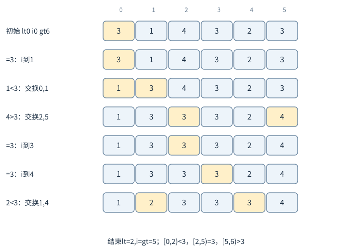
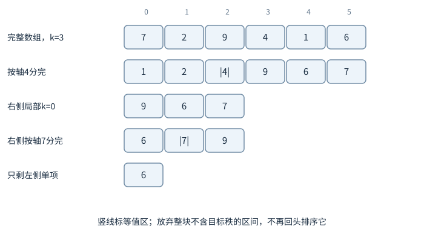
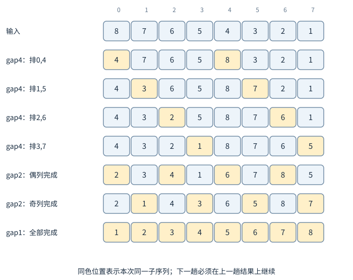
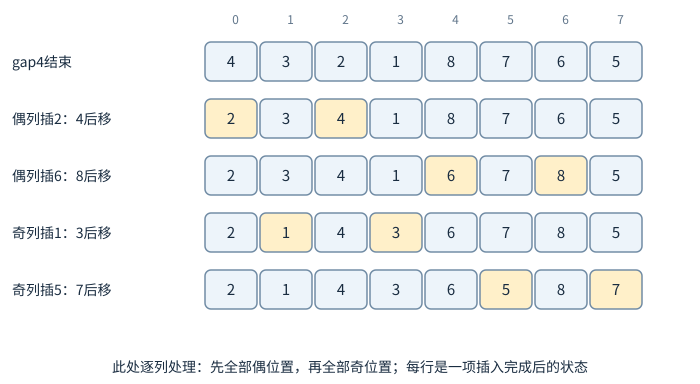
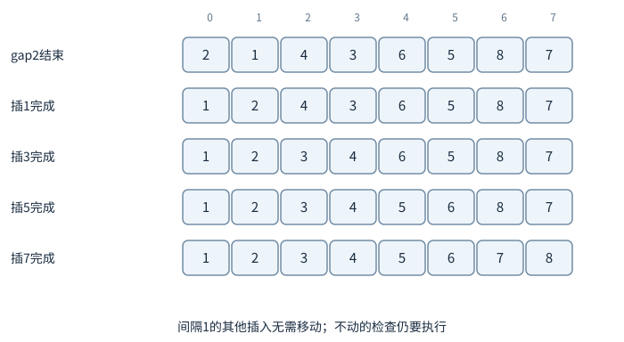
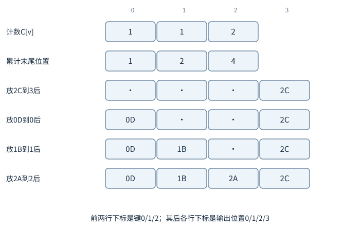
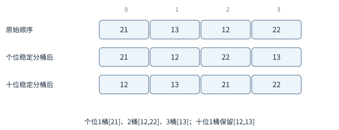

# 划分、选择与步长：排序还有哪些做法

归并排序先分成两半，再花时间合并；快速排序先花时间划分，使轴点左侧不大于它、右侧不小于它，再各排各的。两者都用分治，但本层工作发生的位置不同。读快排实现时，先确定划分函数返回的是轴点位置、两段分界，还是一整段等值区间；递归范围由这个约定决定。

## 例1：三路划分，重复值不必反复递归



图中下标从0起。黄色格是本步比较或交换的位置，数组值可能相同，交换后外观不变也要更新相应下标。轴值先复制为独立的3，随后交换不会改变它。

以轴值v=3划分`[3,1,4,3,2,3]`，维护四段：`[lo,lt)`小于3，`[lt,i)`等于3，`[i,gt)`尚未检查，`[gt,hi)`大于3。初始lt=i=lo，gt=hi。

读a[i]若小于v，与a[lt]交换，lt与i都加1；若等于v，只让i加1；若大于v，先gt减1，与a[gt]交换，i不动，因为换来的项还没看。

```text
初始   [3,1,4,3,2,3] lt0 i0 gt6
等于   [3,1,4,3,2,3] lt0 i1 gt6
小于   [1,3,4,3,2,3] lt1 i2 gt6
大于   [1,3,3,3,2,4] lt1 i2 gt5
等于   [1,3,3,3,2,4] lt1 i3 gt5
等于   [1,3,3,3,2,4] lt1 i4 gt5
小于   [1,2,3,3,3,4] lt2 i5 gt5
```

结束i=gt，未知段为空，返回两条边界lt=2、gt=5。只递归`[lo,lt)`与`[gt,hi)`，等于区间无需再排。每轮未知段长度gt−i至少减少1，因此本次划分Θ(n)。这里返回的是一段等值区间；某些二路划分返回轴点最终秩，另一些返回左右分界，递归区间不能互换。

完整快速排序还要走完递归，而不是划分结束便已经有序。上述第一次划分后是[1,2]、[3,3,3]、[4]三块。中块直接完成；右块仅一项，直接完成；左块选轴1，先把1留在等值区，看到2>1便归右，返回[1]与[2]两个单项区间。全部调用返回后才得到[1,2,3,3,3,4]。这一次只需再排两项，是因为最初的等值块很大，不是所有快排输入都会如此。

## 快排为什么平均快，又为什么会平方

若每次轴点接近中间，递推约为2T(n/2)+Θ(n)，得到Θ(n log n)。若总选到最小值或最大值，一边为空、一边n−1，总代价n+(n−1)+…，为Θ(n²)。用第一个元素当轴，对已排输入的某些二路实现就会遇到这种情况。

随机从当前区间选轴，在互异元素、随机选择独立且均匀等假设下，期望比较次数为O(n log n)。这给每个固定输入上的随机期望，而不是最坏保证。三路划分能避免大量相等值把递归搞坏，但仍不能让所有不平衡轴点的最坏情况自动消失。

实现上可每次递归较小半边，较大半边改成循环，使调用栈最坏O(log n)，即使总运行时间仍可能平方。这是时间与栈空间分别优化的例子。实现也可以给递归深度设置预算：过深时用前章堆排序完成剩余区间，小区间则用插入排序。这样选择后备算法时，仍需把完整最坏成本加到总账。

## 例2：第k小，只追答案所在的一边

找[7,2,9,4,1,6]中从0起第3小，即排序后第4项。使用前面同一套三路划分，第一轴复制为4。



第一次划分内部也逐步看：7>4，与末6换，得[6,2,9,4,1,7]；6>4，与当前未知末1换，得[1,2,9,4,6,7]；1<4、2<4，依次扩大小于区；9>4，与4换，得[1,2,4,9,6,7]；新来的4等于轴，划分结束。小于区长2，等值区长1，轴占全局秩2。目标3在右侧，右侧局部秩改为3−2−1=0。

只在[9,6,7]继续，选轴7：9>7，与末7换，得[7,6,9]；7等于轴，扫描向右；6<7，与等值区开头7换，得[6,7,9]。此时小于区长1，等值区长1，局部目标0在左侧，只剩[6]，直接返回6。被放弃的[1,2]无需内部排序，右侧9也无需再看，因为它们不可能改变目标秩的值。

Quickselect每次只递归一边，随机轴的期望时间O(n)，最坏仍O(n²)。期望线性也能按阶段看：随机轴至少有约1/2概率落在当前秩的中间一半，这时保留下来的目标侧最多约3n/4。一次没选好也只会让子问题缩小，不会变大；等到一次选好的期望尝试数至多约2。因此把规模降到原来的3/4，期望划分工作不超过常数乘n；下一阶段不超过常数乘3n/4，再下一阶段9n/16。几何级数$n+(3/4)n+(3/4)^2n+\cdots=4n$收敛为线性，给出O(n)期望界。极小规模的取整误差可并入固定终止阈值。

不能把快排的“两个孩子”递推直接照搬给选择，也不能因只递归一边就无条件说线性：若每次只丢掉1项，仍是平方和。

确定性线性选择可用“中位数的中位数”：每5项一组，求各组中位数，再递归选这些中位数的中位数作轴。忽略常数边界后，至少约3n/10项不小于轴，也至少约3n/10项不大于轴，最大递归侧不超过约7n/10。递推`T(n) <= T(n/5)+T(7n/10+O(1))+O(n)`可证明O(n)。它牺牲常数与实现简洁，换来最坏界。

## 例3：希尔排序，先让远处的元素接近位置

希尔排序选一串逐渐减小、最后为1的步长gap。固定gap时，把下标相差gap的元素分成子序列，各做插入排序。大步长让元素一次跨越较远距离，最后gap1时整个数组已较接近有序。



数组`[8,7,6,5,4,3,2,1]`，先gap4，分别排下标(0,4)、(1,5)、(2,6)、(3,7)，得到`[4,3,2,1,8,7,6,5]`。再gap2，偶数位置4,2,8,6排成2,4,6,8，奇数位置3,1,7,5排成1,3,5,7，得`[2,1,4,3,6,5,8,7]`。最后gap1插入，得到1到8。



图按列执行gap2插入：偶列[4,2,8,6]先把2插到4前，8随后不动，再把6插到8前；奇列[3,1,7,5]同样先插1、再插5。图省略的是没有移动的插入，检查仍然做过。



最后gap1在[2,1,4,3,6,5,8,7]上继续。插1移2，插3移4，插5移6，插7移8，才得到整体有序。

gap有序并不等于整体有序，最后必须包含1。较小gap排序后仍保持此前某些gap有序性质，但复杂度强烈依赖步长序列。朴素折半序列的最坏界可达平方级；其他序列有不同理论界。不能笼统给所有希尔排序写一个统一的n log n。它通常原地但不稳定，因为远距离移动会越过相等记录。

## 计数排序：键范围小，就直接数有多少个

若n个键都是`[0,U)`整数，可以统计每个键出现次数，再计算前缀位置，将记录稳定放入输出数组。时间Θ(n+U)、额外空间O(n+U)，跳过了只做两两比较的模型，因此不受比较排序Ω(n log n)下界直接约束。



图的前两行下标指键值，后四行下标指出口位置，不要把这两种数组的下标混用。累计数C[v]表示不大于v的记录总数，所以键v的当前最后空位在C[v]−1。

例如记录`(2,A),(1,B),(2,C),(0,D)`，计数为[1,1,2]，前缀累计[1,2,4]。从右往左放：2C放输出下标3并减2的累计；0D放0；1B放1；2A放2。得到0D、1B、2A、2C，两个2仍保持A在C前。若用“每种值打印次数”替代放完整记录，就会丢掉标签等附加数据。

U若远大于n，比如64位任意整数范围，直接开计数表不可行。可以做基数排序，按若干位一轮稳定排序；每轮时间与基数有关，总成本还取决于位数。固定32位与随n增长的长整数，是不同的模型。

## 例4：最低位优先基数排序，为什么每一轮要稳定



排序两位十进制数`[21,13,12,22]`。先按个位稳定排序，得到21、12、22、13；再按十位稳定排序，得到12、13、21、22。第二轮同十位内部保留上一轮已确定的个位顺序，所以整体正确。

把每个桶也写出来：个位1桶[21]，2桶[12,22]，3桶[13]，按桶号收回得到21/12/22/13；十位1桶按当前读入顺序得到[12,13]，2桶得到[21,22]，收回得到12/13/21/22。

最高位优先法在同一输入上先按十位分成1桶[13,12]、2桶[21,22]，再分别按个位排成[12,13]、[21,22]，按十位桶次序拼接。这里不能把所有桶取出后全局再按个位排，否则会得到21/12/22/13，把十位次序破坏。

如果第二轮不稳定，十位为1的12、13可能被翻成13、12，前一轮信息丢失。对最低位优先法，稳定性就是把新一位加到已有低位次序上的桥梁。最高位优先法则先按高位分桶，再在各桶内递归处理低位，结构不同，不能把两者的过程表混用。

## 比较算法时，先确定实际工作

完全排序输出全部有序序列，第k小只输出一个秩位置，前k大只关心一个集合，找众数关心频率。这些输出要求不同。图方便而先把全部排序，可能多做n log n工作；但若后面还要反复区间查询，一次排序也可能值得。

稳定性、额外内存、输入近有序程度、重复值数量、最坏延迟与元素移动成本，都影响选择。复杂度是重要限制，却不是只拿一个大O就能替代的全部条件。

## 线性选择的好轴，怎样保证至少丢掉常数比例

每5项一组，组内排序取第3项作中位数。再递归求这些组中位数的中位数p。至少约一半组的中位数≥p，每个这样的完整组至少有3项≥其中位数≥p；另一半对称。因此至少约3n/10项不小于p，至少约3n/10项不大于p，扣除轴所在组和末尾不足5项组只损失常数。

取一个完整的25项输入，把组和组中位数都写出。每组排序只含5项，是固定规模工作：

|原组|组内有序|中位数|
|---|---|---|
|9,1,8,2,7|1,2,7,8,9|7|
|20,3,19,4,18|3,4,18,19,20|18|
|25,5,24,6,23|5,6,23,24,25|23|
|17,10,16,11,15|10,11,15,16,17|15|
|22,12,21,13,14|12,13,14,21,22|14|

中位数列表7/18/23/15/14有5项，直接排成7/14/15/18/23，取中间15作轴。比如中位数18和23所在两组各有至少3项≥15，中位数7与14所在两组各有至少3项≤15，轴所在组本身还提供若干项。这个具体输入恰含1至25全部整数，所以小于15的有14项，大于15的有10项。

要找从0起第12小，以“子问题不超过5项就直接排序”为终止规则。为了让追踪不依赖原地交换顺序，本段划分按原顺序收集小于、等于、大于三块：

|待选序列|目标局部秩|组中位数→选轴|划分后保留|
|---|---|---|---|
|上述25项|12|7,18,23,15,14→15|左侧[9,1,8,2,7,3,4,5,6,10,11,12,13,14]，仍秩12|
|这14项|12|7,5,13→7|右侧[9,8,10,11,12,13,14]，秩12−7=5|
|这7项|5|10,14→14|左侧[9,8,10,11,12,13]，仍秩5|
|这6项|5|10,13→13|等值区恰占秩5，返回13|

不足5项的尾组在本例取排序后下标⌊长度/2⌋的项，即偶数项时取较大的中间项；小规模中位数列表也用同一规则。因此两项10/14选14，不是随意取平均12。尾组与轴所在组只影响一般证明中的常数项，不破坏两侧各丢掉约3n/10项的规模界。

递归选择p花T(n/5)，分组和划分花cn，目标侧至多约7n/10+常数。要证明总O(n)，猜T(n)≤An，代入右边得到约A(n/5+7n/10)+cn=0.9An+cn。选A≥10c并用足够大的基础阈值吸收常数，就能压回An。决定可行的是两个递归比例之和0.9小于1，不是“选了中位数”这几个字。

如果每3项一组，简单比例分析可能得到T(n/3)+T(2n/3)+cn，比例之和等1，不能用同一代入证明线性。更细算法可能另有性质，但不能把5组法证明中关键常数删掉再声称所有分组大小都一样。

## 快排的期望比较数，也能按元素对来数

把互异元素按最终秩标1到n。秩i<j的两项会直接比较，当且仅当在秩区间[i,j]中，最先被选作轴的是i或j。若先选中间某项，它会把两项分到不同子问题，此后不再直接比较；若端点先成为轴，则比较一次。均匀随机轴下概率为2/(j−i+1)。

将所有对的比较指标取期望并求和，得到`Σ_{i<j} 2/(j-i+1)=O(n log n)`。把差d=j−i相同的项合起来，该差有n−d对，所以

$$
\sum_{i<j}\frac{2}{j-i+1}
=\sum_{d=1}^{n-1}\frac{2(n-d)}{d+1}
\le2n\sum_{d=1}^{n-1}\frac1{d+1}.
$$

最后的倒数和按分母区间[1,2)、[2,4)、[4,8)分组，每组至多“项数×最大单项”≤1，共约log₂n组，故总和O(log n)，乘前面的n得到O(n log n)。

这个证明不要求不同对是否比较相互独立，线性期望即可。它也说明随机化为何有效：固定输入顺序不影响最终秩区间内哪个轴最先出现的均匀性。

有大量重复时，普通两路比较与这份互异秩证明不直接匹配。三路划分将所有等于轴的项一次归并成不再递归的区间，更适合这种输入。对全相等n项，扫描一次后两侧都空，时间线性；若实现仍逐个将等值项留到一侧，就会与这个结论不同。

## 希尔排序为什么可能打乱相等项

考虑相等记录5A在前、5B在后，中间穿插其他值。大gap子序列里某一5可能因与更大值比较向前移动多格，而另一5位于不同子序列保持不动，二者可以跨越而从未直接比较。这与稳定插入排序只移动严格较大且相邻逻辑区间的情况不同。

具体用gap2再gap1处理`[(2,A),3,1,(2,B)]`。gap2的偶位置2A、1排好后，数组变`[1,3,2A,2B]`；奇位置3、2B排好后变`[1,2B,2A,3]`。最后gap1即使采用稳定插入排序，也只会保持当前等值次序B在A前，原来A在B前的顺序已无法恢复。

所以“每一趟子序列插入排序稳定”并不能推出整个希尔排序稳定：不同子序列之间在全局顺序上交错，跨步移动会改变它们的相对位置。需要稳定性时，除非使用带原始序号的完整比较键或专门变体，不应依赖普通希尔排序。

## 划分轴值与数组元素分开保存

划分过程中会交换数组，若只保存指向某格的轴引用，而该格被交换覆盖，后续比较可能在用一个变化的轴值。教学代码通常先把pivot的值或稳定记录拷贝出来，或者保证轴所在格在最终归位前不被改变；两种设计都可以，但实现要兑现这个不变式。

若元素很大，复制轴记录可能有成本，可保存比较键或使用合适引用策略；若键又随记录修改，则还要确认比较期间不变。泛型算法的元素类型假设，决定某个看似简单赋值是否真能视为常数。

## 第k小的k，必须说明是否从零开始

六项数组从零起第3小是排序后的第四项，从一起第3小是第三项。进入右子问题时，零基秩减去小于区长度与等值区长度；若用一基，判定与减量要同步调整，不能只在入口减一次后又把内部条件改回一基。

等值区长度大于一时，目标只要落在这个整段秩范围内，返回轴值即可，无需再挑其中一项递归。若要返回原记录身份，多个相同键之间必须另定并列次序。数值答案唯一与记录答案唯一，也不是一回事。

快速排序的空区间与单项区间应立即返回。若递归区间包含轴点本身，轴在边界时可能再次传入原区间，造成无限递归；划分后大小必须严格缩小，这个终止检查比仅看输出是否有序更早发现问题。

## 练习与答案

**练习1。** 三路划分遇到a[i]>v，与右端交换后为何不增加i？

解答：从未知区右端换来的值尚未被分类，可能小于、等于或大于v。若直接i++，这项会被错误归入等值区或已处理区。只有看过它并按规则放好，才可缩小未知段左边界。与左端交换时换来的是已知等值项，因此那个分支可同时增加i。

**练习2。** Quickselect求第0小，恰好每次选最大轴，会怎样？

解答：每次最大轴落在末尾，目标仍在大小n−1的左侧，只丢掉1项。划分成本n、n−1、……，总Θ(n²)。只递归一边不足以证明线性，需要证明被保留规模在整体上缩得足够快，随机期望或确定性好轴都在解决这件事。

**练习3。** 计数排序n=100、U=10⁹，时间Θ(n+U)是否比比较排序更好？

解答：这里U主导，约十亿规模的初始化与扫描很不划算，比较排序的几百次比较量级通常更合适。渐近表达式中两个变量都要代入，不能只看到计数排序“线性”二字便丢掉U。

阅读对照：[Princeton快速排序](https://algs4.cs.princeton.edu/23quicksort/)可核对二路划分和三路划分返回值的差别；老师《14.排序.pdf》PDF47—51页给出选择算法，54—59页给出gap排序与折半步长的输入敏感性。以上均按PDF查看器页码。
