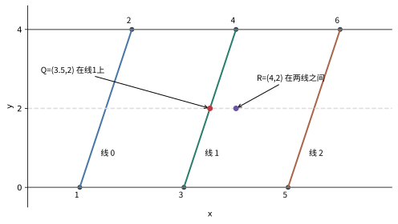

# PA1：把题目变成能一步步执行的程序

这一章对照PA1的两份教师讲解，分别做Filename、Interview、Gift、Graphics和二维偏序。它们的共同困难是：老师写“使用动态规划”“分块”“二分”时，程序究竟存什么，下一步究竟改哪里？下面用另设的小输入把全过程展开。正式输入格式、数据规模和输出要求仍应对照当次题面；现有材料不足以把这五题称作全学期所有OJ题，也没有据此声称已经通过OJ。

## Filename：两个文件名只许插字符、删字符

设原串是`ABC`，目标串是`ABXC`。允许做两种事：删掉原串的一个字符，或者在任意位置插入一个字符。这里**没有成本为1的替换操作**。例如`A`变`B`，必须先删A，再插B，共2次。

先不考虑大输入。我们可以问一个较小的问题：“原串的前几个字符，变成目标串的前几个字符，需要几次？”前缀允许为空。把这个问题的答案放进一个表：

$$D[i][j]=\text{把原串前 }i\text{ 个字符变成目标串前 }j\text{ 个字符的最少插删次数}.$$

这里$i$在$0$到原串长度$n$之间，$j$在$0$到目标串长度$m$之间。`D[0][3]=3`的意思是，空串变成目标的前三个字符，必须插3次。于是表的第一行、第一列先填好：

$$D[0][j]=j,\qquad D[i][0]=i.$$

看右下角某格时，最后一步只有以下可能。

- 删原串的第$i$个字符。之前已经把前$i-1$个字符变成目标前$j$个，故成本是$D[i-1][j]+1$。
- 插目标的第$j$个字符。之前已经得到目标前$j-1$个，故成本是$D[i][j-1]+1$。
- 两边最后一个字符相同，直接保留。成本是$D[i-1][j-1]$。

末字符不同时，第三种“免费保留”不合法，也不能擅自写成对角线加1，那会引入题目没有的替换。取所有合法方案的最小值。因为每种最后一步都列到了，且之前的前缀问题更小，这个递推既不会漏掉最优方案，也不会凭空制造方案。

### 完整填一次表，再沿表找回操作

对`ABC`和`ABXC`，表如下。行标题是原串前缀，列标题是目标前缀。

| $D[i][j]$ | 空 | A | AB | ABX | ABXC |
|---|---:|---:|---:|---:|---:|
| 空 | 0 | 1 | 2 | 3 | 4 |
| A | 1 | 0 | 1 | 2 | 3 |
| AB | 2 | 1 | 0 | 1 | 2 |
| ABC | 3 | 2 | 1 | 2 | 1 |

别一次盯着整张表。只算第三行的后三格：

1. `AB→AB`：B与B相同，可以继承`A→A`的0，所以填0。
2. `AB→ABX`：B与X不同。删B需要`D[1][3]+1=3`；在`AB→AB`以后插X只需`D[2][2]+1=1`，所以填1。
3. `ABC→ABX`：C与X不同。上方1加1为2，左方1加1也是2，所以填2。这个格子成本超过预算1，但它并不会污染右下角：`ABC→ABXC`的C可以匹配C，直接取左上方`AB→ABX`的1。

最后答案是右下角1。恢复一条操作路径时，从右下角反走：C相同，走到`(2,3)`；这一格来自左边加1，所以记录“插X”；B相同走到`(1,1)`；A相同走到`(0,0)`。反转记录后得到：保留A、保留B、插X、保留C。

表需要$(n+1)(m+1)$格，每格只检查常数个来源，因此完整算法时间$O(nm)$，存全表空间$O(nm)$。只求次数、不恢复路径时，当前行只依赖上一行和本行左格，可以滚动成两行。

### 教师给的LCS等式怎么来的

$L$表示两串最长公共子序列的长度。“子序列”允许跳过字符，但保留下来的先后次序不能变。在`ABC`与`ABXC`里，`ABC`就是长度3的公共子序列。保留它，只插X即可。

一般地，保留这$L$个字符，原串另外$n-L$个必须删，目标另外$m-L$个必须插，得到一个成本为

$$n+m-2L$$

的可行方案。还要证明没有更便宜的：任意插删方案最终留下来的原字符，一定按原次序同时出现在两串里，因此留下的数量$r$最多为$L$。至少要删$n-r$个、插$m-r$个，所以至少花$n+m-2r\ge n+m-2L$次。可行上界和不可突破的下界相同，等式才成立。

这个证明也告诉我们为什么不能把它照搬到允许替换的题。`A→B`的LCS长度0，公式给2，而一次替换只花1。

### 预算只有$k$：哪些格根本不必算

若题目只关心最少次数是否不超过$k$，状态`(i,j)`首先必须满足$|i-j|\le k$。原因很直接：从长度$i$变成长度$j$，每次插删最多改变1个长度，光补长度差就至少要$|i-j|$次。一个总成本不超过$k$的编辑路径，每个中间前缀格也不可能已经花掉超过$k$次。

例如刚才$k=1$时，只保留主对角线左右各1格。横线表示本次不计算，读取时按无穷大处理：

| 行 | $j=0$ | 1 | 2 | 3 | 4 |
|---|---:|---:|---:|---:|---:|
| $i=0$ | 0 | 1 | — | — | — |
| 1 | 1 | 0 | 1 | — | — |
| 2 | — | 1 | 0 | 1 | — |
| 3 | — | — | 1 | 2 | 1 |

最后仍是1，最优路径没有被剪掉。带内的2可以保留为2，也可以截成$k+1=2$；我们只需区分“0到$k$”和“已超预算”。**在带内**与**成本够小**是两回事，`ABC→XYZ`始终存在相同长度的格，答案仍然是6。

滚动数组最容易错在“这个槽现在对应哪一列”。把每行存成“最左列号+一段数组”，访问原列$j$时，用$j$减去本行最左列得到槽号。不在这一行保存范围的格，统一读成$k+1$。下面的完整实现每行只清带内的格；若仍每次清空$m+1$格，内层虽缩窄，初始化就会把时间拖回$O(nm)$。

```python
def insert_delete_with_budget(a, b, k):
    if k < 0:
        raise ValueError("budget must be nonnegative")
    n, m = len(a), len(b)
    if abs(n - m) > k:
        return None
    inf = k + 1
    prev_lo = 0
    prev = list(range(min(m, k) + 1))
    for i in range(1, n + 1):
        lo, hi = max(0, i - k), min(m, i + k)
        cur = [inf] * (hi - lo + 1)

        def above(j):
            pos = j - prev_lo
            return prev[pos] if 0 <= pos < len(prev) else inf

        for j in range(lo, hi + 1):
            if j == 0:
                cur[0] = i
                continue
            delete = above(j) + 1
            insert = cur[j - 1 - lo] + 1 if j > lo else inf
            best = min(delete, insert)
            if a[i - 1] == b[j - 1]:
                best = min(best, above(j - 1))
            cur[j - lo] = min(inf, best)
        prev_lo, prev = lo, cur
    answer = prev[m - prev_lo]
    return answer if answer <= k else None
```

`above(j)`通过原列号取上一行；`cur[j-lo]`通过原列号写当前行。两者各自减自己的最左列。`inf`不是某个非常大的神秘数字，而是“已超预算”的统一标记，超过它的候选可以截断。行内从左向右，所以插入所需的本行左格已经算好。

本例第2行保存$j=1,2,3$的`[1,0,1]`，第3行保存$j=2,3,4$的`[1,2,1]`。两行的槽0对应的原列不同；算第3行原列2时，正上方在上一行槽1，左上方在上一行槽0。带的位置移动并没有改变递推式，只改变了坐标到数组槽的换算。

每行至多$2k+1$格，清空、填写各一次。总时间为$O((n+1)(k+1))$，辅助空间$O(k+1)$，字符串本身的存储另计；当$k$大于串长时，实际上不超过完整表的格数。只求次数时这是完整算法，若要恢复具体编辑路径，则需另外保留来源或采用分治恢复，不能说“两行数组里仍保存了全部历史”。

教师讲解PDF第1页关于可达目标有一句“大于$k$”的文字，与前后递推意图相反；本章按长度差下界和“不超过预算”的目标核对，不沿用该笔误。

## Interview：从完整逆序过程得到空位查询

教师讲解PDF第1页将原过程转为逆序入座：n把椅子顺时针编号1到n，初始全空；最后一位应聘者先坐在1号，随后从刚入座位置之后开始，顺时针找第m个空座，放入前一位应聘者，直到全部填满。当前位置不参与本次计数，占用座位也不计数。下面分析这份已明确的逆序子问题；人与正向时间的具体输入输出对应仍以完整题面为准，不能从解题讲义省去的条件自行编出另一套正向规则。

取n=8、m=3，先占1号。前两轮分别数2、3、4和5、6、7，落4和7；第三轮在7之后数8、2、3，第一次绕回起点以前。完整过程可以全部做完：

|当前已占位置p|其余空位，从1开始列|从p之后实际数的3个空位|新占位置|
|---:|---|---|---:|
|1|2,3,4,5,6,7,8|2,3,4|4|
|4|2,3,5,6,7,8|5,6,7|7|
|7|2,3,5,6,8|8,2,3|3|
|3|2,5,6,8|5,6,8|8|
|8|2,5,6|2,5,6|6|
|6|2,5|2,5,2|2|
|2|5|5,5,5|5|

完整逆序座位顺序为1、4、7、3、8、6、2、5。最后空位少于m时，数数会重复绕环，不能把“还剩2空位，找第3个”判成不存在。朴素方法每轮先把m化成剩余空位中的等价名次，再沿环扫描至多一圈；n轮最坏仍需$O(n^2)$位置检查。以下只改变跳过空位的方式，数数规则不变。

### 分块保存空位数，整块跳过

块长B=2时，刚占4后的标记为`0,1,1,0,1,1,1,1`，1表示空：

|块|椅子|空位标记|空位数|
|---|---|---|---:|
|0|1、2|0、1|1|
|1|3、4|1、0|1|
|2|5、6|1、1|2|
|3|7、8|1、1|2|

从4后找第3空位，下一整块5、6只有2空位，可一口跳过，剩余名次从3变1；进入7、8块，逐格找到第一空位7。接着从7后找第3空位时，起点所在块还剩椅8，先数它，名次3变2；绕到1、2块，它只有1空位，整块跳过后剩1；再到3、4块，第一空位是3。起点的零碎尾部、完整块、目标块在同一过程里各做不同的事。

一个查询最多检查两个零碎块的$O(B)$个位置，以及$O(n/B)$个块计数，故成本$O(B+n/B)$。令B与$\sqrt n$同阶，两项都为根号量级，n次共$O(n\sqrt n)$。教师讲解同段先写希望达到$O(1)$，后面实际给的是分块的$O(\sqrt n)$过程，应按真实操作分析。占用一个空座只清一个标记、对应块计数减1，更新本身为常数时间。

### 用前缀空位数把环换成全局名次

每把空椅记1，已占记0。定义$\operatorname{sum}(p)$为1到p的空位总数，全部空位数为S。当前位置p已占，记$r=\operatorname{sum}(p)$；从1开始排列的空位中，前r个都在p以前，p之后的第m个对应全局一基名次

$$q=((r+m-1)\bmod S)+1.$$

先减1把一基名次改为零基，取模绕环，再加1恢复一基。刚占4后，空位[2,3,5,6,7,8]，S=6、r=2，m=3给q=5，第5空位是7。占7后空位[2,3,5,6,8]，S=5、r=4，q=((4+3−1) mod 5)+1=2，第2空位是3，与手工第三轮相同。这里扣的是空位数，不是p的座号。

前缀和与“第q个1”可用同一棵树状数组实现。先说明每个节点究竟管哪段：$\operatorname{lowbit}(p)=p\mathbin{\&}(-p)$，是p的二进制最低位1所代表的2的幂；t[p]保存`[p-lowbit(p)+1,p]`的标记和。例如6是二进制110，lowbit为2，t[6]管5、6；t[4]管1到4。求前6项时先取t[6]，再把p从6减2到4，取t[4]，两块不重叠且恰好覆盖1到6。

初始已占1号时：

```text
标记 a[1..8] = 0 1 1 1 1 1 1 1
节点 t[1..8] = 0 1 1 3 1 2 1 7
```

第一轮要找第3空位。保留pos=0、need=3，从不超过n的最大2的幂8开始试跳，每次跳长减半：

|跳长|试探节点|它保存的块计数|处理后pos/need|
|---:|---:|---:|---|
|8|8|7|7≥3，不能整块越过目标，仍0/3|
|4|4|3|3≥3，目标仍在此前，仍0/3|
|2|2|1|1<3，跳过该块，变2/2|
|1|3|1|1<2，再跳过，变3/1|

最后pos=3表示肯定在目标之前的最后位置，返回pos+1=4。块计数与need相等时不能跳过，因为目标就在这块中；必须严格小于才减去它。把4变占用，t[4]由3减为2、t[8]由7减为6，其余块不含4，不改。

以下程序从全空数组建立树，实际走完前表。t[0]不用；开始全空时，t[p]管的lowbit(p)个位置全为1，所以直接令t[p]=lowbit(p)，无需逐项做n次更新。

```python
def free_prefix(t, p):
    result = 0
    while p > 0:
        result += t[p]
        p -= p & -p
    return result


def kth_free(t, rank):
    n = len(t) - 1
    if not 1 <= rank <= free_prefix(t, n):
        raise ValueError("名次不在当前空位范围")
    pos, step = 0, 1
    while step + step <= n:
        step += step
    while step:
        nxt = pos + step
        if nxt <= n and t[nxt] < rank:
            rank -= t[nxt]
            pos = nxt
        step //= 2
    return pos + 1


def occupy(t, p):
    if not 1 <= p < len(t):
        raise ValueError("座号越界")
    if free_prefix(t, p) == free_prefix(t, p - 1):
        raise ValueError("该座已经占用")
    while p < len(t):
        t[p] -= 1
        p += p & -p


def reverse_seats(n, m):
    if n < 1 or m < 1:
        raise ValueError("座位数和计数步长必须为正")
    t = [0] + [p & -p for p in range(1, n + 1)]
    pos = 1
    occupy(t, pos)
    answer = [pos]
    for _ in range(n - 1):
        S = free_prefix(t, n)
        r = free_prefix(t, pos)
        q = (r + m - 1) % S + 1
        pos = kth_free(t, q)
        occupy(t, pos)
        answer.append(pos)
    return answer

print(reverse_seats(8, 3))  # [1,4,7,3,8,6,2,5]
print(reverse_seats(1, 3))  # [1]
```

名次查找每次只尝试一个二进制位，树状节点组合保持“pos以前已跳过，rank是后面还需要的空位名次”。若整块计数小于rank，就扣去它并越过；否则留在原pos，下一次用更短块缩小位置。最后不能再跳1格，下一格就是目标。占座时向上修改所有覆盖该位置的块，前缀计数仍等于真实标记和。因此环名次换算、树上名次选择、清除一位三个步骤逐轮保持与朴素过程相同。

一次前缀查询、查名次或占座均为$O(\log n)$，全部恢复为$O(n\log n)$，空间O(n)。S只在还有空位时使用，循环结束后不再对0取模。m很大时可先按S取模，但仍保留一基规则；若固定宽整数计算r+m−1，还需避免加法溢出。树状数组也不是任意前缀聚合都可照搬：这里标记非负，前缀空位数单调，“第q个1”才有意义。

## Gift：四组选择，怎样少算一半指数

输入$n$组数对$(a_i,b_i)$，每组必须恰好选一个，问总和不超过预算$P$的方案数。不同组的两个选项即使数值相同，也仍然代表不同选择。下面这4组贯穿整个算法：

```text
第1组 (1,4)    第2组 (2,5)
第3组 (0,3)    第4组 (1,2)    预算 P=7
```

直接递归每组分两个分支，共$2^4=16$个叶。大到40组就是$2^{40}$，约一万亿。中间相遇先切成两半：前2组列全部左半和，后2组列全部右半和。一个完整方案唯一对应“一份左选择+一份右选择”，所以只要统计和不超过7的左右配对。

| 左选择 | 左和 | 右选择 | 右和 |
|---|---:|---|---:|
| 1、2 | 3 | 0、1 | 1 |
| 1、5 | 6 | 0、2 | 2 |
| 4、2 | 6 | 3、1 | 4 |
| 4、5 | 9 | 3、2 | 5 |

对每个右和$r$，需要左和$\ell\le P-r$。左数组`[3,6,6,9]`排序后，可以用`upper_bound(P-r)`找第一个超过阈值的位置；这个位置前有几项，就有几个合法左方案。

| 右和$r$ | 左和阈值$7-r$ | 合法左数组项 | 本轮贡献 | 累计 |
|---:|---:|---|---:|---:|
| 1 | 6 | 3、6、6 | 3 | 3 |
| 2 | 5 | 3 | 1 | 4 |
| 4 | 3 | 3 | 1 | 5 |
| 5 | 2 | 无 | 0 | 5 |

两个6分别来自“1、5”和“4、2”，删掉任何一个都会少算。这里在数方案，不是在列不同总和。

### 教师拓展里的两次线性归并怎么做

第一处归并用于生成**有序**半和。从只有空选择的`[0]`开始，每添一组$(a,b)$，把旧列表分别整体加$a$、加$b$，得到两个有序列表，再归并。左半的全过程：

```text
空组                     [0]
添(1,4)：[0]+1，[0]+4  -> [1,4]
添(2,5)：[1,4]+2       -> [3,6]
         [1,4]+5       -> [6,9]
归并                     [3,6,6,9]
```

右半同理：`[0]→[0,3]→merge([1,4],[2,5])=[1,2,4,5]`。每次列表翻倍，各层处理量是$2+4+\cdots+2^h<2^{h+1}$，其中$h$是这一半的组数，所以全部有序枚举为$O(2^h)$，无需最后再排序。

第二处归并用于计数。右和从小到大走，允许的左和阈值不断下降，左指针只会往回退。初始把指针放在左数组末尾9：

```text
r=1，阈值6：9太大，退到第二个6。可用3项，累计3。
r=2，阈值5：两个6依次退掉，停在3。可用1项，累计4。
r=4，阈值3：3仍可用。再加1，累计5。
r=5，阈值2：3也退掉，指针变-1。再加0，仍为5。
```

右指针走完一次，左指针也最多退完一次，配对阶段是$O(|L|+|R|)$。加上有序生成，总时间与空间都是$O(2^{\lceil n/2\rceil})$量级；这里假设一次加法和计数的机器字运算成本为常数，且相应数值放得下。普通“生成后排序、每项二分”版本也完全正确，时间通常多一个$n$量级因子。

下面实现的两次归并正好对应刚才的生成表和计数表。`merge`遇到相等值仍把两项都保留；`j`表示左数组前多少项当前可用，所以直接加j，不能只加不同和值的数量。空的一半从[0]开始，表示唯一一种空选择，而非零种方案。

```python
def merge(left, right):
    result = []
    i = j = 0
    while i < len(left) and j < len(right):
        if left[i] <= right[j]:
            result.append(left[i])
            i += 1
        else:
            result.append(right[j])
            j += 1
    result.extend(left[i:])
    result.extend(right[j:])
    return result

def ordered_sums(pairs):
    sums = [0]
    for a, b in pairs:
        sums = merge([x + a for x in sums], [x + b for x in sums])
    return sums

def count_gifts(pairs, budget):
    middle = len(pairs) // 2
    left = ordered_sums(pairs[:middle])
    right = ordered_sums(pairs[middle:])
    j = len(left)
    answer = 0
    for r in right:
        while j > 0 and left[j - 1] + r > budget:
            j -= 1
        answer += j
    return answer

print(count_gifts([(1, 4), (2, 5), (0, 3), (1, 2)], 7))  # 5
print(count_gifts([(1, 1), (2, 2)], 3))  # 4，四种选择都要计
```

负数不妨碍排序后的阈值计数，但会破坏“部分和已超过预算就立刻剪枝”的推理。例如先选5，后面还能选−10，最后可能合法。数值范围也分开估：和的绝对值最多是各组最大绝对值之和；方案数最多是$2^n$。和装得下32位，方案数未必装得下。

中间相遇的“把一次完整选择唯一拆成两份”是正确性的关键。它也用来检查：奇数组怎么分不影响配对一一对应，空的一半要保留一个和0，不能生成空列表。

## Graphics：点在线哪边，为什么能连续砍掉一半线

教师讲解的核心是“将端点分别排序后连成有序、不相交的分界线，按叉积二分”。先画一个明确的几何小例。下边界$y=0$有端点$x=1,3,5$，上边界$y=4$有端点$x=2,4,6$，依次连成3条线。第$j$条从下向上定向，查询点$Q=(3.5,2)$。



二维向量$(u_x,u_y)$、$(v_x,v_y)$的叉积在这里是一个数：

$$\operatorname{cross}(u,v)=u_xv_y-u_yv_x.$$

对线段起点$A$、终点$B$和点$Q$，先作差得到$u=B-A$、$v=Q-A$。本图$y$向上，线从下向上，叉积为负表示Q在线的右侧，正表示左侧，零表示线上。不要把这个正负约定搬到屏幕$y$向下的坐标系而不检查。

三条线逐条手算：

| 线 | $A$ | $B-A$ | $Q-A$ | 叉积 | Q的位置 |
|---|---|---|---|---:|---|
| 0 | $(1,0)$ | $(1,4)$ | $(2.5,2)$ | $1\cdot2-4\cdot2.5=-8$ | 右侧 |
| 1 | $(3,0)$ | $(1,4)$ | $(0.5,2)$ | $2-2=0$ | 线上 |
| 2 | $(5,0)$ | $(1,4)$ | $(-1.5,2)$ | $2+6=8$ | 左侧 |

本例Q**恰好在线1上**。若题目规定线上归右边区域，则问“有多少条线在Q左侧或经过Q”，应把叉积$\le0$算进前半；若线上归左区，就用$<0$。图中的区域说明也应按这一边界约定理解，不能把线上点说成严格处于两线之间。

为演示普通内部点，使用图中的$R=(4,2)$，叉积依次为−10、−2、6，谓词“Q在此线右侧”依次为真、真、假。找第一个假，过程是：

```text
初始候选线下标 [0,3)
mid=1：cross=-2<0，线1也在点左边，答案边界在[2,3)
mid=2：cross= 6>0，线2在点右边，答案边界在[2,2)
结束：有2条线在点左边，点在第2个区域（从0编号）。
```

二分合法是因为谓词只变一次。证明也不难：在高度$y$令$t=y/4$，第$j$条线横坐标为

$$x_j(y)=(1-t)x_j^{\text{下}}+t x_j^{\text{上}}.$$

上下两列端点都按相同次序递增，且$0\le t\le1$，所以$j<k$时两端差都为正，其非负加权和仍为正，得到$x_j(y)<x_k(y)$。查询点从右侧走到左侧只会经过一次分界。若端点顺序交叉，这个证明就失败，二分也可能错；先排序的依据必须来自题面结构。

朴素逐条测试是$O(n)$一次；有序后每次二分$O(\log n)$，预处理排序$O(n\log n)$。整数坐标可以用整数叉积精确判零。若坐标绝对值至多$M$，差可到$2M$，两个乘积各可到$4M^2$，相减的绝对值可到$8M^2$，中间运算的类型要按这个上界选择。先用窄整数做乘法，再赋给宽整数，救不了已经发生的溢出。

这里二分的返回值是“有多少条分界线在点的左边”，不是找到一条恰好通过点的线。完整参考函数如下：lines已按同一上下端点顺序排列，每项为从下向上的(A,B)；点在上下边界之间，且这些线不交叉。`on_line_right=True`表示线上点划入右侧区域，即把叉积0也计入左侧线数。

```python
def region(lines, Q, on_line_right=True):
    lo, hi = 0, len(lines)
    while lo < hi:
        mid = lo + (hi - lo) // 2
        A, B = lines[mid]
        value = ((B[0] - A[0]) * (Q[1] - A[1])
                 - (B[1] - A[1]) * (Q[0] - A[0]))
        line_is_left = value <= 0 if on_line_right else value < 0
        if line_is_left:
            lo = mid + 1
        else:
            hi = mid
    return lo

lines = [((1, 0), (2, 4)), ((3, 0), (4, 4)), ((5, 0), (6, 4))]
print(region(lines, (4, 2)))             # 2
print(region(lines, (3.5, 2), True))     # 2，在线1时归右
print(region(lines, (3.5, 2), False))    # 1，在线1时归左
```

函数不会替调用者验证线是否交叉；那是建立有序谓词的输入前提。若原题需要把区域计数汇总，先对每个查询得出该下标，再给对应区域计数加1。只输出一个叉积符号还没有完成区域定位。

## 二维偏序：先算清楚谁可以接谁，再加速

教师PPT给三元组$(a_i,b_i,c_i)$：选一些**不重复索引**，可以按坐标顺序组织成链，要求相邻两项的$a$、$b$都不下降，最大化所选$c$之和。这里允许重新组织所选索引，不能擅自改成“必须保持原输入顺序的子序列”问题。后者的依赖关系不同。

取5项：

| 编号 | $a$ | $b$ | 权重$c$ |
|---|---:|---:|---:|
| A | 1 | 3 | 4 |
| B | 2 | 2 | 5 |
| C | 2 | 4 | 6 |
| D | 3 | 3 | 7 |
| E | 4 | 5 | 2 |

先按$a$、再按$b$排序，本例顺序就是A、B、C、D、E。A不能接到B前，因为$b$从3降到2；B可以接C；A和B都能接D；C和D彼此不可接，但都能接E。

设$f_i$为“必须以第$i$项结尾的最大链权”。以$i$结尾的链，要么只有自己，要么在一条合法前驱链后加自己。因此

$$f_i=c_i+\max\left(0,\max_{j<i,\ b_j\le b_i}f_j\right).$$

外面的0表示从自己重新开始；里面的$j$只能在已处理项里，并满足第二坐标不下降。按排序顺序，第一坐标已经不会下降。

| 当前项 | 可以接的前驱及其$f$ | 选中前驱 | 当前$f$ | 最优链 |
|---|---|---|---:|---|
| A | 无 | 无 | 4 | A |
| B | 无，A的$b=3>2$ | 无 | 5 | B |
| C | A:4、B:5 | B | 11 | B→C |
| D | A:4、B:5；C的$b=4>3$ | B | 12 | B→D |
| E | A:4、B:5、C:11、D:12 | D | 14 | B→D→E |

这张表本身就是一个正确的$O(n^2)$算法：每行扫所有前驱。如果加速版输出不是14，可以回到某一行查是哪个前驱漏了。

### 前缀最大值树状数组：整块记住“最好的一条链”

第二坐标原值为2、3、4、5，压成秩1、2、3、4。压缩只保存大小关系，不保存距离。定义`query(r)`返回所有第二坐标秩不超过$r$的已处理项中，最大的$f$。在本例中树状节点管的区间是：

```text
t[1] 管秩1       t[2] 管秩1..2
t[3] 管秩3       t[4] 管秩1..4
```

初始各项为0，逐点处理：

| 项 | 秩 | 查询经过哪些节点 | 查得前驱最大值 | 更新后`t[1..4]` |
|---|---:|---|---:|---|
| A | 2 | `t[2]` | 0 | `[0,4,0,4]` |
| B | 1 | `t[1]` | 0 | `[5,5,0,5]` |
| C | 3 | `t[3]、t[2]` | 5 | `[5,5,11,11]` |
| D | 2 | `t[2]` | 5 | `[5,12,11,12]` |
| E | 4 | `t[4]` | 12 | `[5,12,11,14]` |

为什么C没有被D接上？D只查秩1到2，而C在秩3；节点`t[4]`虽存着11，查询秩2时并不读它。查询向下减去最低位1，更新向上加最低位1，都只经过$O(\log n)$个区间。每个节点总存其所管区间里已经出现过的最大$f$，所以查询恰好等于平方算法里那一项“所有合法前驱的最大值”。总时间$O(n\log n)$。

对应查询与更新也可照着节点区间写出。t初始为0，表示允许空前驱链；r是当前第二坐标压缩后的1起名次，value是已经算好的$f_i$：

```python
def best_prefix(t, r):
    answer = 0
    while r > 0:
        answer = max(answer, t[r])
        r -= r & -r
    return answer


def improve(t, r, value):
    if not 1 <= r < len(t):
        raise ValueError("rank outside tree")
    while r < len(t):
        t[r] = max(t[r], value)
        r += r & -r
```

本例C的r=3，查询先读`t[3]`负责原秩3，再减lowbit(3)=1到2，读`t[2]`负责原秩1、2，再减2到0结束。得到前3秩的最大值；更新则反向改所有覆盖r的块。每个节点只需不断增大其最大值，不能用这段代码实现任意删除或降低旧$f$，那时原最大值可能失效，需要另一种维护办法。

这里的聚合是`max`，不能仿照前缀和把两个查询相减求任意区间最大值。若要恢复链，节点同时保存“最大值、取得它的前驱编号”，每项把查询得到的编号存为`parent[i]`。从E回溯得到E、D、B，再反转就是B→D→E。

把前面的压缩、查询和更新连成求最优值的完整入口。该入口只返回权值，不声称已经输出路径；`allow_empty=False`时全负输入也要返回某个负权单项，而非0。相同坐标不去重，原模型允许它们按任意固定身份顺序全部进入非降链。

```python
def weighted_chain(points, allow_empty=True):
    ordered = sorted(points, key=lambda p: (p[0], p[1]))
    values = sorted({b for a, b, c in ordered})
    rank = {b: i + 1 for i, b in enumerate(values)}
    t = [0] * (len(values) + 1)
    answer = 0 if allow_empty else None
    for a, b, c in ordered:
        r = rank[b]
        value = c + best_prefix(t, r)
        improve(t, r, value)
        if answer is None or value > answer:
            answer = value
    return answer

points = [(1, 3, 4), (2, 2, 5), (2, 4, 6), (3, 3, 7), (4, 5, 2)]
print(weighted_chain(points))                # 14
print(weighted_chain([(1, 1, -3)], False))   # -3
```

相等条件会直接改程序：若$a$要求严格增加，同$a$的B、C必须先一起查询、再一起更新，否则B→C被错误放行；若$b$也要求严格增加，查询上界应为当前秩减1。本题教师原模型是两坐标不下降，不要把“防同组污染”的技巧不加区分地加进来，反而漏掉本来合法的同$a$链。

同坐标的正权项在允许重排、非降的模型中可以全部选，合并成权重和；非正权项在**允许空解**时可丢弃。若要求至少选一项且全部权重为负，答案应是其中最大的负数，不能直接输出0。每个预处理都应对应题面的一个条件。

### 教师PPT的分治为什么一定先左、传播、再右

还可以用分治加速同一个DP。取3个两坐标都递增的点，权重5、7、11。正确的$f$是5、12、23。

```text
初始下界 f=[5,7,11]
先解左点1：f1=5
左点贡献到右点：f2=max(7,5+7)=12，f3=max(11,5+11)=16
再解右区间[2,3]：点2贡献给点3，f3=max(16,12+11)=23
```

若先把右半算完，右内部只能得到$f_2=7,f_3=18$，再传播左点会把$f_2$改成12，却未必重新让它贡献给点3，最后漏掉23。普通归并排序的“两半都排完再合并”不能原封不动套来解带依赖的DP。

教师分治子任务的入口承诺是：“进入区间$[l,r]$前，更早区间对本区间的贡献已经写入$f$。”先递归左半使其最终定值，再按$b$有序扫描，把左侧合法前驱的最大值传给右半，然后才递归右半。维护按原编号的左右归属与按$b$的扫描顺序，需稳定划分或辅助索引，不能排序后把原依赖次序弄丢。每层各项被线性处理，总层数$O(\log n)$，所以也能做到$O(n\log n)$。

在前面五点的同一输入上，左半A、B、C先完成，得到f为4、5、11。根层传播时左侧按b排列为B(b2,f5)、A(b3,f4)、C(b4,f11)，右侧是D(b3)、E(b5)。扫到D，先收入B和A，前驱最好为5，D从7变12；扫到E，再收入C，前驱最好为11，E从2变13。接下来才递归右半D、E，已经定值的D12使E再变14：

|阶段|f[A,B,C,D,E]|本阶段用到的依赖|
|---|---|---|
|初始每项单独成链|[4,5,6,7,2]|无|
|先解左半|[4,5,11,7,2]|B→C|
|左半向右半传播|[4,5,11,12,13]|B→D、C→E|
|最后解右半|[4,5,11,12,14]|更新后的D→E|

以下代码把按a/b排序后的下标固定为依赖次序，另传一份按b有序的下标表。每层只按下标属于左半还是右半稳定分拣，没有在每个节点重新排序；否则排序成本会额外增加一层对数。只求权值时：

```python
def chain_cdq(points, allow_empty=True):
    points = sorted(points, key=lambda p: (p[0], p[1]))
    n = len(points)
    if n == 0:
        return 0 if allow_empty else None
    f = [p[2] for p in points]
    by_b = sorted(range(n), key=lambda i: points[i][1])

    def solve(lo, hi, order):
        if hi - lo <= 1:
            return
        mid = (lo + hi + 1) // 2
        left = [i for i in order if i < mid]
        right = [i for i in order if i >= mid]
        solve(lo, mid, left)
        j, best = 0, 0
        for i in right:
            while j < len(left) and points[left[j]][1] <= points[i][1]:
                best = max(best, f[left[j]])
                j += 1
            f[i] = max(f[i], points[i][2] + best)
        solve(mid, hi, right)

    solve(0, n, by_b)
    return max(0, max(f)) if allow_empty else max(f)

print(chain_cdq(points))  # 14，与平方DP及树状数组相同
```

代码采用半开区间[lo,hi)，切分点向上取整，使这五点第一次恰好左半A、B、C、右半D、E，与上表一致。单点区间直接返回。所有合法前驱j<i恰好在某层首次分属左右两边，该层只在b也合法时传播，因此不会漏掉最优前驱，也不会引入反向依赖。切分形状可以改变，先左、传播、再右的次序不能改变。

## 先自己走，再对答案

1. Filename：`AB→BA`，只准插删，预算1能成功吗？指出表里哪条路径达到最小值。
2. Interview：空椅为`[1,3,4,6,7]`，当前位置8，从之后数第7个空位，落在哪里？
3. Gift：左半和`[1,1,4]`、右半和`[2,3]`，预算4，写出每个右和贡献的数量。
4. 二维链若要求$a$严格增加，前面5项的最优值是否还为14？

解答：

1. 不成功。保留A，删原来的B，再在A前插B，共2次；或保留B，删A再在后面插A。长度为2的公共子序列不存在，LCS长度只有1，故至少$2+2-2=2$次。
2. $S=5,r=5,m=7$，全局秩$((5+7-1)\bmod5)+1=2$，第2空位是3。手走也一样：1、3、4、6、7、1、3。
3. 右2允许左≤2，两份1都算，贡献2；右3允许左≤1，仍贡献2，总4。
4. 仍是14，链B→D→E的$a$为2、3、4，合法。但C不能再接同$a$的B，故$f_C$从11改为10（A→C）；最终最大值碰巧不变，不能只比较最后答案就以为同组处理写对了。

本章主要依据课程PA1两份讲解。动态规划的“状态先定义为明确子问题、再按依赖次序求值”可对照Jeff Erickson的[Dynamic Programming](https://jeffe.web.engr.illinois.edu/teaching/algorithms/book/03-dynprog.pdf)第3章；其教材采用通用编辑距离模型，使用时必须重新检查本题只准插删这一操作集合。本章的小输入、状态表和实现边界均按上述PA模型重新推演。
