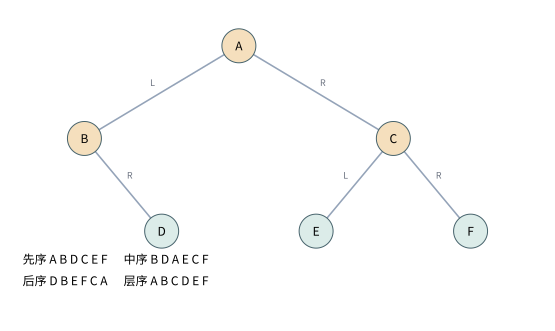

# PS05：树的箭头、遍历顺序和编码成本，一步一步核对

[教师原始习题单：第05次习题](../../HW/习题单/第05次习题.pdf)共37题。路径长度按边数，根深度0，叶高度0，空树高度约定为-1。先序为根—左—右，中序为左—根—右，后序为左—右—根。“真二叉树”指每个内部节点恰有两个孩子，不等于每层都满。

## 1 · 路径按边计：空走一步都没走，就是0

节点到自己的路径长0。u到v长a，v到w长b，若可沿树中同一路径接起来，总长就是a+b，不需要因为连接点v被数了两次再减1。

例如根R到A一条边，A到B一条边，R到B深度2。若按节点数，前两段各有2个节点，连接后却是3个，公式总要额外修正；按边计数与“每过一条链接深度加1”一致。

计数约定本身都可以定义，但后续高度递推、路径拼接、复杂度边界必须统一。看到别的书叶高1时，先做整体偏移换算，再判断公式是不是矛盾。

## 2 · 深度加高度不超过全树高度

设v深度d，从根到v有d条边；v的最深后代距v为h(v)，拼起来就是根到某个叶的路径，长d+h(v)。全树高度H是所有根叶路径的最大值，因此 $d+h(v)\le H$。

若v的子树中含有全树某条最深路径，取等；若v在较短的侧枝，便可能严格小于。例：根左链深4，右孩子就是叶。右孩子d=1、h=0，总1<4；左链中任一节点的深度加剩余高度都等于4。

不能把全树最长路径误当“必须经过每个节点”。这条不等式是在比较v所在的那条候选路径与所有候选的最大值。

## 3 · 三种树表示：多存一条边，省下哪种搜索

只有parent时，判断u是否为v祖先，可从v向上走到根，最坏O(h)。接入新节点时设置parent即可，但若要列出它的所有孩子，就可能扫描全体节点。删除整棵子树若无孩子索引，也需要先找到哪些节点属于它，不能只看摘根那一步。

只有孩子列表时，从u向下DFS能判断v是否属于其子树，最坏O(size(u))；要从全树删除子树根，还需知道它在父节点孩子列表中的位置，若没有parent或外部位置，可能先从根搜索。已知插入父亲和孩子序号时，插入成本还取决于孩子容器是数组还是链表。

parent加孩子列表兼顾上溯和下行，但每次接入、移动、删除都要两边同步。删除含s个节点的子树至少要处理这s个对象，故实际释放Ω(s)。

用一棵小树核对父表示的查询：A是根，B、C的parent为A，D、E的parent为B。问B是不是E的祖先，从E走到B就命中；问C是不是E的祖先，则E→B→A→空都没遇到C，拒绝。接入F为C的孩子，只写`parent[F]=C`便能表达这条父关系；但问“C有哪些孩子”时，只有parent数组就需扫描所有节点找parent等于C的项。一个方向的边能让上行容易，不会自动提供反向目录。

相同树下求D和C的LCA：深度D为2、C为1，先把D移到B，使两边都深1；B与C不同，一起上移到A，得到答案A。每次走向parent都会使深度减1，故至多高度量级。

求LCA时，有parent可先算深度、把更深节点上移，再同时上移，O(h)时间；没有parent，可从根找两条路径再比较最后公共位置，普通实现O(n)时间、O(h)路径空间。预处理倍增或时间戳能改进多次查询，但需要额外结构和预处理成本。

## 4 · 叶子总比双分支多一个：同一条边数两遍

非空树n个节点有n-1条边。另一方面，每个单分支节点向下贡献1条，双分支贡献2条，所以
$$
n_1+2n_2=n_0+n_1+n_2-1.
$$
消去n1，得到 $n_0=n_2+1$。再写 $e=n-1=n_1+2n_2$，可看见单分支越多，边数里越多是单链贡献。

真二叉树n1=0，于是 $n=2n_2+1$、$n_0=(n+1)/2$、$e=2n_2$。完全二叉树可以有一个单孩子节点，不能不看结构就套真树公式。

例：根有两个孩子，其中左孩子还有一个孩子。n0=2、n1=1、n2=1，边3=1+2，叶2=双分支1+1。手数一次，再对照公式，比直接背三个字母更稳。

## 5 · 长子—弟弟编码：一棵二叉树可能代表一片森林

约定左指针表示第一个孩子，右指针表示下一个兄弟。多叉树的根没有兄弟，因此它编码后的根右指针为空。任意二叉树若根有右孩子，按这套含义就代表根还有兄弟，更自然地对应森林，而非单棵树。

例如二叉根A的右指针指B，左指针指C，解码为两棵树：第一棵根A、孩子C，第二棵根B。不能把B同时当A的普通孩子，那会混用左右指针的含义。

把整树根在某些接口里视为虚拟父节点的右孩子，是为统一“指向该子树的入口引用”的约定；它不让真实根凭空多一个父亲，也不意味着根在长子—弟弟编码里有真实的右兄弟。

## 6 · 有序森林与二叉树：正反变换都写出来才叫一一对应

森林各根按从左到右用右兄弟指针串起来；每个根的孩子列表，首孩子接左指针，后续孩子也用右指针串起来。所有节点只保留这两类指针，就得到二叉结构。

具体把森林`A的孩子为[B,C]；B的孩子为[D]`和另一根E编码：

```text
原有序森林：           二叉编码（左=首孩，右=弟弟）：
    A       E                  A --右--> E
   / \                        /
  B   C                      B --右--> C
 /                          /
D                          D
```

真实的原树边有A→B、A→C、B→D；编码中的B→C却是兄弟边，不表示B是C父亲。解码A的孩子时，从A.left=B开始沿右链收集B、C；解码B的孩子时，从B.left=D开始，只收D。根A的右链给森林另一根E，不应把E放进A的孩子列表。

解码时，从二叉根沿右指针拆出森林的根序列；每个节点的左指针给第一个孩子，再沿这条孩子的右链列出其余孩子，逐个递归。顺序没有丢，层级也由左指针与兄弟链的位置唯一决定。

正变换后立刻反变换会恢复每个原孩子列表，反过来也恢复每一条二叉指针，所以既不会两个森林编码成同一结构，也不会遗漏某个二叉结构。无序树若本来没有兄弟顺序，就不具备这项同样的一一对应前提。

## 7 · 原题要求的真树：每个空位置都要补，包括旧叶子的两边

以下先设原树非空，n=n0+n1+n2，n0=n2+1。原题要求新树双分支数 $2n_2+n_1+1=n$，叶数 $2n_2+n_1+2=n+1$。正确转换是：把每个原节点都保留为内部节点，原来缺失的左、右孩子各补一个带标记的外部空叶。

原叶有两个空位置，要补两个；原单分支补一个；原双分支不用补。新外部叶总数 $2n_0+n_1=2n_2+n_1+2$；每个原节点如今都有两个孩子，新双分支数正是n，单分支为0。

例：只有一个原根A。补后是A连两个外部叶，内部1、外部2。若只给单分支节点补另一边，A一开始没有孩子，完全不补，这时仍只有一个叶，达不到题面要求的两个外部叶。只给单分支补孩子也是一种变成真树的方法，但它的节点数与本题指定的转换不同。

原树A只有左孩子B时，转换可以全部画出来。圆点`#`是带标记的外部叶，不是原数据节点：

```text
原树                  扩充后
  A                      A
 /                      / \
B                      B   #
                      / \
                     #   #
```

原来有2个节点、1条边、4个孩子指针槽，其中1个非空、3个空。一般n个原节点有2n个孩子槽，非空槽恰好对应n−1条边，所以空槽为$2n-(n-1)=n+1$。补每个空槽一个外叶，正好得到n+1，不依赖原树是否有单分支。这是与$n_0=n_2+1$推导独立的第二次核对。

保留外部叶标记，逆变换删除所有外部叶即可唯一恢复原树。标记不能与普通数据值混用，否则真实节点恰好也存“空”字样时会有歧义。

## 8 · 高度更新：某处没变，往上的高度也不会变

高度由两个孩子高度决定，$h(v)=1+\max(h_L,h_R)$。一次局部修改只影响一条祖先路径；若更新到某祖先a，发现h(a)与旧值相同，那么a的父亲看到的这个孩子高度没变，另一孩子又没改，因此父高也不变，往上同理。

插叶、删叶、接入整棵子树、分离子树都适用这个逻辑，但必须从真正受影响的入口向上，并在改完孩子链接后重算。高度不变不表示size没变；若还维护节点数、和或其他统计，不能一并提前停。

需要把其他缓存与高度分开：原节点A的左子树高度2、右子树高度0，所以A.height=3。向右子树插一个叶，让右高变1，A.height仍为3，可以停止高度传播；但A.size已经加1，所有祖先的size也都应加1。若把`if(newHeight==oldHeight) break`放在同时更新height和size的循环里，会少更新上层size。提前停止只适用于已经证明不变的那一项统计。

例：根两边高度分别3和1，在较短一边增加到2，根高度仍4，继续往更高处传播高度就是多余。最坏插在唯一最长链末端，高度一路变到根，优化仍O(h)，只是某些修改能提前结束。

## 9 · 勤奋缓存与懒惰计算：用操作序列算总账

若每次求height都遍历子树，单次可能O(n)；缓存height后查询O(1)，但修改时需向上维护。size也一样：即时维护使size查询常数，代价是每次接入、删除、旋转等都正确更新。

例如一天修改100次、查询一百万次，缓存常常合适；一天改一百万次、只查一次，按需遍历可能更简单。要把树高、子树规模和查询频率代入，而不是认为“勤奋一定更好”。

维护多个缓存还会增加一致性风险：旋转后必须先更新低节点，再更新高节点，使父读到的新孩子信息正确。测试除了最终值，还要在每次修改后用独立遍历结果核对缓存。

## 10 · 中序在单侧链上：空调用忽略后，看剩余工作

全右链中序先遇空左树，然后访问当前，再递归右树，右递归之后没有剩余访问工作，可按尾递归化。全左链则先递归左边，再返回访问当前，访问工作都积在返回路上，是头递归形状。

一般树左右都有非空分支，不能同时把两条路径都压成同一种单链循环。空子树调用仍有固定检查成本，讨论形状时可以忽略它，但实际计费不要说从未执行过。

以A右连B右连C，中序就是A、B、C，可直接循环；A左连B左连C，中序应为C、B、A，要记住祖先或借助结构回溯，不能从根一路输出。

## 11 · 单链先序：只向前走，不需要parent

每节点最多一个孩子时，先访问当前，再把p设为唯一的非空孩子，直到空。因为没有另一棵尚未处理的侧树，不需要返回祖先寻找分支。

时间Θ(n)，辅助空间O(1)，即使没有parent也完全可行。若递归版编译器没有尾调用优化，它会保留n层；显式循环才把空间保证写进实现。

这项简化依赖“最多一个孩子”。一般树中若先深入左边，右边还没处理，需要保存任务；删去parent并不会删去这些待办任务。

## 12 · size访问器：只要不重不漏，哪种遍历都能数

定义Count含value，visit每到一个真实节点就加1。先序、中序、后序、层序都访问每个节点一次，所以最终都为n；空树为0，外部空叶是否算节点必须按所求结构定义。

求所有data总和、检查每项是否在某范围，也可这样写。若要计算“每个节点子树大小”，单纯给全局计数器加1不够，需要把左右子结果汇回父节点，后序更自然。

函数对象按引用还是值传递也要核对，避免最后外部计数仍0。遍历的抽象复用建立在任务真正只需要一次单节点访问的前提上。

## 13 · clone：中序、后序都能复制，但要保存结构位置

后序做法：先复制左子树得到L，再复制右子树得到R，然后新建根并接上L、R。先序则先建根，再递归填两边。二者都能保持形状，且每个原节点对应一个独立新节点。

中序也可以先复制左边，保存结果L，创建当前根，再复制右边并连接；不能因为“根在中间创建”就说不可能。要保存孩子身份，而非仅把中序值输出，再当作BST插入，那会改变原形状。

后序复制的最小实现可直接对照结构：

```text
clone(p):
    若p为空，返回空
    L = clone(p.left)
    R = clone(p.right)
    q = 新建与p数据相同的节点
    q.left=L；若L非空则L.parent=q
    q.right=R；若R非空则R.parent=q
    更新q的height/size
    返回q
```

对原树A左B右C，先创建新B'，再C'，最后A'，连接A'.left=B'、A'.right=C'。根数据相同但地址不相同，且B'、C'都不指回原A。只复制中序`B,A,C`并逐项插入BST，可能得到根B、右A、A右C，与原形状不同。复制值序列不能代替复制孩子位置。

无论哪种都需Θ(n)新输出存储，递归栈最坏O(h)。若构造中途失败，还要释放已经复制的部分或使用资源管理对象，避免只在完全成功的路径上没有泄漏。

## 14 · 打印树：缩进只说明深度，还需要说明哪条边

若每层缩进两格，只能看出节点深浅，不一定知道它是哪个父亲的左或右孩子。完整打印还需保存左右分支身份，以及哪些祖先层还有未打印的兄弟，用来决定竖线是否继续。

可以先打印右子树、再根、再左子树，让树向侧面展开；也可以先序打印带“L/R”的路径。选择一种后把图例写清，避免读者把上方节点误当左孩子。

先序带路径打印适合最早的自检。例如树A左B右C，B只有右孩子D，应输出：

```text
root: A
L:    B
L/R:  D
R:    C
```

`L/R`表示从根先走左边、再走右边，所以D是B的右孩子。若只缩进，`D`出现在深度2，读者仍可能误以为B有左孩子。路径文字与图中空位置一起保留，就能验证分支方向。

用一棵左右高度不同、有单孩子且有空位的小树核对，比用满树更能暴露错误。打印是显示接口，不能通过交换真实孩子指针来“画得好看”而改变树。

## 15 · 清空不只允许后序，但绝不能释放后再读

后序先清左右，再删根，最容易保证仍能找到未处理节点。先序也可先保存left、right，再delete根，再用保存的地址清左右；删除根后不能再读它的字段。

中序可先清左，保存右指针，再删根，然后清右。对象析构若会自动递归释放孩子，就不能同时再手工递归，否则双重释放；所有权策略必须统一。

各种顺序都能做到Θ(n)，差别在于保留哪些地址、析构副作用和代码可验证性。正确性由生命周期与剩余对象可达性决定，不是某个遍历名字天然授予安全。

## 16 · 从RPN建树：栈里放的从数字变成子树

遇操作数就建叶节点入栈；遇二元运算符，先弹右子树R，再弹左子树L，新建运算符根并接上L、R；遇一元后缀运算则只弹一棵树。

例如 `2 3 4 + *`：先有叶2、3、4，+弹4和3，形成根+的子树；*再弹这棵右子树和叶2，得到2*(3+4)。最后栈恰有一棵树，便是答案。

栈里每项是一整棵已经建好的子树，不能把“栈中多个节点”误连成一棵链：

| 读token | 操作 | 栈（底→顶；用括号表示子树） |
|---|---|---|
| 2 | 建叶2 | `[2]` |
| 3 | 建叶3 | `[2,3]` |
| 4 | 建叶4 | `[2,3,4]` |
| + | 弹右4、左3，建`+(3,4)` | `[2,+(3,4)]` |
| * | 弹右`+(3,4)`、左2，建`*(2,+(3,4))` | ` [*(2,+(3,4))]` |

归纳不变量是：已经消耗的RPN前缀被栈中这些互不相交的完整子表达式恰好分解。遇运算符合并的就是最近完成的几个子表达式，顺序由先左后右的后序决定。每个token创建一个节点、每条孩子边写一次，故时间线性，输出树也必须占线性空间。

执行前检查元数，结束检查剩余棵数；`2 +` 操作数不足，`2 3` 留下两棵，都不合法。固定token与元数后，树结构可唯一恢复；若同一符号有不明确的一元、二元含义，还需词法或语法信息。

## 17 · 沿右藤的“对称版”，会不会把先序变成根右左

直接访问根后一路深入右边、把左子树暂存，得到的是根—右—左，并非要求的根—左—右。若只是把lc与rc交换，必须同时承认遍历定义变了。

沿右藤分解时，可以把基本工作改成“访问藤上当前节点，完整处理它挂着的左子树，再沿右边走一步”。左子树仍必须先完成，不能把整条右藤预先访问完。直接写出来是：

```python
def preorder_right_vine(node, visit):
    while node is not None:
        visit(node)
        preorder_right_vine(node.left, visit)
        node = node.right
```

while负责沿当前右藤前进；递归负责侧面的整棵左子树。没有左孩子时，空调用立即返回；有左孩子时，调用结束前不访问当前节点的右孩子。这正好保持根—左—右。



取A左B、右C，B右D，C左E、右F。访问A后，先进入左子树B；访问B，左边空，沿B的右藤访问D。整个B子树完成，才回到A那一层沿右藤到C；访问C，递归访问E，再沿右藤访问F。输出为A、B、D、C、E、F。若先扫A、C、F再补B、D、E，先序就被破坏了。

这个版本把右方向改成循环，递归栈只为尚未处理完的左侧调用保存返回位置。全右链只需常数层调用，全左链却要Θ(n)层；时间仍Θ(n)，一般辅助空间O(h)。沿左藤的迭代版则显式保存待办右子树，两者保存的位置不同。递归版在长链上还可能超过语言的调用深度限制。

若要把上述左递归也改成显式栈，离开当前节点进入左边之前，就保存它尚未继续的右藤起点；左侧完成再恢复：

```python
def preorder_right_vine_iter(root, visit):
    resume = []
    node = root
    while node is not None or resume:
        if node is None:
            node = resume.pop()
            continue
        visit(node)
        if node.left is not None:
            if node.right is not None:
                resume.append(node.right)
            node = node.left
        else:
            node = node.right
```

栈内每项都是“当前左侧工作完成后，接着处理这段右藤”的任务，最后存入者最先恢复。它与常见的“先压右、后压左”任务栈在访问顺序上等价，但这里不必把立即要走的左孩子也压栈。两种写法都没有更好的普遍时间阶；优缺点要比较具体树形上的待办数量、调用开销与实现清楚程度。

## 18 · 先序正确性：按整树规模归纳，侧枝也要包括

空树无输出；单节点访问一次正确。对更大树，沿左藤访问根及各左后代，并把每处右子树压栈。最深处的右侧任务最后压入，最先弹出，正好符合先做完当前左子树内部，再返回更高祖先处理右树的顺序。

每个被压的右子树规模小于原树，且彼此不重叠，归纳假设保证它们各自按先序完成。藤节点与这些侧树恰好覆盖原树，所以不漏、不重、次序正确。

若只归纳藤长度，外挂侧树可能比整条藤大得多，原归纳假设未必覆盖它们。可以增强命题，让它对任意合法侧树也成立；不能只把参数名字从“规模”换成“藤长”就算证明。

## 19 · 不压空右树：减少无效栈动作，但加了一次判断

原先无条件压右孩子，可能压入nullptr；弹出后又立刻发现为空。改成右孩子非空才压，就消去这些无效push和pop。

对全左链，若原版每层都压空右树，会积累很多空任务；去掉后待办栈可以显著缩小。对几乎每个节点都有右孩子的树，新增判断很少省动作。

总时间仍Θ(n)，在不同编译器与数据下实际净收益需要测量。能严格说少做了哪些栈操作，不应直接保证所有机器上运行时间都按同一比例下降。

## 20 · 先序栈空间：高度是上界，待办右树数更贴切

沿左藤版栈保存还没访问的右子树根。当前路径每经过一个“走向左孩子、右边还有任务”的祖先，最多增加一个待办，因此栈长不超过相应左祖先数，进而不超过O(h)。底部哨兵或当前节点另加常数。

全右链高度n-1，几乎没有左祖先，待办栈可常数；全左链若不压空右树，也可以常数。若长左链每个祖先还挂一个真实右叶，走到底时会同时积累约h个右任务，达到高度阶。

原题c、d要求构造极端树，不只报一个$O(h)$。若只统计非空右任务：全右链长n，高度n−1，最大左祖先数0，显式待办栈峰值0（连当前指针一起计也只多常数）；高度上界可比实际大线性倍。要让左祖先数与高度相同，可取每一步都走左的深链；若还要求**实际栈任务**达到高度阶，就在左链每个非末节点挂一个右叶，下降时分别留下这些右叶，走到底同时有h个待办。

```text
        A
       / \
      B   a
     / \
    C   b
   / \
  D   c
```

访问A、B、C、D时，栈中的非空右任务依次为`[a]、[a,b]、[a,b,c]、[a,b,c]`，底层任务c最先恢复。树高3，待办峰值3。左链若完全不挂右叶，左祖先数仍大，实际非空任务却为0，说明这个数量是上界而非每棵树的精确等式。

题目问两个上界之比的数学期望，必须说明树形与选点分布。左右方向独立对称的一条固定路径，其左转次数期望是路径长一半；但“全树最大左祖先数/全树高度”的期望不是因此自动一半。max与期望以及比值都不能随意交换。没有随机模型，不能给出普遍数字。

## 21 · 中序归纳：左藤只是拆解入口，不是全部规模

中序先沿左藤把祖先压栈，直到最左节点；弹出当前访问，再把其右子树按同样方式展开。整棵树规模归纳可以直接覆盖左右两个更小子树。

对文中的弯曲树，完整中序栈过程是：

```text
A左B，B右C，C左D。
沿左压A、B，栈[A,B]，当前到空。
弹B并访问，输出B；转B.right=C。
沿左压C、D，栈[A,C,D]，当前到空。
弹D访问，输出B,D；D.right为空。
弹C访问，输出B,D,C；C.right为空。
弹A访问，输出B,D,C,A；结束。
```

每次弹出的节点，其左子树已经完成，自己访问后再转右子树。等待中的A不会在B结束时被马上访问，因为B的右子树C已经被安排在A之前。这就是栈的后进先出与中序要求相符的具体位置。

若以左藤长度归纳，需要把“藤上每个节点挂着任意右子树时，算法仍正确处理它们”写进命题，并独立保证这些侧树的正确性。只讨论藤本身的访问顺序不足以证明整棵树。

用根A、左B、B右C、C左D的小树测试：中序应B、D、C、A。它很容易揭穿只按一条直链推理、漏掉弯曲侧枝的证明。

## 22 · 最后一个中序节点：一路向右后，再向上越过根

中序最后访问整树最右节点。它没有右子树，否则右子树中还有更晚节点。求succ时，若有右子树应取其最左节点；没有就向上，直到第一次从某祖先左侧返回，该祖先才是后继。

对于整树最右节点，向上始终处在祖先右侧，最终越过根得到nullptr。因此算法应在访问parent前判空，不能再从根去读不存在的父节点。

最小树只有一个根，它也是最后节点，succ直接为空。测试这个例子能检查代码是否把“根无父亲”的边界遗漏。

## 23 · 没有parent，也能后序：自己保存返回阶段

栈保存(node,stage)。stage=0时准备处理左边，改成1后压左孩子；stage=1时左边已完成，改成2后压右孩子；stage=2时左右都完成，访问当前并弹出。

```python
def postorder(root, visit):
    stack = [(root, 0)] if root is not None else []
    while stack:
        node, stage = stack.pop()
        if stage == 0:
            stack.append((node, 1))
            if node.left is not None:
                stack.append((node.left, 0))
        elif stage == 1:
            stack.append((node, 2))
            if node.right is not None:
                stack.append((node.right, 0))
        else:
            visit(node)
```

以A左B右C走程序：栈先`[(A,0)]`；处理阶段0后变`[(A,1),(B,0)]`；B没有孩子，依次改为B的阶段1、2，然后访问B并弹掉；恢复A阶段1，改存A阶段2并压C；C同样完成三个阶段、访问C；最后弹A阶段2并访问。输出B、C、A。每个父帧在压孩子**以前**已改好下一阶段，所以孩子返回后不会再次从阶段0开始。

这相当于把语言调用帧的程序位置显式存出来，时间Θ(n)、辅助空间O(h)。parent指针是获得返回方向的一种办法，不是唯一办法。

## 24 · 后序正确性：访问条件就是“两棵子树已完成”

对每个帧，阶段只按0→1→2向前推进。进入阶段1前左子树任务已执行完，进入阶段2前右子树也已执行完；因此访问根时，恰好符合左—右—根。

每个非空孩子只由唯一父帧压一次，树没有共享孩子或环，所以不会重复。空孩子直接跳过，不影响阶段含义。按子树规模归纳，两个子任务各自输出正确，接上当前根便正确。

如果输入其实是共享子图或有环，这份树遍历可能重复或不结束，需要visited和另一种语义。先把“是合法树”写成前提，证明才不会偷换对象。

## 25 · 迭代遍历总时间：一次下藤走h步，不能给每个节点都收h步

先序每个节点访问一次，其右任务至多压弹各一次；中序每个节点压一次、弹一次；阶段式后序每个节点只经历固定三阶段。合计都Θ(n)。

内层while偶尔走很长一条藤，但这条藤上的节点随后不会在别处再次作为新的未访问节点下藤。把所有内循环迭代相加是n量级，不能看到嵌套循环就相乘。

若算法每次求succ都从根重新搜索，或每次重算整棵子树信息，已经不是这里被分析的迭代版本，可能增加成本。复杂度结论应绑定到真实的节点进出次数。

## 26 · 层序遍历：队列里为什么只会混着相邻两层

先把根入队。每次弹一个节点v访问，再按左后右把其孩子入队，孩子深度仅比v大1。FIFO保证当前层尚未处理节点在前，刚发现的下一层孩子排在后，所以队列深度非降，最多差1。

归纳可知根先到，每个非根节点恰由唯一父亲发现一次。每个节点入队一次、出队一次，因此总Θ(n)。同层左先右后来自孩子入队顺序；若调换左右，深度顺序仍正确，但同层阅读方向会变。

用原题下一问的5节点例列全队列：根R左A右B，A左C右D。

| 本次弹出访问 | 新加入的孩子 | 操作后的队列（左为队首） | 深度序列 |
|---|---|---|---|
| 尚未开始 | 先放R | `[R]` | `[0]` |
| R | A、B | `[A,B]` | `[1,1]` |
| A | C、D | `[B,C,D]` | `[1,2,2]` |
| B | 无 | `[C,D]` | `[2,2]` |
| C | 无 | `[D]` | `[2]` |
| D | 无 | `[]` | `[]` |

处理A以后当前层还剩B，下一层C、D已经到尾部，两层同时存在；但深度差从不超过1。每一轮一定弹1个，加入可以是0、1、2个，所以队列长度并不单调。

“左边更早”只能对同层按该有序树定义解释。一个很浅的右节点会早于深处左节点，不能把全树横向位置当成绝对处理次序。

## 27 · 层序空间：队列可能比某一层还稍宽

设最大层宽w。队列可能同时包含当前层剩余部分与下一层已发现部分，故不一定恰好≤w，但最多是相邻两层的总宽，仍O(w)。单链每次队列最多1，完全树可线性大。

更精确地，队列每个节点代表一棵互不相交的尚未处理子树，每棵至少包含一个不同叶子，所以队列长度不超过叶子总数。非空二叉树叶子最多 $\lfloor(n+1)/2\rfloor=\lceil n/2\rceil$，完全二叉树可以达到这个数量级，且这种BFS队列也能达到该上界。

例如n=5完全树，根孩子A、B，A有C、D。处理A以后队列为B、C、D，长度3；最大单层宽却只有2。这一小例解释了为何空间Θ(w)不表示每时每刻精确等于某层宽。

## 28 · 完全树放进数组：父子下标怎么算

零基存储时，节点i的左孩子2i+1、右孩子2i+2；i>0的父亲为 $\lfloor(i-1)/2\rfloor$。存在与否只需检查孩子下标是否小于n，不能先访问再判断。

根0，下一层1、2，再下一层3、4、5、6。这些区间连续，因此层序扫描局部性很好；沿一条深路径，下标却按倍增跳跃，不能保证每对父子都物理紧挨。

完全性保证中间无空洞；任意稀疏树硬放这种数组，深单链可能需要指数大的空位置。适用条件与缓存收益都要按访问模式说明。

## 29 · 真树先后序重建：第二个先序项给出左子树范围

假设标签互异，且给的是同一棵真二叉树。先序首项和后序末项必须是同一个根；若不止一个节点，先序第二项就是左子树根。到后序中找它，可得到整个左子树的末端与长度，从而把两个序列都切成左右两块递归。

例如先序A,B,D,E,C，后序D,E,B,C,A。根A，左根B在后序下标2，左块长度3；递归左块得到B的孩子D、E，右块只有C。真树保证根不可能只有一支，消除了“这段到底左子树还是右子树”的歧义。

把两次递归切分写得更具体。下标采用从0开始的半开区间：

```text
pre = [A,B,D,E,C]       post = [D,E,B,C,A]
根A：pre[0] == post[4]
左根B在post[2]，左子树长度=2-0+1=3
左：pre[1:4]=[B,D,E]，post[0:3]=[D,E,B]
右：pre[4:5]=[C]，    post[3:4]=[C]
左根B：其左根D在左post的第0位，左长度1
于是B.left=D，B.right=E；C是叶。
```

得到的形状是：

```text
        A
       / \
      B   C
     / \
    D   E
```

若不是叶，真树要求左右两块都非空，且每块节点数为奇数；例如只剩2项却试图构造真树，应报告输入不合法。保留四个边界下标而不反复切片复制，才能达到线性总工作；用Python切片直接实现会额外复制子数组，不能仍把这些复制当免费。

用标签到后序位置的字典可使定位期望常数，总体O(n)；若每层线性找标签，退化树形可二次。还要验证左右块均合法、根标签一致、标签集合一致，不能把不一致序列强行拼成树。

## 30 · 增强遍历：空标记能救先序、后序，救不了中序

先序读一个token，若是#返回空；否则建根，再依次读取左、右子树。对 `A B # # C # #`，先建A，左建B并读两个空，右建C并读两个空，边界被递归结构唯一确定。

增强先序的反向恢复不用猜哪个子树在哪结束：读到A要继续恢复两个孩子；读到B也要继续恢复两个孩子；两个#分别让B.left、B.right为空，返回B；再读C，读完它的两个#返回C；最后A的两个孩子都齐，返回A。递归中的“还欠几个孩子”就是边界信息。

```text
读取后：A             读取B,#,#后： A       全部完成： A
                                    /                  / \
                                   B                  B   C
```

反读增强后序时规则对称：最后一个真实token是根，接着最先读到的是右子树的末根，所以必须先建右、后建左。先后顺序弄反会得到镜像树，值集合一样，结构却错。

后序从末尾反读，遇根后先恢复右、再恢复左，同样唯一。每个真实节点和空位置读一次，时间线性，还要检查最后有没有多余token。

中序增强不唯一：A只有右孩子B，与B只有左孩子A，都会给 `# A # B #`。空标记本身不自动记录根在哪，所以“所有增强序列都能唯一重建”是错误推广。

## 31 · 组合重建：每个“唯一”都带着前提

互异标签下，先序给根、中序给左右分界，故先+中唯一；后+中同理。普通先+后对单孩子方向无解：A左B和A右B的先序都A,B，后序都B,A。

加上真树条件可排除单孩子歧义，如前题。层序加中序也能逐层选出各区间最早出现的根来重建，但单独层序只有访问顺序，不能决定哪些边存在。

层序+中序也走一个例：层序`[A,B,C,D,E]`、中序`[D,B,E,A,C]`。层序最早的A为根，中序把左边切成D、B、E，右边为C；在左集合中，层序最早出现的是B，故左根B，再由中序分出左D右E；右边只有C。得到与前题同一棵树。朴素每层筛一遍层序可能$O(n^2)$，唯一性成立不代表任意构造实现都已经线性。

标签重复时，连先+中也可能不唯一，必须为不同节点加身份或另外约束。先检查输入条件，再选重建方法，不能只拿两个遍历名称就保证有解且唯一。

## 32 · 交换子树：成本差由总权与深度差决定

两棵互不为祖先后代的子树根深d1、d2，总权W1、W2。交换后各叶内部相对深度不变，第一棵整体移动d2-d1层，第二棵反向移动，因此
$$
\Delta C=(W_1-W_2)(d_2-d_1).
$$

若较大权W1原来更深，即W1>W2且d1>d2，则差为负，成本下降。权相等或深度相等只保证不变，不能说严格下降。

把差分逐项展开。交换前这两棵子树的每个叶深都可写成“子树内部深度+子树根深度”。内部深度不变，其对应成本会完全抵消；只剩根深度项：

$$C_{\text{后}}-C_{\text{前}}=W_1d_2+W_2d_1-W_1d_1-W_2d_2
=(W_1-W_2)(d_2-d_1).$$

$W_1$是第一棵子树所有叶权之和，不是子树根原来的data；$d_1$是交换前该根距整树根的边数。若把单个叶权与整棵子树总权混用，计算会少掉内部其他叶整体移动的贡献。

例W1=10、W2=3，深度3与1，交换差(10-3)(1-3)=-14。若一棵包含另一棵，直接交换会破坏树，不能把同一公式不加结构限制地套用。

## 33 · Huffman最优：贪心选择要能嵌进某棵最优树

先取最小两权a、b。在一棵最优真编码树里选最深的一对兄弟叶，把a、b交换到这两个位置。最小权放得更深不会增加成本，故存在一棵最优树让它们为兄弟。

把这对兄弟缩成权a+b的叶，原树成本恰等于缩小树成本再加a+b。若缩小树不是最优，换成更优的小树再展开，就会改进原最优树，矛盾。因此在缩小问题上继续做同样贪心，按叶数归纳得到最优。

交换论证中，“最小权放深处”可以直接算：若$a\le w$而a原在深度$d_a\le D$，把它与深度D、权w的叶交换，成本变化为$(a-w)(D-d_a)\le0$。先放a，再放b；最深的两个兄弟位置深度相同，第二次不会增加已放好的a的成本。最深叶的兄弟必须也是叶，否则兄弟的后代更深，矛盾。于是找到的是**一棵同样最优且具有贪心第一步的树**，不需要断言所有最优树都只有同一个形状。

缩成一叶时，原a、b比合并叶都多1层，所以展开额外成本恰好是$a+b$。这也是“每次合并和的总和等于最后WPL”的来由：每次合并为其子树的每个叶深加1，累计到叶上就是权重乘最终深度。

对[2,3,7,8]，先合2+3=5，再5+7=12，再12+8=20，WPL为5+12+20=37。展开树的叶深分别3、3、2、1，直接算2×3+3×3+7×2+8×1也为37。两个算法得到不同左右码字不一定有错，最优编码树可能不唯一。

## 34 · 框架与森林容器：换容器要重新带入成本

核心框架只有：取两个最小根、合并为新根、把新根放回，直到剩一棵树。它依赖优先队列能力，不必知道底层是无序数组、堆还是两个有序来源。

无序数组每轮线性找最小，n轮可二次；小根堆每次取最小、插入均O(log n)，总O(nlog n)。初始建堆可以线性，但后面n-1轮合并仍在。

接口隔离让框架可复用；复杂度分析却不能对不同容器照抄一个数字。源码中找到森林类型、取最小和插回的位置，再把每项成本相加。

## 35 · 双队列Huffman：线性的是已经有序之后的合并阶段

原始权重升序放在一个来源，新合并的权放第二个队列。每次只比较两个队首，从中取全局最小的两个。新合并权按生成顺序不减：下一轮取到的两个可用最小值，不会产生比上次合并和更小的新和。

原输入[1,2,4,8]：取1、2得3，合并队列[3]；取3、4得7；取7、8得15。每个原项与合并项进出常数次，有序合并阶段O(n)。

每次取出两项时都重新比较两个来源的队首，而不是先在一个来源拿齐两项。例如原权`[1,2,4,8]`：

| 轮 | 轮初原队列 | 轮初合并队列 | 依次取两最小 | 轮后合并队列 |
|---:|---|---|---|---|
| 1 | `[1,2,4,8]` | `[]` | 1、2 | `[3]` |
| 2 | `[4,8]` | `[3]` | 3来自合并队、4来自原队 | `[7]` |
| 3 | `[8]` | `[7]` | 7、8 | `[15]` |

有序性的严格理由是：设本轮取$x\le y$，此前所有未取项都≥y；插回$x+y$也≥y，因为权非负。下一轮取的两个数都≥y，所以新和至少$2y\ge x+y$。因此合并队列尾部追加仍非降。若允许负权，这一步就失去依据，题目的非负频数条件不能省。

用栈存原权时，应让最小项在栈顶，即压入方向相反；换成升序队列也一样。若原权未排序，前面的排序一般O(nlog n)，因此原题总复杂度仍O(nlog n)，不能把后半线性当无条件总线性。

## 36 · 平均比较排序下界：少数短路径救不了所有排列

互异n项共有n!个等概率排列，每个对应决策树一片可区分叶，深度di是比较次数。二叉树满足Kraft界 $\sum2^{-d_i}\le1$，且函数 $2^{-x}$ 凸，所以
$$
2^{-\bar d}\le\frac1{n!}\sum_i2^{-d_i}\le\frac1{n!},
$$
得到 $\bar d\ge\log_2(n!)=\Omega(n\log n)$。

上式中的Kraft界可以不用新术语直接看成空间分配：给二叉决策树根一个长度1的区间，每比较一次把当前区间平分给两个孩子。深度$d_i$的叶占长度$2^{-d_i}$，不同叶区间不相交，所以总长≤1。设$N=n!$，这N个长度的几何平均不超过算术平均，于是

$$\left(\prod_{i=1}^N2^{-d_i}\right)^{1/N}
=2^{-(d_1+\cdots+d_N)/N}
\le\frac{\sum_i2^{-d_i}}N\le\frac1N.$$

两边取以2为底的对数再改符号，便得到平均深度$\bar d\ge\log_2N$。最深叶只约束一个输入；这一平均数不等式把所有叶都算进来，因此才能回答本题。

也就是说，哪怕某些输入一眼就能认出，其他分支必须付出足够比较，均匀平均仍不能突破此界。若输入分布高度集中，平均下界应该用其信息量重新描述；若采用整数桶、位运算等超出比较模型的操作，也不能把这条下界照搬过去。

随机算法还需说明平均是在输入随机、内部随机，还是两者共同取期望。证明固定比较树的均匀平均后，对内部随机选择的树再平均，仍能得到相应下界。

## 37 · 编码构造下界：限定比较模型，再构造足够多的输出

这里讨论任意未排序正实权重、仅通过比较区分大小、输出带原字符标签的最优树。已排序权重的线性合并没有违反下界，因为排序信息已经作为输入给出了；受限整数模型也可能有其他手段。

可取一组增长极快的固定权重，后一权重远大于前面所有权重之和的n倍，再把字符标签任意置换。这时最大权必须在深度1：让它多一层的损失，大于其他所有叶在至多n-1层内调整所能补偿的总量。移去最大叶后对剩余子树重复，最优树被迫呈梳状，依次用深度暴露各权重名次，只有最小两叶可互换。

例如权重1、10、100、10000，四叶的梳形最优深度为3、3、2、1。10000若被放到深度2，光它一叶就多付10000；把它换到深度1后，其余权总和111即使多移动最多3层，也补不了这个损失。接着在剩下3叶里，100也被迫比1、10更浅，最后1、10同深可以互换。把四个字符标签任意分配到这四个权重，树的叶深至少区分$4!/2=12$种名次信息。

一般构造要求每个更大权$W$大于$n$倍所有较小权之和S。若最大权不在深度1，成本至少$2W$；而存在一棵把它放深度1、其余叶深不超过n−1的候选树，成本至多$W+(n-1)S<2W$，矛盾。去掉这个最大叶后，另一侧子树必须也是剩余权的最优树，再递归使用相同条件。这个候选成本比较补上了“增长足够快为何强迫梳形”的必要一步。

所以至少有n!/2类必须区分的带标签输出，二叉比较树需 $\log_2(n!/2)=\Omega(n\log n)$ 深度。也可把问题看成：构造后在线性时间读出深度顺序，便得到这个受限排序族的排序信息。

Huffman树是最优树的一种，因此同一组强分离输入也约束其构造。不能把“任意树的任意层序遍历一定按所有叶权排序”当成无条件事实；左右孩子可交换，同层叶也可能需要额外安排。下界应建立在明确可区分的信息上。

## 本章练习与核对

1. 原树仅A左孩子B。扩充全部空位置后，内部、外部叶各几项？若只给A补右孩子，会漏什么？
2. 给先序A,B和后序B,A，画出两棵可能树；加什么条件才能排除这种歧义？
3. 权重1、2、4、8做双队列Huffman，每轮取哪两项，最终WPL多少？

第一题：原节点n=2，扩后内部2、外部叶3；A右边补1个，B左右各补1个。仅给A补右边会让B仍是普通叶，达不到原题“每个原节点成为内部”的计数。第二题：A左B与A右B均符合；要求真二叉树后，这个双节点输入本身不合法，并非随便选一棵就解决。第三题：1+2=3，3+4=7，7+8=15，WPL=3+7+15=25；叶深3、3、2、1，直接1×3+2×3+4×2+8=25核对。
