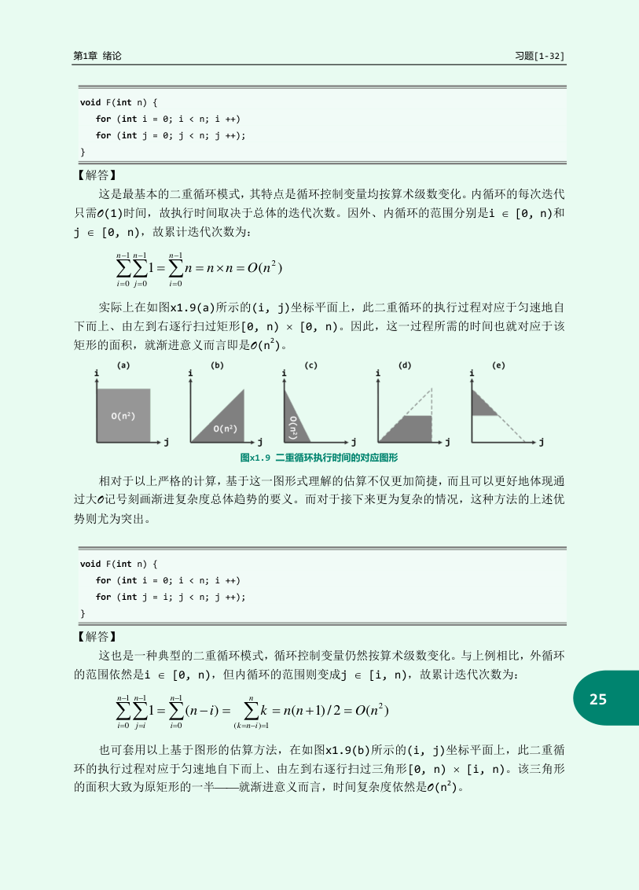

# 习题1-32：把十六段程序逐层数清楚

PS01第16项让我们独立分析《数据结构习题解析》1-32。本章对应作者官方合体PDF第446到455页，亦即习题解析印刷页24到33；第456页为空白。原程序可从[作者教材页](https://dsa.cs.tsinghua.edu.cn/~deng/ds/dsacpp/)进入合体PDF阅读。下面保留题号顺序，用自己的推导解释每段执行成本，并把容易混淆的返回值、轮数与递归深度分别列出。

题目使用抽象机器，假设字长足够、移位是单位操作、递归不会因真实机器栈限制而失败。这里的T表示执行成本，V表示返回值。把原程序直接交给固定字长C++运行，可能先遇到溢出或非法移位；若用大整数，又要另算位成本。这些实现边界不改变题目指定模型下的推导，却决定实验能测到什么。

## 1：矩形循环区域，行数乘列数

控制代码（按原题端点）：

```cpp
for (int i = 0; i < n; ++i)
    for (int j = 0; j < n; ++j) { /* 计一次 */ }
```


第一段的核心是n轮外循环，每轮n次内循环。若把一次主体执行画成坐标(i,j)，正好是n×n方格，每格访问一次，总n²次。

n=4时，每行4次，共4+4+4+4=16次。每个循环还要增加变量、检查条件，内层条件每行约n+1次，总也为Θ(n²)，不会改变阶。基础操作不是只有函数体里面那一条，但主项可由它代表。

把n=3的每一个内层状态列出来，就得到坐标格，不依赖“二重循环”这个外观：

```text
外i=0：j=0 → 1 → 2，3次；j变3，条件失败。
外i=1：j重新置0，再走0 → 1 → 2，3次。
外i=2：j又重新置0，再走0 → 1 → 2，3次。
i变3，外条件失败；总9次主体。
```

每次重入内循环都会重新初始化j，所以它不是“j只从0走到n一次”。



上界是常数倍n²，下界同样至少有n²次主体，因此为Θ(n²)。若只写“有两层for所以平方”，这份理由在第6与第8段就会失效；这里正确是因为每行确实有n项。

## 2：三角形区域，逐行长度不同

控制代码（按原题端点）：

```cpp
for (int i = 0; i < n; ++i)
    for (int j = i; j < n; ++j) { /* 计一次 */ }
```


第二段内层从当前外层位置扫到边界。各行长度依次n、n−1、…、1，因此

$$N(n)=\sum_{i=0}^{n-1}(n-i)=\frac{n(n+1)}2=\Theta(n^2).$$

n=4时为4+3+2+1=10。它大约是第一段的一半，但渐近阶相同。判断下界可只看前n/2行：每行至少n/2次，已足以贡献常数倍n²。

n=4时每行实际j值是`i=0:0,1,2,3`；`i=1:1,2,3`；`i=2:2,3`；`i=3:3`。将第1行与第4行相加是4+1=5，第2行与第3行也是3+2=5，共两对得到10。一般把1到n与倒序n到1相加，每对为n+1，共n对，再除2，得到$n(n+1)/2$。求和公式不是额外假设，而是把同一批行长度配对。

如果循环端点改为不含当前位置，各行变n−1、…、0，精确次数变n(n−1)/2，仍平方级。端点差一会影响精确值，不能在考试问“执行几次”时直接忽略；问Θ时才可在证明后舍去低阶项。

## 3：内层步长2013，常数再大也仍是常数

控制代码（按原题端点）：

```cpp
for (int i = 0; i < n; ++i)
    for (int j = 0; j < i; j += 2013) { /* 计一次 */ }
```


内层每次增加固定2013，第i轮约执行i/2013次。取整误差每轮至多常数，总误差O(n)，主和为

$$N(n)=\sum_{i=0}^{n-1}\left\lceil\frac{i}{2013}\right\rceil=\frac{n(n-1)}{2\cdot2013}+O(n)=\Theta(n^2).$$

例如将2013暂时换成便于手算的3，外层上限i从1到9，相应循环次数可能按端点约定取ceil(i/3)，依次1、1、1、2、2、2、3、3、3，总18；外层规模扩大，仍是二次增长。这个小数值示例解释步长作用，不替换原题中的固定常数。

按原常数取几个确切边界：i=0时一次也不做；i=1到2013，j只有0，做1次；i=2014到4026，j为0、2013，做2次；i=4027时j为0、2013、4026，做3次。故每行恰为$\lceil i/2013\rceil$。n=4028时外层最后i=4027，总主体数为$2013\times1+2013\times2+1\times3=6042$。这个小表同时验证了严格小于边界和取整方向。

原常数很大，1≤n≤2014时除i=0外每行恰做1次，主体精确为n−1次，所以小规模曲线确实接近线性。渐近结论讨论无界增长的n，不由小规模测时曲线决定。若步长改成n，就不再是固定常数，必须重新求和。

## 4：只做前半外循环，内层却仍然很长

控制代码（按原题端点）：

```cpp
for (int i = 0; i < n / 2; ++i)
    for (int j = i; j < n; ++j) { /* 计一次 */ }
```


外层只有约n/2轮，每轮内循环长度在约n/2到n之间。上下夹逼为

$$c_1 n^2\le N(n)\le c_2 n^2$$

其中c₁、c₂为与n无关的正常数，所以Θ(n²)。n=8时，若内层长度为8、7、6、5，总26，已经能看出不是只执行4次。

n=8时外层i只取0、1、2、3，因为整数`n/2`等于4；内层分别取`0..7`、`1..7`、`2..7`、`3..7`，行长8、7、6、5。若n=9，外层仍只有4行，行长9、8、7、6；不能把`i<n/2`在整数代码里擅自当作$i<4.5$而多走i=4。精确式可令$h=\lfloor n/2\rfloor$，总数$hn-h(h-1)/2$。

这里不必为了得到Θ而求一个很长的精确闭式。行数Θ(n)、每行长度Θ(n)，且界对所选所有行都成立，直接相乘即可。若某些行短某些行长，不能只取最小或最大后就宣称紧界，应检查足够多行都提供所需下界。

## 5：后半个三角形，仍有平方数量的格子

控制代码（按原题端点）：

```cpp
for (int i = n / 2; i < n; ++i)
    for (int j = 0; j < n - i; ++j) { /* 计一次 */ }
```


外层走后半段，内层长度从约n/2逐步减到1。总和约为`1+2+…+n/2`，所以Θ(n²)。n=8的简化行长4、3、2、1，总10；n翻倍时行数与最长行都翻倍，面积约变4倍。

n=8时，外i=4、5、6、7，对应内j分别为`0..3、0..2、0..1、0`，长度4、3、2、1。n=9时从i=4开始，行长5、4、3、2、1，共15。一般令$s=\lceil n/2\rceil$，主体数为$s(s+1)/2$。原页说明中内范围有一处写成`[0,i)`，但实际代码是`j<n-i`；这里必须跟代码而不是跟那句说明。

旧解答旁的说明若写成另一个区间，应回到实际循环条件数格子，而不是同时抄两套互相冲突的文字。求和下标的范围是程序语义的一部分。

前5段的共同结论都是平方，但理由不全一样：矩形、完整三角形、固定步长三角形、梯形、半三角形。把每种区域画出来，后续遇到换边界的程序就能重新分析，而不必记住第几个答案。

## 6：外面n轮，里面翻倍到n

控制代码（按原题端点）：

```cpp
for (int i = 0; i < n; ++i)
    for (int j = 1; j < n; j <<= 1) { /* 计一次 */ }
```


内层状态1、2、4、8……，在达到n以前执行约log₂n次。外层每次都重新从1开始，所以每一轮都要重新支付这份成本，总Θ(n log n)。

n=16时，若条件为j<n，内层取1、2、4、8，共4次，外层16轮，总64次；若条件为j≤n，则每轮多一次取16，总80次。两者同阶，精确计数却不同。

精确地，第t次主体时$j=2^t$，t从0开始。合法条件$2^t<n$，因此n>1时每轮主体数为$\lceil\log_2n\rceil$。n=9时j是1、2、4、8，做4次；n=8时没有最后的8，只做3次。外层n次重置j，总主体数就是$n\lceil\log_2n\rceil$，端点已经明确。

不要因为内层变量翻倍就说“所有轮合起来是一个几何和”。这里每个j对应一次常数操作，而不是做j次操作；内层总成本是项数log n。若主体改成重复j次，才需相加1+2+4+…得到Θ(n)，再乘外层n会变平方级。

## 7：翻倍到固定上限，关于n就是常数

控制代码（按原题端点）：

```cpp
for (int i = 0; i < n; ++i)
    for (int j = 1; j < 2013; j <<= 1) { /* 计一次 */ }
```


内层翻倍却只到2013，与输入规模n无关。因为2¹⁰=1024、2¹¹=2048，不论n多大，内层都只有约11次检查范围内的主体动作。外层n轮，总Θ(n)。

完整内层轨迹是`1,2,4,8,16,32,64,128,256,512,1024`，共11次；下一值2048不小于2013而退出。因此主体精确执行11n次，内层退出判断另做n次。n从100涨到百万，只改变重复这条固定轨迹的次数。

第6与第7的代码可能只差一个上限，渐近结论就从n log n变为n。分析要问“哪个量会随输入增长”，不能只搜源代码里的乘法或移位符号。

若常数2013本身变成另一个输入参数M，则应写Θ(n log M)，再根据n、M之间是否有关联决定是否可化简成单变量形式。

## 8：步长随外层变化，出现调和和式

控制代码（按原题端点）：

```cpp
for (int i = 1; i < n; ++i)
    for (int j = 0; j < n; j += i) { /* 计一次 */ }
```


先固定n=8，看每个i到底让j访问哪些位置，再决定公式。j总从0起，所以大步长也往往不只执行一次。

n=8各行真正访问的j是：

| i | j的值 | 次数 |
|---:|---|---:|
| 1 | 0,1,2,3,4,5,6,7 | 8 |
| 2 | 0,2,4,6 | 4 |
| 3 | 0,3,6 | 3 |
| 4 | 0,4 | 2 |
| 5 | 0,5 | 2 |
| 6 | 0,6 | 2 |
| 7 | 0,7 | 2 |

i=7时并不是1次，因为j=0也执行一次。由$j=ti<n$得$t<n/i$，从t=0计数恰为$\lceil n/i\rceil$，所以这里不能误用向下取整。每项介于$n/i$与$n/i+1$之间，求和误差才小于n。于是一般总数为

$$N(n)=\sum_{i=1}^{n-1}\left\lceil\frac ni\right\rceil=nH_{n-1}+O(n),$$

其中$H_{n-1}=1+1/2+\cdots+1/(n-1)$叫调和和。本例精确为8+4+3+2+2+2+2=23。

H_n为对数级，可把分母按2的幂分组：1一组，2到3一组，4到7一组，每组总贡献在正常数范围内，共Θ(log n)组。这个解释也说明为什么“大量后面很小的项”仍会累积出一个对数因子。

## 9：一个循环，累计步长是三角数

控制代码（按原题端点）：

```cpp
for (int i = 0, j = 0; i < n; i += j, ++j) { /* 计一次 */ }
```


i、j从0开始，每轮做i+=j，再让j加1。k轮后i=k(k−1)/2、j=k。n=10时状态依次(0,1)、(1,2)、(3,3)、(6,4)、(10,5)，5轮结束。

退出需要k(k−1)/2≥n，故k=Θ(√n)，每轮常数工作，总Θ(√n)。第一轮i没变，但j变了；若只盯i就说“状态不动”，会漏掉下一轮增量来源。

这里的输入n以一个整数给出；若按n的二进制位数b计，√n仍可约为$2^{b/2}$。模型中所谓“平方根时间”是关于数值n，不自动等于关于输入编码长度的多项式时间。

## 10：i的指数也在翻倍，得到双对数

控制代码（按原题端点）：

```cpp
for (int i = 1, r = 1; i < n; i <<= r, r <<= 1) { /* 计一次 */ }
```


r从1开始每轮加倍，i从1开始每轮左移r位。左移r位是乘$2^r$，不是乘r，也不是只乘2。

逐轮列出：初始i=1、r=1；第一轮i=2、r=2；第二轮i=8、r=4；第三轮i=128、r=8；第四轮i=32768、r=16。k轮后i的二进制指数是1+2+4+…+$2^{k-1}$=$2^k$−1，所以

$$i=2^{2^k-1}.$$

两条逗号更新从左向右执行，i使用的是本轮旧r。若n=1000：

| 已完成轮数k | i | r | 下一次i<n |
|---:|---:|---:|---|
| 0 | 1 | 1 | 真 |
| 1 | 2 | 2 | 真 |
| 2 | 8 | 4 | 真 |
| 3 | 128 | 8 | 真 |
| 4 | 32768 | 16 | 假，停止 |

所以恰4轮。把“左移r位”误当“左移1位”会得到完全不同的轨迹；把更新顺序反过来也会变成2、8等幂次错位。

让i达到n，需$2^k$−1≥log₂n，故k=Θ(log log n)。这是对数的对数，来源是指数本身在几何增长。真实C++在移位位数达到类型位宽前就要特别处理，不能把这张抽象表无限照跑。

## 11：指数塔增长，反复取对数数回去

控制代码（按原题端点）：

```cpp
for (int i = 1; i < n; i = 1 << i) { /* 计一次 */ }
```


i每次变为$2^i$，状态1、2、4、16、65536……。到达一个极大阈值n，倒着问：对n反复取log₂，多少次降到不大于1？这个次数记为log₂* n，读作迭代对数。

例如n=65536，依次取log得到16、4、2、1，共4次；正向从1到65536也是4次指数化。成本Θ(log* n)，虽然现实规模下数值很小，作为无界函数仍会增长，不能严格写成Θ(1)。

取n=17，正向为`1→2→4→16→65536`，4次主体后结束；反向取对数是`17→约4.087→约2.031→约1.022→约0.032`，也是4次降到不大于1。这里log星数的是操作“反复取对数”的次数，不能把星号读成乘号。n≤1时循环0次，讨论渐近阶时默认n足够大。

它也不是log log n。若n是高度不断增长的指数塔，双对数仍随塔高后的庞大数值变化，log*只记录需要剥掉多少层指数。

## 12：G返回平方，第二次调用吃的是返回值

控制代码（按原题端点）：

```cpp
int F(int n) { return n > 0 ? G(G(n - 1)) : 0; }
int G(int n) { return n > 0 ? G(n - 1) + 2*n - 1 : 0; }
```


辅助G(m)把前m个奇数相加：1+3+…+(2m−1)=m²，所以返回值V_G(m)=m²，执行成本T_G(m)=Θ(m)。主函数先算G(n−1)，再将返回的(n−1)²作为另一次G的参数。

取n=5，第一次G(4)加4个奇数得到16；第二次G(16)加16个奇数得到256。总加法次数约4+16=20，而返回256。一般返回(n−1)⁴，运行成本`Θ(n)+Θ((n−1)²)=Θ(n²)`。

以G(4)展开，调用依次是`G4→G3→G2→G1→G0`；返回依次0、1、4、9、16，新增的数为1、3、5、7。每次从$k-1$项的平方加上$2k-1$，恰为$k^2$，因此返回值与成本都能归纳证明。第二次G(16)则有17个调用、16次加奇数；加上第一次5个调用，共22个G调用，而不是256个。若统计的是非基础递归步，则是4+16=20，两个计数口径只差基例，均为平方阶。

把“返回多大”和“执行多久”分成两列，就不会把四次方返回值误当四次方时间。相反，一个函数也可以花很久最后只返回0，输出大小本身并不决定所有计算成本。

## 13：昂贵的是循环条件里的开方子过程

控制代码（按原题端点）：

```cpp
void F(int n) { for (int i = 1; i < n / G(i, 0); ++i) {} }
int G(int n, int k) {
    return n < 1 ? k : G(n - 2*k - 1, k + 1);
}
```


G从输入m中依次减去1、3、5……，第k次累计减去k²，首次使剩余非正时返回k，所以G(m,0)=ceil(√m)，成本Θ(√m)。

例如m=10，依次减1后余9，减3余6，减5余1，减7余−6，共4步，ceil√10=4。m=9时减1、3、5恰到0，共3步，边界也吻合。

F在第i次检查中调用G(i,0)，条件大致i<n/G(i,0)。以G约√i代入，外层能走到I满足$I^{3/2}$约n，所以I=Θ($n^{2/3}$)。这只是条件被检查的轮数，不是总成本，因为每次检查本身花Θ(√i)。

因此

$$T(n)=\Theta\!\left(\sum_{i=1}^{I}\sqrt i\right)=\Theta(I^{3/2})=\Theta(n).$$

平方根和为何是$I^{3/2}$？上界I项每项至多√I；下界后I/2项每项至少√(I/2)，两者相乘即可。若只写外循环$n^{2/3}$，会漏算条件调用；若再无脑乘一个最大√I，则能给上界，但还需后半段提供匹配下界。

原解答一处前面得$n^{2/3}$，后面却写$n^{1/3}$的文字，应以前面阈值与程序重新推导为准。整数截断版本的条件`i < floor(n/ceil√i)`可准确变成`(i+1)ceil√i <= n`，便于用纯整数检查。

把n=30的所有条件检查都列出来。G返回的是向上取整平方根；整数除法先截断，因此条件$i<\lfloor30/G(i,0)\rfloor$等价于$(i+1)G(i,0)\le30$：

| i | G(i,0) | 整除30/G | 条件通过吗 | 本次G减奇数次数 |
|---:|---:|---:|---|---:|
| 1 | 1 | 30 | 是 | 1 |
| 2 | 2 | 15 | 是 | 2 |
| 3 | 2 | 15 | 是 | 2 |
| 4 | 2 | 15 | 是 | 2 |
| 5 | 3 | 10 | 是 | 3 |
| 6 | 3 | 10 | 是 | 3 |
| 7 | 3 | 10 | 是 | 3 |
| 8 | 3 | 10 | 是 | 3 |
| 9 | 3 | 10 | 是 | 3 |
| 10 | 4 | 7 | 否，退出 | 4 |

主体9轮，条件10次，条件中减奇数的总次数26。最后一次虽然不进空主体，G(10,0)仍真的执行了，不能漏算。阈值接近$n^{2/3}$而非$n^{1/3}$；原页后续把阈值估成三次方根的优化文字同样不适用于原条件，不能只修前面的一个指数就继续引用后面的错误建议。

本书`示例/复杂度计数.py`把逐个减奇数与独立整数平方根核对，再将逐项条件阈值与单调二分核对。它验证有限范围算例，没有拿排版结论自己核对自己。

## 14：F只有一条递归链，G却会越来越长

控制代码（按原题端点）：

```cpp
int F(int n) { return n > 0 ? G(2, F(n - 1)) : 1; }
int G(int n, int m) { return m > 0 ? n + G(n, m - 1) : 0; }
```


G(a,b)通过把a累加b次返回ab，成本Θ(b)。F从F(0)=1起，每层通过G把前次返回值乘2，故F(n)=$2^n$。

n=4时，F各层返回1、2、4、8、16，对应G的第二参数依次1、2、4、8，工作量总1+2+4+8=15，加F自身4层常数工作，仍Θ(16)。一般

$$T(n)=\Theta\left(n+\sum_{k=1}^n2^{k-1}\right)=\Theta(2^n).$$

最高层的调用关系应分成“先返回一个数，再拿这个数当重复次数”：

```text
F4 等F3返回8，再执行G(2,8)，8次加法，返回16。
 F3 等F2返回4，再执行G(2,4)，4次加法，返回8。
  F2 等F1返回2，再执行G(2,2)，2次加法，返回4。
   F1 等F0返回1，再执行G(2,1)，1次加法，返回2。
    F0 直接返回1。
```

F的调用链最深只有5帧，但最后的G(2,8)有9个含基例的G帧。一般在顶层G执行时，有$2^{n-1}+1$个G帧，外面还等着1个F(n)帧，总峰值为$2^{n-1}+2$帧（n≥1），所以不止运行时间指数，朴素递归实现的最大额外调用栈也指数。不要只数F那一条短链就答空间O(n)。

这里指数时间来自每层G参数越来越大，不是F有两个递归孩子。G自身的递归深度为Θ(b)；代入最高层b=$2^{n-1}$以后，最大深度才对n呈指数。不能把G(a,b)直接说成深度$2^b$，那又多套了一层指数。

## 15：孩子规模不同，总量甚至可以低于线性

控制代码（按原题端点）：

```cpp
int F(int n) { return n > 3 ? F(n >> 1) + F(n >> 2) : n; }
```


先看规模64的孩子如何缩小，再列调用数和一般式。每次调用的常数工作相同，因此总时间与递归树节点数同阶。这里不需要先知道Fibonacci的增长结论。

例如规模64的孩子为32、16；32再分16、8；16再分8、4。虽然每个非叶节点有两个孩子，孩子总规模只有父的3/4，不像两半分治保留全部规模。只数孩子个数会丢掉缩小比例。

若以“一次进入F计1个调用”作精确成本，可从基础情况逐项算：

| n | 两孩子 | 总调用数C(n) | $(C(n)+1)/2$ |
|---:|---|---:|---:|
| 1 | 基例 | 1 | 1 |
| 2 | 基例 | 1 | 1 |
| 4 | 2、1 | 3 | 2 |
| 8 | 4、2 | 5 | 3 |
| 16 | 8、4 | 9 | 5 |
| 32 | 16、8 | 15 | 8 |
| 64 | 32、16 | 25 | 13 |

令$n=2^k$，$S_k=C(2^k)$，基础情况是$S_0=S_1=1$，非基础情况满足$S_k=S_{k-1}+S_{k-2}+1$。定义$U_k=(S_k+1)/2$，把等式两边代入：

$$U_k=\frac{S_{k-1}+S_{k-2}+2}{2}=U_{k-1}+U_{k-2}.$$

初值$U_0=U_1=1$，表的最后一列正是1、1、2、3、5、8、13。现在证明它为何是黄金比例的指数级，而不把“与Fibonacci同阶”当作额外黑箱。

取$\varphi=(1+\sqrt5)/2$，它满足$\varphi^2=\varphi+1$。对所有k≥0，有

$$\varphi^{k-1}\le U_k\le\varphi^k.$$

k=0、1时直接代入都成立。若前两项成立，将上下界分别相加：下界为$\varphi^{k-2}+\varphi^{k-3}=\varphi^{k-3}(\varphi+1)=\varphi^{k-1}$，上界同理为$\varphi^{k-1}+\varphi^{k-2}=\varphi^k$。归纳完成，两界只相差固定倍数φ。

由$S_k=2U_k-1$得到$S_k=\Theta(\varphi^k)$。再代$k=\log_2n$，使用$\varphi^{\log_2n}=n^{\log_2\varphi}$，得到

$$T(n)=\Theta(n^{\log_2\varphi})\approx\Theta(n^{0.69424}).$$

调用总数25不是F(64)返回值；返回值由基例的数值决定，是另一个问题。

另一种解法令指数p满足$2^{-p}$+$4^{-p}$=1，置x=$2^{-p}$，则x+x²=1，正根x=1/φ，得p=log₂φ。整数向下取整与很小规模的基础分支，需用单调性和相邻二次幂夹逼处理，改变常数而非指数。

## 16：随机分支，把每轮期望加起来

控制代码（按原题端点）：

```cpp
for (int i = n; i > 0; --i)
    if (!(rand() % i))
        for (int j = 0; j < n; ++j) { /* 计一次 */ }
```


外层i由n降到1，每轮若随机数对i余0，就执行n次内层。理想模型假设每个模数下余数均匀，触发概率1/i。记该轮是否触发为X_i，不管各轮是否独立，都有E[X_i]=1/i。总成本含外循环n次及nΣX_i，所以

$$E[T]=\Theta\!\left(n+n\sum_{i=1}^n\frac1i\right)=\Theta(n\log n).$$

n=4时，触发概率依次1/4、1/3、1/2、1，期望触发数H₄=25/12，内层期望工作4H₄=25/3。这个数可以不是整数，它是不同运行整数成本的平均。

对n=4，拿一条确定的随机数输出记录`[8,5,6,7]`来单步看，分别用于i=4、3、2、1：

| i | rand本次给的数 | 余数 | 内层执行次数 |
|---:|---:|---:|---:|
| 4 | 8 | 0 | 4 |
| 3 | 5 | 2 | 0 |
| 2 | 6 | 0 | 4 |
| 1 | 7 | 0 | 4 |

这一条运行内层12次，既不是平均$25/3$也不是最坏16。期望是对所有可能随机记录加权平均，不能要求每一条记录都等于它。

最坏每轮触发，Θ(n²)；最好仍需n轮外循环，且i=1必触发一次n内层，故Θ(n)。同一程序给出三种不同答案，各自描述一个不同问题，不能把期望当最坏保证。

若真实rand在0到R均匀，余0的数为0,i,2i,…,floor(R/i)i，共floor(R/i)+1个，因此准确概率

$$p_i=\frac{\lfloor R/i\rfloor+1}{R+1}.$$

它一般不恰等于1/i。如果R+1≥n，每轮误差至多约1/(R+1)，合计内层期望误差O(n²/(R+1))=O(n)，不改变n log n主阶。如果固定R而让n无限增长，i>R时触发只对应随机数0，概率固定1/(R+1)，累积可能带来平方主项，不能继续引用同一理想渐近结论。

## 练习与答案

**练习1。** 一个函数返回n⁸，能否仅由这个式子推出它至少需要n⁸步？

解答：不能。在固定字或抽象无限字模型中，连续常数次乘法即可计算n²、n⁴、n⁸。位模型下要考虑输出位数与乘法位成本，但输出数值n⁸本身不等于执行次数。第12段正是在防止把返回值套进时间结论。

**练习2。** 第13段若预先用O(1)表查得到每个ceil√i，外循环时间还为Θ(n)吗？

解答：单看已准备好的表且查询常数成本，循环轮数为Θ($n^{2/3}$)，每轮条件成本变常数，总循环成本也变成该阶。但预处理表与内存成本要另算，不能拿修改后的程序成本冒充原程序。题目中昂贵G调用的存在是结论的一部分。

**练习3。** 第16段证明期望时，为什么没用各次随机分支独立？

解答：只求期望总和，线性期望永远成立，知道每轮触发概率就够。若求“所有分支都触发”的概率，或集中界，则可能需要独立性或其他相关条件。每份概率证明只使用它真正需要的假设，既不能少写，也不用额外乱加。
