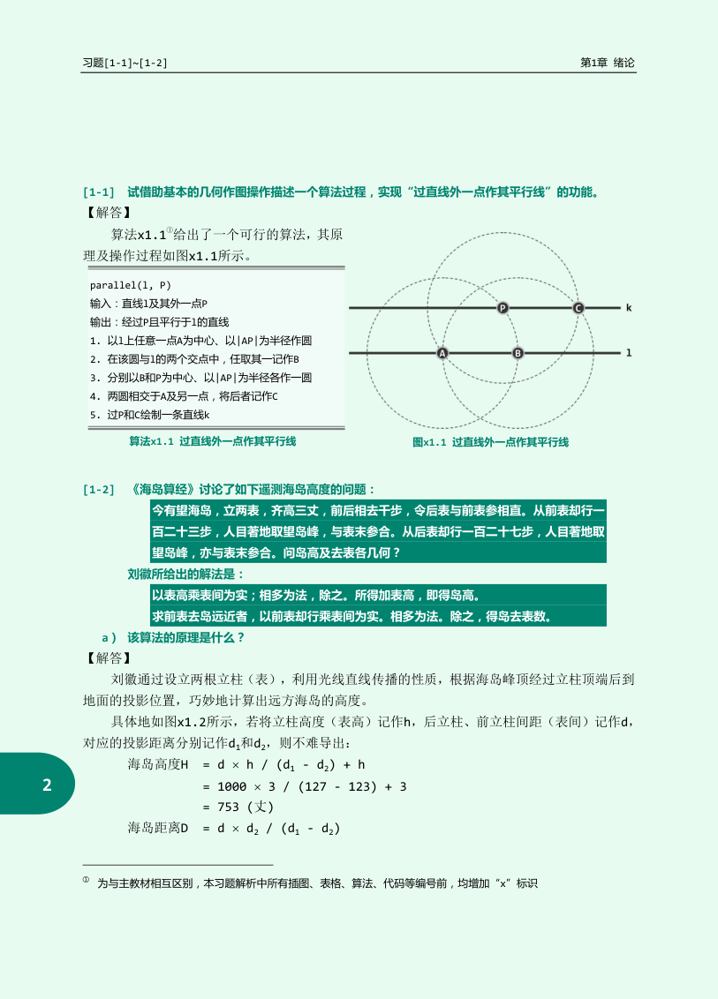
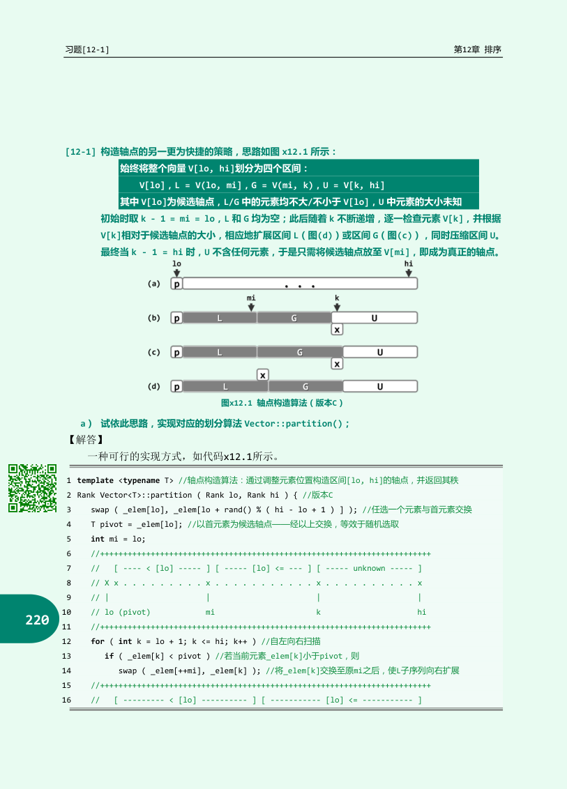

# 教材、习题解析、PS与PA，怎样对着解决同一个问题

遇到一段看不懂的证明，不必在同一页上反复硬读。先判断缺的是定义、具体执行、证明方法还是代码约定，再去对应材料补。教材给完整概念，课件常保留课堂推导的图与中间步骤，PS提出容易混淆的条件，PA则要求你把它们落实成在规模内可运行的程序。

课程名是数据结构。教材书名、旧版章号、课程课件节号与本书章号各有一套，不能拿某套号直接代替另一套。2026教材本地PDF含完整十四章，覆盖算法、向量、列表、栈队列、树、搜索结构、词典、图、优先级队列、串与排序。旧版第三版与习题解析的章序不同，不能把此前只读到的范围写成文件本身只有六章。

## 先知道自己翻的是哪一份书

本地2026教材为352页PDF；作者官方合体PDF为669页，含第三版主教材与《习题解析》，习题解析从PDF第413页开始。官方入口是[作者教材页](https://dsa.cs.tsinghua.edu.cn/~deng/ds/dsacpp/)，公开原件本地保存在`资料/教材与参考/数据结构（第3版）与习题解析（官方合体）.pdf`。

2026版十四章在PDF中的起始页如下，按实际书签与原页核对：

|章|主题|PDF起始页|本书主要对应|
|---|---|---:|---|
|1|算法概论|9|01—03|
|2|向量|43|04—06|
|3|列表|75|07|
|4|栈与队列|93|08—09|
|5|二叉树|123|10—11|
|6|二叉搜索树|151|12|
|7|搜索应用|183|14|
|8|高级搜索树|197|13|
|9|词典|239|15|
|10|图算法基础|259|16|
|11|图算法进阶|277|17|
|12|优先级队列|289|18|
|13|串|307|19|
|14|排序|327|20|

PDF前置目录目前只列到第六章，尚未更新到后八章；后半请按PDF书签或本表定位，不能据前置目录判断文件只含六章。这是文件内容与定位表，不表示本书已逐题解完教材全部习题。引用算法时还须核对具体版本，例如2026版算法14.2的LUG代码与旧习题12-1的单扫描划分不是同一个循环。

一份PDF中印刷页可能从前言重新编号，习题解析又从自己的页码开始。因此引用“第24页”不够；本书32章明确说“官方合体PDF446页、习题解析印刷24页”，两者定位到同一位置。搜索提取文字能帮助定位名词，涉及树形、箭头、求和上下限与分式时，仍应看对应原页。

下面按官方书签列出旧版习题解析的292道大题。许多题还有小问；它们与PS01—05的184个编号不是同一套，题量不能相加后就宣称全部完成。

|旧版习题范围|大题数|官方PDF页|本书对应|
|---|---:|---|---|
|1-1至1-32，绪论|32|424至456|01—03、22、28、31；32专讲1-32|
|2-1至2-41，向量|41|458至493|04—06、23|
|3-1至3-19，列表|19|496至508|06—07、24|
|4-1至4-26，栈与队列|26|510至524|08—09、25、30|
|5-1至5-30，二叉树|30|526至540|10—11、26|
|6-1至6-32，图|32|542至565|16—17|
|7-1至7-20，搜索树|20|568至578|12|
|8-1至8-20，高级搜索树|20|580至599|13—14|
|9-1至9-26，词典|26|602至615|15|
|10-1至10-22，优先级队列|22|618至632|11、18|
|11-1至11-10，串|10|634至640|19|
|12-1至12-14，排序|14|642至650|20|

## 原书十二章，各完整走一类代表题

以下题号都来自旧版《习题解析》，定位均为官方669页合体PDF的物理页。它们让你看到题目与本书的具体接点，并不代替原书所有题。题意采用转述，算例另设。

### 绪论1-1，PDF424页：尺规算法也要证明输出关系

任务是在直线l外给定点P，作过P的平行线。取l上一点A，以AP为半径作圆，与l交于B；再分别以B、P为圆心、同半径作圆，两圆除A外的另一交点为C，连接PC。



按图一步步核对，而不是看到最终平行线就结束：第一圆以A为圆心，P在圆上；B取这圆与l的交点，所以AB=AP。第二、三圆分别以B和P为圆心、以同一个半径AP作图；A在这两圆上，因此取两圆交点时要明确取**另一个**C，而不是又取回A。于是BC=PC=AP。最后P与C不同，可以连成直线。

P不在l上使A、B、P不共线，两个相交圆不是相切于A的一种退化情形，因此另一个交点存在。输入条件保证了操作本身可执行。

为什么PC平行l？AB=AP，且BC=PC=AP，所以A、B、C、P依次构成菱形，PC与AB平行，AB又在l上。P不在l上保证相关三角形不退化。算法的基本操作是定半径作圆、取交点、连直线，并非必须先写成C++才叫算法。01章说明输入条件与基本操作模型，尺规题同样要交代这些前提。

### 向量2-2，PDF458页：重叠复制怎样选方向

源区间与目标可能重叠时，按地址判断。数组[A,B,C,D,E]将前三项复制到从下标1起的位置，目标在源右侧，必须倒着：先C到3，再B到2，再A到1，结果[A,A,B,C,E]。若正向，A先覆盖B，后面会不断复制A。

右移的每一格如下，尚未读出的源用原大写字母保持：

```text
初始        [A,B,C,D,E]
先a[3]=a[2] [A,B,C,C,E]
再a[2]=a[1] [A,B,B,C,E]
后a[1]=a[0] [A,A,B,C,E]
```

若反过来先写a[1]=a[0]，源B被覆盖；下次读取a[1]得到A，错误已不能靠最后一行补救。判断方向时画的是**地址区间**，不是比较元素值大小。

反过来将下标1到3的B,C,D复制到0到2，目标在左，正向得到[B,C,D,D,E]。若倒着，先D覆盖下标2的C，再向前读时已丢原C。一般规则是右移重叠区从后向前，左移重叠区从前向后；不重叠时两向都可。04章的插入和删除正是在使用这条覆盖依赖关系。

### 列表3-3，PDF496页：唯一数据节点删除以后是什么

双哨兵链表H↔X↔T，X既是首数据节点也是末数据节点。先保存p=X.pred=H、q=X.succ=T；令p.succ=q、q.pred=p，再释放X，size从1变0。得到H↔T，恰好是空表的不变式。

对两条真正的接线分别画中间状态：先写H.succ=T，正向已经绕过X，但T.pred暂时还指X；再写T.pred=H，双向关系恢复。到这时才销毁X。循环或回调若可能在两行之间观察表，应按并发或重入协议处理；本题普通单线程删除把这几行作为一个局部修改完成。

```text
删前：H <-> X <-> T，size=1
保存：left=H，right=T
接好：H <-------> T，size=0
释放：X不再拥有或连接后续节点
```

如果X析构会自动删除succ，则本来独立的尾哨兵可能被误删；课程节点只按其约定释放自己的data与存储，容器统一拥有链，不能把两种所有权策略混用。

没有特殊分支仍能成立，是因为H、T虽然不属于用户数据，却提供合法邻居。不能将X删除后再读X.succ，也不能把H或T当作可删除数据。07章的同一套remove对中间、首尾与单节点情形统一适用，前提是哨兵确实存在且不被当作数据。

### 栈与队列4-1，PDF510页：用列表实现栈，接口不止换个名字

令列表末端为栈顶：push(e)调用insertAsLast(e)，pop调用remove(last())，top返回last.data；size与empty沿用列表管理信息。双向列表有尾哨兵时，取末节点与在末端插删都是O(1)，因此标准栈接口都可最坏常数。

空栈的pop、top必须拒绝或返回失败，不能把尾哨兵的数据当结果。若还继承了find接口，应核对失败返回：列表返回空位置，向量可能返回负秩，调用代码必须相应修改。原页代码用last与insertAsLast，旁边个别“首元素”注释应按实际调用理解为末端；不能把互相冲突的注释当作两套同时成立的方向。

用链画四个接口的实际变化，H、T为哨兵：

```text
empty：H↔T，size=0，true
push A：H↔A↔T，size=1
push B：H↔A↔B↔T，size=2，top读T.pred即B
pop：保存B.data，令A.succ=T、T.pred=A，释放B，size=1，返回B
```

每次末端读T.pred、插接或摘接都是固定条数，因而最坏常数。单链即使有tail指针，也没有B的前驱A，尾删可能先扫描全链；原题基于有前后链接的List，复杂度依据不能漏掉这一表示条件。

具体执行push A、push B、pop得到B，剩A，top仍A。若换成首端做栈顶也可，但遍历显示顺序会反过来，使用者若依赖“底到顶”的输出，需统一约定。08章强调的是后进先出关系，而非底层一定用数组。

### 二叉树5-1，PDF526页：深度加高度为何不超过整树高

取任意节点v，从根到v长depth(v)，再取v子树里最深叶x，v到x长height(v)。两段接起来是整树中一条根叶路径，所以depth(v)+height(v)=depth(x)≤height(T)。若v子树包含至少一个整树最深叶，便取等；若不包含，子树内所有叶都更浅，不等号严格。

符号可以直接对应到一张树：

```text
        R              depth(R)=0，height(R)=3
       / \
      A   Q            A深1高2，Q深1高0
     /
    B                  B深2高1
   /
  C                    C深3高0
```

取v=A，子树里最深的是C，根到A的1条边接上A到C的2条边，得到3；取v=Q只能得到1。一般式子里，`max`只是“在v子树里挑最深后代”的操作，换成全树挑，候选更多，所以不会更小。

例如根R左边有三条边长链，右孩子Q是叶。整树高3，Q深1、高0，相加1<3；左链上的节点均位于某条最深路径，相加3。证明不要求树平衡，也不要求最深叶唯一。10章统一的按边计高约定可直接用于这道题。

### 图6-1，PDF542页：关联矩阵乘自己转置，究竟保留了什么

无向链A-B-C，两条边分别为列，关联矩阵为`I=[[1,0],[1,1],[0,1]]`。两行点积共同计数两顶点关联的边，故`I I^T=[[1,1,0],[1,2,1],[0,1,1]]`。对角是度1,2,1，非对角为相邻边数；简单无环图下，非对角就是邻接矩阵。

先解释矩阵相乘怎样读取。I的行是顶点，列是边e1=AB、e2=BC：

$$I=\begin{pmatrix}1&0\\1&1\\0&1\end{pmatrix}.$$

乘$II^T$的第A行第B列，就是I的A行与B行的点积：$1\cdot1+0\cdot1=1$，共同碰到1条边。A与C点积$1\cdot0+0\cdot1=0$，不相邻。B与自己点积$1^2+1^2=2$，是度2。每一格都来自这个规则，得到

$$II^T=\begin{pmatrix}1&1&0\\1&2&1\\0&1&1\end{pmatrix}.$$

有平行边时非对角可能大于1，表示公共关联边的条数；本例没有自环。

有向链A→B→C，把出发端记−1、到达端记+1，则`I=[[-1,0],[1,-1],[0,1]]`，乘积为`[[1,-1,0],[-1,2,-1],[0,-1,1]]`。它记录总度与忽略方向的连接数，却无法恢复边方向，因为将某列整体取反不改变乘积。别误把这个对称乘积叫作原有向邻接矩阵。

把A→B方向反过来，I的第1列由`[-1,1,0]`改成`[1,-1,0]`，整列取负。任意两行在这一列相乘都同时多两个负号，贡献不变，所以乘积无法区分A→B与B→A。对角度数与连接关系能保留，原方向却丢了；这个信息损失可以由一条边的实际变换直接证明。

应用例子是差分约束x_v−x_u≤w，转成边u→v权w。给各点一个超级源0权到达边，最短距离满足所有`d[v]≤d[u]+w`，可作可行赋值；若存在负环，将环上不等式相加会得0≤负数，矛盾。17章Bellman–Ford检测负环因此能处理这类可行性问题。另做一个完整可行性例子：

$$x_2-x_1\le3,\qquad x_3-x_2\le-1,\qquad x_3-x_1\le4.$$

转成1→2权3、2→3权−1、1→3权4，并从超级源向三个点各连0边。初始d1=d2=d3=0；扫1→2时0≤0+3，不改；扫2→3时0>0−1，把d3改−1；扫1→3时−1≤4，不改。下一轮全部不改，取赋值$(x_1,x_2,x_3)=(0,0,-1)$，三项左侧依次0、−1、−1，都满足对应上界。

若再加入$x_1-x_3\le-3$，沿1→2→3→1的环权和为3−1−3=−1。把三个约束直接相加，变量全部抵消，得到$0\le-1$，不可能。因此负环不是算法随意定的失败信号，它对应原约束之间的矛盾。

矩阵方向编码负责表达约束，乘积本身并没有保留全部有向信息。

### 搜索树7-1，PDF568页：局部孩子大小还不够

BST要求左子树所有后代≤根，右子树所有后代≥根。中序按左、根、右列出，因此非降。反过来若中序非降，对任意根，所有左子树项都出现在根前且不大于根，所有右项都在根后且不小于根，故满足这种允许重复的BST定义。

仅检查孩子会漏错：

```text
      10
     /
    5
     \
      12
```

根的左孩子5<10，5的右孩子12>5，每条边局部都像BST，但12属于10的整个左子树，违反≤10。中序实际输出5、12、10，在12→10处下降。

检查时可以把祖先累积的范围传下去：根10允许任意实数；左孩子5继承“≤10”；5的右孩子继承“≥5”还必须保留原来的“≤10”，所以允许范围为[5,10]，12立即被拒绝。若递归时只传当前父亲限制，忘掉更高祖先的上界，正好会漏掉本例。12章先用互异键得严格递增；原书这题允许非严格关系，重复键的策略需另加约定。

### 高级搜索树8-1，PDF580页：重复记录需要身份，整组查询需要边界

原题要伸展树允许多个相等数据项，并增加searchAll与removeAll。可把内部比较键设成`(用户key,唯一递增id)`，按字典序严格比较；旋转只依赖这个总序，不会把相等用户键随机挤到不相干位置。对外查找仍只看用户key，所有相等key在中序中连续。

依次插`(5,A,id1)`、`(3,B,id2)`、`(5,C,id3)`，每次把新项伸展到根。三次状态可以全部画出：

```text
插A后：   5A       插B并右旋后： 3B       插C并两次左旋后： 5C
                                  \                         /
                                   5A                      5A
                                                          /
                                                         3B
```

内部次序始终`3B < 5A < 5C`。查询第一个用户key不小于5，根5C是候选，向左5A也是候选，再向左3B太小、其右边空，故最左候选是5A。把5A绕5C右旋到根：

```text
       5A
      /  \
     3B   5C
```

一次search(5)可返回A，单项remove(5)也只删除找到的一份，C仍应存在。删除全部不能仅删根，也不能用一个布尔“5存在”代表两条记录。

批量接口可以用**两次直接分裂**得到$O(\log n+k)$摊还界。分裂不仅要把等值范围找对，还要真正伸展走完搜索的节点；只旋转一个很早记录的候选，可能遗漏长搜索路径的成本。

第一次分成L（用户key<x）与R（用户key≥x），按以下完整规则执行：

1. 从根搜索到空指针，不在命中等值时提前停。当前key<x就向右走，否则向左走；每走到真实节点，都把它记为last。
2. 空树直接得到两个空树。非空树把**实际最后访问的last**伸展到根，正常修正每次旋转的parent、孩子和size。
3. 若新根key<x，它就是小于x的最后一项。根及其左边归L，根的右子树归R：断`root.right`。
4. 若新根key≥x，它就是第一个不小于x的项。根及其右边归R，根的左子树归L：断`root.left`。

为什么last只能是边界两侧紧邻的项？搜索要么在“<x”的节点向右走到空，说明它与x之间已没有更大但仍<x的节点；要么在“≥x”的节点向左走到空，说明没有更小但仍≥x的节点。祖先给出的另一侧限制也一直保留。伸展保持中序，所以旋转后按根的一条边切开，仍恰好把整个全序切在x之前。

第二次把R分为M（用户key≤x）与G（用户key>x）。搜索规则相应改为：key≤x向右，否则向左，仍一路到空、伸展last。新根若≤x，断`root.right`，左份为M、右份为G；新根若>x，断`root.left`，左份为M、右份为G。R原本全≥x，所以M中的项恰好全等于x。每次断边后，把新分离的根parent置空，重算仍保留孩子的原根size；若某份为空，直接保留为空。

把两边都非空的例子走全。查询x=5，初态为一棵合法伸展树：

```text
       5C
      /  \
     5A   8D
    /
   3B
```

第一搜索依次访问5C、5A、3B，再从3B的右边走到空，last是3B。3B是左—左孙，先绕5C右旋得到5A为根、左3B、右5C（5C右8D）；再绕5A右旋，得到：

```text
       3B
         \
          5A
            \
             5C
               \
                8D
```

新根3<5，断它的**右边**，得到L仅3B，R为5A右连5C、5C右连8D。第一步并非找到5A就停，3B的访问也被实际伸展覆盖了。

第二搜索在R中依次访问5A、5C、8D，从8D左边到空，last是8D。它是右—右孙，连续两次左旋：先绕5A，得到根5C、左5A、右8D；再绕5C，得到根8D、左孩子5C、5C左孩子5A。新根8>5，断它的**左边**：

```text
L：3B       M： 5C        G：8D
               /
              5A
```

searchAll中序遍历M，得到A、C共k=2项，再合回L、M、G；removeAll销毁M的两个节点，再合L与G，删除结果为3B右连8D。若没有等值项，M为空；若全表都小于x，第一次新根是全表最大项、右边本来空，R自然为空，不需要读取不存在的候选。

一个能检查复杂度口径的反例是：根10，左边为1→2→…→9的右链，查询x=9.5。第一个≥x的候选一直是根10，但真实搜索会走到9。如果只伸展候选10，树完全不变，反复查询每次都线性。这里会伸展实际last=9，再按9<9.5断右边，整条访问路径都进入正常伸展分析。

合并两棵所有内部键满足左<右的伸展树，可把左树最大项伸展到左根，此时没有右孩子，再把右树接到其右边并修parent、size。若其中一棵为空，直接返回另一棵。刚才searchAll后的合回也可执行：先将M接在L的3B右边，再把合树最大项5C伸展到根，此时左边是3B、3B右孩子为5A，最后把8D接到5C右边。中序仍是3B、5A、5C、8D；查询可以改变形状，不能改变记录内容与总序。每次分裂都搜索到last并将last伸展，搜索长度与这次伸展路径相配；合并也在找到左树最大项后将它伸展。各自按访问引理摊还$O(\log n)$，切掉一条边不会增加按子树大小计算的森林总势能；中间树遍历或销毁需$\Theta(k)$，所以总$O(\log n+k)$摊还时间、输出/删除量另计。k=0时也要处理空M。单次伸展可能很长，不能把摊还结论改成单次最坏对数。

仅仅说“找到首项后不断求后继”还不足以自动保证这个批量界：如果每次后继从根重查，可能多出k个对数；如果结束边界要走一条很深的非等值链，也需要分析那段代价。两次分裂明确圈出全部输出的子树，扫描成本才可以直接按k记账。第13章给伸展旋转与访问引理，本节把它们接到重复记录这个具体接口。

### 词典9-2，PDF602页：一座塔不要重复复制整个词条

跳转表某键高4层，若每层都复制一份长字符串和值对象，会浪费4份大载荷。可让底层数据节点唯一拥有payload，高层索引只存指向同一payload或底层节点的引用及横纵链接。

例如某条记录P的key为7、value是一段长文本，塔高3。把载荷只留一份：

```text
第2层： ... ↔ index7 ----payload----> P(key=7,value=长文本)
                   |                   ↑
第1层： ... ↔ index7 ----payload--------+
                   |                   ↑
第0层： ... ↔ data7  ----payload--------+
```

横向链接负责这一层前后跳，纵向链接负责上下，payload引用只负责找到那一份记录。更新value把P.value改一次，不复制三份；key通常不能直接原地修改，否则横向有序性会被破坏，应删后重插。

删除时先在每层把索引前后邻居接好，拆掉塔，再释放唯一载荷P一次；若先删P，高层比较key时就可能读到悬空引用。若接口允许外部长期持有记录，则还要用共享所有权或稳定句柄规定什么时候可释放，塔高本身没有解决外部生命期。

查询在高层停止时，沿引用返回那一份数据。链接数期望O(n)的前提不变，但每层不再重复存可能很大的键和值；13章的跳转索引因此与对象所有权接起来。

### 优先级队列10-1，PDF618页：四个基础实现，把三个接口都算一遍

无序向量尾部插入摊还O(1)，找最大O(n)，删最大可扫描后用末项填洞，总O(n)。无序列表可常数插节点，找最大与删前寻找仍O(n)。若缓存最大位置，getMax可O(1)，但删最大后重找下一最大仍需O(n)，缓存没有免除这笔工作。

用插4、1、7、6，再删最大，实际动作如下：

| 结构 | 插完前3项 | 插6时做什么 | 取得/删除7时做什么 |
|---|---|---|---|
| 无序向量 | `[4,1,7]` | 尾写6，成`[4,1,7,6]` | 扫到下标2的7，用末项6填洞，成`[4,1,6]` |
| 有序向量 | `[1,4,7]` | 把7右移，6填进去，成`[1,4,6,7]` | 直接读/删末项，成`[1,4,6]` |
| 无序双链 | `4↔1↔7` | 尾接6 | 扫出7的节点，常数摘链 |
| 有序双链 | `1↔4↔7` | 先走链接找到4与7之间，再常数接6 | 尾指针直接读/摘7 |

无序的代价落在寻找最大，有序的代价落在寻找并保持插入位置。链表“已知位置后插删常数”没有免除寻找位置。

有序升序向量在正确秩插入需寻找并搬移，O(n)，最大在尾，getMax与尾部删除O(1)或按收缩策略给摊还界。有序双向列表插入需O(n)寻找位置，末端取最大与删末节点O(1)。保持全序使删除极值便宜，却使插入较贵。18章的完全二叉堆只维护父子序，getMax O(1)，插入与删最大O(log n)，正是放松全序换来的平衡。

### 串11-1，PDF634页：前缀、后缀与子串的坐标

以S=ABCDE为例，长度为5，长2前缀AB，长2后缀DE。按原题Excel式从1编号，mid(S,2,2)取BC；换成本书从0起的区间，就是S[1:3]。相等比较要求长度相同且每个对应字符相同，ABC与AbC在区分大小写的exact语义下不同。

把同一个S从两种坐标写出来：

```text
字符       A B C D E
Excel位置  1 2 3 4 5
本书下标   0 1 2 3 4
```

合法参数下，`mid(S,i,k)`的本书半开区间是`[i-1,i-1+k)`。例如i=2、k=2，读下标1、2的B、C，右端3不读；`left(S,2)`是`[0,2)`，`right(S,2)`是`[3,5)`。三个参数分别是起点、长度与排除的右边界，不能把k直接当结束下标。这里用ASCII与合法范围说明映射；不同工具的非法参数、Unicode计数细节还需按其各自接口规则核对，不能把这张坐标表当作所有软件错误处理也完全相同。

这道看似简单的接口题在提醒你：课件的秩、语言切片与工具界面起点可能不同。字符长度也要看采用字节、码点还是其他单位；不能拿一个软件的显示长度直接当另一个API的字节偏移。19章先固定字符模型，再定义π与匹配起点，正是为了防止这类坐标错位。

### 排序12-1，PDF642页：一个扫描指针也能完成轴点划分

原题版本C把轴值先放lo，mi指向已知小于轴的区域末尾，k从lo+1向右扫。遇a[k]<pivot，就先mi加1，再交换a[mi]与a[k]；否则只前进k。最后交换a[lo]与a[mi]，返回mi。



本段遵循原题**闭区间**`[lo,hi]`。若数组长度n，整表调用应传hi=n−1，不能传n。为专看分区过程，下面固定首项作轴；原题随机选轴只是先交换一个位置到首项，不改变扫描不变量。

```python
def partition_closed(a, lo, hi):
    pivot = a[lo]
    mi = lo
    for k in range(lo + 1, hi + 1):
        if a[k] < pivot:
            mi += 1
            a[mi], a[k] = a[k], a[mi]
    a[lo], a[mi] = a[mi], a[lo]
    return mi
```

前置条件是`0<=lo<=hi<len(a)`；空区间由外层快排的基础分支直接跳过，不应调用本函数去读a[lo]。

以[4,7,2,5,1]、lo=0、轴4为例：7不动；2小，mi=1，交换得[4,2,7,5,1]；5不动；1小，mi=2，得[4,2,1,5,7]；最后4与下标2交换，得[1,2,4,5,7]，轴点秩2。扫描中[lo+1,mi]严格小于轴，[mi+1,k)不小于轴，未知段从k开始；每步都缩小未知段，扫描线性。

用竖线把每轮的四块画出来，轴一直单独放首格：

```text
初始：4 | 空 | 空       | 7,2,5,1        mi=0，k=1
看7：4 | 空 | 7        | 2,5,1          7>=4，k前进
看2：4 | 2  | 7        | 5,1            mi=1，交换2与7
看5：4 | 2  | 7,5      | 1              5>=4，只扩G
看1：4 | 2,1| 5,7      | 空             mi=2，1与7交换
末换：1,2 | 4 | 5,7                     返回mi=2
```

第三块内部不需要有序，`7,5`在扫描中完全合法；划分只承诺相对轴的大小。每步要么把当前小项换到L末端，同时把原G首项转移到G末端；要么直接把当前项归G。未知区每轮少1，终止后轴与mi交换便让左侧全<轴、右侧全≥轴。后续递归是`[lo,mi-1]`和`[mi+1,hi]`，轴本人不再递归。

这里返回单个轴点；20章的LUG、DUP也返回轴点，而另列的三路划分返回整个等值区间，递归边界不能混用。若所有值相等，版本C每次mi仍为lo，递归侧大小n−1，仍可能平方；随机选轴无法改变“所有值相同”这个事实，三路划分才会一次跳过全部等值项。

## 读完例子，再按薄弱处回到材料

## 路线1：复杂度题，先把“要数什么”固定

先读01章的计算模型，明确一条移位、大整数乘法和数组访问是否算常数。再读02章的三种和式与递归树，亲自写出每行次数。随后做PS01：给程序一个小n，列出循环状态，再写一般阈值。遇到1-32，32章按16段分别区分返回值、外层轮数和总调用成本。

例如第13段G算ceil√i，主循环走到i约$n^{2/3}$。若只看外循环轮数，会答错；把每次条件调用的√i成本求和，才得到线性。看答案之前要问：“这里哪一句是在数轮数，哪一句是在数工作？”

到PA时再将复杂度与规模核对。n=40的二选一组合不能轻易做$2^{40}$枚举，可考虑两半；字符串长度很大但预算k小，可考虑带状DP。理论阶是选择算法的约束，不是写完代码后用来装饰的结尾。

## 路线2：向量与列表，同一个插入动作付不同的账

读向量课件原图时，追踪容量、size与复制量，不要只记“扩容摊还常数”。04章给纯追加序列，28章再把势能总账写成等式。然后用PS02检查不同增长策略、成功失败查找长度和二分接口。

转到列表，先在纸上画前驱、当前节点、后继，写出四根链接。07章删除例子专门保存旧next，防止释放后使用。PS03再检查稳定性与比较次数：列表节点摘接便宜，不等于在有序列表中寻找插入位置也便宜。

若程序输出排序值正确，仍应给相等项加A、B标签检查稳定性。选择“最后一个最大值”后远距离交换，可能让另一种相等键反序；06章给了可手算的反例。用具体记录比“这个算法通常稳定吗”的印象判断可靠。

## 路线3：栈队列，先写状态再谈峰值

08章先手算括号和RPN，再读老师中缀优先表。课程原表的乘方左结合与数学常用右结合应分开。PS04有些题要求原程序，有些要求修改程序，不能把修改后的规则倒灌回原版。30章对21式列出每次数字压入与每次运算后的完整数值栈，便于定位哪次减法或除法先算错。

09章用窗口最大值和直方图说明删除候选的理由。之后读PS04里“单步空间”“整段峰值”“随机期望”的问题，再去28章看记录变量与并合界。固定一个窗口的平均候选数小，不代表无限长流的最大候选数同样小。

PA中不一定直接出现栈，但同样需要问“哪些旧状态仍可能影响未来”。Filename保留带内可达状态，Gift保留有重复身份的半和，偏序DP保留每个b前缀的最佳值。这些压缩都应给出不会丢掉更优解的理由。

## 路线4：树，把所有计数约定写在第一张纸上

先固定高度按边数还是节点数，空树高度取多少，二叉树是否区分左右，是否允许单孩子。10章统一按边数，给增强先序解析；PS05再检查普通遍历与带空标记遍历的唯一性。

扩充二叉树是在每个缺失孩子处补一个外部空叶。n个原节点有n+1个空槽，所以补后外叶n+1，所有原节点都成为双分支节点，共n个；不是只给原单孩子节点补一次。原叶的左右两个缺口也必须补。这个约定与增强先序中n+1个空孩子标记是同一份结构信息的两种写法。

BST、AVL先用12章小树执行删除与旋转，再回到教材的通用节点重构；不要只看最终树形。Huffman先用11章算合并权重总和，再读贪心交换证明和比较下界。最优编码的成本、构造算法的复杂度、输出所有码字的长度，是三个不同的量。

## 范围说明

这本书按现有章节讲解核心概念，按22—26章逐项处理本学期五张PS，32章专门重做原书1-32。取得669页原件并建立12章索引，不等于292道原书大题及所有小问都已经逐题完整解答。查到一个题号以后，仍要看对应章节是否实际给出了该题的证明与计算。

课内样卷中带使用限制的原件留在本地，31章用另设实例提炼方法。个人作业、转系资料和群聊照片也不因写教材而进入公开仓库。公开教材中的例子用于教学与检查，不替代课程发布的正式约束与独立提交。
