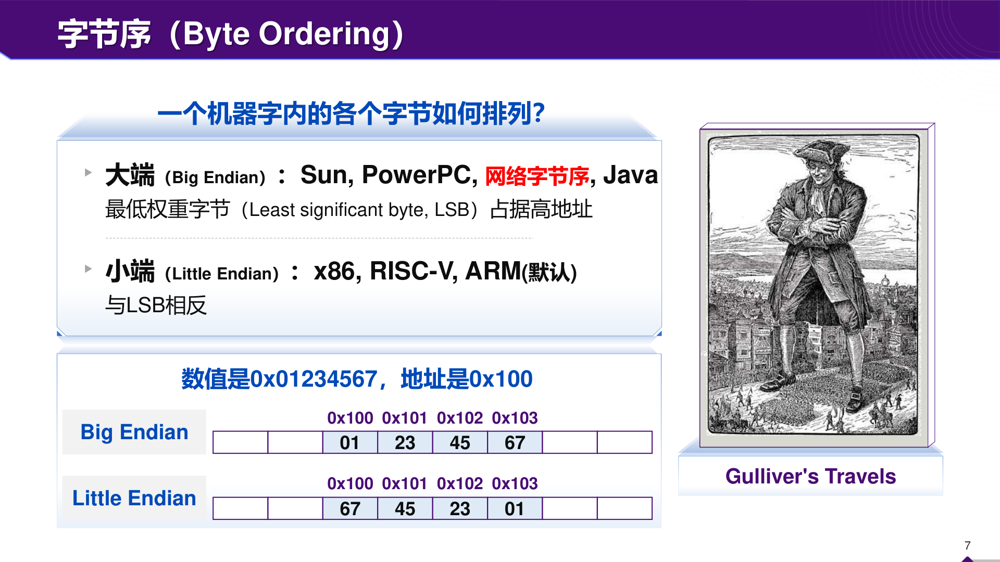

# 位、字节、地址：先把内存格子画对

终端输出 `78 56 34 12`，代码里写的却是 `0x12345678`。如果你第一次接触内存查看器，很容易怀疑程序把数据写反了。实际发生的是：一个整数占了四个字节，查看器按地址从低到高显示，而这台机器把低权重字节放在低地址。数值和存放次序是两个问题。本章会把它们拆开，然后教你从内存重新读回整数。

## 一个格子到底能装多少

位，英文 bit，只有 0 和 1 两种状态。两个位有 `00、01、10、11` 四种组合。每多一位，组合数乘 2，所以 n 位有 $2^n$ 种位串。8 位组成一个字节，英文 byte；一个字节共有 256 种位串。这里先说组合数，不急着说它们代表的数。相同位串可以被读成整数的一部分、字符编码的一部分，或者一条指令的一部分。

二进制和十进制都使用位权。十进制 307 是 $3×10^2+0×10+7$。二进制 `1011` 是 $1×2^3+0×2^2+1×2+1=11$。从右往左，位权依次是 1、2、4、8、16。二进制数字写长了不好读，于是常把每四位打包成一个十六进制数字。十六进制用 0至9 和 A至F 表示 0至15，前缀 `0x` 只是提醒你按十六进制读。

例如 `0xB6` 可分成 B 和 6，B 对应 `1011`，6 对应 `0110`，连起来是 `10110110`。它的无符号数值是 $11×16+6=182$。不要把十六进制 B 当成变量，也不要把 `0x10` 读成十进制 10；它是十进制 16。

存储容量的单位也要看定义。KiB 是 $2^{10}$ 字节，MiB 是 $2^{20}$ 字节；十进制 kB 是 $10^3$ 字节。教师课件用 K、M 讲二进制数量级时，要按课件约定读。硬盘标称容量、网络速率和程序显示值可能采用不同单位，计算前先统一成字节。网络中的 bit/s 还是位每秒，转成 byte/s 需要除以 8，且实际协议还会消耗额外带宽。

## 地址、内容、对象大小分开写

暂时把内存画成这样的表：

|地址|该地址上的一个字节|
|---|---|
|`0x1000`|`0x78`|
|`0x1001`|`0x56`|
|`0x1002`|`0x34`|
|`0x1003`|`0x12`|

表左边是位置，右边是内容。地址每增加 1，移动一个字节。一个 4 字节对象从 `0x1000` 开始，会占用 `0x1000` 到 `0x1003`，下一个不重叠对象最早能从 `0x1004` 开始。结束地址要用“起始地址加长度减 1”，因为起点自己也算一个字节。

C 里 `&x` 取得对象 x 的地址。若 `p` 指向 x，`*p` 则按 p 的类型读取或写入 x。指针自身也占存储空间；在本书的 LP64 假设下，一个指针对象占 8 字节。指针里保存的地址宽度、所指对象的大小、所指对象的值，三者不能互换。例如 `int *p` 的 p 常为 8 字节，`*p` 是一个通常 4 字节的 int，它的值可能恰好是 7。

字这个词有两种使用场景。口头说“64 位机器字长”，通常指整数通路、寄存器等方面的宽度；x86 指令手册中的 word 却固定指 16 位，doubleword 指 32 位，quadword 指 64 位。教师课件已经提醒不同架构的 word 定义不同。做题时写出“多少位”，比只写“一个字”更不容易误会。

## 小端、大端各自怎么摆

把 `0x12345678` 拆成四个字节。最高权重字节是 `0x12`，最低权重字节是 `0x78`，因为完整数值为

$$
0x12×256^3+0x34×256^2+0x56×256+0x78.
$$

小端把 `0x78` 放在最低地址。大端把 `0x12` 放在最低地址。端序只调整多字节对象中字节的存放顺序；同一字节中的位不因此倒排，字符串中的字符也不因此整段颠倒。把 `0x12` 写成二进制 `00010010` 时，仍按通常的高位在左写法阅读。



原图下半部的列标题从 `0x100` 增加到 `0x103`，因此从左往右走是在增加地址。第一行 Big Endian 的 `01` 最先出现，说明高权重字节在低地址。第二行 Little Endian 的 `67` 最先出现，说明低权重字节在低地址。图里的值是 `0x01234567`，它只有写法和本章例子不同，拆法相同。图上“与 LSB 相反”这一简写不够完整：实际需要记住的是最低权重字节占哪个地址，不要把 LSB 当成一种端序名字。

网络协议通常规定使用大端的网络字节序；主机内部采用什么端序，并不改变协议约定。因此发包之前要做主机到网络的转换，收包之后再转换回来。`htonl` 中的 l 在接口名里沿用历史称呼，它处理的是 32 位值，不应该因某台机器的 C long 为 64 位就推断它处理 64 位。

## 算例一：从内存还原数值

题目：小端机器上，一个 32 位无符号整数从 `0x2000` 开始，四个连续字节为 `EF BE AD DE`，整数是多少？

第一步，确认长度为四个字节，不能只读第一格。第二步，小端下最低地址的 `EF` 权重为 $256^0$，其后依次是 $256^1$、$256^2$、$256^3$。第三步，按通常高位在左的写法重组为 `0xDEADBEEF`。若要验证，可以再从该数每次取最低 8 位并右移 8 位，依次取到 EF、BE、AD、DE，与内存表一致。

如果把同一组字节按大端格式解释，则得到 `0xEFBEADDE`。这不是两台机器计算能力不同，而是它们遵循的格式不同。文件格式或网络包应规定端序，不能指望接收者猜。

## 算例二：数组下标为什么要乘四

题目：`int a[4]={7,11,19,23};`，每个元素 4 字节，从 `0x3000` 开始。求 `a[3]` 的地址以及 `a+1` 指向哪里。

a 的四个元素起点依次是 `0x3000、0x3004、0x3008、0x300C`。因此 `&a[3]=0x300C`。表达式 `a+1` 的类型为 `int *`，移动一个 int，得到 `0x3004`。这里的 `+1` 不是给裸地址加 1 个字节；C 已按所指类型缩放。

若先令 `unsigned char *q=(unsigned char *)a`，那么 `q+1` 才是 `0x3001`。通过字符类型观察对象表示是 C 允许的做法。假设小端，元素 7 的四字节表示为 `07 00 00 00`，`q[1]` 是 0，不是第二个数组元素 11。原来的类型信息决定一次跳多远、一次读多少。

还要分清 `a` 与 `&a`。a 在多数表达式中转换成指向首元素的指针；`&a` 是指向整个数组的指针。它们的起始数值可相同，但 `&a+1` 跨过整个 16 字节数组，和 `a+1` 的步长不同。

## 算例三：显式拼接一个协议字段

题目：文件中四个字节 `01 02 03 04` 按大端存储，怎样在任何端序的主机上取出数值？

可以逐字节读取，再用无符号移位明确赋予位权：

```c
#include <stdint.h>
uint32_t read_be32(const unsigned char p[4]) {
    return ((uint32_t)p[0] << 24)
         | ((uint32_t)p[1] << 16)
         | ((uint32_t)p[2] << 8)
         |  (uint32_t)p[3];
}
```

先转 `uint32_t` 再左移，是为了在足够宽的无符号类型中计算。四项分别是 `0x01000000、0x00020000、0x00000300、0x00000004`。它们的 1 位区域不重叠，按位或得到 `0x01020304`。计算的输入是每个字节的数值，因此主机端序不会改变结果。

若直接写 `*(uint32_t *)p`，除了端序问题，还可能遇到对齐和 C 对象访问规则的问题。简单的强制类型转换并不会把外部字节自动转换成协议格式。需要高效批量读取时可研究 `memcpy` 与专用转换接口；先把格式解释正确，再考虑速度。

## 十六进制查看器怎样读

一次显示十六个字节的工具，通常左侧是行首地址，中间是十六进制字节，右侧是可打印字符。右边的字母只是同一字节按某种字符编码作的辅助显示。二进制文件某个位置恰好显示字母 A，不能据此认定那里保存着一个 C 字符串。

字符串 `"AB"` 在常见 ASCII 兼容编码下占 `41 42 00` 三个字节，末尾 00 是字符串终止符。整数 `0x4142` 在小端下则占 `42 41` 两个字节，两者布局并不相同。字符编码决定一个字符对应哪些字节；端序处理多字节数值的字节次序。这两个概念会在 UTF-16 等格式中相遇，但仍需要分别说明。

32 位地址能形成 $2^{32}$ 个不同位串。若按字节寻址，理论上覆盖 4 GiB 地址范围。这个计算讨论的是地址编码能力，不等于某个进程可用 4 GiB 用户内存，更不等于机器必须装 4 GiB 内存。保留区域、操作系统布局、实际硬件和地址翻译都会影响可用空间。x86-64 也不能仅凭寄存器是 64 位就断言所有 $2^{64}$ 字节均为当前可用地址，实际地址位数与规范地址规则要看具体处理器和系统。

## 再算一个有长度字段的二进制记录

一条记录规定：前两个字节是大端长度L，接着L字节是正文。收到字节`00 03 41 42 43 7F`。首先读长度`0x0003=3`，正文范围从偏移2开始，占偏移2、3、4，内容为`41 42 43`；偏移5的`7F`已经是下一字段或多余数据，不能因为“缓冲还有字节”就算入正文。

如果接收缓冲总长为n，要验证`L<=n-2`，但前提先确认n>=2。直接写`L+2<=n`，在更一般的大类型长度场景中可能先发生加法溢出；先验证最小头长，再用减法比较剩余空间，是容易审查的结构。这个例子把格式、地址和长度联系起来：字段的数值决定后续读取范围，而范围必须受实际缓冲长度约束。

若正文声明为UTF-8文本，字节数不等于汉字数。一个汉字在UTF-8中常用三个字节，某些字符用更多；按字节偏移截断，可能恰好切在一个编码序列中间。于是“给我前10个字符”和“给我前10字节”是不同请求。C的char是一个字节单位，不自动代表一个用户看到的完整字符。

再比较两个输出：打印指针用`%p`并传`(void *)p`，打印size_t用`%zu`。printf不会在运行时根据任意实参猜测你本来想用的格式；格式告诉它应怎样取与解释参数。地址数字用错格式，可能打印截断或形成未定义行为。调试内存问题时，先确保调试输出本身类型正确。

## 位编号和字节编号怎样同时标

一个32位数的位编号通常从最低位0数到31。字节编号若按对象内地址递增，则从字节0到字节3。小端机器的字节0承载数值位0至7，大端机器的字节0承载数值位24至31。两种编号都可用，但“第一个字节”必须说清是最低地址字节还是最高权重字节。

例如数值`0x80000001`有位31和位0为1。小端字节为`01 00 00 80`，大端为`80 00 00 01`。最高数值位没有因存放而变成最低数值位，它只是落在不同地址。这也是为什么对数值做`x&1`检查奇偶不依赖主机端序：运算作用于数值位，而不是按内存显示顺序机械挑第一个字符。

反过来，如果你直接读`((unsigned char *)&x)[0]`，得到的是最低地址字节，它就受端序影响。两个写法观察的对象不同：前者问数值最低位，后者问存储起点上的字节。把问题写完整，答案自然不再打架。

练习：数值`0x0100`按小端存放，两字节为`00 01`。若有人通过第一个字节是否非零判断原整数是否非零，错在哪里？答案是他只检查低8位，数值256的低8位恰为零，高8位仍有1。正确判断整数非零直接比较x与0，或检查全部相关字节，不能只看某一端。

## 自己做，再看答案

练习一：小端机器上，16 位无符号数 `0x12A0` 从地址 `0x80` 开始。写出两个字节。若只读取地址 `0x81` 的一个无符号字节，得到多少？

答案：先拆成高字节 `12`、低字节 `A0`。小端低字节在低地址，所以 `0x80:A0，0x81:12`。只读 `0x81` 得到 `0x12=18`。不能把它读成原整数的全部，也不能把 `12` 当十进制 12。

练习二：`double b[5]` 从 `0x5000` 开始，每个元素 8 字节。`&b[4]`、整个数组最后一个字节、`b+5` 分别在哪里？能解引用 `b+5` 吗？

答案：`&b[4]=0x5000+4×8=0x5020`；数组总长 40 字节，最后一字节为 `0x5027`；`b+5=0x5028`，是合法形成的尾后指针。尾后指针可用于结束比较等操作，但不能当作现存元素解引用。把“能形成地址”和“能访问该地址中的对象”分开，后面的越界问题会清楚很多。

练习三：内存依次是 `00 01`。你知道这是两个字节，但不知道字段类型与端序，能断言数值为 1 吗？

答案：不能。若是大端 16 位无符号字段，它是 1；若是小端 16 位无符号字段，它是 256；若是两个独立字节，它们是 0 和 1。解码需要格式信息，字节本身不会告诉你该套哪种解释。
