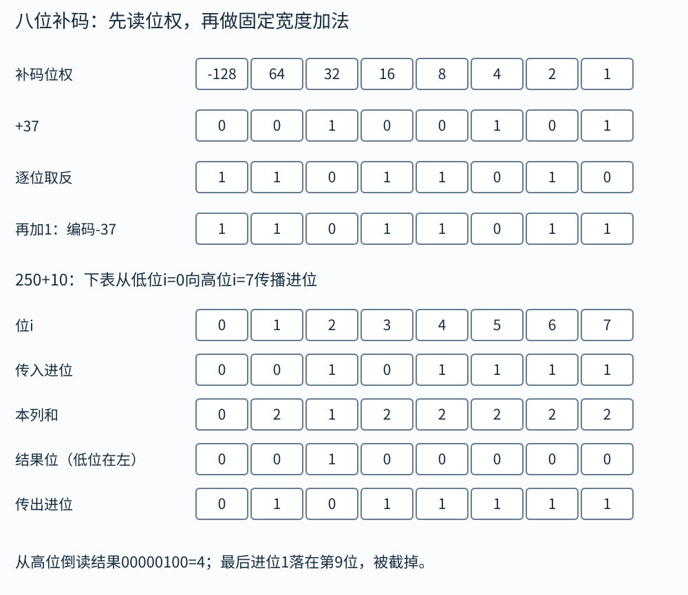

# 整数：位串没有变，为什么 255 会成为 −1

假设只有八盏灯，每盏灯只能亮或灭。你想用它们表示整数，总共有 256 种灯光组合。若全给非负数，可以表示 0至255；若希望同时表示负数，就要把其中一部分组合分给负数。补码是一套具体的分配方法。它还让正数和负数尽量使用同一套加法电路，这正是它适合计算机的原因。

本章要同时处理两层规则：固定宽度位串的运算，以及 C 源代码是否允许你这样运算。八位加法电路把结果截成八位，是可以精确模拟的；C 中普通有符号加法发生溢出时，标准并没有要求编译器忠实模拟这套截断。两层规则在大部分正常输入上相同，在边界处必须分开。

## 无符号数逐位读，补码只改最高位的权

设宽度为 w，位从高到低为 $b_{w-1}\cdots b_1b_0$，每个 b 是 0 或 1。无符号解释为

$$U=\sum_{i=0}^{w-1}b_i2^i.$$

补码解释为

$$T=-b_{w-1}2^{w-1}+\sum_{i=0}^{w-2}b_i2^i.$$

公式中求和只是“把每一位乘上它的权再加起来”。你可以不用背公式，直接在八个格子上方写 `−128、64、32、16、8、4、2、1`。最高位为 0 时，补码和无符号读法一致；最高位为 1 时，两种读法相差 256。一般 w 位时相差 $2^w$。

八位 `11111111` 的无符号值是 255，补码值是 $−128+127=−1$。八位 `10000000` 则是 −128，`01111111` 是 127。因此补码范围是 $−2^{w-1}$ 到 $2^{w-1}−1$。负数比正数多一个，原因是零也占掉了一种最高位为 0 的组合，不能再给正数使用。

## 怎样把一个负整数写成补码

对八位的 −37，先写 +37：`00100101`。逐位取反得到 `11011010`，加 1 得 `11011011`。为什么“取反加一”有效？八位全 1 的无符号值是 255，取反把 37 变成 `255−37`，再加 1 就成为 `256−37`。这个数截在八位里，正是 −37 所对应的补码位串。

验证时不要再重复同一个口诀，改用位权：`11011011` 是 $−128+64+16+8+2+1=−37$。使用不同方式核对，才容易发现抄错。

最小负数是个特殊边界。八位 −128 取反加一后仍为 `10000000`。这不表示数学中 −(−128)=−128，而是 +128 无法装进八位有符号范围。求绝对值、取负、除以 −1 时都要想到这个边界。C 中 `-INT_MIN` 通常不能在 int 中表示，不能先算出溢出结果再试图补救。

## 固定位宽的加法怎样丢掉进位

将八位无符号 250 与 10 相加：`11111010+00001010=1 00000100`。九位数学结果是 260，容器只有八位，留下 `00000100`，即 4。无符号 C 算术正是按对应类型的模数约化：w 位时结果模 $2^w$。

有符号补码的硬件加法可使用同样的位运算，但“是否溢出”要按补码范围判断。八位 120+20 的数学结果 140 超出 127，截断后是 `10001100`，按补码读为 −116。两个正数得到负位串，说明有符号溢出。两个负数得到非负位串也说明溢出。一个正一个负相加不会超出补码范围。

无符号进位和有符号溢出不是同一件事。八位 `255+1` 无符号有进位；若把同两组位串读成 −1 与 1，有符号和却是 0，没有溢出。后面汇编中的 CF、OF 分别反映这两种不同条件。

八位加法可以逐位复演，不必把整串心算当黑箱。下面计算250+10，从最低位`i=0`开始。每列加“两个输入位和上一列进位”，本列和为0或1就直接写；为2时写0、向左进1；为3时写1、向左进1。

先用原位串核对每列输入，再算传入与传出。

|位i（从低到高）|0|1|2|3|4|5|6|7|
|---|---:|---:|---:|---:|---:|---:|---:|---:|
|传入进位|0|0|1|0|1|1|1|1|
|本列和|0|2|1|2|2|2|2|2|
|结果位|0|0|1|0|0|0|0|0|
|传出进位|0|1|0|1|1|1|1|1|

从最高结果位倒着读是`00000100`，最左还多一个进位1，即九位`1 00000100`。八位容器只保留4。进位必须沿列传播，不能因为前面一列暂时没有进位，就把所有后续进位固定为0。

## 算例一：十六位加减完整走一遍

题目：两个 16 位补码数位串是 `X=0x2026，Y=0xFACE`，求和与差的结果位串，并判断是否有符号溢出。

先确定解释。X 最高位为 0，是十进制 8230。Y 最高位为 1，先当无符号数算得 64206，再减 65536，得到 −1330。于是数学和为 6900，数学差为 9560，均在 −32768至32767 内。

按十六进制位串计算，`0x2026+0xFACE=0x11AF4`，只留下低 16 位 `0x1AF4`。差则是 `0x2026−0xFACE` 模 65536，得到 `0x2558`。分别转换回十进制是 6900、9560，与前面的有符号数学计算一致，两次都没有有符号溢出。加法出现了第 17 位进位，但这并不意味着有符号溢出。

做这类题时写上“16 位”非常重要。同一算式若按 32 位零扩展，结果的解释就不同。题目里的方括号补码表示法描述的是位串，运算之前先补齐宽度。

## C 里的类型转换实际会改变哪一步

宽化是把短类型放进较宽类型。无符号值扩展时高位补 0；有符号值扩展到能容纳原值的更宽有符号类型时，需要保持数值，常见补码机器采用符号扩展，即复制原最高位。八位 `11111011` 表示 −5，扩展为 16 位 `1111111111111011`，仍表示 −5。若高位补 0，则变成 +251，数值已经改变。

截断是只留下目标宽度能保留的位。对无符号转换，C 明确按模数给出结果。例如 `(uint8_t)300` 得到 44，前提是该实现提供 uint8_t。对超出目标有符号范围的转换，C17 的规则是实现定义的结果或实现定义的信号，不能把常见机器上的截断读法冒充所有实现的要求。

还要注意整数提升。`unsigned char`、`short` 参与多数算术时，先提升到 int，或在 int 不足以表示全部值时提升到 unsigned int。两个八位变量相加，并不自动意味着每一步都在八位内计算。`unsigned char a=250,b=10; int c=a+b;` 在常见 32 位 int 环境里 c 为 260；将和再赋给 unsigned char 才得到 4。

混合有符号与无符号时，要做通常算术转换。例如常见环境中的 `-1 < 1u`，两边会转到 unsigned int，−1 变成 UINT_MAX，因此比较为假。这里并没有先按普通整数比较再转换布尔结果，转换发生在比较之前。`size_t` 是无符号类型，数组长度与负下标混算尤其容易出现这种情况。

## 算例二：长度检查为什么能被绕过

题目：`size_t n=10; int i=-1;`，判断 `i<n` 是否为真，能否据此访问 `a[i]`？

在常见 64 位 size_t 的 LP64 环境，i 转成 size_t，−1 对应非常大的无符号数，因而 `i<n` 为假。若代码反过来写 `if (i >= n) reject(); else use(a[i]);`，这个特定负数也会被拒绝，但这不能成为通用设计：混合转换难读，而且若比较换成别的类型或先做溢出运算，条件可能失效。

清楚的检查是先确认 `i>=0`，再把已知非负的 i 转成 size_t 与 n 比较：`i >= 0 && (size_t)i < n`。`&&` 从左往右短路；左边为假时，不执行右边及访问。这样条件直接表达两个要求：下标非负，且小于长度。若下标本来就来自 size_t，则只需检查上界，并避免写永远为真的 `i>=0`。

## 位运算到底在改什么

按位与 `&` 保留两边都为 1 的位置，按位或 `|` 保留至少一边为 1 的位置，异或 `^` 在两位不同处产生 1，按位取反 `~` 翻转每一位。逻辑运算 `&&、||、!` 则把操作数视为真假，结果为 0 或 1。`6&3=2`，而 `6&&3=1`，两者不能互换。

取最低四位可写 `x & 0xFu`。设置第 k 位可写 `x | (1u<<k)`，清除第 k 位可写 `x & ~(1u<<k)`。这些写法要求移位位数在类型范围内；对 32 位 unsigned int，k 要在 0至31。写 `1<<31` 会把有符号 1 移向不可表示位置，应使用合适宽度的无符号常量，例如 `UINT32_C(1)<<31`。

左移在无符号类型内等于乘 $2^k$ 再模位宽，但负有符号左移等情况在 C17 中有未定义行为。有符号负数右移在 C17 中由实现规定；本书明确假设算术右移时，复制最高位。无符号右移则高位补零。算术右移常相当于向负无穷取整的除法，C 的有符号整数除法向零截断，所以负数时二者不总相同。

## 算例三：−13 除以 4 与右移两位

数学商是 −3.25。C 中 `-13/4` 向零截断，得 −3，余数为 −1，使 $−13=(−3)×4+(−1)$ 成立。若用算术右移，八位 −13 是 `11110011`，右移两位为 `11111100`，即 −4。

若确实需要用算术右移实现向零截断，可在负数上加偏置 $2^k−1$ 再移。例如 $(-13+3)>>2$，算术右移得到 −3。偏置为什么为 3？它补偿丢弃的最多三单位，使负数向零靠近。这个技巧需要检查类型、溢出及移位语义；实际 C 源码直接写 `/4`，编译器往往能生成正确优化，读者不必为了“底层”主动制造不可靠表达式。

## 算例四：乘 25 的四步写法

题目允许移位与加减，不考虑溢出。先令 `t=x+(x<<1)`，得到 3x；再令 `y=(t<<3)+x`，得到 $24x+x=25x$。总共两次移位、两次加法。另一种 $32x−8x+x$ 也只需两次移位和两次加减。

这里“不考虑溢出”是题目给定的数学模型。如果写真实 C 程序，必须保证每个有符号中间结果都可表示，负数左移的规则也要处理。可以使用满足位宽要求的无符号类型做模运算，或在更宽有符号类型里用乘法并检查范围。不要因为代数恒等式正确，就直接认定任意位级改写符合 C。

## 怎样在计算前检查有符号加法

对 int 的 `a+b`，若 b>0，需要 `a<=INT_MAX-b`；若 b<0，需要 `a>=INT_MIN-b`。这两个减法在相应分支中是安全的，检查通过后才真正相加。不能先求 `c=a+b`，再用 `c<a` 判断有没有有符号溢出；溢出那一步已经使标准不再保证程序行为。

无符号加法可先检查 `a > UINT_MAX-b`，也可以利用定义明确的模结果检查进位。选择哪种方式，要先说清变量类型。编译器内建的溢出检测接口也很实用，但它们属于具体工具的扩展，不能当作普通 C 运算符的语义。

## 边界检查再练：乘法和减法会先于判断发生

假设输入给出元素数n，每项8字节，程序写`if(n*8<=capacity) copy(...)`。如果n是无符号类型，乘法可能按模数绕回较小值，使检查通过。应改成在单位一致时比较`n<=capacity/8`，或先做`n<=SIZE_MAX/8`再乘。关键是检查应在可能溢出的运算之前，而不是算出坏结果再拿它判断。

以8位无符号模型为例，n=33，乘8的数学结果264，模256后成为8。capacity=16时，错误检查觉得8<=16，于是允许写264字节。除法检查33<=16/8为假，直接拒绝。这不是稀有的进位细节，而是长度字段变成缓冲区越界的常见路径。

减法同样有边界。size_t remaining=total-used，若used>total，结果不是负数，而是模数下的巨大值。先检查used<=total，再求remaining。无符号并不意味着自动安全；它让溢出行为有定义，仍可能不符合你的业务含义。

## 用补码推导符号扩展，而不是死记补1

w位补码负数的无符号编码是$(T+2^w)$。扩成W位后想保持同一负值T，目标编码应为$(T+2^W)$。两者之差为$2^W-2^w$，正好对应从原符号位以上直到新最高位全补1。比如八位−5的编码251，16位−5编码65531，差65280即`0xFF00`，因此得到`0xFFFB`。

这个推导也解释了正数为何补0：T本来非负，编码就是T，不需要加任何高位。扩展选择取决于源值的有符号解释，不是看目标寄存器名字。源类型为unsigned char的0xFB是251，扩到int应保持251；源类型为signed char的同位串在常见补码环境是−5，扩到int应保持−5。

将有符号短数先转成无符号短数，再扩宽，与直接符号扩宽可能不同。例如八位模型中，−5先转uint8_t得到251，再转uint32_t仍251；若先作为int32_t的−5，再转uint32_t，则得到$2^{32}-5$。强制转换的顺序会改变每一步所要求保留的数值或模数，不能把所有括号简单删掉。

## 为什么机器有一条加法，C却不保证有符号绕回

C给优化器一种约定：正确程序中的普通有符号运算不能超出其可表示范围。编译器因而可以基于这个前提推理。例如对定义良好的int x，表达式x+1若发生，结果应大于x；边界x=INT_MAX不是一个可要求它按绕回语义处理的合法反例，因为那次加法本身溢出。

这不是说编译器每次溢出都会主动报警，也不是说运行时硬件无法产生截断位串。它说的是源语言没有给那条路径一个可依赖结果。若你确实需要模$2^w$算术，就选恰当无符号类型；若需要数学有符号结果，就检查范围或用更宽/任意精度。把意图写进类型与检查，胜过依赖某个优化等级下碰巧的输出。

## 自己做，再看答案

练习一：八位补码 `10000101` 是多少？加 5 后有没有有符号溢出？

答案：$−128+4+1=−123$。加 5 得 −118，仍在范围内，位串是 `10001010`。最高位仍为 1，这只说明结果为负；负结果本身不代表溢出。这里一负一正相加，也可直接排除有符号溢出。

练习二：常见 32 位 int 环境中，`unsigned char a=255;`，`a+1` 与 `(unsigned char)(a+1)` 分别是多少？

答案：a 先提升为 int，255+1=256，所以`a+1`是int的256。再转换回八位 unsigned char，按模 256 得 0。这里发生绕回的时刻是最后的窄化转换，不是前面的int加法。

练习三：为什么 `abs(INT_MIN)` 不能普遍当作普通正整数使用？

答案：最小负数的绝对值比最大正数大 1，同类型装不下。先把值转换到确实更宽、能够表示其绝对值的有符号类型，再取负，或者采用明确的无符号幅值算法。只是在外面强制转换 `((long)abs(x))` 无济于事，abs 的计算早已在 int 返回类型上遇到边界。
