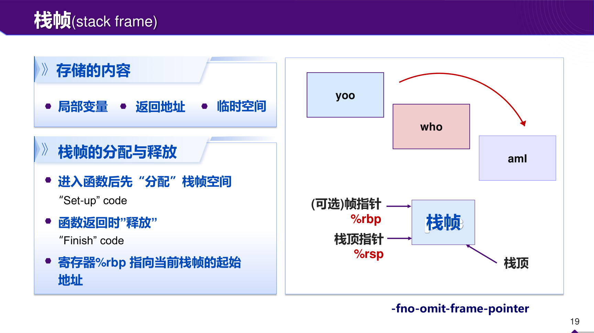
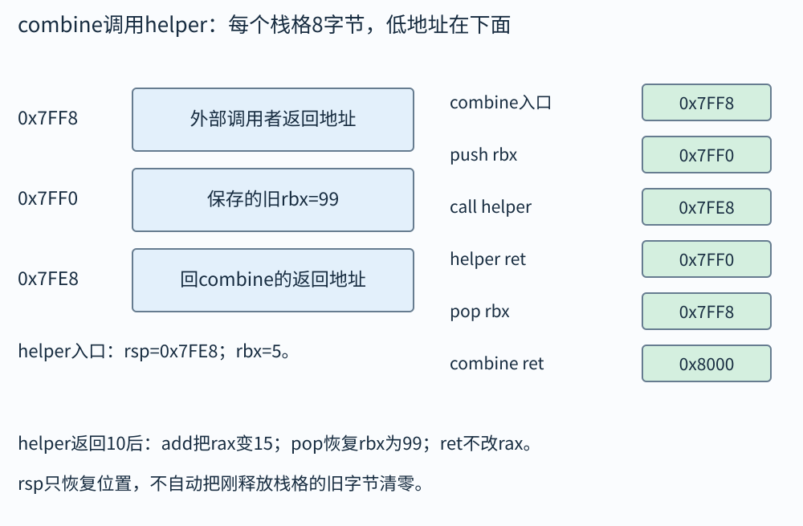
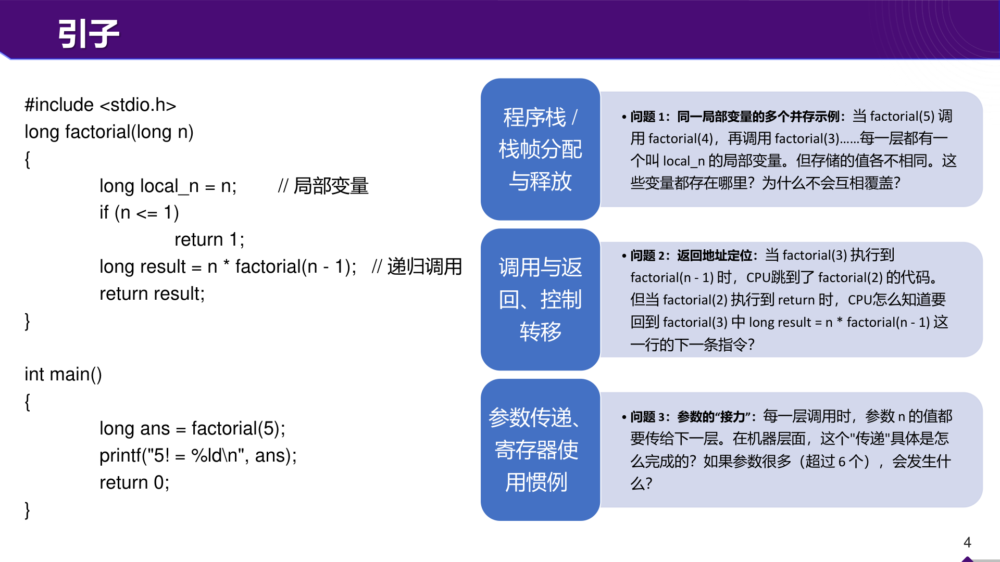

# 函数调用：参数怎么进去，返回时怎么找回原来的位置

主函数调用 `factorial(3)`，后者调用 `factorial(2)`，再调用 `factorial(1)`。每一层都把参数叫 n，但它们分别等于3、2、1；最里层返回后，外面还记得要乘2、再乘3。程序需要保存这些尚未完成的工作，也需要保存“回去以后执行哪条指令”。运行栈正好适合这种最后进入、最先退出的顺序。

不过，C 的局部变量不一定每个都有一个固定栈格子。优化器可能把它放在寄存器，甚至证明它不需要真的存在。我们先用可见的栈帧模型学习调用，再说明哪些部分是调用约定要求，哪些只是编译器常用布局。

## 一次普通调用需要约定哪些事

调用者是发出 call 的函数，被调用者是接到 call 后开始运行的函数。两边要约定参数放哪、结果放哪、哪些寄存器可被改写、返回地址怎样保存、栈怎样对齐。这套约定叫调用约定，是 ABI 的一部分。ABI 是二进制接口规则，保证分别编译的代码能够合作。

本书采用的 System V AMD64 中，普通整数和指针参数的前六个通常依次在 rdi、rsi、rdx、rcx、r8、r9；更多这类参数通过栈传递。浮点参数使用另一套寄存器分类，结构体等聚合参数还要进一步按 ABI 分类，不能把这个简表套到所有函数。普通整数返回值通常在 rax。

调用者保存寄存器是“被调用者可以改，调用者若还要原值就自己先保存”。被调用者保存寄存器是“被调用者若使用并改写，返回前要恢复”。常见被调用者保存寄存器包括 rbx、rbp、r12至r15。保存责任并不是寄存器不能改，而是有人负责在约定时间把它还原。

## call 与 ret 每一步改什么

rsp 保存当前栈顶地址。常见 x86-64 栈向低地址增长。`pushq` 先令 rsp 减8，再把八字节写到新栈顶；`popq` 先读当前栈顶，再令 rsp 加8。两条操作的顺序不同，不要笼统写“栈动了一下”。

普通近调用 call 把下一条指令的地址压栈，再把指令执行位置转到目标函数。ret 从栈顶取出返回地址，令 rsp 加8，并跳到该地址。返回值是另一个问题：它通常已放在 rax，ret 并不负责把数学结果搬进 rax。

正常 System V AMD64 函数入口满足 rsp+8 按16字节对齐。这是因为调用之前栈通常按16对齐，call 又压入八字节返回地址。被调用者若继续调用别人，要安排保存与局部空间，使下一次 call 前再次满足对齐要求。Windows x64 还有不同的参数寄存器和 shadow space，不能混用。

## 算例一：一次调用的地址追踪

题目：call 前 rsp=`0x8000`，call 的下一条指令地址是 `0x401025`，被调用函数地址为 `0x402000`。只追踪 call 与最终 ret，没有其他压栈动作。

call 先将 rsp 变为 `0x7FF8`，在 `0x7FF8` 起八字节写入返回地址 `0x401025`，再开始执行 `0x402000`。被调用函数完成计算后，假设 rax=17，栈顶仍正确指向 `0x7FF8`。ret 读取其中地址，rsp恢复 `0x8000`，接着执行 `0x401025`，rax仍可供调用者读取为17。

如果被调用函数多分配了16字节却未释放，ret 看到的栈顶就不是原来返回地址的位置。即使 rax 中答案正确，也无法保证回到正确地方。因此检查一个汇编函数时，要同时追踪结果寄存器和 rsp 的净变化。

## 栈帧怎样容纳一个尚未完成的函数

栈帧可以含局部数组、溢出到内存的临时值、保存的寄存器以及调用所需状态。常见教学代码先 `pushq %rbp`，再 `movq %rsp,%rbp`，令 rbp 成为这个函数的稳定参考位置，之后用负偏移访问局部数据。rsp 可能随临时压栈变化，rbp 通常暂时保持不变。



原图上方的 yoo、who、aml 表示先后进入的函数。右下两个箭头分别标出可选帧指针 rbp 和当前栈顶 rsp。它在解释“同一函数活动中的一块状态”，并没有规定所有局部变量的固定顺序。图右下 `-fno-omit-frame-pointer` 是要求编译器保留帧指针的一类选项；优化编译时可能省略 rbp 帧指针，通过 rsp 偏移或调试展开信息恢复调用关系。

在常见带帧指针的函数入口，push旧rbp后，`0(%rbp)` 是保存的旧rbp，`8(%rbp)` 是返回地址。但这只适用于已经说明的序言布局。看到另一段代码没有这套序言，不能继续机械套同样偏移。

## 算例二：带局部空间与保存寄存器的完整函数

假设函数收到 x，调用 helper(x)，然后把返回值与原 x 相加。x 在 rdi，而 helper 可能改写 rdi，所以必须保存原 x：

```asm
combine:
    pushq %rbx
    movq %rdi, %rbx
    call helper
    addq %rbx, %rax
    popq %rbx
    ret
```

函数入口 rsp 是“16字节对齐地址减8”。push rbx 后又减8，正好恢复16字节对齐，可以安全进行下一次call。rbx 原值被保存到栈，随后装原x；helper按约定保护rbx，所以返回后它仍是x。add得到目标；pop恢复调用者原rbx；ret再使用本函数返回地址。

取入口 rsp=`0x7FF8`，原rbx=99，x=5。push后rsp=`0x7FF0`，该处保存99；rbx变5。call helper再把自己的返回地址压到`0x7FE8`，helper返回后rsp回`0x7FF0`。若helper返回10，add后rax=15。pop恢复rbx=99、rsp=`0x7FF8`，本函数ret后回到调用者，rsp=`0x8000`。这张地址表能同时核对保存责任与对齐。



每个横框恰为8字节。进入combine时，`0x7FF8`已经保存调用者的返回地址；push保存旧rbx到`0x7FF0`，让下一次call前rsp按16对齐。helper的返回地址在更低的`0x7FE8`，不是覆盖上面的99。helper ret后先回到`0x7FF0`，combine再取回99，最后才弹自己的返回地址。

若用小端观察保存的99，最低地址字节是`63`，其余七字节为0；返回地址也是八字节地址值，但意义是“接着执行的位置”，不能把99当作返回地址。栈向低地址增长说的是push后地址数值变小，不是图必须画成某种上下方向。

## 递归不是一段代码复制成许多份

代码通常只有一份，每次调用的执行状态不同。递归保存的 n、返回地址与局部值属于不同的活动实例。同名变量不是同一个存储实例，就像同一张表格可以填三份，每份里的“姓名”栏不同。



图左侧 factorial 的每一层需要保留自己的 n，因为递归返回后还要乘它。右上问这些同名变量为何不覆盖，答案是它们各有自己的活动状态，通常分布在不同栈帧或被正确保存的寄存器。右中问返回定位，答案是call保存返回地址。右下问参数接力，答案是调用约定安排寄存器或栈位置。把三个问题分别落到保存的值、地址和传参位置，就不会把“递归用了栈”当作无法展开的口号。

## 算例三：阶乘下去以后怎样一层层回来

考虑非负小 n 的阶乘：n≤1返回1，否则返回 n×fact(n−1)。fact(3) 先保留3，调用fact(2)；fact(2)保留2，调用fact(1)；fact(1)直接返回1。此时fact(2)才真正完成乘法2×1=2，并返回2；fact(3)再做3×2=6。

可以把调用栈写成三行待办：最外层“等待fact(2)，拿回来乘3”；中间层“等待fact(1)，拿回来乘2”；最内层“直接交回1”。返回时每消掉一行待办，就释放相应活动状态。向下展开3层，不意味着向下时已经把3×2×1一次算完；未完成的乘法在返回路上继续。

假设每层固定使用16字节辅助状态，最深同时存在n层，峰值辅助栈空间与n成正比。若一个递归算法先算左子树，返回后再算右子树，总调用次数可能很大，但峰值栈只取决于同时活着的调用深度。时间和栈空间必须分别数。

阶乘还受整数范围限制。64位有符号long不是无限精度，n太大时乘积溢出。写“递归公式正确”不等于“任何n都能由这个C函数正确计算”。基础条件也需说明：若允许负n而代码只检查`n==0`，可能不断减小并最终出错。

## 算例四：第七个整数参数在哪里

假设函数只收七个普通long参数，无其他复杂分类。调用者把前六个装入六个参数寄存器，第七个放到栈参数区域。正常入口时 rsp 指向返回地址，因此在最简单布局中，第七个参数可从 `8(%rsp)` 读取。若函数随后 `pushq %rbp; movq %rsp,%rbp`，这个参数相对 rbp 变为 `16(%rbp)`。

偏移为什么增加8？因为push又放入了一个保存值，rbp被设在更低地址。不是第七个参数移动了，而是用于计数的参考点改变了。若函数再分配局部空间但保留rbp，参数相对rbp的偏移仍不变；相对rsp则继续变化。

实际调用还需要考虑栈对齐、参数分类和可能的填充，学习时应把题目限定的参数类型写清。浮点参数与结构体参数不能只按“第几个名字”套这个结论。

## x86-32 对照，以及栈上危险的两个来源

传统32位cdecl常把参数从右往左放到栈上，由调用者清理参数，结果在eax。寄存器宽度、指针大小和参数偏移都与这里的64位例子不同。教师课件专门安排32位对照，就是提醒你先识别环境，再读偏移。函数名相同并不保证二进制调用方式相同。

栈越界是写入超出局部对象边界的位置，可能破坏相邻局部值、保存的寄存器或返回地址。返回局部变量的地址则是生命周期问题：函数退出后该对象已不存在，拿着旧地址继续访问不是“稍后可能被覆盖才算错”，而是已经违反对象生命周期规则。第07章会分别举例。

还有一个常见误会：栈空间释放通常只移动rsp，不负责把旧字节清成零。调试器里还能看见旧值，不能证明对象仍然活着。内存内容暂时残留与语言层面的访问许可，是不同事情。

## 叶子函数、红区和尾调用：哪些栈动作可以省

不再调用其他函数的函数常叫叶子函数。若它只用少量寄存器，可能完全不调整rsp，直接计算后ret。这不意味着call没有保存返回地址，而是被调用函数无需额外局部栈空间。函数是否有栈帧，还要看你说的是逻辑活动记录还是显式分配的空间，术语应说清。

System V AMD64在特定用户态约定中提供rsp下方128字节红区，某些函数可把临时数据放在那里而不显式下调rsp。这不是所有平台都有的保证，内核代码、Windows x64和特定编译选项可能不同。老师的基础题若没有涉及红区，不应为了套它去重解释普通push/sub布局；遇到优化叶子函数时再按ABI核对。

尾调用是函数最后一步直接调用另一个函数并把其结果作为自己的结果，不再有额外未完成工作。编译器在满足调用约定与优化条件时，可能恢复当前状态后直接跳到目标，省去新返回链的一层。普通阶乘`n*fact(n−1)`在返回后还要乘n，不是这种直接尾位置；带累加参数的版本才可能改写为尾递归。C并不普遍保证尾调用优化，因此不能仅凭源码写成尾递归就保证常数栈空间。

## 调用者保存和被调用者保存各适合什么值

如果一个临时值只在两次call之间使用，放调用者保存寄存器无需额外负担；若它必须跨越许多call仍有效，放被调用者保存寄存器，函数入口保存一次、出口恢复一次，可能更省。反过来，被调用者若只做很短计算，也可以直接用易改寄存器而不建立保存序言。

例如函数f需要x跨过g与h两个调用。方案一把x放某个调用者保存寄存器，每次调用前后都存取；方案二把x放rbx，f入口保存旧rbx，两个被调用函数按约定保持它，f出口恢复。两者可以实现同样语义，成本取决于具体代码。调用约定规定责任边界，编译器在边界内选择安排。

初学读反汇编时，不必猜“为什么编译器偏爱rbx”。先检查这个值是否跨call，谁会覆盖它，哪里恢复。观察真实的数据生命范围，比把每个寄存器永久贴上“参数”或“局部变量”标签更可靠。

## 返回局部地址，与返回结构体值不同

`return &local;`把即将结束的对象地址交出去，访问会悬空。`return local_struct;`按值返回结构体，则语义是把成员值交给调用者，可通过寄存器或隐藏返回指针等ABI方式实现，不等于返回原局部对象的地址。看到机器代码中出现一个隐藏指针，也不能反推源码一定返回指针类型。

较大的结构体返回可能由调用者提供存储位置，被调用者把结果写入；这会影响显式参数寄存器的安排。因而“前六参规则”应一直带着普通整数/指针参数与分类条件，不能遇到任何函数都按源码从左往右机械配寄存器。

练习：函数返回一个含两个long的小结构体，是否一定放在栈上？答案是不一定，ABI可能把符合分类的结果放在多个寄存器；具体按类型布局与ABI规则判断。先明确返回语义，再检查实现，不要用一种教学序言概括全部情况。

## 自己做，再看答案

练习一：一个函数push了rbx、再sub rsp,16分配空间，返回前只add rsp,16，漏了pop，会怎样？

答案：局部空间已释放，但rsp仍指向保存的rbx。ret会把旧rbx内容当作返回地址弹出并跳转，真正返回地址还留在更高处，栈也少恢复8字节。必须同时恢复rbx并使rsp指回正确返回地址位置。

练习二：递归二分搜索每次只递归一个长度约减半的区间，峰值栈深度是多少？

答案：长度依次n、n/2、n/4，直到常数，共约log₂n层。每层固定辅助空间时，栈空间O(log n)。如果写成循环，只保存当前左右边界，可以减少到常数辅助空间。这里讨论的是这套实现，并非所有名字叫“二分”的程序都同样用栈。

练习三：优化汇编没有rbp，也没给局部整数分配内存，是否说明程序漏执行了局部变量？

答案：不一定。局部值可以一直在寄存器中，也可能已被常量传播消除。C要求保持可观察行为，不要求每个源码变量都拥有固定内存格子。分析时追踪值如何产生和使用，不能只按源码名字寻找栈槽。
