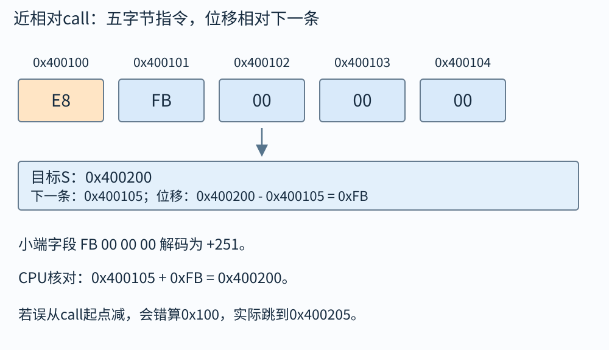

# 编译与链接：函数写在另一个文件里，机器怎么找到它

main.c里调用sum，sum的定义却在sum.c。编译main.c时，工具可能还没看到sum的函数体，照样能生成main.o。直到链接时，工具把“这里需要sum”与“这里定义了sum”对应起来，再修正调用位置。理解这条过程，你就能分清语法错误、未定义符号、重复定义和运行时找不到共享库分别发生在哪一层。

本章以常见Linux的ELF目标文件为例。macOS使用Mach-O，Windows常用PE/COFF，细节与命令输出不同。可以比较概念，但不要拿ELF的段名与重定位格式逐字套到所有系统。

## 算例一：两个源文件怎样接起来

把以下三个文本文件放进同一目录。sum.h只声明接口，告诉两份源文件参数和返回值都是哪些类型：

```c
#ifndef SUM_H
#define SUM_H
long sum(const long *a, long n);
#endif
```

sum.c给出实现。它只在本题约定的n非负、a有至少n项且部分和不溢出的输入上工作：

```c
#include "sum.h"
long sum(const long *a, long n) {
    long total = 0;
    for (long i = 0; i < n; ++i)
        total += a[i];
    return total;
}
```

main.c准备三个元素并调用这个接口：

```c
#include <stdio.h>
#include "sum.h"
int main(void) {
    long a[3] = {2, 4, 8};
    printf("%ld\n", sum(a, 3));
    return 0;
}
```

在终端依次执行：

```sh
cc -std=c17 -Wall -Wextra -c main.c -o main.o
cc -std=c17 -Wall -Wextra -c sum.c -o sum.o
cc main.o sum.o -o app
./app
```

最终输出14。前两个命令只处理各自的.c；main.c知道sum的声明，不需要在这一阶段得到sum的函数体。第三个命令才把两者合起来。分别编译后，main.o含main的定义、对sum和printf等符号的引用；sum.o含sum的定义。链接器找到sum的入口，修正main中调用sum的位置；printf则由相应标准库链接安排解决。程序运行时传a地址与长度3，sum返回14，printf按long格式输出。

若命令漏写sum.o，main.o里的sum引用无人提供，链接失败。若把sum.c中的函数改成文件级static，那个定义只在sum.c内部有效，通常同样不能满足main.o的外部sum引用。若把main里的声明改为错误参数类型，符号名字可能仍对上，错误便延后到运行行为，不能指望“链接成功”兜住它。

## 一个编译命令背后的四个阶段

预处理展开include、宏和条件编译，输出仍是C文本。编译阶段分析C的类型和语义，做优化，生成汇编或中间表示到汇编的结果。汇编器把指令与数据转换为可重定位目标文件，通常后缀.o。链接器把多个目标文件和库组合，完成符号解析与重定位，生成可执行文件或共享对象。

例如可以用`cc -E main.c`观察预处理结果，用`cc -S main.c`生成汇编，用`cc -c main.c`停在目标文件。`cc main.o sum.o -o app`再链接。cc在这里是驱动程序，它替你选择和调用后端工具；看到同一个命令名字，不表示所有阶段都由同一个内部模块完成。

错误发生的阶段影响排查方法。少一个分号通常在编译阶段报；声明了函数但没有提供定义，可能编译通过、链接报undefined reference；共享库路径不对，则可能链接成功，到启动时才报加载失败。先定位阶段，再查对应输入，能少走很多弯路。

## 符号表：名字要对应哪块代码或数据

符号可以代表函数入口、全局变量等位置。目标文件记录自己定义了哪些符号、使用了哪些未定义符号。文件级static函数或变量通常具有内部链接，不应作为其他目标文件同名引用的候选定义。普通局部自动变量往往没有链接意义上的全局符号，优化后甚至不在内存中单独存在。

C的声明告诉编译器“这个名字的类型是什么”，定义还负责真正提供对象或函数。头文件通常放声明，让多个.c一致地知道接口。把一个普通全局对象定义直接放进头文件，再被两个.c包含，就可能得到两个定义。头文件保护宏防止的是同一翻译单元重复包含，不会替不同.c合并全局定义。

链接器通常不会替你做完整C类型检查。一个文件以long声明某外部对象，另一个以int定义，即使名字能对上，程序也可能按错误大小读写。应把声明集中到共同头文件，并让定义文件也包含它，尽早由编译器检查一致性。

## 算例二：相对调用位移怎么填

题目：某x86-64相对call位于地址`0x400100`，该指令长度5字节，目标函数入口为`0x400200`。位移是多少？

相对基准是下一条指令地址`0x400105`，所以位移为`0x400200−0x400105=0xFB`，十进制251。执行时CPU把下一条地址加位移，得到目标入口，同时将下一条地址作为返回地址压栈。

如果错用call起始地址作基准，会算出`0x100`，最终跳到`0x400205`，偏了五字节。链接器的重定位记录正是告诉它“哪几个字节要填、依据哪个符号、采用哪种计算规则”。不同重定位种类的公式不同，不能把这个call公式套到任意绝对地址数据。

重定位之后，指令本身并不需要保存“sum”这个人类名字。它可以直接携带偏移。符号和调试信息常为了分析保留，也可以被剥离；程序仍能运行，因为运行所需的位置关系已经编码到指令或动态链接结构中。

把这个call的五个机器字节也列出来，能检查“符号地址”和“位移字段”是不是被混在一起：

|地址区间|内容|它负责什么|
|---|---|---|
|0x400100|E8|近相对call操作码|
|0x400101至0x400104|FB 00 00 00|32位小端位移+251|
|0x400105|下一条指令起点|计算位移的执行基准|
|0x400200|目标函数入口|最终跳到的位置|



若相应ELF重定位按`S+A-P`表达：S为目标符号地址`0x400200`，P为位移字段起点`0x400101`，这一写法的加数A为−4，便得到`0x400200−4−0x400101=0xFB`。−4把“字段起点”换成“字段结束后的下一条”。具体重定位类型按目标文件给定规则，不能看见相对引用就假定所有类型的A都为−4。本例位移落在有符号32位范围内；若目标距离超出范围，就需要其他调用安排，截断字段并不能保证仍跳到目标。

反向核对CPU执行：把字段解码成+251，取下一条`0x400105`加`0xFB`，恰好`0x400200`。若目标地址小于下一条指令地址，位移为负，字段仍按32位补码保存，不是加一个巨大无符号跳距。

## 目标文件里的节与运行时的段

ELF节用于组织链接时的信息，例如.text保存机器代码，.rodata保存只读数据，.data保存有初值的可写数据，.bss描述需要零初始化的可写存储。符号表、重定位表等也有自己的节。节的名字帮助理解职责，具体文件可以有更多节，也有不完全同名的安排。

.bss中的大量零通常不需要在磁盘文件中逐个存出来；文件记录运行时要多少空间，由加载器建立为零初始化的内存。因此一个定义了巨大静态零数组的程序，运行内存可能远大于可执行文件磁盘大小。malloc得到未初始化存储的情况与此不同，不要把“系统某些新页看起来为零”当malloc的语言级承诺。

加载时更关心段。程序头描述哪些文件区域要映射到哪些虚拟地址，以及读、写、执行等权限。多个节可以归入一个加载段。节表便于链接和分析，程序头便于加载，不能看到两个名词都叫“块”就合并为同一东西。

## 静态库为什么有时换个顺序就能链接

静态库通常是多个目标文件的归档，不是把整座库无条件装进最终程序。传统链接器从左到右处理输入，遇到库时按当时尚未解决的符号需求提取成员。因此“先出现使用者，再出现提供者”常是静态库顺序的重要原则。

设main.o需要a，libA.a中的a又需要b，libB.a提供b。常见命令顺序为`main.o -lA -lB`。如果先写-lB，当时尚无b需求，链接器可能不提取其成员；之后a引入b需求时，未必回头自动重扫前面的库。实际现代工具支持分组重扫、全库纳入等选项，但你首先要理解普通扫描为什么会失败。

循环依赖库时，简单调换一个顺序可能不够，分组扫描或更合理的模块拆分才是办法。不要通过随意重复十遍库名碰碰运气。链接器诊断给出的未定义符号与引用对象，能指向真正的依赖边。

## 算例三：重复定义与static的区别

a.c和b.c都写`int count=1;`，两者都提供一个有初值的外部定义，链接器通常报重复定义。若两个文件都改为`static int count=1;`，它们分别得到只在各自文件可见的独立对象，名字相同但不是共享计数器。

若本意是共享一个计数器，应该在一个.c中定义一次，在共同头文件中写`extern int count;`，其他.c包含头文件。extern声明让编译器知道类型，实际存储由那一个定义提供。若本意是每个模块拥有私有计数，static是合理选择，但不能拿它只为消除错误提示而改变程序语义。

旧工具链对无初值暂定定义可能采用公共符号合并规则，较新工具链默认设置也可能变化。课程题常讲“强符号、弱符号、公共符号”的历史模型；实际项目不应依赖错误多重定义恰巧被合并。明确单一定义，比猜链接器版本可靠。

## 共享库、位置无关代码和动态装入

共享库可以在运行时映射进进程，不同程序使用同一库的代码页时有机会共享物理页。库在每个进程里的虚拟地址不一定相同，也不意味着它的可写全局数据在不同进程间自动共享。

位置无关代码尽量避免把固定绝对地址写死在指令中，配合相对寻址、全局偏移表GOT等结构访问外部数据。过程链接表PLT常参与外部函数调用。动态链接器负责建立映射、解析动态符号、完成必要的运行时修正；某些环境使用延迟绑定，某些采用立即绑定，具体要看链接选项和系统策略。

程序启动时找库的路径，也与编译时头文件搜索路径不同。`-I`主要影响包含头文件，`-L`主要影响链接时搜索库，运行时还有加载器的路径规则。因为编译能找到声明，不代表运行时一定找到实现。诊断时分开检查“声明来自哪里、链接选中哪座库、运行加载哪份库”。

## 算例四：库加载失败应该查什么

题目：编译链接都成功，把app复制到另一台相同架构Linux机器却提示缺少libexample.so。你应先改C源码吗？

首先确认错误发生在动态加载阶段。可检查可执行文件记录的依赖库名字、目标机器是否安装兼容版本、运行时搜索路径与架构是否匹配。将头文件一起复制过去通常不能解决问题，因为头文件在编译阶段使用，运行时需要的是共享对象及其依赖。

若程序已启动，调用某函数时才报找不到动态符号，还要检查库版本是否提供该符号，以及符号版本或加载范围。若架构不同，文件即使同名也不能直接使用。修复应针对实际依赖，不要把网上某个同名二进制随意塞到系统目录。

## 头文件接口为什么也要被定义文件包含

假设头文件声明`long transform(long);`，实现文件却没有包含头文件，自己定义成`int transform(int);`。调用文件按long参数与long返回值生成代码，定义文件按int处理，符号名字仍可能一样，链接器只见到名字对上，不能替你恢复C类型一致性。

让实现文件也包含公共头文件，编译器便能在同一翻译单元看到声明和定义矛盾，尽早诊断。跨语言接口还需要注意C++名字修饰、extern "C"、结构体布局等规则；把文件后缀从.c改.cpp，不等于二进制接口保持不变。

这解释了一个看似繁琐的工程习惯：接口声明只有一个可靠来源，每个使用者和提供者都包含它。复制粘贴一份看起来相同的函数原型，未来某次修改后可能分叉，链接成功也不能证明调用正确。

## 动态链接查到同名函数，为什么仍可能不是预期那份

进程可加载多座共享对象，它们可能导出同名符号。动态符号解析有查找范围与顺序，某些平台还允许符号插入等行为。于是“系统里确实存在一个名为foo的符号”并不充分，还要确认当前引用会绑定到哪一个定义。

课程基础部分不需要记完所有加载器选项，但应知道排查方向：实际加载路径、库版本、导出符号、可见性与绑定方式。把多个不兼容版本放进同一搜索路径，可能让开发机偶然成功、部署机失败。记录实际依赖版本与可重复构建过程，比只存一条编译命令更稳。

共享库ABI兼容还涉及结构体大小、枚举或类型约定、函数签名和符号版本。源码能重新编译并不意味着旧二进制无需重编。头文件是源码接口的一部分，共享对象提供二进制实现，两者版本必须协调。

## 一道bss与文件大小的推理题

程序A定义`static unsigned char buf[1000000];`，无显式非零初值；程序B在运行时malloc同样多字节。A的可执行文件不必因此多出一百万个零字节，但运行时需要建立相应零初始化对象。B直到分配路径执行时才请求存储，失败与对象生命周期也由动态路径决定。

若A的数组完全不被使用，优化与链接垃圾回收还可能移除它，所以实验时要确认对象真的保留。若想比较文件大小，别把一个已被删掉的对象误当bss压缩效果。读工具输出时，把磁盘文件字节数、虚拟映射大小和实际驻留物理页数分开。

练习：把零数组改为一百万个明确非零字节的初值，文件大小是否通常更可能增大？答案是更可能，因为初始内容需要在文件或等效机制中表达；但压缩、链接优化与格式仍可影响具体大小。不要只凭源码数组长度推断最终磁盘精确字节数。

## 编译期替换接口：宏能替你改调用，也能带来误会

课程选节中的库插入可以从编译期方法理解：在编译某段源码时，用头文件宏把一个函数名重定向到包装函数。比如把普通分配调用导向一个记录请求大小的my_malloc，包装函数再调用实际分配接口。这样可以统计分配，但必须避免包装函数自己也被同一个宏再次替换，造成无限递归。

宏在预处理阶段生效，只影响包含它之后的源码文本，不会自动改写一个已经编译好的第三方目标文件。想在链接期或运行期拦截，是其他层次的机制，具有不同工具和限制。把三种阶段分开，就知道为什么“我加了宏，但库内部调用没变”并不奇怪。

函数式宏还可能重复求值实参，例如不谨慎的平方宏传入i++，行为与普通函数不同，甚至触及未定义的修改顺序。接口包装应尽量保持参数只求值一次、类型一致和错误语义不变。为了统计而改变malloc失败处理或把errno无意覆盖，就会使观察工具本身改变被观察程序。

## 一个重定位字段不是整个符号表

符号表负责告诉工具“这个名字的定义或引用是什么”；重定位项负责指出“输出文件哪个位置需要按哪种规则修正”。同一个函数符号可以被多个调用点引用，每个调用点各有修正位置；某个符号也可能仅用于调试或导出，并不对应你刚看到的那条call。

设main.o里两处调用sum，汇编时sum不在本文件中，工具可以为两处保留相应待修正字段。链接把sum放到最终地址后，两处call距离不同，因此位移数值也不同。不能把“sum地址是0x5000”直接填进两处相对位移字段，否则会把地址与位移混淆。

练习：两条相对call下一条地址分别0x1005和0x2005，目标都0x3000，它们位移一样吗？答案不一样，分别0x1FFB和0x0FFB。目标符号相同，引用位置不同，重定位结果自然不同。这个例子正好把第01章的地址、第04章指令位置和本章链接责任连起来。

## 自己做，再看答案

练习一：`extern int x;`和`int x=3;`各负责什么？将后一行放进被两个.c包含的头文件，有什么风险？

答案：前者通常只是声明外部对象及其类型，不在此处提供带初值的定义；后者定义对象并给初值。放入两个翻译单元会各提供一个外部定义，通常导致多重定义。头文件保护宏不能跨翻译单元消除它们。

练习二：call起点`0x1000`，长度5，目标`0x0F00`，相对位移是多少？

答案：下一条地址`0x1005`，位移`0x0F00−0x1005=−0x105`，即−261。它需按该重定位字段的有符号编码保存。执行时`0x1005−0x105=0x0F00`，核对无误。

练习三：两个进程加载同一个共享库，库里的普通全局变量是否就是同一个共享计数器？

答案：通常不是。代码页可能共享，但可写数据属于各自进程的地址空间；私有映射可能先共享再写时复制。若希望跨进程共享数据，要明确使用共享内存等机制，并安排同步，不能从“共享库”的名字推出可写对象共享。
