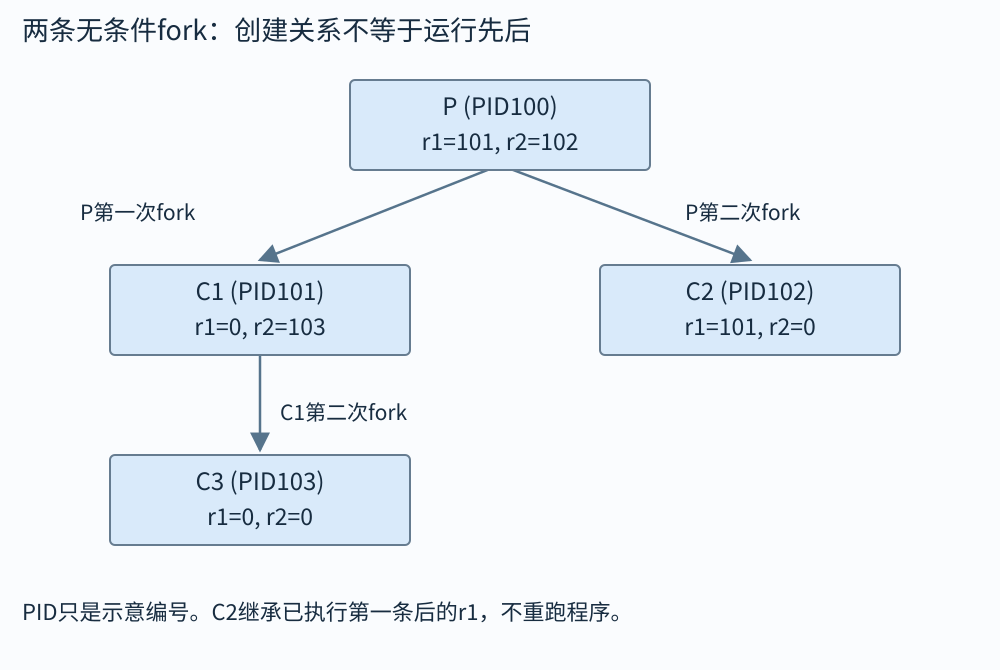

# 异常与进程：程序为什么能停下来，又从原处接着跑

你在终端里启动程序，它并没有独占整台电脑。操作系统不断安排不同执行活动使用处理器，同时处理磁盘、时钟和网络带来的事件。有时是程序主动请求系统服务，有时是当前指令访问了不允许的位置，有时是外部设备通知处理器“数据到了”。正常顺序执行的指令流因此被打断，这一类机制统称为异常控制流的一部分。

本章先分清异常、进程、上下文切换，再用fork画出父子进程。看fork题时，最有效的工具不是把源码机械复制粘贴，而是画一棵进程树，为每个进程单独保存变量和下一条指令位置。

## 进程、程序文件和地址空间

程序文件是磁盘上的代码与数据描述；进程是运行时实例。你可以把同一可执行文件启动两次，得到不同进程ID、不同执行进度和通常相互隔离的数据。进程地址空间是它可使用的虚拟地址集合及映射，下一章组中的虚拟内存会解释如何映射到物理页。

设同一个求和程序启动两次，记作进程P和Q。它们的代码可以相同，但当前加到哪里不同。只列三项状态：P暂时有rax=7、rsp=0x8000、下一位置0x401020；Q有rax=99、rsp=0xA000、下一位置0x501040。这些地址只为演示，实际还有其他寄存器与映射状态。

|阶段|CPU当前执行谁|CPU里的rax/rsp/下一位置|被暂停者的状态留在哪里|
|---|---|---|---|
|先运行P|P|7 / 0x8000 / 0x401020|Q的99 / 0xA000 / 0x501040已由系统保存|
|系统接管切换|内核|执行内核所需的状态，本表不列|把P的7 / 0x8000 / 0x401020保存下来|
|恢复Q|Q|99 / 0xA000 / 0x501040|P的保存状态没有因Q使用rax而丢失|
|Q执行一段后再切换|内核|先保存Q本次进度|假定Q已变为100 / 0xA000 / 0x501044|
|恢复P|P|7 / 0x8000 / 0x401020|Q的新状态留待以后恢复|

内核是操作系统中以受控权限管理这些资源的部分。它保存当前执行者继续所需的状态，再恢复另一执行者，这就是一次上下文切换。P再次获得CPU时，不是从程序开头重做，也不会把Q留下的100当作自己的部分和。

上下文包括寄存器、程序计数位置、栈状态、地址空间关联等继续运行所需信息。普通函数调用在同一进程的执行路线中转入另一个函数；切换进程则会恢复另一个运行实例的状态。两者都出现“保存与恢复”，保存对象和目的不同。

在单核上，多个进程可以通过交错运行形成并发；在多核上，它们也可能真正同时执行。并发只要求执行时间段有重叠、彼此都尚未完成，不要求每一瞬间同时占着CPU。后面分析竞态时，单核交错也足够产生问题。

## 普通函数调用与进入内核的区别

普通call遵循用户程序的调用约定，在当前允许权限下跳到另一段用户代码。系统调用则通过受控入口请求内核执行服务，例如打开文件或创建进程。用户程序不能仅靠把某个函数地址写进指令，就获得任意硬件权限。

处理器异常按成因和返回位置可作教学分类。中断通常来自当前指令流外部，例如时钟或设备事件；陷阱常用于有意进入系统服务或调试，处理后可从后续位置继续；故障由当前指令引起，处理成功后可能重新执行该指令，例如可修复缺页；终止类错误则可能无法安全继续。不同架构术语细节有所差别，重点是问清“因谁发生、能否修复、回到哪条指令”。

缺页不一定是程序错误。一个合法的虚拟页暂时没有驻留物理内存，内核可以准备页面，再重试原指令。访问根本没有合法映射或没有权限的位置，则可能使进程收到SIGSEGV等信号。缺页异常是处理器与内核之间的机制，信号是操作系统向进程报告事件的另一层接口，不要把两者写成完全同一个东西。

## fork 返回两次，源码并没有从头重跑

fork成功后，原进程成为父进程，新建子进程从fork返回后的同一逻辑位置继续。父进程得到子进程ID这个正数，子进程得到0。失败时只有原进程，返回−1，没有子进程。通过返回值分支，父子可以执行不同工作。

普通私有内存开始时内容相同，但分别属于两个地址空间。父进程把自己的x改成20，不会自动把子进程x也改成20。Linux常用写时复制实现：开始共享部分物理页，某方写入时再复制，保持私有内存的语义。实现上暂时共享物理页，不等于语言程序中的普通变量成为跨进程共享变量。

文件描述符则有一层不同关系：父子各有描述符表项，但对应表项可能指向同一个内核打开文件描述，从而共享文件偏移等状态。第13章会画这一层。回答“fork共享什么”时，不能只说“全共享”或“全不共享”。

## 算例一：x 的两份副本

```c
int x = 10;
pid_t pid = fork();
if (pid == 0) {
    x += 1;
    /* 子进程看到 x=11 */
} else if (pid > 0) {
    x += 2;
    /* 父进程看到 x=12 */
} else {
    /* 处理失败 */
}
```

fork之前一份x=10。成功之后有两份内容同为10的私有x。子进程自己的加法得到11，父进程自己的加法得到12。谁先执行不改变这两个结果，因为两边没有写同一个私有对象。

如果两边分别打印，输出行先后通常没有保证。你不能看到终端上“父先出现”，就认为fork保证父先运行。调度、缓冲和I/O都会影响可观察顺序。若题目明确父进程先wait子进程，则可增加一个实际顺序约束。

## 算例二：连续两次fork有几个进程

代码是两条不带条件的fork，假定都成功：第一条之后有原父P与子C1；第二条会由这两个进程各执行一次，P再生C2，C1再生C3，共四个进程。每个进程都从自己执行的fork之后继续。

可以按阶段画数量：开始1个，第一轮2个，第二轮4个。一般k条每个现存进程都必经且成功的fork，最后有$2^k$个进程。但只要加入条件、提前退出、失败或exec，这个公式就不能直接套。

例如`if(fork()==0) fork();`，只有第一轮子进程继续执行第二次fork，总共三个。看见两个fork字样就回答四个，漏掉的是控制流条件。分析时应把“哪个进程会经过这条指令”写在每个树节点旁。

用两条有名字的返回值把四个执行者分开。下面只是为图指定示意PID，真实PID由系统分配：

```c
pid_t r1 = fork();
pid_t r2 = fork();
/* 假定每个调用均成功，所有执行者都到达这里 */
```

|最终进程|它由谁创建|r1保留什么|r2是什么|下一步执行哪里|
|---|---|---:|---:|---|
|P，示意100|原进程|101|102|第二条fork之后|
|C1，示意101|P的第一次fork|0|103|第二条fork之后|
|C2，示意102|P的第二次fork|101（继承P当时的值）|0|第二条fork之后|
|C3，示意103|C1的第二次fork|0（继承C1当时的值）|0|第二条fork之后|



C2不会倒回第一条fork再产生孩子，它已继承第一条执行后的状态；C3也不会重做第一条。树中的创建边表示谁生谁，不表示叶子之间有从左到右的运行顺序。若程序是第一次fork只由子分支继续fork，就只保留P→C1→C3那部分，不会出现C2。

## exec：换程序，不是再生一个孩子

exec系列在成功时用新程序替换当前进程的程序映像，当前进程ID通常保持。原来的后续C代码不会再执行；只有失败才返回错误。因此常见shell模式是父进程fork，子进程准备重定向后exec目标程序，父进程等待或继续处理命令。

exec需要准备参数数组，最后用空指针结束。环境变量也可由不同接口继承或明确提供。名字不同的exec接口在路径查找、参数传递方式等方面不同，使用前查实际原型。不要把参数数量、数组终止符和字符串本身的终止符混为一个问题。

多线程进程fork后，子进程只保留调用fork的那个线程，其他线程持有的锁状态却可能被继承到私有内存。子进程在exec之前可调用的安全函数因此受到严格限制。这是系统接口的真实边界，不应把单线程教学示例无条件放进复杂多线程程序。

## wait 回收的是退出后的记录

子进程退出时，内核需要暂存退出状态，让父进程以后查询。已经退出但尚未被回收的子进程常叫僵尸进程，它没有继续执行用户代码，却占有必要的管理记录。父进程通过wait或waitpid取得状态并回收。父进程先退出还涉及孤儿进程由系统中的指定回收者接管等规则，具体按系统规定处理。

等待的状态不是一个可直接当退出码使用的普通整数。应使用WIFEXITED、WEXITSTATUS等宏解释：先确认正常退出，再取退出码；若被信号终止，要用对应宏。`waitpid`还可能被信号打断，返回−1且errno为EINTR，此时通常需要按程序策略重试。

## 算例三：让子输出先于父输出

想让子进程打印C并结束，父进程等待后打印P。逻辑顺序是：fork成功；子执行输出并退出；父对指定子pid调用waitpid；等待确认结束后才输出P。这里“子结束在父后续操作之前”由wait建立，不是靠sleep估计时间。

但输出缓冲仍需设计。若父进程在fork前有尚未刷出的stdio缓冲，父子都会继承那份用户态缓冲副本，可能各自再次刷出。可在fork之前明确fflush需要的流，或用适合场景的低层write。在子进程exec失败的路径，常用_exit结束以避免再次执行继承的stdio清理；这也需要正确报告错误。

完整真实代码必须检查fork与waitpid返回值。只在纸面写`wait(NULL)`，却让失败返回与子进程分支混在一起，可能把“没有孩子”错误解读为“孩子已完成”。错误路径同样属于程序控制流。

## 算例四：为什么 hello 会打印两次

设程序先执行`printf("hello");`，没有换行也没有fflush；随后fork成功，父子都正常return。在输出流此时确实保存未刷用户缓冲的条件下，fork复制缓冲，父子退出各刷一次，可能看到两份hello。

若hello在fork前已经刷出，则没有这份重复。终端通常行缓冲，重定向到文件时常采用不同缓冲策略，因此“我在终端没复现”不反驳缓冲复制原理。分析应先写出具体缓冲前提，不能把“fork前打印必定重复”当无条件结论。

文件描述符共享的内核偏移与stdio复制的用户缓冲，是同时存在的两层状态。把它们各画一个盒子：一个在进程用户空间，fork后两份；一个在内核打开文件描述中，可能由父子引用同一个。这张图能解释为什么输出内容和偏移顺序并不只取决于C变量。

## 非局部跳转与异常的区别

setjmp保存某种恢复执行所需环境，longjmp可回到仍有效的保存点，常用于跨越多层函数退出。它不等于普通return，也不等于操作系统切换进程；使用它还要遵守局部对象、资源释放和信号掩码等规则。尤其不能跳回已经返回的函数活动。

本课程把这些内容放在异常控制流范围，是为了让你识别“下一条执行位置不只来自顺序、if和call”。遇到一种转移机制，始终追问保存了哪些状态、恢复了哪些状态、哪些资源需要手动清理。名字里都有“跳”，不代表它们有同样保证。

## 把setjmp和longjmp实际走一次

下面先在main仍活着的栈帧保存一个恢复点，再进入f与g。g不逐层return，而是longjmp直接回到恢复点。setjmp第一次正常执行返回0；longjmp(env,7)之后，看起来像同一次setjmp现在返回7，于是switch走case7。

```c
#include <setjmp.h>
#include <stdio.h>
static jmp_buf env;
static void g(void) {
    puts("g: jump");
    longjmp(env, 7);
}
static void f(void) {
    puts("f: before g");
    g();
    puts("f: after g");
}
int main(void) {
    switch (setjmp(env)) {
    case 0:
        puts("main: first return is zero");
        f();
        break;
    case 7:
        puts("main: resumed with seven");
        break;
    default:
        return 1;
    }
    return 0;
}
```

执行输出依次是main第一次、f调用前、g跳转、main恢复。f中的after g不会出现，因为控制没有经g返回到f。与异常控制转移类似，这里跨过了中间普通返回路线；但它仍在同一线程、同一进程中，不是创建或恢复另一个进程。

几个限制要跟例子一起记：不能在main已经返回后再跳回它的旧恢复点；不能把另一个线程保存的env当本线程恢复环境；跳转不会自动替你释放malloc对象、解锁或关闭途中取得的资源。setjmp之后被修改过的某些非volatile自动局部变量，在longjmp回来后也不能继续假定保留修改后的值；本例没有依赖这类变量。

setjmp作为宏还对调用所处表达式有规则，本例直接把它作为switch控制表达式，避免随手放进任意复杂计算。longjmp第二参数为0时，恢复点得到的返回值会改成1，以便与首次正常返回0区分。理解这些约束以后，才适合把它用于错误恢复，不能拿它当跨函数goto随意跳。

## 进程树要画父子关系，执行图要画先后关系

父子关系告诉你谁创建谁，不自动规定谁先执行fork之后的指令。执行图则记录由程序顺序、wait等建立的约束。假设父打印P，子打印C，父未wait，则P先或C先都可能；若父在打印P前wait子结束，子先完成的约束才成立。

输出由多个字节或多个调用组成时，还要问一次输出是否作为一个整体、底层对象是否允许交错。stdio一行文本在你的C代码中是一条printf，不等于它一定只对应一条write。题目若采用“每次打印原子输出一个字符”的模型，可以按该模型枚举；真实系统需要明确缓冲与写入保证。

画图时，把每个进程内的先后用箭头连起来，再加入wait边。符合全部边的排列才是允许顺序。只背“fork后顺序不确定”，既不能枚举答案，也不能看出哪些顺序其实被等待排除了。

## 退出状态怎样正确解释

子进程`return 7`通常经运行时转换为退出，父进程waitpid取得的是编码状态，不是直接整数7。父先用WIFEXITED确认正常退出，再用WEXITSTATUS取得退出码。若孩子被信号终止，WIFSIGNALED和WTERMSIG等宏才有相应意义。

假设父直接打印原始status，看到1792而以为系统把7乘了256弄错。在常见编码里7可能位于特定位段，这个值并不意外；但正确程序不应手写移位猜所有平台编码，而使用规定宏。接口提供宏就是为了隔开编码细节。

退出码可表达范围也有限，不能拿它当任意64位计算结果传输渠道。若要父子交换大结果，应通过管道、共享内存、文件等合适机制，并定义格式与同步。进程结束记录负责报告状态，不代替通用数据通信。

## fork失败时为什么不能落入父子成功路径

fork返回−1，表示没有新孩子。错误代码若只写`if(pid) parent(); else child();`，会把−1也当作真，直接进入“父已经有孩子”的逻辑，可能等待错误对象或记录非法pid。应明确分成pid<0、pid==0、pid>0三类。

资源限制、内存压力或系统策略都可能使创建失败。教学算题可以注明“假定全部成功”以专注进程树；工程代码必须检查。写注释说明假设，比把失败路径悄悄删除更诚实，也让读者知道何时需要补上。

练习：父创建两个孩子，第一个成功、第二个失败，是否仍按四个进程分析？答案是否。必须按每个现存进程真正执行到的调用与每次结果画树。简单的$2^k$只适用于每轮每个进程都执行且成功的特定模型。

## 自己做，再看答案

练习一：fork成功后，父子都执行`x++`，初始私有x为0。最终父子各看到多少？

答案：各为1。它们各自修改自己的私有x，不是两个线程共同对一个共享计数器加一。若希望跨进程共享同一计数器，必须使用明确共享映射等机制，并安排同步。

练习二：`fork(); if(fork()==0) puts("X");`，假定全成功，X执行几次？

答案：第一条后两个进程。每个进程都执行第二条fork，并各产生一个返回0的孩子，所以puts在两个新孩子中执行，共两次。四个进程的总数与打印次数不同，要看打印所在分支。

练习三：exec成功后，紧接着写在源码里的`puts("done")`是否执行？

答案：不会。当前程序映像已被替换。若这一行执行，通常意味着exec失败并返回，需要检查errno，而不能把它当成“新程序执行完成后自动回来”。要等待新程序结束，应由另一个进程使用wait类接口。

接口细节可对照 [Linux man-pages 的 fork 文档](https://man7.org/linux/man-pages/man2/fork.2.html) 和 [execve 文档](https://man7.org/linux/man-pages/man2/execve.2.html)。
