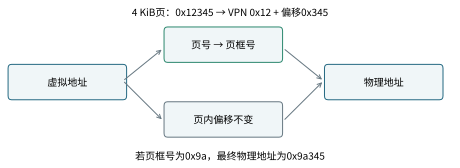

# 虚拟内存：同一个地址，为什么能装着两份不同数据

两个进程都打印某个变量地址为`0x400000`，内容却一个为7、一个为99，并不矛盾。程序通常看到的是虚拟地址。每个进程有自己的映射规则，同一个虚拟地址可以翻译到不同物理位置。虚拟内存把“程序如何给位置编号”和“数据实际放在物理内存哪里”分开，也为隔离、共享和按需装入提供基础。

学习地址翻译时，最容易混的是四组词：虚拟页号、页内偏移、物理页号、物理地址。本章会用小得能手算的地址模型，反复把它们写出来。真实x86-64系统的页表层级更复杂，课程引言明确多级页表不作默认要求；先把单级模型讲透，不拿层级名字堆满纸。

## 先把整段地址切成页号和页内位置

页是固定大小的地址区间。假设每页256字节，即$2^8$字节，低8位描述页内偏移，其余高位描述页号。虚拟地址`0x12AB`可拆成虚拟页号`0x12`与偏移`0xAB`。

为什么翻译时偏移保持？映射以整页为单位，把虚拟页的起点对应到物理页的起点；页内第171个字节仍是目标物理页内第171个字节。改变的是页号，不是重新打乱页内字节顺序。因此物理地址为“物理页号×页大小+原偏移”。

物理页框也叫物理页帧，是物理内存里容纳一页的位置。页表为虚拟页记录它映射到哪个物理页框，以及是否有效、可读写、可执行、是否用户可访问等属性。不同系统字段不同，但核心都包含“在哪里”和“允许怎样用”。

## 算例一：第一次完整翻译

题目：虚拟地址16位，页大小256字节。页表中虚拟页`0x12`映射到物理页`0x3A`，且允许当前读操作。读虚拟地址`0x12AB`，物理地址多少？

第一步，256=$2^8$，偏移8位。第二步，虚拟页号为高8位`0x12`，偏移为低8位`0xAB`。第三步，查该进程的页表得到物理页号`0x3A`。第四步，拼接物理页起点`0x3A00`与偏移，得到`0x3AAB`。

核对：`0x12AB`和`0x3AAB`低8位完全相同。若算出`0x3A12`，说明把页号和偏移位置混了；若算出`0x3A+0xAB`，说明忘记页号需要先乘页大小。

这张图另用4KiB页，不是上一题的256字节页。图中0x12345拆为VPN0x12与偏移0x345，页框号取0x9A，得到物理地址0x9A345；低12位保持不变。更换页大小时，必须重新确定偏移位数，不能沿用上一题的低8位。

读图时先沿虚拟地址的高位找到页表项，再沿映射箭头到物理页号；低位偏移另有一条不变通路。箭头表示查找关系，不表示CPU把整个页复制一次。普通每次访存做的是地址解释；只有缺页处理、写时复制等情况才可能另外搬运页面内容。

## 页表有效与权限允许是两次不同检查

某页表项表明页面不驻留，操作系统可能仍知道它来自哪份文件或交换区域，能够装入后继续执行。另一个地址可能根本不属于进程合法映射，无法通过正常缺页处理修复。两者都可能在硬件翻译时遇到异常，但后续处理不同。

权限检查也独立存在。页面已驻留，但只读，写入仍会触发保护相关异常。页面可读，不等于可执行；代码页可执行，也不应当然可写。用户态可访问权限与内核态访问权限也要区别。判断访问是否成功，不能只看“有没有物理页号”。

课本教学中有效位常简写“该页是否缓存到DRAM”，真实操作系统的页表状态与内核辅助结构更复杂。做题按给定字段定义；解释实际系统时，不要把一个教学有效位当成唯一的合法性证明。

## TLB 是翻译结果缓存，不是数据缓存

地址翻译后还要真正读取数据。如果每次都先访问内存中的页表，额外开销很大。TLB缓存最近使用的部分虚拟页到物理页翻译。查到叫TLB命中，查不到叫TLB未命中。

TLB未命中不等于缺页。TLB里没有记录，页表里仍可能有一个已驻留且合法的映射，硬件或系统查页表并把结果补进TLB即可。缺页则是页表翻译或权限检查需要异常处理的另一种情况。数据缓存未命中又是第三层问题：地址翻译正确，但所需数据不在某级缓存，要去更低层取。

可以按门牌本、门牌查找缓存、屋内物品三个对象来分别想象，不过最后仍要回到实际名词：TLB存翻译，页表存映射和属性，数据缓存存数据块。比喻只能帮助分开概念，不能代替字段与地址计算。

## 算例二：TLB索引与标记怎样拆

题目：虚拟地址16位，页大小256字节，TLB有4组，每组1项，按虚拟页号低2位索引。求地址`0x2D83`的页内偏移、TLB组号和标记。

地址低8位为`0x83`。虚拟页号`0x2D`的二进制为`00101101`。低2位`01`给组号1；余下高6位`001011`给标记11。查TLB第1组时，必须比较保存的标记是否等于11并检查有效，不能仅凭索引相同就命中。

虚拟页`0x29`二进制`00101001`也落在第1组，但标记为10。它可能替换掉`0x2D`，这叫冲突。TLB按页缓存，访问同一页里的不同字节不会产生不同VPN条目；访问很大数组时的翻译局部性与跨页方式有关。

实际处理器还可能带地址空间标识，使不同进程的同一虚拟页号可区分；上下文切换如何管理TLB依赖硬件与操作系统。教学模型若没给这些字段，就先按单地址空间计算，不必自行编造额外行为。

## 按需分页的一次时间线

程序第一次读某个合法但未驻留的页面。处理器翻译发现当前页表无法直接完成访问，触发异常，保存可恢复状态并进入内核。内核检查地址确属合法映射，找到数据来源，分配物理页框，必要时先选择其他页面回收；把文件或零初始化内容准备好，更新映射，再返回重试原来的访存指令。

程序看到的效果可能只是这次访问比平时慢很多。若它是首次访问零填充匿名页，系统不一定要从磁盘读一页；若文件内容已在页缓存，也未必产生实际磁盘I/O。不能把所有缺页统一描述为“从硬盘读回来”。

若内存压力很大，页面反复被换入换出，程序花大量时间处理缺页而非做有效工作，称为抖动现象的一种。工作集是某段时间里经常访问的页面集合。程序的空间局部性、访问顺序与系统可用物理内存一起决定是否容易陷入这种状态。

## 算例三：缺页率很低，为什么仍可能很慢

题目：普通一次访问按简化模型耗时100纳秒，某类需要磁盘的缺页处理耗时8毫秒，缺页概率p=$10^{-5}$。忽略其他层次，估计平均访问时间。

先统一单位，8毫秒为8,000,000纳秒。平均时间约为$(1-p)×100+p×8,000,000$纳秒，得到约180纳秒。缺页概率只有十万分之一，仍接近多花80%的时间，因为两种路径耗时差约八万倍。

这里是帮助理解数量级的玩具模型，不是当代每台机器的性能保证。缺页来源、存储设备、调度和I/O并发都会改变实际耗时。算式真正教的是：低概率事件若代价极大，平均性能仍可能被显著拖慢。估算时既看发生率，也看慢路径成本。

## 写时复制怎样支持fork

fork后父子私有页面可先映射到同一个物理页，并被标成受写保护的写时复制状态。双方只读时无须立即复制内容；某一方第一次写入，触发保护异常，内核确认这是允许通过复制解决的情况，分配新页、复制旧内容、更新该方映射并恢复写权限，再重试写入。

父子随后看到的修改各自独立，符合私有地址空间语义。不是所有只读保护异常都可用复制修复；必须由内核知道该页是写时复制候选。如果程序试图改真正的只读常量映射，不能凭“复制一份就好了”的想法认定系统应允许。

## 算例四：同虚拟地址的两份内容

父子页表起初都把VPN5指向物理页框9，某字节内容7。父写该字节为20，触发写时复制后，父VPN5改指向页框12，页框12对应字节为20；子仍指向页框9，对应字节保持7。

两边打印的虚拟地址仍可能完全相同，因为VPN与页内偏移没变，变化在父页表的映射。若某页从一开始就是明确的共享映射，写入语义又不同；是否共享由映射类型决定，不由“现在碰巧指向同一物理页”单独决定。

## mmap与普通读文件的关系

内存映射可把文件的一段内容关联到虚拟地址范围，通过普通访存使用。它不保证映射一建立就把整个文件读进物理内存，常可按需准备页面。私有映射的修改通常不回写到原文件；共享映射提供不同的可见性和持久化行为，还要考虑同步接口与错误处理。

读文件read则把内容显式复制进调用者缓冲，返回实际读取字节数。两者是不同接口，各有适用场景，不应简单说mmap永远更快。映射建立、缺页、地址空间占用、随机访问方式和故障处理都会影响选择。课程先要求你画清映射关系，再讨论性能。

## 共享物理页不等于共享所有写入

两个虚拟地址可以映到同一物理页，不同进程也可以如此。但写入可见性还受映射类型、权限、写时复制与同步规则影响。共享代码页通常只读，多进程安全复用；私有数据页可在写时复制之前暂用同一页，写后分离；显式共享映射则允许按规定共享修改。

因此判断“是否共享”，应先问接口语义，再看当前映射。观察某一时刻物理页号相同，只说明当前实现复用了存储；它不必允许一方修改影响另一方。反过来，两个不同虚拟地址可以指同一共享内容，地址数字不同也不证明独立。

这层区分在fork、共享库和mmap三处都会出现。把它们用一张统一表总结：虚拟地址属于谁，页表映到哪里，权限是什么，写入时是否复制，是否需同步。每列都回答一个具体问题，避免用一句“共享内存”包住所有差异。

## 地址空间很大，不等于驻留内存同样大

进程预留或映射一大片虚拟范围，未必立即占有相同数量物理页。按需分页可在首次访问时才准备内容。程序的虚拟大小、驻留集大小和实际物理内存压力，因此可能差很多。它们分别衡量映射规模、当前驻留页和系统资源状态。

若系统允许某些过量承诺策略，分配接口成功也不总能理解为“以后每一页都已稳稳放在物理内存里”。实际内存不足时如何处理依系统策略。应用仍应合理限制规模、处理可报告失败，并避免用一个进程内的成功返回推断整台机器无限可用。

本课程基础模型可以假设合法页面最终能被准备好，以练地址翻译；讨论真实程序稳定性时，就要把资源限制带回来。教学简化应说出边界，而不是藏起来让读者误以为所有系统都这样。

## 跨页读取怎样拆成两次检查

假设页大小256字节，读取一个8字节数，起点虚拟地址0x12FC。它覆盖0x12FC至0x1303，前4字节在页0x12，后4字节在页0x13。两页可映到不相邻物理页，必须分别满足映射与权限。

如果只查起始页有效，就断言整个8字节访问安全，会漏掉第二页。硬件如何完成跨页指令、异常时状态如何保持，要按架构规则；应用层最先应保证整个对象范围均合法。对文件映射末尾、缓冲区边界附近的宽加载尤其要留意。

练习：0x12F8起读8字节是否跨页？答案是不跨，范围到0x12FF；起点0x12F9则到0x1300，跨到下一页。判断用“起点偏移+长度是否超过页大小”，记住长度包含起始字节，避免多加或少加1。

## 自己做，再看答案

练习一：页大小4KiB，虚拟地址`0x12345`，页内偏移与VPN各是多少？若映射到物理页`0xAB`，物理地址是多少？

答案：4KiB=$2^{12}$，低12位偏移`0x345`，VPN=`0x12`。物理页起点`0xAB000`，拼接得`0xAB345`。低三位十六进制数字正好对应12位，所以此题可直接拆，但仍要先确认页大小。

练习二：TLB未命中、页表有效且有读权限，是否一定要访问磁盘？

答案：不需要。只需按模型查页表取得翻译并填充TLB，随后读数据。数据本身还可能命中缓存。TLB未命中不是缺页；即使缺页，也未必需要磁盘。

练习三：只读代码页已在物理内存，用户程序写它失败。能否说“页已经有效，所以操作系统错了”？

答案：不能。驻留状态与访问权限是不同条件。页存在只说明能定位内容，写权限仍可禁止。应检查访存类型、页属性和程序为何尝试写代码，而不是只看物理页号。
