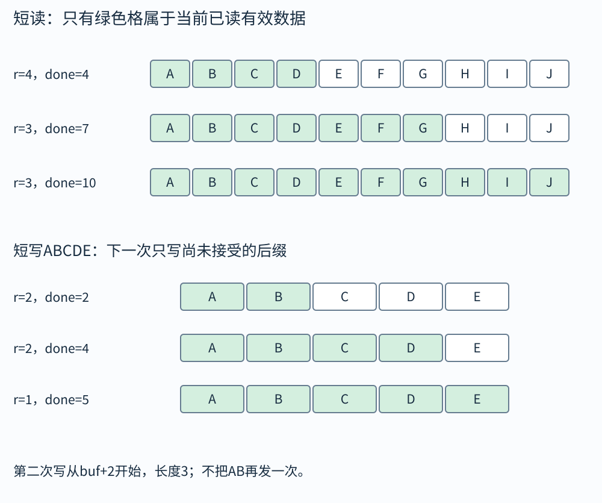
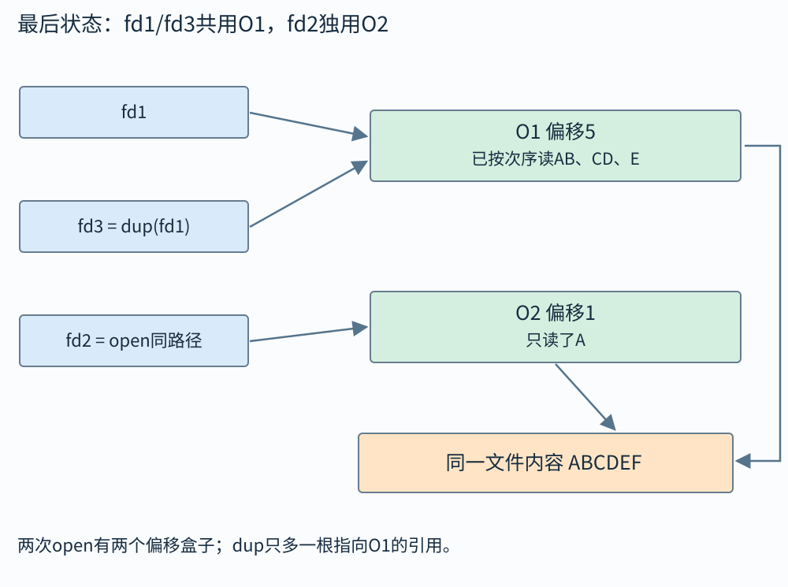

# 输入输出：文件描述符、偏移和缓冲到底分几层

你打开同一个文件两次，两个读取位置可能互不影响；把一个描述符dup一下，两个名字却通常共用同一读取位置。fork又会复制用户态stdio缓冲，同时让相应文件描述符引用同一个内核打开文件描述。看起来矛盾的现象，画出三层对象以后就清楚了。

本章先讲底层read/write，再讲共享偏移、重定向与stdio。所有I/O例子都要检查实际返回值。请求读100字节，不等于这次真的得到100字节；读到短数据也不自动等于文件结束。

## 三层对象先分开

第一层是进程自己的文件描述符表，描述符是小整数，例如标准输入0、标准输出1、标准错误2。表项引用内核中的打开文件描述。第二层的打开文件描述记录当前文件偏移、打开状态标志等；多个描述符可能指向同一个它。第三层是底层文件对象及文件系统元数据，描述实际文件内容与属性。

同一个文件可被多次open，产生不同打开文件描述，因而各有偏移。dup复制一个描述符引用，通常指向同一个打开文件描述，因而共享偏移。fork后子进程继承的相应描述符也引用同一打开文件描述。close一个描述符只是撤掉该引用，不一定立即关闭所有别人仍在使用的引用。

用户态的FILE*与缓冲再放在图上方，是C标准I/O库维护的一层，不能和整数描述符混成同一个对象。一个库流内部可能关联描述符，但printf先写用户缓冲，write直接请求内核，两者的可见时机不同。

## read返回值怎样解释

`read(fd,buf,n)`成功时返回实际字节数r，满足0≤r≤n。r>0意味着这次确实得到r字节；r=0通常表示在对应读语义下到达文件结束；r=−1表示失败，要查看errno。n=0等边界另有规定，不能用零长度调用的返回值推断整个文件为空。

短读可能由管道、终端、网络或剩余文件长度等原因产生。若要读满一个固定长度记录，就循环累计，直到读够、遇到真正EOF或发生应处理的错误。被信号打断时的EINTR通常可按策略重试；非阻塞描述符上的EAGAIN表示当前暂时不可用，需要等待合适事件，而非马上无限忙循环。

write也可能短写，只写出前r字节。下一轮应从buf+r继续，长度减r；重发整个缓冲会重复数据，忽略尾部则丢数据。返回类型ssize_t能表示−1，不能一开始就转成size_t，否则−1会变成巨大无符号数。

## 算例一：三次短读拼一个记录

需要读10字节。第一次read请求10，返回4，已填buf[0..3]；第二次请求剩余6，返回3，填buf[4..6]；第三次请求剩余3，返回3，填buf[7..9]，累计完成10。

若第二次返回0，则只有4字节有效，记录不完整，应按协议报告截断或保留部分数据等待其他上层处理，不能把buf剩余旧内容当成新数据。若第二次返回−1且EINTR，则第一次的4字节仍在，不要把累计量清零重读整个记录。

安全读满循环的核心状态只有两个：已完成done和剩余n−done。每次成功r>0后令done+=r；EOF返回done；真实错误返回错误并说明接口是否保留部分进度。实际函数应明确区分“提前EOF得到部分数据”和“调用失败”，不能靠一个模糊布尔值丢掉信息。

把10字节记录假定为`ABCDEFGHIJ`，两种数量不要混：`done`是已经得到的字节数，`r`是本次新得到的字节数。

|调用前done|传给read的指针/长度|本次r|新增有效位置|更新后done|
|---:|---|---:|---|---:|
|0|buf+0，10|4|0至3：ABCD|4|
|4|buf+4，6|3|4至6：EFG|7|
|7|buf+7，3|3|7至9：HIJ|10|

若在第二行先遇EINTR，`done`仍为4，下一次仍传`buf+4,6`，不能退回buf开头。返回0则是“只有ABCD有效”，不能把未填的6格拿去解析记录。写出`ABCDE`时同理，实际返回2、2、1就依次推进指针0、2、4：



## 算例二：同文件两次open与dup

文件内容为ABCDEF。fd1=open得到打开文件描述O1，偏移0；fd2=open同一路径得到O2，偏移0。从fd1读两字节得到AB，O1偏移2；从fd2读一字节得到A，O2偏移1，二者互不影响。

现在fd3=dup(fd1)，fd1和fd3都引用O1，当前偏移2。从fd3读两字节得到CD，O1偏移4；再从fd1读一字节得到E。若误以为dup创建独立偏移，就会错误预测fd1仍读C。

三个描述符可能都指同一个文件内容，但共享层次不同。判断题中不要只画文件名，把O1、O2两个内核对象明确画开。fork后相应描述符共享偏移，也按同一原则追踪。



箭头要读到内核对象一层再停止：fd1与fd3共用O1的偏移，fd2有独立O2；两对象最终仍读同一文件内容ABCDEF。上图不是“三份文件副本”。close(fd3)只删fd3那根引用，fd1仍可沿O1继续，不能因编号不同或相同路径就猜共享关系。

## 偏移与文件长度不是同一个量

文件偏移是下一次按该打开文件描述读写的位置。文件长度是文件目前有多少字节。lseek可改变支持寻址对象的偏移，不一定立即读取或写入数据；管道等对象不支持普通文件式任意寻址。

把偏移移到文件末尾之外再写，可能形成空洞文件，中间逻辑上读为零，但文件系统未必分配同等物理存储。磁盘占用与逻辑文件长度因此可能不同。这个现象与.bss在磁盘上不必逐字存零的理由也不同，应分别按文件系统与加载器机制理解。

并发追加不能简单写成“先lseek到末尾，再write”，因为两步之间别的执行者可能也追加。O_APPEND等标志提供更合适的追加语义，但跨多次write的整条逻辑记录是否不可交错，仍需另作设计，不能把“每次写前在末尾”当无限大的事务。

## 重定向不是改printf的代码

shell可在exec之前把描述符1重新指向某个文件，之后程序仍执行printf，底层使用的标准输出却已换了目的。dup2常用于把一个已打开描述符复制到指定编号。

例如打开output.txt得到fd=3，调用dup2(3,1)，让1引用同一个打开文件描述，再close(3)，描述符1仍有效，因为它保留了引用。若误以为close(3)把文件彻底关闭，就无法解释重定向为何继续工作。

重定向后FILE*缓冲策略可能与终端不同。把输出从终端改到文件会改变可见时机，不表示程序突然丢失数据。需要在关键点检查fflush或关闭结果，但不要每输出一个字符都无条件刷缓冲，性能和接口意义都要考虑。

## 算例三：fork共享偏移，不共享普通缓冲变量

先open文件ABCDEF，偏移0，随后fork成功。父先read两字节得到AB，偏移变2；子随后read两字节得到CD，偏移变4。这个顺序是假定的调度之一，真实情况下谁先读不保证，但对应描述符指向同一个打开文件描述，所以共同推进偏移。

若父子在fork之前已分别把文件内容读进自己的用户数组，那么fork后数组只是普通私有内存副本，修改不互相影响。若fork前还有stdio未刷缓冲，双方也各得一份缓冲副本。三个场景同时出现时，必须标出每项状态属于用户空间还是内核对象。

要让不同线程或进程按明确位置读取，可研究pread等位置式接口，它不按普通共享文件偏移的方式推进。但接口是否适用于目标对象、并发修改文件如何处理，仍要明说。

## stdio为什么快，为什么也容易让人误判

每次系统调用有固定成本，printf、fread等库接口常通过用户缓冲积累或预取一批数据，减少底层调用次数。行缓冲常在换行时刷出，完全缓冲常按块刷出，无缓冲则尽快传递；具体流初始策略依环境和实现规定。

`fflush`把库缓冲中待输出的数据交给底层，不等于保证数据已经永久落到物理存储介质。要讨论断电后是否持久，需要文件系统与fsync等更低层保证。读者若把“终端看到了”“内核接收了”“磁盘持久化了”当同一步，会错误判断日志与数据库安全性。

混用stdio与read/write操作同一底层文件时，库可能已经预读了一批数据，其用户态逻辑位置与内核偏移不再是你直觉中的同一数。除非明确处理同步规则，最好为同一数据流选择一致接口，避免一部分代码以为只读了一字节，另一部分发现内核偏移已前进一整块。

## 算例四：短写时从哪个字节继续

要写字符串ABCDE，共5字节。第一次write返回2，说明AB已经被接受；第二次应传指针buf+2、长度3，即CDE。如果第二次也返回2，接受CD；第三次写E。

若程序第二次仍写ABCDE，最终可能得到ABABCDE；若程序把返回2当“成功了”直接结束，则只写AB。正确循环不关心一次调用是否“看起来成功”，只根据实际计数更新。若返回0但尚有待写数据，要避免死循环并按接口场景处理异常停滞。

对于管道或网络，还要考虑对端关闭造成的错误与SIGPIPE。返回检查和信号策略需要配合，不能把所有失败统一重试。对永久错误无限重试既不会修好问题，还可能把CPU占满。

## 为什么二进制协议不能直接写结构体

结构体可能有填充，整数有端序，类型大小和对齐依赖ABI。直接`write(fd,&s,sizeof s)`只能在严格受控的同布局约定下使用，不自动构成可移植格式。填充字节还可能包含未初始化内容，带来信息泄露。

应明确每个字段宽度与编码，逐字节序列化，或者使用规定格式的库。读入时也检查总长度与字段范围。第01章的read_be32就是一个小例子：它从四个明确字节构成一个32位值，不依赖主机结构体布局。

## 读行与读字节：换行也占空间

假设输入是三个字符A、B、C，随后换行。在常见单字节编码中共4字节。若缓冲容量4，想把整行读成C字符串，还要终止零，共需5字节。给定容量的读行接口通常至多保存容量减1个字符并添加终止符；若没读到换行，可能只是缓冲装满，不表示一整行结束。

处理超长行时，应明确策略：扩容、分段处理，或拒绝并消费本行剩余内容。若只读前一段，下一次把剩余片段误当新记录，就会使整份输入错位。解析器既要知道缓冲大小，也要知道记录边界，二者不能混用。

输入还可能含零字节。底层read返回r字节不保证它们是以零结尾的文本，直接用printf("%s",buf)可能越过有效部分。若用于文本，预留一字节并在buf[r]写终止符，且考虑内部零是否允许；若是二进制，则应按明确长度输出或处理，不能用strlen重新猜长度。

## 管道的结束条件为何取决于所有写端引用

管道是一种字节流通信对象。读端在没有数据但仍有写端可能产生数据时，阻塞读可以等待；当所有写端引用都已关闭，且剩余数据耗尽时，读端才看到EOF。fork后不需要的写端若忘记关闭，会使某个读者一直等不到结束。

例如父子各继承管道读写两端，父只想读、子只想写。父应关闭自己不使用的写端，子关闭自己不使用的读端；子写完关闭写端，父读尽后才能得到EOF。如果父一直留着写端，内核仍认为存在写者，父可能在等一个永远不会到来的新字节。

这不是“close越多越安全”，而是每个进程只保留自己确实需要的引用。先画出fork后四个描述符表项，再逐个划掉不使用的端点，能看出哪个引用阻止了EOF。管道没有消息边界，写一次不保证读一次对应同样长度，上层仍需协议或分隔符。

## 多线程写日志，完整记录怎样保持在一起

若一条日志由三次write拼成：时间、内容、换行，两个线程可能交错成时间A、时间B、内容A、换行B等。单次接口调用的某些原子保证不自动覆盖多次调用组合。可以在应用层用同一锁保护整条记录，或先在私有缓冲构造再按目标对象的保证写出。

管道对于不超过规定大小的写入有特定原子性约束，普通文件、终端、套接字又有各自规则。不要从某一种对象推导“write永远完整且不交错”。短写处理仍必需；重试是否会被其他写者插入，取决于你如何保护整个记录。

练习：一个读管道的父进程一直得不到EOF，子已退出，最先该查什么？答案是查父自身或其他继承者是否还持有管道写端。进程退出会关闭其引用，但其他表项仍可保持写端存在；结束条件是引用全部消失，不是某个特定孩子退出。

## 可靠读写的可运行核心

以下两个函数只面向阻塞式字节流教学使用。调用者要求的n不得超过SSIZE_MAX，使成功字节数能装进ssize_t。read_exact_or_eof在EOF时返回已得到字节数，调用者必须与n比较；write_all要么完成n字节，要么返回−1，但失败前可能已有部分字节写出，不能无条件把整个请求重新发送。

```c
#define _POSIX_C_SOURCE 200809L
#include <unistd.h>
#include <errno.h>
#include <stdint.h>
#include <limits.h>

ssize_t read_exact_or_eof(int fd, void *buf, size_t n) {
    if (n > (size_t)SSIZE_MAX) { errno = EINVAL; return -1; }
    unsigned char *p = buf;
    size_t done = 0;
    while (done < n) {
        ssize_t r = read(fd, p + done, n - done);
        if (r > 0) { done += (size_t)r; continue; }
        if (r == 0) break;
        if (errno == EINTR) continue;
        return -1;
    }
    return (ssize_t)done;
}

ssize_t write_all(int fd, const void *buf, size_t n) {
    if (n > (size_t)SSIZE_MAX) { errno = EINVAL; return -1; }
    const unsigned char *p = buf;
    size_t done = 0;
    while (done < n) {
        ssize_t r = write(fd, p + done, n - done);
        if (r > 0) { done += (size_t)r; continue; }
        if (r == 0) { errno = EIO; return -1; }
        if (errno == EINTR) continue;
        return -1;
    }
    return (ssize_t)done;
}
```

为什么把buf转成unsigned char*？因为加done应该按字节移动；void*没有标准C指针算术，int*则会每次跳sizeof(int)。为什么r先保持ssize_t？因为−1是错误标记，转成无符号再比较会误认巨量成功。为什么done只在r>0时增加？因为失败与EOF都没有本次新字节可计。

这两个函数没有把EAGAIN当EINTR重试。非阻塞对象应结合就绪通知与更完整状态机，立即忙重试会占满CPU。也没有解决写入的消息原子性与断点重传语义：write_all保证正常完成时总量正确，失败时外部可能已看到前缀，协议若重试要知道如何避免重复。接口名字里的all不是事务保证。

自测可先用临时普通文件写入ABCDE，重置偏移后读取5字节核对，再请求8字节应只返回5。还可用管道人为分两批写入，检查读满循环是否保留第一批。不要只测一次read恰好返回n的幸运路径，否则循环体里最重要的累计逻辑根本没有被检验。

## 文件元数据：stat看的是属性，不是正文

文件不只有内容，还带类型、权限、长度、时间等属性，称元数据。stat按路径取得相关属性，fstat按已经打开的描述符取得属性，lstat在路径最后一项是符号链接时报告链接本身而不是跟到目标。它们回答的是“这个对象是什么”，不会把文件正文读进你的缓冲。

属性通常放进struct stat。st_mode同时包含文件类型与权限相关位，不能直接拿整个整数与一个自写常量比较；用S_ISREG、S_ISDIR等宏判断普通文件或目录。普通文件的st_size通常是逻辑字节长度，不等于磁盘实际占块量，也不保证下一次读取前长度不变。时间字段也要按接口类型处理，不把它们一概当成int打印。

举例：一个普通文件逻辑长1000字节，进程当前打开偏移为200。stat仍报告长度1000，不是剩余800；剩余量是你结合偏移与长度另算的，而且并发截断或追加可能马上改变它。lseek改变当前打开文件描述的偏移，通常不会直接改变stat报告的文件长度；实际写入才可能扩展文件。

权限位中的r、w、x分别表示读、写、执行等权限，但对象类型不同，含义也不同。目录的x主要表示能否按名字搜索或穿过它，r主要涉及读取目录项，w涉及修改目录内容，并非“把目录当文本覆盖”。删除文件通常要满足父目录相关权限等条件，不能只看目标文件是否可写。真实权限判断还包括身份、组、ACL和系统策略，基础位图不概括全部规则。

## 符号链接把名字再指向另一个名字

假设目录里target是100字节普通文件，shortcut是指向target的符号链接。stat("shortcut")通常跟到目标，报告普通文件属性；lstat("shortcut")报告符号链接本身，其长度等字段具有链接对象的含义。目标被删除后，shortcut名字仍可能存在，但跟随它的stat或open失败，称悬空链接。

这与硬链接不同。硬链接是在目录中增加对同一个底层文件对象的另一名字，改一个名字不自动删除另一个。符号链接保存的是一段目标路径，可能指向不存在的位置，也可能跨不同文件系统。初学时先画“目录名字到对象”与“链接内容再解释成路径”两条不同关系，不要都叫“快捷方式”就认为语义相同。

路径也不是打开对象的永久身份。一个线程先stat路径确认类型，另一方随后替换目录项，前者再open同一路径可能得到另一个对象。这是检查时与使用时之间的竞态。按需求先安全打开，再用fstat核对已打开对象，可以避免一部分路径替换窗口；若需要禁止跟随链接或限制目录边界，还要采用具体系统提供的合适接口。单次fstat也不保证文件内容此后永不变化。

## 目录项不是文件内容列表自动递归展开

目录保存名字到文件系统对象的关联。opendir打开一个目录流，readdir逐个取得目录项，closedir关闭。目录项中的d_name是名字，不是完整路径，也不自动包含该文件的所有元数据。某些系统给d_type，但它可能未知或不便可移植依赖；要可靠知道类型，应使用合适属性接口。

readdir返回空指针时，可能到结尾，也可能出错。一个清楚的循环在每次调用前把errno置0；返回空时，errno仍0表示正常结束，非0表示错误。不能在整段循环一开始只清一次errno，因为中间的其他操作可能留下错误状态，使最后一次正常EOF被误认失败。

返回的目录项存储可能在下次readdir时被复用，若要长期保留名字，应自己复制；不要把每次返回的内部指针简单存进数组，最后才统一读取。读取顺序也不保证按字母或创建时间排序。想按名字展示，先收集再明确排序。

## 算例五：列出一个目录，并正确处理结束和错误

下面完整程序接受一个目录路径，逐个输出名字。它只列当前一层，包含接口返回的“.”与“..”，没有声称递归统计全部文件。某些名字可含换行或控制字符，所以这是学习接口的直接文本输出；若做可机器解析的清单，应另选明确转义或长度编码格式。

```c
#define _POSIX_C_SOURCE 200809L
#include <dirent.h>
#include <errno.h>
#include <stdio.h>

int main(int argc, char **argv) {
    const char *path = argc > 1 ? argv[1] : ".";
    DIR *dir = opendir(path);
    if (dir == NULL) {
        perror("opendir");
        return 1;
    }
    int status = 0;
    for (;;) {
        errno = 0;
        struct dirent *entry = readdir(dir);
        if (entry == NULL) {
            if (errno != 0) {
                perror("readdir");
                status = 1;
            }
            break;
        }
        if (printf("%s\n", entry->d_name) < 0) {
            perror("printf");
            status = 1;
            break;
        }
    }
    if (closedir(dir) == -1) {
        perror("closedir");
        status = 1;
    }
    if (fflush(stdout) == EOF) {
        perror("fflush");
        status = 1;
    }
    return status;
}
```

逐步走一个只有alpha、beta两个普通文件的目录。opendir成功建立目录流；readdir可能先给“.”、再给“..”、再给两个名字，但顺序不是程序可依赖保证。每取得一项，当前就打印其名字，不跨下一次调用保存内部指针。最后一次返回NULL且errno为0，正常退出循环；仍要closedir释放目录流，检查stdout最后刷新是否失败。

若给不存在的路径，opendir失败，程序报告并返回1，不进入循环。若中途目录读取错误，当前errno被perror解释，仍尝试closedir，再以非零状态结束。若只把while(readdir(...))写完就返回0，会把读取错误与正常读完混在一起。

目录正被别的进程修改时，枚举结果不必是一张某个单一时刻完整不变的快照。递归归档或同步程序若要求完整性，需要设计枚举、打开、校验与重试的协议，不能把“循环到EOF”夸成证明整个变化中的目录从未漏项。课程目录接口与工程快照保证是两个层次。

## 为任务选择接口：别把高层和低层当成优劣排名

按格式读写少量文本，stdio的缓冲与格式化往往方便；处理明确字节协议、描述符重定向、管道或网络，需要理解read/write与返回计数；查询类型长度用stat类接口，不应为了知道长度把整个文件先读一遍；遍历名字用目录流，而不是把目录路径当普通文件内容硬读。

选择由所需语义决定。高层接口没有免除错误检查，低层接口也没有自动更快或更安全。对于同一数据流，混用前应知道各自缓冲与偏移关系；对于外部输入，始终明确字节数、字段格式和对象范围。完成I/O的程序最后还要判断输出是否真正成功，不能只因主循环结束就忽略刷新或关闭阶段的失败。

## 自己做，再看答案

练习一：文件XYZ，fd1和fd2由dup关联。fd1读一字节后，fd2读一字节，分别得到什么？

答案：在题目给定顺序且无其他I/O时，fd1得X，偏移变1；fd2得Y，偏移变2。描述符编号不同不代表偏移独立。

练习二：read请求100返回20，能否立即认定EOF？

答案：不能。只知道本次得到20字节，可能是短读。若需要继续，下一次再读；返回0才按对应接口的EOF语义处理。切勿读取缓冲后80字节的旧内容当成本次数据。

练习三：fflush成功是否意味着拔电后数据必然保留？

答案：不能。它处理用户态库缓冲向底层传递，持久化还涉及内核、文件系统、设备缓存与相应同步保证。先明确你要保证哪一层“完成”，再选接口。

返回值细节可对照 [read](https://man7.org/linux/man-pages/man2/read.2.html)、[write](https://man7.org/linux/man-pages/man2/write.2.html) 与 [dup](https://man7.org/linux/man-pages/man2/dup.2.html)。
