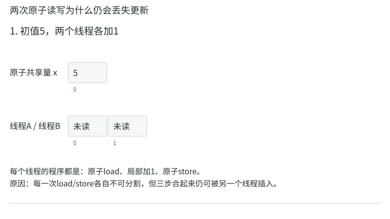
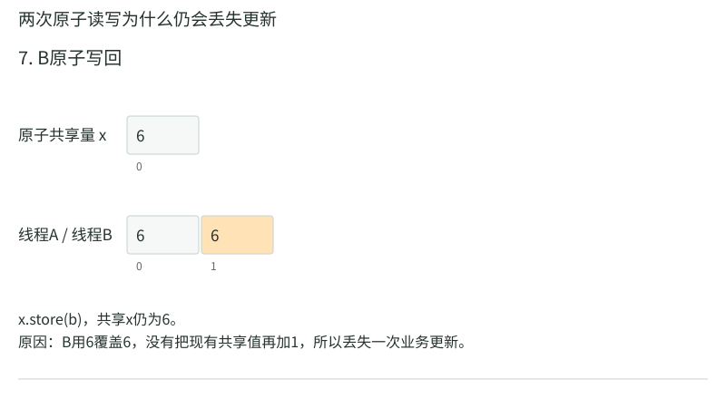
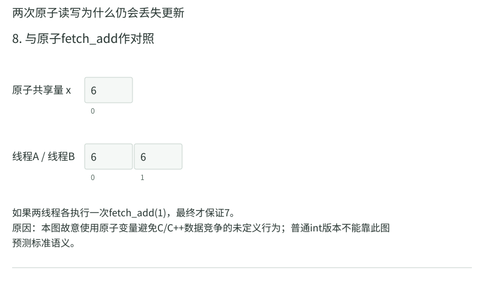

# 线程与并发：同一个变量被两个人动过以后

单线程代码`counter++`很容易理解：把计数加一。两个线程各做一遍，你可能自然期待加二。但源代码的一行通常不是处理器的一步；它可能要先读旧值、在寄存器里加一、再写回。两条执行流交错时，后写回的一方可能覆盖先前更新。在C里，普通共享变量上的这种未同步冲突访问还构成数据竞争，程序不能再按普通顺序交错模型获得标准保证。

本章把两件事一起讲：用具体交错帮助理解问题，再用语言层面的同步规则判断什么程序才合法。不能看懂一次“丢失更新”以后，就以为真实编译器必须只产生这一种坏结果。

## 一个进程里的线程共享什么

同一进程中的线程通常共享地址空间，包括全局数据和动态分配对象，也共享许多进程资源。每个线程有自己的寄存器状态和执行位置，通常有自己的栈；线程局部存储则给每个线程单独实例。

“每个线程自己的栈”不等于其他线程硬件上不能访问它。若一个线程把自己局部变量地址交出去，其他线程可以通过该地址尝试访问；必须保证对象仍存活，并按共享访问规则同步。栈是分配和管理方式，不是自动建立的隔离墙。

线程结束与进程结束也不同。一个线程从线程入口返回，通常结束该线程；进程退出会结束整个进程中的线程。主线程若过早return导致进程结束，其他线程可能没来得及完成工作。使用join等机制等待，并检查创建是否成功。

## 创建线程时参数必须活得够久

pthread_create把入口函数与一个void*参数交给新线程。新线程可能在调用者下一行之前就开始，也可能过一会儿才运行。把循环变量i的地址反复传给多个线程，很可能让它们都读取同一个不断变化的对象，而非创建时的独立编号。

可为每个线程准备独立参数对象，例如数组args[k]，在创建前填好，直到所有相关线程读完之前保持有效。若父函数返回，局部args生命周期结束，再访问就悬空。线程参数设计同时涉及“每份数据是否独立”和“对象是否仍活着”两项检查。

## 算例一：三个线程为什么都可能打印3

循环k=0、1、2创建三个线程，每次传`&k`，循环完成时k变3。若新线程直到此后才读取，就都可能看到3。若创建者仍在修改k而线程未同步读取，普通C对象还存在数据竞争，不能把“都打印3”当完整语义描述。

修复为args[0]=0、args[1]=1、args[2]=2，每个线程接收对应元素地址，创建前完成写入，后续不再修改，join全部线程后再销毁数组。现在各线程读自己的稳定参数，执行顺序仍不固定，但编号含义不再依赖调度时机。

若仅把k在循环内复制到一个新的块局部变量，再传其地址，也不一定安全：该局部对象可能在本轮结束后就消失，下轮还可能复用同一存储。必须按对象生命周期分析，不能只看源码变量名换了。

## 数据竞争与竞态条件有什么区别

数据竞争是语言模型中更精确的冲突访问问题：不同线程访问同一内存位置，至少一次是写，至少一次访问为非原子，并且这两次冲突访问之间没有所需的先发生关系（happens-before）。C中这样的数据竞争导致未定义行为。两个合法原子访问本身不因缺少release/acquire配对就成为数据竞争，但多个原子步骤仍可能有下面的逻辑竞态。竞态条件则更宽，指正确性依赖不受控制的执行顺序；即使每次访问都是原子操作，几步组合仍可能有逻辑竞态。

例如银行余额采用原子变量，两个线程都“先读余额足够，再各扣款”。每个读写都可能合法，但两个检查都看到旧余额，组合操作仍可能允许透支。你需要使“检查与扣款”作为一个受保护事务，或使用正确的原子比较交换循环，不是只把类型加一个atomic就万事大吉。

volatile也不提供普通线程间互斥或完整内存同步。它用于特定访问语义，并不能把读改写变成不可分割操作。锁、原子操作与条件变量各解决不同问题，后面分别展开。

## 算例二：用合法的原子读写看清丢失更新

为了让每步结果有明确的语言保证，本例用C11原子变量，不拿有数据竞争的普通int预测结果。初始`x=5`，A和B各执行同样三行：

```c
int local = atomic_load(&x);  // 读到自己的局部变量
local = local + 1;           // 只改自己的局部变量
atomic_store(&x, local);     // 写回共享原子对象
```

其中x声明为`_Atomic int`，代码需包含`<stdatomic.h>`。`atomic_load`和`atomic_store`分别保证一次读、一次写的原子性；局部变量由各自线程拥有。把两线程的局部副本分别命名为a和b，便于在图里区分。默认原子操作采用顺序一致内存序，本例不需要先掌握更弱的内存序。

|依次执行的动作|A的局部a|B的局部b|共享x|
|---|---:|---:|---:|
|初始|未读|未读|5|
|A：load|5|未读|5|
|B：load|5|5|5|
|A：局部加1|6|5|5|
|B：局部加1|6|6|5|
|A：store|6|6|6|
|B：store|6|6|6|

<!-- trace:cs-atomic-race -->

下面保留同一交错，分别显示共享x与两份局部副本。格子下方的0、1仅为示意槽位编号；A、B的局部变量不是同一个共享数组。








<!-- /trace:cs-atomic-race -->

A写回之后，B并未重新读取6；B的局部副本早已算成6，所以它只是又写一次6。两次合法的原子store没有把业务上的“两次加1”合成不可分割操作。这条交错完全可以发生在单核上，关键是步骤的先后，而非两个线程是否真的同时占用两个核。

若让A三行全部完成后B才开始，B会读到6，随后写7。两种次序都遵守每个线程内部的代码顺序，却得到不同业务结果。需要无条件完成两次加1时，可让每个线程执行一次`atomic_fetch_add(&x,1)`；这个接口把“读取当前值、加1、写回”作为一个原子读改写操作，两次操作合计得到7。也可用同一把互斥锁保护三行，让另一线程在整段结束后再进入。

普通非原子int上的未同步冲突会触发数据竞争和未定义行为，不能把上表的6或7当成它全部允许的结果。分清这一点后，图里的具体交错既能解释丢失更新，又不会误导你把C程序当作只能逐行交错的解释器。

[这条交错的C11核对程序](示例/原子交错.c)把表中顺序明确写成语句，可用`cc -std=c11 原子交错.c -o 原子交错`编译运行，分别得到6和7。它验证的是已经指定的这一条轨迹；真正开两个线程时，谁先读、谁先写仍由实际调度决定。

## join建立等待，也帮助管理生命周期

pthread_join等待指定可连接线程结束，并可取回线程返回的void*结果。返回指针不能指向线程已经结束的局部对象；可返回由外部拥有且仍存活的对象，或动态分配对象并说明释放责任。

成功join还提供相应同步保证，使等待者能在正确条件下看到线程完成前的效果。不能用`sleep(1)`替代join：线程可能因负载、I/O或调度超过一秒，睡够时间不证明工作完成。sleep是一段时间的暂停，join是对某个执行者结束状态的等待。

分离线程结束后由系统自动回收线程相关管理资源，不能再用普通join回收；这不等于应用自己的堆对象自动释放。线程生命周期与对象所有权仍要分别安排。

## 算例三：并行求和怎样避免热点计数器

数组有8个数1至8，两个线程各算一半。T1在私有局部sum1中算1+2+3+4=10；T2在sum2中算5+6+7+8=26；各自把结果写到独立结果槽；主线程join两者后汇总为36。

如果每处理一个元素都抢同一把锁更新全局总和，虽可正确，但锁成为热点，线程大部分时间争用它。先做局部累加，再减少合并次数，通常更有利。正确性来自各段覆盖不重叠、无遗漏，以及合并发生在所有部分完成之后；性能改善来自减少同步操作，而不是“线程越多必然越快”。

还要考虑整数溢出与负载均衡。每段长度相同不保证工作量相同，例如某元素触发大量计算。结果槽若落同一缓存行，频繁更新仍可能伪共享；把每个线程的临时累加放寄存器、最后写一次可缓解这种热点。

## 原子性、可见性、顺序性分别问什么

原子性问一个操作能否被其他执行者观察到中间一半。可见性问某方写入何时按规则对另一方可用。顺序性问两个操作之间是否建立了所需先后关系。它们相关，但不是一个词可以包办。

设生产者先填data，再设ready。消费者看到ready后读data。若两者只是普通变量且没有同步，既可能数据竞争，也不能凭源码顺序假定跨线程发布成立。采用锁可把数据与标志一起保护；采用C原子时，可用release写ready与acquire读ready建立所需关系，前提是消费者确实读到对应发布值，且对象无其他未同步冲突。

对只需累加独立计数、不用该计数发布其他数据的场景，较弱原子顺序可能足够。但初学时应先写出需要保证的关系，再选择顺序；不要为了“更快”先把所有操作改成relaxed，之后才猜是否正确。

## 算例四：原子计数也救不了两步检查

库存原子变量stock=1。两个线程都先load，均读到1，均决定可以买，然后各自fetch_sub(1)。两次扣减都原子，最终stock=−1，卖出两件。

错误在“检查到扣减”的组合没有成为一个不可分割决策。可以用互斥锁把检查与扣减圈在一起，或用compare_exchange循环，只有把某个已知正库存成功改为减一后的值，才认定购买成功。后者循环失败时要重新检查更新后的库存，不能无限按照最初看到的1继续。

这与第10章检查done后pause的竞态有共同结构：两步之间的状态可能被别人改变。但修复机制不同，不能拿信号屏蔽代替线程锁，或拿原子计数替代条件等待。

## 比较交换怎样把库存检查与减一合成一次决策

CAS是compare-and-swap的常用简称；C11的compare_exchange接口把“当前值是否等于我以为的旧值，若是就改成新值”作为原子操作。这里用strong版本，失败表示当前值不匹配；weak版本还可能出现允许的伪失败，通常也放在正确循环中使用。

库存初始为1，两个线程都先读到1，分别存在自己的expected局部变量。T1尝试把原子stock从expected的1改为0，比较成功，库存变0，T1取得商品。T2随后也带expected=1尝试，实际stock已0，比较失败，不扣库存；接口还把实际0写回T2的expected。T2重新检查expected>0为假，退出并报告未取得商品。

|时刻|原子库存|T1的expected|T2的expected|业务结果|
|---|---:|---:|---:|---|
|双方读完|1|1|1|尚未出售|
|T1比较交换成功|0|1|1|T1出售一件|
|T2比较交换失败|0|1|0|T2不得出售|
|T2重查退出|0|1|0|总共只出售一件|

关键在失败后expected是一个输出参数，会被更新，不是永远保留最早的1。若程序忽略失败仍发货，或失败后用旧判断直接扣款，原竞态仍在。每次成功CAS才是“这次购买完成”的唯一状态转换点；看到一次正库存只是尝试的起点，不是已经买到的证据。

若其他线程同时补货，失败后读回的expected可能又大于0，循环可根据新值重新尝试减一。若接口允许一看到0就失败返回，则并不承诺等待未来补货；需要等库存的任务应另用条件等待协议。原子比较交换保证一次决策不可分割，不自动提供业务上的排队和等待。

## 可重入与线程安全也要分开

一个接口线程安全，可能内部用锁保护共享状态，但不适合在信号处理函数里重入，因为信号可能打断正持锁的线程，处理函数再等同一把锁就死锁。可重入强调在尚未完成一次调用时再次进入能否正确工作，讨论信号与递归等上下文时尤为重要。

返回指向内部static缓冲的函数，也可能让两个调用者拿到同一块会被后续调用覆盖的数据。接口文档若要求调用者提供缓冲，常是把隐式共享状态显式化。判断安全性要看共享对象与调用约束，不能只看函数名后有没有_r之类后缀。

## happens-before用一条具体数据发布关系解释

线程间的“先发生关系”不只是墙上时钟谁早谁晚，而是语言与同步操作建立的、可用于推理内存效果的关系。生产者先写data=42，再以release方式发布ready=1；消费者以acquire读取并确实观察到这次发布的1，随后读data，才能据该关系推理看到已发布的数据。

如果消费者读到的仍是初始ready=0，就不能把这次acquire当作已经接上生产者发布。若另一个线程后续无同步再改data，先前一次正确发布也不会保护所有未来写。要把“哪次写、哪次读、哪段数据”具体连起来，不能把release/acquire当两个随处放的保险符。

使用默认较强顺序的原子操作可以简化部分排序推理，但仍不替你维护业务不变量。锁内检查、修改和解锁形成的结构，对初学者往往更容易审查；只有在需求和性能证据支持时，再引入更复杂原子协议。

## join与线程返回值的对象归属

线程入口返回void*，它只是一个地址值，不自动拷贝指向的结构体。若返回局部结构体地址，线程一结束对象就失效，join取到地址也救不回。可让调用者提供一个结果槽，线程写完后返回NULL，调用者join后读取；也可由线程分配结果，约定join者释放。

后一种还要处理线程创建、分配和join失败。若线程分配成功但没人收结果，可能泄漏；若多个等待者或其他模块都free同一结果，可能重复释放。线程接口和动态分配结合时，每个地址仍要有清楚拥有者。

取回的指针是否为空，也不能独立判断线程是否成功。应用可以约定NULL表示成功无结果，或表示失败；应定义明确结果结构或错误通道，不要靠随意把小整数强转指针在所有平台传错误码。

## 工作拆分：不只是平均分段

有n个任务与k个线程，简单分段可令第t段边界为floor(tn/k)至floor((t+1)n/k)，覆盖全部下标且不重叠。但tn乘法本身也可能溢出，真实实现需采用安全计算或限制规模。数学分段公式正确，不免除机器整数范围检查。

若任务成本不同，动态工作队列可能更均衡，但引入队列同步；静态分段开销低，却可能让某个线程拖后腿。评估总完成时间时看最慢分段，不是平均线程耗时。并行算法的结构正确与负载是否均衡，也应分别分析。

练习：8个任务，前4个各耗时10单位，后4个各1单位，两个线程按连续一半分段，理想总完成多久？答案是max(40,4)=40；若能合理均分重任务与轻任务，可能各约22。并行度相同，分配方式影响利用率。

## 自己做，再看答案

练习一：每个线程有自己的栈，所以把局部数组地址给另一线程一定安全，对吗？

答案：不对。地址可以被其他线程使用，但必须保证数组生命周期覆盖所有访问，并按共享读写情况同步。创建线程的函数先返回，会使数组失效；同时无同步写同一元素还可能数据竞争。

练习二：两个线程只读取创建前已完成初始化、随后不再修改的数组，是否必须为每次读加锁？

答案：在正确创建与发布关系下通常不需要，因为不存在并发冲突写。同步需求来自访问关系，不是“用了线程就所有变量都上锁”。仍需保证数组活到线程使用完。

练习三：程序使用atomic_flag或原子整数以后，就一定没有竞态条件吗？

答案：不能。单次操作可以原子，多个操作组成的业务条件仍可能被交错破坏。库存例子中每次load和fetch_sub都原子，却仍透支。应把完整不变量及其保护范围写出来。
