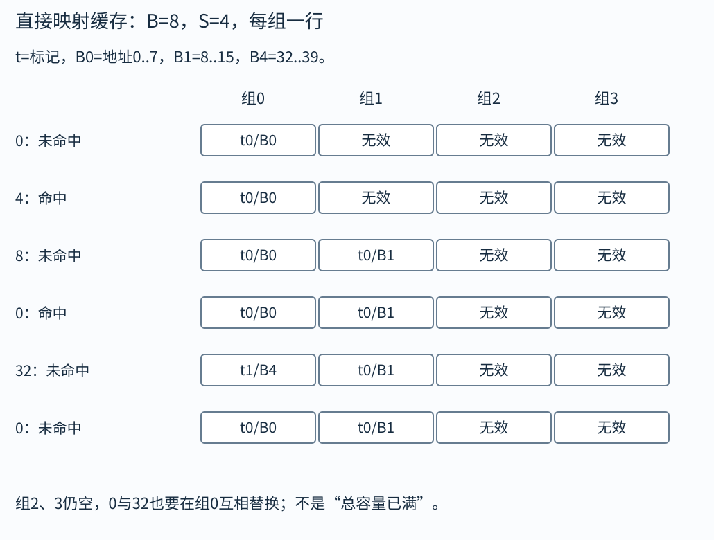

# 性能与缓存：同样读一个数组，为什么顺序不同就差很多

两个程序做相同次数加法，却可能相差数倍。原因之一是处理器等待数据的时间不同。寄存器、各级缓存、主存和存储设备构成不同容量与延迟的层次，数据靠近处理器时更快，但空间更少。缓存利用程序常有的局部性，把最近或附近要用的数据保留在较快层。

本章是理解系统性能的补充，不把所有处理器实现都塞进课程要求。我们用简单缓存模型手算命中，再用访问次序与依赖链解释优化。速度结论必须带模型和测量条件，不能看见一句“O(n)”就断言两个程序耗时相同。

## 时间局部性与空间局部性

时间局部性是刚用过的数据很快又用；例如循环反复更新同一个sum。空间局部性是用了某位置后，很快访问附近位置；例如顺序扫数组。缓存通常按一整块而非一个字节传输，块也叫缓存行，读a[i]时可能顺带把后面几个元素带来。

容量大不等于速度快。更靠近CPU的小缓存通常延迟低，远层容量大却更慢。一次访问可能先查L1，未命中查L2，再查更远层。平均耗时取决于各层命中率与未命中代价，不是把所有延迟简单相加到每次访问上。

脏块是被修改但尚未写回下层的缓存块。写回与直写、写分配与不写分配是不同策略组合。教学题必须按给定策略模拟，不能只看读缓存的规则就推断写入行为。

## 地址怎样分成标记、组索引与块内偏移

设块大小B=$2^b$字节，有S=$2^s$组，每组E行。地址低b位是块内偏移，再上s位是组索引，剩余高位是标记。组索引决定到哪一组查，标记用于区分映到同组的不同内存块；有效位说明该行是否装着可用块。

直接映射缓存每组只有一行。组相联每组有多行，需在组内找匹配标记，未命中时按替换策略选行。全相联只有一组，多行可容纳任意块。容量公式S×E×B通常只计算数据容量，不含标记与状态位管理开销。

## 算例一：32字节小缓存逐次访问

题目：直接映射缓存，4组，每块8字节，初始全空，访问字节地址0、4、8、0、32、0。

B=8，块内偏移3位；S=4，索引2位。地址0属于内存块0，组0，标记0，首次未命中，装入0至7。地址4仍在同一块，命中。地址8属于块1，组1，标记0，首次未命中。再次0命中。

地址32属于块4，组号4模4=0，标记为1，替换组0原块0，因此未命中。最后再访问0，组0里标记已是1而非0，又未命中。六次共2次命中、4次未命中。虽然缓存总容量32字节，0和32仍互相冲突，因为它们被限制到同一组。

三类常见未命中可从这个例子延伸：第一次见某块是强制未命中；总工作集超出容量可能有容量未命中；即使总容量尚有余量，同组冲突仍可能造成冲突未命中。分类需与参照模型配合，不能仅凭一次替换就随意归类。

把“查组”和“比标记”写成每次都执行的动作。对本题，块号为`address//8`，组号为`block%4`，标记为`block//4`：

|地址|块号/偏移|组/标记|访问前该组|命中？|访问后该组|
|---:|---|---|---|---|---|
|0|0/0|0/0|无效|否|有效，tag0，数据0至7|
|4|0/4|0/0|有效，tag0|是|不变|
|8|1/0|1/0|无效|否|有效，tag0，数据8至15|
|0|0/0|0/0|有效，tag0|是|不变|
|32|4/0|0/1|有效，tag0|否|改tag1，数据32至39|
|0|0/0|0/0|有效，tag1|否|改回tag0，数据0至7|

命中不仅要求组号对，还要求有效位和标记都对。块内偏移只决定命中块里的哪一个字节，不会让地址4另占一条缓存行。只看0与32“差32字节、刚好总容量”会给直觉，算出同组不同标记才给出实际替换机制。

## 算例二：按行与按列遍历二维数组

假设int4字节，缓存行64字节，数组每行恰好16个int。按行读取时，第一次访问某行可能取入64字节，随后同一行15个元素可利用该缓存行。若缓存足够避免其他干扰，每16个元素约一次强制取块。

按列读取时，相邻访问跳过整行64字节。若数组很多行，且缓存无法同时保留所有行，读完第一列后再读第二列，先前行可能早已被替换，重复取同样缓存行。数学上仍访问每个元素一次，实际下层传输量却可能更大。

这不是“列循环永远慢”。若矩阵很小全在缓存里、数据原本按列存放、编译器做了变换，或硬件预取与并行掩盖部分代价，结果会变化。正确结论是让最内层沿实际连续存储方向走，通常更有空间局部性，应在目标环境测量确认。

## 分块为什么有用

矩阵乘法等算法会重复使用行与列。把数据分成能在缓存中暂留的小块，可以在一块被替换之前完成更多相关计算。分块改变的是复用距离：两次使用同一数据之间经过的其他数据量减少。

选择块大小不能只按“缓存总容量除元素大小”计算，因为还要同时容纳多个矩阵块、程序其他数据和组相联冲突。太小会增加循环与边界处理开销，太大又装不下。先用模型理解，再通过测量选择合理参数，比背一个固定32或64更可靠。

## 算例三：Amdahl定律怎样限制加速

某程序原耗时100秒，其中80秒可用4个处理单元理想并行，剩20秒必须串行。理想新时间为20+80/4=40秒，加速比100/40=2.5，不是4。

一般可并行比例p、并行倍数k，理想加速为$1/((1-p)+p/k)$。当k趋向无穷，最大加速仍受1/(1−p)限制。本例最高5倍。实际还要增加线程创建、同步、数据传输与负载不均，常比理想更慢。

这也适用于优化一个热点函数。只占总时间1%的代码，即使优化到零，也不可能使整体快一倍。先测量主要时间花在哪里，再选择优化对象，能避免花很多精力精简不重要的循环。

## 指令数相同，依赖链也会不同

处理器可在一定条件下重叠执行独立操作。连续`sum+=a[i]`让每次加法依赖上一次sum的结果，形成依赖链。用多个独立累加器处理不同元素，最后合并，可能增加并行机会。

但浮点数不满足精确结合律，拆累加器会改变加法分组，可能改变结果末位。整数有符号溢出与无符号模运算规则也要先说明。允许怎样的数值差异由任务决定，不能为了测速默认所有重排都合法。

编译器可能已经做循环展开、向量化和别名分析。源码少一行不保证机器指令少，机器指令少也不保证更快。查看生成代码和实际计时，能帮助区分“我觉得快”与“目标机器真的快”。

## 算例四：伪共享让独立计数器互相拖累

两个线程T1、T2各自只写自己的counter1、counter2，逻辑上没有同一个变量的数据竞争。但若两者位于同一缓存行，不同核写入时可能不断争取该行的独占所有权，让缓存行在核之间来回迁移。

这叫伪共享，因为程序变量不同，硬件一致性管理单位却是整行。可减少写入频率、使用线程局部累加最后合并，或按实际缓存行布局隔开热点。简单给结构体塞很大填充可能浪费内存并降低别处局部性，应根据访问与测量判断。

区分真共享也很重要：若大家确实写同一个全局计数器，即使填充周围空白，也不能消除对同一位置的竞争。先弄清共享对象，再选择布局措施。

## 怎样做一个可信的性能实验

明确输入规模、编译选项、架构和被测代码版本。避免把一次程序启动、文件下载或首次缺页的时间误当内层循环速度。重复测量，记录分布或中位数，观察异常波动；同时检查结果正确，避免编译器把未使用的计算全部删掉，得到一个“极快但没做事”的程序。

热缓存与冷缓存实验回答不同问题。若实际任务每次只处理一个从未读过的大文件，专门预热到全部缓存的成绩可能不相关。若真实任务反复访问同一小表，冷启动延迟也不能代表稳定吞吐。测量场景应与需求对应。

吞吐量是单位时间完成多少工作，延迟是某个任务从开始到结束多长。多线程提高总吞吐，也可能让单个请求等待更久。报告性能时说清指标，不能用一个“更快”覆盖所有体验。

## 平均访问时间再算一层

设L1命中耗时1纳秒，未命中概率5%，L1未命中后到下一层取得数据额外耗时10纳秒。简化平均时间为1+0.05×10=1.5纳秒。这里10是额外惩罚，不是把整个访问总耗时再无条件加一遍。题目若给的是未命中总耗时11，则应写0.95×1+0.05×11，同样1.5。

再加入下一层未命中，必须说清概率是总体概率还是在上层未命中的条件概率。假设L2在被访问时又有10%未命中，需要额外100纳秒，平均可写1+0.05×(10+0.1×100)=2纳秒。若误把10%当所有请求中的比例，就会把慢路径算重。

这种小模型用于培养概率与成本意识，真实CPU还有重叠访问、预取、队列和并行访存等机制，未必能用单请求串行式精确预测吞吐。算式的每项应标清“什么时候付这笔时间”，你就能检查模型是否自洽。

## CPE怎样从测量中读出来

处理数组时可用每元素周期数CPE估计稳定段的成本。测多个长度n，把周期近似写成T(n)=固定开销+CPE×n，斜率反映每增加一个元素多花多少周期，截距反映函数调用、设置循环等成本。

小n时固定开销占比大，直接用一次总时间除n可能高估稳定CPE；大n跨缓存容量后，斜率可能变化，不能用一条直线覆盖所有范围。应按数据层次和输入区间解释曲线，观察折点是否对应缓存、内存带宽或分支行为变化。

例如T(100)=500周期，T(200)=800周期，简化线性斜率(800−500)/(200−100)=3周期/元素，截距200周期。直接500/100=5并非稳定斜率。两点只能给一个粗估，更多数据和重复测量才能检查线性假设。

## 指针追逐与顺序数组不是同样的n次读

链表下一个节点地址要等当前节点被读取后才知道，形成地址依赖链。数组顺序访问的未来地址更容易提前计算，硬件可预取或并行发出多个请求。即使两者都访问n个元素，内存等待的重叠能力不同。

节点若分散在许多页，还会增加缓存和TLB压力；紧凑数组有更好空间局部性。但链表支持某些已知节点位置的局部插删，不一定每项任务都该改成数组。数据结构选择要结合操作需求、对象大小和访问模式，不能单用一个渐近时间界判性能。

练习：一个算法每步必须先读出下一地址，另一个算法可同时知道接下来16个地址，为什么后者可能吞吐更高？答案是它可能重叠多个独立访存、让预取工作；前者被数据依赖串住。总字节数相同，不保证等待能同样被隐藏。

## 一次访问究竟搬了多少数据

假设每条缓存行64字节，一个int4字节。程序只访问大型数组中每16个元素的第一个元素，逻辑上每次读取4字节，却可能为每次访问取入一整行64字节，有效载荷比例仅1/16。若后面不会使用同一行的其他元素，空间局部性没有被利用。

与之相比，顺序读取16个连续int，第一次取行之后可利用同一行其余元素，64字节传输带来64字节有效数据。两段循环做同样次数的加法，或都标成线性复杂度，并不能看出传输效率差别。要把访问步长换算成字节，再与缓存行大小比较。

如果数据布局是“结构体数组”，只处理某一个很小成员时，可能反复把其他成员一起搬来；“数组的结构体”式分离字段可能提高某种遍历效率。但当任务总要一起读取一个对象的所有字段，紧凑结构体也很自然。布局选择来自主要访问，不是存在一种名字永远更优。

## 带宽上限也能做粗估

假设每处理一个元素都必须从主存读取8字节，目标内存有效带宽按简化模型为40GB/s，忽略写回和其他开销，吞吐上限约为$40\times10^9/8=5\times10^9$元素每秒。分子是每秒能传输的字节数，分母是处理一个元素必需传输的字节数，相除才得到每秒最多能处理多少元素。若每元素实际要读两份8字节并写一份8字节，基本传输量至少24字节，上限应按24重算，写分配还可能增加流量。

这个上限不保证程序能达到，只说明超过它的某个测量若仍声称数据来自主存，就需要检查单位、缓存命中或编译器是否删了工作。GB与GiB也要区分，位每秒与字节每秒更不能混。性能估算的第一步仍是第01章学过的单位核对。

## 自己做，再看答案

练习一：缓存8组、每组2行、每行32字节，数据容量多少？地址块内偏移和组索引分别几位？

答案：容量8×2×32=512字节。32=$2^5$，偏移5位；8=$2^3$，索引3位。两路相联不增加索引位数，而是每组可比较两份标记。

练习二：程序只有一半可并行，即使无限多处理器，理想加速上限是多少？

答案：串行一半仍需原时间50%，另一半理想趋零，总时间至少原来一半，上限2倍。实际同步等开销还会降低收益。

练习三：两个独立字段无数据竞争，能否据此证明它们不会有缓存争用？

答案：不能。硬件按缓存行跟踪一致性，不同字段可能落在同一行形成伪共享。语言正确性和硬件性能是两层问题，应分别检查。
