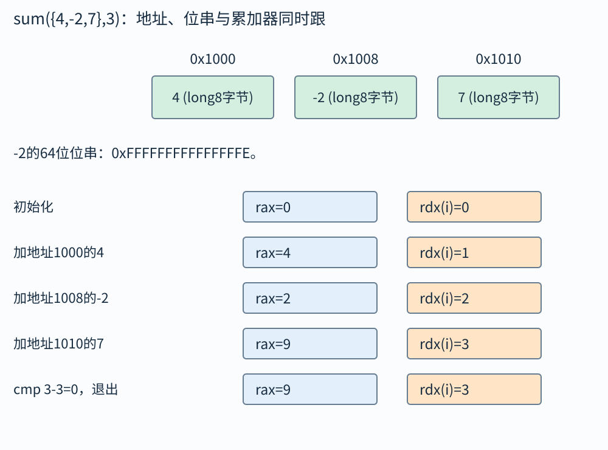

# 综合走读：沿着一个小程序，把前面的知识连起来

单章例子常把环境准备得很干净：给定寄存器，给定地址，只问一条指令。真正的程序需要同时考虑数据类型、布局、调用、分配、I/O和并发。本章用几段小程序串起来，每次明确输入与环境，再追踪从源代码到可观察结果的路径。

不要企图一眼看穿所有层。先找当前问题最先可能出错的位置：是输入解析就错，还是整数范围不够，还是地址有效但生命周期结束，还是两个线程把状态改乱。沿着实际发生顺序检查，比把所有名词挨个写一遍更有用。

## 例一：从数组求和到机器状态

问题：在LP64、long为8字节、x86-64 System V环境下，函数`long sum(const long *a,long n)`求n个元素之和。限定n非负，a指向至少n个有效元素，所有部分和均不溢出long。若a={4,−2,7}、n=3，结果多少，循环汇编如何走？

先看C逻辑：sum初始0，i从0到n−1，每轮加a[i]。部分和依次4、2、9，结果9。输入约束中的“所有部分和可表示”很重要，最终结果在范围内并不排除中间先溢出再相消。

先把清零和递增对应到已经学过的位操作：xor把相同两位异或为0，因此xorq %rax,%rax将rax全部64位清零；incq %rdx把rdx加1。其余地址、cmp和跳转沿用04、05的规则。教学汇编为：

```asm
sum:
    xorq %rax, %rax
    xorq %rdx, %rdx
.Ltest:
    cmpq %rsi, %rdx
    jge .Ldone
    addq (%rdi,%rdx,8), %rax
    incq %rdx
    jmp .Ltest
.Ldone:
    ret
```

rdi保存数组首地址B，rsi保存n，rdx保存i，rax保存部分和。第一次比较0−3，jge不跳；地址B+0，加载4，加到rax；i变1。第二轮地址B+8，加载−2；第三轮地址B+16，加载7。i变3后，比较3−3，ZF=1，jge退出。

不变量可以写成：“每次进入.Ltest时，i在0至n之间，rax等于前i个元素的和。”初始i=0，空和为0；每轮把第i个元素加入，再让i加一，关系保持；退出时i=n，rax就是全部n个元素和。这样不仅算了一个输入，也解释了为什么循环结构实现目标。

若n=0，第一次测试就退出，允许a为空吗？要看函数是否真的不解引用以及接口约定。此代码零轮不访存，C版本若没有其他指针运算，可设计允许空指针与零长度组合；不能自动把这个结论推广到函数里还先做了`a+n`或其他操作的版本。写接口时明确零长度规则。

现在把数组基址固定为`0x1000`，不把B继续留成抽象字母。内存中三个long占`[0x1000,0x1018)`，每项8字节：

|循环轮次|cmp时rdx/rax|jge|这次内存地址/读值|add后rax|inc后rdx|
|---|---|---|---|---:|---:|
|1|0/0|不跳|0x1000，4|4|1|
|2|1/4|不跳|0x1008，−2|2|2|
|3|2/2|不跳|0x1010，7|9|3|
|退出测试|3/9|跳|没有访存|9|3|



第二行读入的−2是八字节补码`0xFFFFFFFFFFFFFFFE`。按完整64位有符号意义相加4+(−2)=2，与只把一个字节FE当254不同。最后一次cmp结果为0，jge决定到ret；ret自己还要从栈恢复调用者指令位置，9则已经在rax，不由ret另算。

## 例二：把字节文件读成数组之前，要先决定格式

现在真正接起一次读取任务。规定文件前4字节是大端无符号计数n，随后正好有n个四字节大端无符号数；本应用至多接收一百万项，额外尾部字节算格式错误。只要总和，不需要把全部元素留下，因此使用一个四字节缓冲反复读。

沿同一份输入走完整条路线：

```text
00 00 00 03 | 00 00 00 04 | 00 00 00 02 | 00 00 00 07
  计数3        第0项4        第1项2        第2项7
```

|刚完成的读取|四字节缓冲|i与累计和|下一步要做什么|
|---|---|---|---|
|头部|00 00 00 03|n=3，total=0|确认n未超过应用上限|
|第0项|00 00 00 04|i=0，加得4|还需两项|
|第1项|00 00 00 02|i=1，加得6|还需一项|
|第2项|00 00 00 07|i=2，加得13|项数已满足，再查文件结束|
|结束检查|read返回0|总和仍13|输出13，关闭描述符|

每个四字节字段都先读完整，再解码。read4内部若第一次只得到1字节，done变1，下一次仍在同一个字段内，从b+1继续请求3字节；不能把这次短读当作新元素。字段未齐就遇到EOF，应报格式截断，不把旧缓冲字节混进去。下面程序把这些出口与正常路径同时写出：

```c
#define _POSIX_C_SOURCE 200809L
#include <errno.h>
#include <fcntl.h>
#include <inttypes.h>
#include <stdint.h>
#include <stdio.h>
#include <stdlib.h>
#include <unistd.h>

/* 1: four bytes; 0: EOF before any byte; -2: partial field; -1: error. */
static int read4(int fd, unsigned char bytes[4]) {
    size_t done = 0;
    while (done < 4) {
        ssize_t r = read(fd, bytes + done, 4 - done);
        if (r < 0) {
            if (errno == EINTR) continue;
            return -1;
        }
        if (r == 0) return done == 0 ? 0 : -2;
        done += (size_t)r;
    }
    return 1;
}
static uint32_t be32(const unsigned char b[4]) {
    return ((uint32_t)b[0] << 24) | ((uint32_t)b[1] << 16)
         | ((uint32_t)b[2] << 8) | (uint32_t)b[3];
}
static int reject(int fd, const char *message) {
    fputs(message, stderr);
    if (close(fd) == -1) perror("close");
    return EXIT_FAILURE;
}
int main(int argc, char **argv) {
    if (argc != 2) {
        fputs("usage: record-sum file\n", stderr);
        return EXIT_FAILURE;
    }
    int fd = open(argv[1], O_RDONLY);
    if (fd == -1) { perror("open"); return EXIT_FAILURE; }
    unsigned char b[4];
    if (read4(fd, b) != 1)
        return reject(fd, "missing or incomplete header\n");
    uint32_t n = be32(b);
    if (n > 1000000u)
        return reject(fd, "too many elements\n");
    uint64_t total = 0;
    for (uint32_t i = 0; i < n; ++i) {
        if (read4(fd, b) != 1)
            return reject(fd, "missing or incomplete element\n");
        total += be32(b);
    }
    unsigned char extra;
    ssize_t r;
    do { r = read(fd, &extra, 1); } while (r < 0 && errno == EINTR);
    if (r < 0) return reject(fd, "cannot check file end\n");
    if (r > 0) return reject(fd, "unexpected trailing data\n");
    int ok = printf("%" PRIu64 "\n", total) >= 0;
    if (close(fd) == -1) { perror("close"); ok = 0; }
    if (fflush(stdout) == EOF) ok = 0;
    return ok ? EXIT_SUCCESS : EXIT_FAILURE;
}
```

[完整源文件](示例/cs-aha-record-sum.c)可在支持POSIX的系统用`cc -std=c17 -Wall -Wextra cs-aha-record-sum.c -o record-sum`编译，运行时给文件路径。PRIu64来自inttypes.h，为uint64_t提供匹配的输出格式，不假定它必定等同unsigned long。

read4只负责固定四字节字段，返回1表示完整、0表示字段开始就结束、−2表示只拿到一部分、−1表示真实读取错误；主循环只接受1。be32中先转uint32_t再移位，避免按窄类型或有符号提升误读。reject集中关闭已经打开的描述符，然后返回失败，不会继续使用不完整数据。

累计类型选uint64_t有数值依据：即使把应用上限放宽到n最大为$2^{32}-1$，每项最大也为$2^{32}-1$，总和至多$(2^{32}-1)^2<2^{64}$。本例一百万项的限制更小，所以总和不溢出。若修改格式或允许持续无限输入，需要重算上界，不能只凭“64位”断言安全。

文件字段固定四字节，本机long却在本书环境中占八字节，因此不能直接fread成long数组；直接读成uint32_t也不会自动改变端序。若把头部00 00 00 03在小端主机按本机整数解释，会得到0x03000000，而不是3。这里先按格式解码，再决定计数、范围和资源需求。

## 例三：程序从源文件到输出的一条完整链

沿刚才的record-sum继续看运行过程。源文件中的头文件让编译器知道open、read、close和printf等接口；编译器为main、read4、be32生成目标机器代码，汇编器把代码与必要记录放入目标文件，链接器再解析程序对系统库的外部引用。把程序拆成多个.c时，也按08的声明、定义和重定位规则相接。

程序启动时，加载器建立可执行代码、静态数据等映射，必要时由动态链接器处理共享库。main取得命令行中的文件路径，open成功后得到一个描述符。每次read请求内核把文件字节放进b，返回的r决定本次有效部分；read4在用户代码中累计done，不是让内核猜这一字段共有四字节。

be32只在四字节完整时读取b并计算整数，total随后累加解码后的值。n和total分别是计数与数值，不能把字节偏移、记录项数、累计和写进同一列状态。局部缓冲及累计变量可能在栈或寄存器中，具体分配由编译器决定；本程序不需要为全部n项malloc一份数组，峰值额外缓冲保持固定。

普通访存仍经过11的翻译和权限规则，缓存只影响数据取得的路径与成本，不会替代码补格式校验。数据齐全、尾部验证通过后，printf将数值按匹配格式转成字符；库可能先缓冲，fflush再把待输出内容交给底层。close撤销输入文件引用，不清空局部b；main结束才结束这次自动对象的生命。

这条路线给出不同失败的先后关系：输入文件根本打不开，就不会开始字段解码；头部不足四字节，就不能根据n安排循环；端序读错，会在资源需求和循环次数之前先污染n；输出失败则发生在计算完成之后。先找第一条不满足条件的操作，再研究更晚的症状。

## 例四：把求和分给两个线程，正确性分几层检查

问题：数组长度8，内容1至8，两线程各负责一半，主线程取总和。先规定数组在创建前初始化、整个计算期间只读，参数对象与结果槽在join全部结束前持续存在。这样输入读取没有并发写冲突。

参数分别记录`begin=0,end=4`与`begin=4,end=8`，区间采用左闭右开，即包含begin、不含end。两个区间不重叠，并集正好覆盖0至7，没有漏掉中点也没重复。T1局部和10，T2局部和26，各写自己结果槽；主线程在两个join成功后读结果并加得36。

若线程创建第二个失败，主线程不能假装两个都存在而直接join未初始化的线程句柄。它可以等待已创建的第一个，并在当前线程计算剩余段，或报告失败并按设计清理。错误路径的参数和数组生命周期仍要保证。

若把每项结果都更新同一个全局total，必须同步，性能也可能被锁热点限制。独立局部和减少共享，但不能忽视数值范围；对浮点求和，分组变化可能改变舍入结果。并行化至少要检查覆盖、生命周期、同步与数值语义，缺哪层都不能用“线程跑完了”证明正确。

## 例五：一个看起来只错一行的接口设计

函数接收`char *buf,int len`，内部做`malloc(len+1)`再复制len字节并加终止符。乍看似乎考虑了字符串结尾。若len<0，转换到size_t可能成巨大值；若len接近INT_MAX，`len+1`先在int里有符号溢出；若源buf实际不足len字节，即使目标分配够也会越界读。

改进从约定开始：长度用能表达对象大小的size_t；要求源缓冲至少有len字节；检查len==SIZE_MAX时无法加一；分配len+1并检查返回；复制后写target[len]='\0'；明确调用者释放。若目标是文本，还要考虑内部是否允许零字节、编码是否合法；若只是二进制数据，附加零并不使它自动成为可安全按字符串处理的文本。

这个例子说明“加一个检查”往往不够。要把所有操作按发生顺序写：参数解释、长度运算、分配、读取、写入、生命周期。检查必须在危险运算之前，并覆盖读取端和写入端。

## 做综合题时怎样写纸面答案

开头列环境：位宽、端序、ABI、类型、有无并发。接着列输入对象与有效范围，再写关键状态表。对于分支题，给出能覆盖不同出口的测试；对于并发题，给出导致问题的具体交错；对于公式计算，写中间单位与范围。

最后核对三个边界：空输入、最小或最大合法值、与别名或共享有关的特殊关系。它们不保证穷尽所有错误，却经常能发现“一般情况算对了”的漏洞。答案若依赖题目未给出的条件，应明确写假设，不要悄悄把未知当零或把失败当不存在。

## 例六：一步步检查一个可扩容读入器

问题：读入未知长度文件，最终返回全部字节及长度。初始容量为4，已用0。每次在剩余空间读数据，空间耗尽就扩容。输入共有10字节，假设每次read恰好填满可用部分。

先分配4，读4，used=4、capacity=4；扩到8，保留原4，再读4，used=8；扩到16，再读最多8，实际读2，used=10；继续读得到0才确认EOF。短读2本身不是必须结束的证据，所以仍要做下一次读取或按已知协议判断。

扩容前检查capacity翻倍是否超出SIZE_MAX，realloc使用临时指针，失败时仍能释放旧对象。若used<=capacity不变量被破坏，`capacity-used`会无符号下溢，所以每次更新都应保持这一关系。若文件是文本，还要为终止零预留空间；若是二进制，返回明确长度，不依赖零字节。

这个程序同时使用动态分配、I/O、整数边界和对象生命周期。检查清单按执行顺序展开：容量运算是否安全，分配是否成功，读取返回值是否正确处理，已用量是否只加实际读到字节，最终由谁释放。每一条都有明确失败输入，不是泛泛的“注意安全”。

## 例七：一份输出顺序题怎样列约束

父fork一个孩子，子依次输出A、B后退出；父先输出C，再wait孩子，最后输出D。假设每个字母输出作为一个原子事件，无缓冲复制问题。约束是子内A在B前，父内C在D前，wait使B在D前；C与A、B之间没有额外顺序。

允许的整体顺序有CABD、ACBD、ABCD。D必须最后，因为C与B均在它前；A必须在B前。写出A CBD这类顺序时，要按字符真正合并，不能漏事件。若父把wait移到C之前，则只剩ABCD。

真实printf多字节文本可能需要额外输出原子性与缓冲假设，但纸面题可明确采用本模型。这样你知道哪些是程序证明出来的边，哪些是为了聚焦调度而采用的简化条件。

## 例八：先找不变量，再选同步对象

设计一个后台任务队列，约定已提交数submitted、已完成数finished、队列中的任务和正在处理任务共同满足数量关系。若只把两个计数分别设原子，队列插入与计数增加仍可能被观察在不同时间，查询者可能拿到不一致快照。

最易审查的第一版是用同一锁保护队列与相关计数，在同一临界区完成提交或完成状态更新；消费者等“队列非空或已关闭”的谓词。待正确以后，若查询很频繁再研究快照或分离计数，但不能无依据拆掉关系。

练习：主线程看到finished==submitted是否一定能销毁所有任务对象？答案要看这两个值的发布与读取关系、是否仍有人可继续提交、是否还存在借用者。单个数值相等不自动证明系统已静止；需要关闭提交并等待所有工作和借用结束的完整协议。

## 自己做，再看答案

练习一：求和函数最终结果为5，是否足以证明有符号long所有中间计算都没溢出？

答案：不足。可能先累加到超过LONG_MAX，后面又加负数使数学最终和回到5，但C的溢出已经发生。需要保证每个部分和可表示，或采用明确的检测、更宽精度、任意精度等设计。

练习二：把长度n划分为两个左闭右开区间，能否用`[0,n/2]`与`[n/2,n)`？

答案：前一个写成右端包含，会把中点算两次。统一左闭右开应是`[0,n/2)`与`[n/2,n)`。取n=5，前段0、1，后段2、3、4，覆盖正好一次。

练习三：程序对同一个文件先fread再read，发现第二次像跳过了一段。第一怀疑应是什么？

答案：先检查stdio是否预读到用户缓冲，导致底层共享偏移已前移。不要立刻归咎于磁盘丢字节。把FILE*缓冲、描述符、打开文件描述的偏移分别画出来，再检查混用接口的同步规则。
