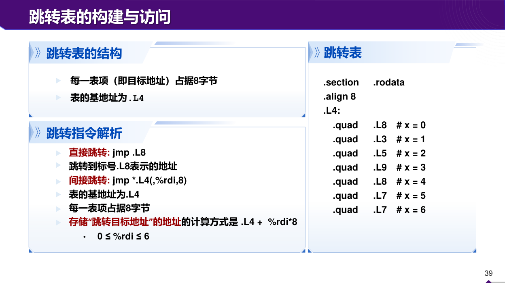
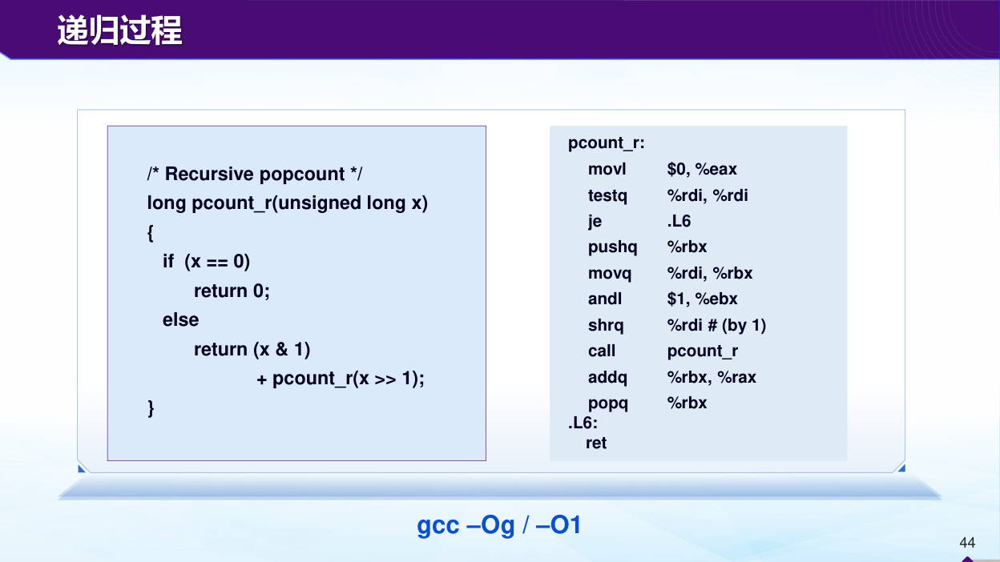

# 机器表示工坊：从题面条件一步步算到答案

本章把整数、浮点、寻址和控制流放在可独立演算的问题里。你可以先遮住解答，写下自己的位串或状态表，再逐项核对。题目数值有的与本地HW范围相同，目的在讲方法；课堂提交应由你理解后独立完成，而不是把一页结果当知识本身。

算题前统一四个约定：位宽必须固定；十六进制每位对应四位二进制；浮点特殊值按题目给定格式；汇编按AT&T源在前、目的在后。最常见的错并不复杂，往往是中途忘了其中一个约定。

## 工坊一：限定三个1，怎么找最大与最小补码

问题：八位补码，位串恰含三个1、五个0，求最大值、最小值、绝对值最小值对应位串。

最大值先争取符号位0，这样结果非负。剩余三个1放在最高的正权重位置64、32、16，得到`01110000`，值112。把一个1从较高正权位移到较低位只会减少数值，因此这确是符号0组中的最大；符号1组全为负，不可能超过它。

最小值要让符号位1，先获得−128；剩余两个1放在最小正权重1、2，得到`10000011`，值−125。若把它们放高位，会抵消更多负值，反而变大。

绝对值最小要比较正负两类的最近零候选。符号0时，三个1放1、2、4，得到`00000111`，值7。符号1时，为了靠近零，应把剩余两个1放64、32，得到`11100000`，值−32。两者绝对值7与32，故答案是`00000111`。注意“最小值”与“绝对值最小”是两个优化目标，不能用同一位串回答。

## 工坊二：十六进制补码减法，不靠猜符号

问题：16位X=`0x7FF0`，Y=`0x0030`，求机器加法结果，判断有符号与无符号是否溢出。

数学和为`0x8020`，小于`0x10000`，所以没有无符号进位。X与Y按补码都是正数，和位串最高位却为1，发生有符号溢出。若按补码解释结果，`0x8020−0x10000=−32736`，这与数学和32800不同。

再做X−Y：`0x7FC0`，数学值32704，可表示，没发生有符号溢出。不要仅因为结果接近符号边界就认定危险；应检查实际数学范围。对C源代码中的有符号加法，第一种输入不可当作定义良好的截断计算，而汇编位串题仍可明确问低16位是什么。

## 工坊三：两种FP8，分别把范围与精度算出来

采用IEEE风格，E4M3有4指数位、3小数位，bias=7；E5M2有5指数位、2小数位，bias=15。E4M3最大次正规位串为`0|0000|111`，值$7×2^{-9}$。E5M2最大正常位串为`0|11110|11`，有效数1.75，实际指数15，值57344。

最小正次正规值分别为E4M3的$2^{-9}$和E5M2的$2^{-16}$。指数位更多的E5M2能把非零值延伸到更小数量级，也覆盖更大的有限值；E4M3在相同正常数量级里有更多有效位、间距更细。

例如区间[1,2)内，E4M3可表示1、1.125、1.25……1.875，共8格；E5M2为1、1.25、1.5、1.75，共4格。固定8位都只有256种位串，浮点没有凭空增加编码数量，只把它们按不均匀间距分配，并留一些给零、无穷和NaN。问“定点可表示数的个数多还是浮点多”时，还必须明确特殊编码算不算数值、正负零算几个数，不能只比较范围就回答个数。

如果训练中梯度范围很大，E5M2较宽指数可能更合适；若激活范围稳定而需要更多有效位，E4M3更有吸引力；若模型已校准比例因子用于对称量化部署，INT8配合缩放也可能合理。选择基于范围、误差和任务约束，不能说某格式在所有情况下最好。

## 工坊四：阶码全零时别减bias

问题：1符号、5指数、2小数格式，位串`0|00000|10`，求数值。

指数全零，必须用次正规规则，实际指数E=1−15=−14；小数域F=2，所以有效数为2/4=1/2，值$2^{-15}$。如果误用E=0−15，再误加隐藏1，得到的值既不符合次正规定义，也无法与相邻格点连续衔接。

核对最小步长为$2^{-16}$，当前F=2，所以正好两个步长，即$2^{-15}$。用“域公式”和“步长乘整数”两条路线检查，可以迅速发现把隐藏1放错的错误。

## 工坊五：三条lea的系数核对

要求计算32x+4y+2z+w，四参在rdi、rsi、rdx、rcx。候选指令：

```asm
leaq (%rsi,%rdi,8), %rax
leaq (%rcx,%rdx,2), %rdx
leaq (%rdx,%rax,4), %rax
```

第一步产生8x+y；第二步用旧rdx中的z产生w+2z，覆盖rdx；第三步把第二步结果加四倍第一步结果，得到目标。特别检查第二条使用rdx旧值，第三条使用rdx新值，不能在一张静态代数表里把它们都写成z。

取四组基向量输入可分别验证系数：只令x=1其余0，返回32；只令y=1返回4；只令z=1返回2；只令w=1返回1。再加混合输入检查寄存器覆盖是否破坏关系。随机测试能发现错，但这段线性表达式的符号展开更直接地解释为什么正确。

## 工坊六：条件传送选哪一个候选值

函数先算hi=2x+y、lo=x+2y，再在x>y时返回hi，否则lo。令rax先放hi，rdx放lo，比较`cmpq %rsi,%rdi`。我们需要在x≤y时把lo送进rax，所以条件传送为`cmovle %rdx,%rax`。

取x=5、y=2：hi12、lo9，比较大于，传送不发生，返回12。取x=2、y=5：hi9、lo12，比较小于，传送发生，返回12。取x=y=3：两候选都为9。因此本函数里cmovle与cmovl都能给相同可观察返回值，后者在相等时保留hi也无妨。不能要求机器无条件保留源码if的分支选择；编译器只需在合法输入上保持可观察行为。若另一个函数在相等时两个候选值不同，才可用相等输入区分l与le是否实现所需语义。

若hi、lo的计算可能溢出或有副作用，需要回到源程序规则。这里题目中的候选都明确先算，条件传送只替换选择阶段；若原源码只允许执行其中一个危险分支，就不能照抄这个技巧。

## 工坊七：递归保存了什么，别只数call

函数`f(n)`在n≤1返回1，否则算`n+f(n−2)`。取n=5。下行状态为f5等待“回来加5”、f3等待“回来加3”、f1直接1。回程f3=4，f5=9。最大同时三层活动，总调用也是三次；把递归改成每层调用两次后，这两个数量可能明显分开。

若用rbx保存当前n，函数必须先保存调用者原rbx，并在返回前恢复。调用f(n−2)前还需满足栈对齐。只写“把n放rbx，call，再add”却不保存rbx，破坏调用约定，即使本次返回值9，也可能使上层后续计算出错。

## 工坊八：从结构体偏移认出访问对象

常见LP64下，`struct R{char c; long x; int y;};`。c偏移0，x需8字节对齐，从8占到15；y从16占到19；总长向8对齐为24。若数组r首地址B，`r[i].y`地址为B+24i+16。

x86寻址比例只支持1、2、4、8，24i可以先算3i，再乘8。例如lea产生i+2i到临时寄存器，最终以比例8访问。看到两次lea不等于数组有两层；它可能只是在凑一个24字节结构体步长。

若某位同学把结构体总长算20，会在i=0时仍访问正确y，但i=1起就错位。测试不能只测首元素，至少选第二个与最后一个合法元素，才能检验步长。

## 工坊九：读懂两个位置都有测试的scan

本地HW2的scan一开始令sum=0、i=0；循环顶部检查i<n，不满足就结束；只有i为偶数时才把i加入sum；然后i加一；循环底部检查sum<limit，满足才回顶部。这个控制流不等于在入口同时检查`i<n && sum<limit`，因为底部的limit测试发生在一轮工作之后。

等价而易读的结构是：先检查顶部n条件，执行偶数累加和i递增，再在sum>=limit时break。取n=10、limit=6，i0累加0，sum0；i1不加；i2加2，sum2；i3不加；i4加4，sum6；底部比较不再小于6，返回6。实际被加下标为0、2、4。

边界limit=0很有辨别力：若n>0，原汇编仍先执行i=0这一轮，再在底部退出。虽然本例sum仍0，看上去与零轮输出同值，副作用或其他初值改动可能区分它们。还原C时保持测试位置，不能仅凭最终数值一样就擅自前移条件。

顶部`cmpq %rdi,%rdx; jge`是有符号比较i与n；底部`cmpq %rsi,%rax; jl`是有符号比较sum与limit。test最低位用jne跳过奇数累加，与数值是否负是两回事；本题i从0递增，在合法小输入里无需引入负下标。

## 工坊十：为有缺口的switch填完整表

case为0、2、3、4，1走default。范围检查先比较n与4，使用无符号ja排除大于4的位串，也把负long当成很大无符号数而排除。表中必须有五项，按0至4顺序：L0、Ldef、L23、L23、L4。case2与3共用同一目标，case1虽无显式分支仍必须占一个表格位置。



这张原图对应的是另一个0至6示例，但布局方法相同。右侧每条.quad分配八字节目标地址；左侧间接跳转先计算表首+8×下标，再读取该位置保存的目标地址，最后跳转。它不是跳到“表项本身的地址”去执行数据。0与4都指L8，5与6都指L7，说明不同case可共享代码。

本工坊取x=7。n0返回12；n1走default返回1；n2与n3返回14；n4返回5；n=−1或5被范围检查挡到default。选n1能发现漏填缺口，选n−1能发现只作有符号上界检查而遗漏下界，选n4能发现表长少一项。

## 工坊十一：把老师的递归位计数完整走一遍



图左每次取x&1，统计当前最低位；再对无符号x逻辑右移1，统计剩余高位。右侧先把返回值初始化0，x为0就直接ret；非零时保存rbx，把最低位留在ebx中，右移rdi后递归；回程把rbx加到rax，恢复rbx再ret。

取x=13，即1101₂。各层当前位依次1、0、1、1，剩余x依次6、3、1、0。最深0返回0；x1层得1；x3层得2；x6层加0仍2；x13层加1得3。总共四个1位候选位置，但其中一个位为0，所以结果3。栈最深含x13、6、3、1、0五次活动；非零层都需要保存跨递归的低位。

图中`andl $1,%ebx`写32位子寄存器，会清高32位，rbx最终只为0或1，适合随后64位add。源参数是unsigned long，`shrq`用逻辑右移，高位补0。若误把类型改为有符号负数并用算术右移，可能永远保留最高1位，不再按同样方式到0，终止分析就变了。

## 工坊十二：为什么jl要看SF异或OF

把比较看成a−b。若没有有符号溢出，OF=0，结果最高位SF就能表示差是否负，因此SF异或OF等于SF。若发生溢出，截断结果的符号与数学差相反，需要翻转SF；OF=1恰好完成翻转。

用八位边界各走一次。a=−128、b=1，数学差−129，小于0但不能表示；低八位为127，SF=0，OF=1，异或为1，正确判小于。a=127、b=−1，数学差128，大于0但不能表示；低八位为−128，SF=1、OF=1，异或0，正确判不小于。a=2、b=5，差−3无溢出，SF1、OF0，判小于；a=5、b=2则SF0、OF0，判不小于。

这四组覆盖“无溢出正负差”和“有溢出两种方向”。对于相等，差0，ZF=1，SF=OF=0，jl不跳；jle再把ZF纳入，才覆盖小于或等于。用条件码组合表达数学关系，需要关照截断边界，不能只背字母。

## 工坊十三：32位栈帧偏移与64位别混

传统32位cdecl教学序言为pushl ebp、movl esp,ebp。入口时栈顶已有4字节返回地址；push旧ebp后，0(ebp)为旧ebp，4(ebp)为返回地址，8(ebp)为第一个栈参数，12(ebp)为第二个。这与64位带帧指针例子的8字节步长不同。

若函数先sub esp,16分配局部空间，局部对象可位于ebp负偏移，参数仍在正偏移。恢复时可用等价于esp=ebp、再pop ebp的序列释放局部空间并恢复参考点，最后ret弹4字节返回地址。调用者还可能负责清理它先前压入的参数，不能让被调用者和调用者重复清同一段。

取入口esp=0x8000，push旧ebp后esp=0x7FFC，ebp设此处。返回地址在0x8000，第一个参数在0x8004，相对ebp分别4和8，核对一致。这里故意选入口0x8000便于算术，不用它暗示真实32位ABI所有调用前的对齐细节都已规定。

练习：有人看到`8(%ebp)`就说“是64位返回地址”，哪里错？答案是寄存器名ebp已提示32位上下文，偏移还取决于建立帧的方法。在刚给定cdecl序言里，8(ebp)是第一个参数，不是返回地址。分析必须先识别架构与序言。

## 自己做，再看答案

练习一：8位补码恰含一个1，最小值与绝对值最小值分别是什么？

答案：最小值把唯一1放符号位，`10000000`为−128；绝对值最小把它放最低正权位，`00000001`为1。因为没有全零候选，绝对值不可能为0。

练习二：E5M2格式`0|01111|01`表示多少？同数量级相邻正常数间距多少？

答案：q15、bias15，E0；小数域1，有效数1+1/4=1.25。区间[1,2)的间距为$2^{0-2}=1/4$。与次正规最小步长不能混用，指数变化时正常数间距也会变化。

练习三：结构体大小24，数组元素i地址为B+24i。若i=3、B=`0x1000`，成员偏移16，最终地址多少？

答案：24×3+16=88，十六进制`0x58`，得到`0x1058`。先用十进制算字节数再转换十六进制即可；不要把十进制88直接当作十六进制`0x88`加上去。
